# afe_xosc — 24 MHz Crystal Oscillator Driver — Datasheet

*Datasheet of the transistor-level crystal oscillator driver `afe_xosc_tr` (`AFE/Crystal Oscillator Driver/afe_xosc_tr.sp`) of the USB 2.0 ULPI PHY. It drives an external 24 MHz crystal and supplies the reference clock of the PLL `afe_pll`. Revision 0.2, 2026-11-22. All values come from ngspice 42 simulations with the X-FAB xh018 BSIM3v3 models of `ne3i` / `pe3i` (3.3 V isolated MOS, converted by `sim/xfab2ngspice.py`; worst-case corners at 3 σ). Resistors and capacitors are ideal, the pads are modelled as 2.5 pF per pin, and there is no layout extraction. The values are therefore pre-layout estimates, not sign-off data. Typical: tm, 27 °C, VDD18A = 1.8 V, crystal VXM7A-9001-24M with ESR = 100 Ω (its maximum), C1 = C2 = 12 pF, DRV = 10 in the transient simulations (DRV = 11 is the recommended setting).*

Figures: `fig/` (SVG; PNG copies for Word), generated by `gen_figures.py` from the simulation results in `data/` (`sim/run_all.py`). Related documents: [../xosc_description.md](../xosc_description.md) (circuit description and schematic sheets), [AFE/doc/pll_datasheet/pll_datasheet.md](../../doc/pll_datasheet/pll_datasheet.md) (the PLL it feeds), `DOC/sn74lvc1gx04.pdf` (prototype), `DOC/VXM7A-9001-24M0000000_Jan04_2022.pdf` (crystal).

## 1. Overview

`afe_xosc` is a Pierce crystal oscillator with amplitude regulation and a squaring output buffer. Two analog pads (XI, XO) connect an external 24 MHz fundamental-mode crystal and its two load capacitors. The block delivers a 1.8 V CMOS clock `REF_CLK` to the PLL reference input `CDR_FREF` (REFSEL = 01, N = 20 → 480 MHz). Its function corresponds to the SN74LVC1GX04 (unbuffered amplifier + buffered square-wave output), integrated and extended by automatic level control.

**Features**

- 24 MHz Pierce oscillator for AT-cut fundamental crystals, C_L = 8 pF, ESR ≤ 100 Ω (Vectron VXM7A-9001-24M), external C1 = C2 = 12 pF.
- NMOS gain stage with a programmable PMOS current source: start-up current 250 / 375 / 500 / 625 µA (DRV1:0).
- Start-up margin −R_neg / ESR_max ≥ 5.6 at all simulated corners with DRV = 11 (recommended), ≥ 4.8 with DRV = 10.
- Automatic level control (peak detector + error pair): XI held at ≈ 0.75 Vpp, crystal drive level ≈ 50 µW at ESR = 100 Ω (crystal limit 200 µW). No series resistor needed.
- Supply current in operation ≈ 0.36 mA from VDD18A (0.31–0.52 mA over the corners, ≈ 0.66 mW typical), 0.8 mA during start-up (DRV = 11), < 10 nA with XTAL_EN = 0.
- Start-up to a stable clock in ≈ 0.3 ms, to 90 % amplitude in ≈ 0.6 ms (tm, ESR 100 Ω); worst simulated 0.53 / 1.06 ms (ws, 125 °C, 1.62 V, DRV = 10).
- AC-coupled, self-biased squarer with a Schmitt trigger: REF_CLK duty cycle 48–50 %, edges ≈ 0.25 ns, no runt pulses.
- Frequency error added by the circuit (pulling relative to the 8 pF nominal load): +1.8 … +7.3 ppm over all corners.
- Bypass mode: an external 24 MHz clock on XI (CMOS 1.8 V or ≥ 0.3 Vpp AC-coupled sine), XO open.
- Thick-oxide (3.3 V) devices on a 1.8 V supply. The gate oxides tolerate 3.3 V on XI.

**Views and status**

| View | File | Status |
|---|---|---|
| Transistor schematic | `afe_xosc_tr.sp` | Simulated with ngspice 42 and the xh018 models at the corners of section 15. No layout |
| Testbench | `sim/tb_xosc_tr.py` | `op`, `ac`, `ss`, `start`, `byp`, `en`; prints TEST PASSED / FAILED |
| Schematic sheets | `doc/xosc_{block,core,alc,sq}.svg` | Generated by `doc/draw_xosc.py` |
| Verilog-A model | `AFE/veriloga/afe_xosc.va` | Equations checked against the transistor circuit through their ngspice copy `sim/afe_xosc_beh.sp` (section 16); Spectre testbench `AFE/veriloga/tb/tb_afe_xosc.scs` not run yet |

## 2. Block diagram

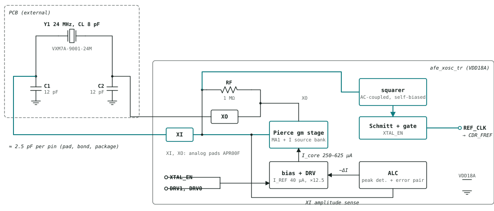

The crystal and C1 / C2 form the π-network of the Pierce oscillator. MA1 (gate XI, drain XO) amplifies, with the PMOS current-source bank as its load. RF (1 MΩ) sets the DC operating point XI = XO = V_GS(MA1). The amplitude regulation compares the XI peak with V_SET = 0.1·VDD18A and takes current away from the bias of the bank. The squarer couples XI through 0.5 pF into a self-biased inverter, followed by a Schmitt trigger, the XTAL_EN gate and the output driver.

## 3. Pin description

| Pin | Type | Direction | Level | Function |
|---|---|---|---|---|
| `XI` | analog | in | 0 … VDD18A | Crystal terminal / external clock input. DC bias ≈ 0.85 V (set by RF). Pad APR00F |
| `XO` | analog | out | 0 … VDD18A | Crystal drive. Open in bypass mode. Pad APR00F |
| `XTAL_EN` | logic | in | 1.8 V CMOS | 1 = on. 0 = off: bias off, XI / XO to VSS, REF_CLK low. Tie high (always-on domain); see 11 |
| `DRV1`, `DRV0` | logic | in | 1.8 V CMOS | Start-up (maximum) core current: 00 250 µA, 01 375 µA, 10 500 µA, 11 625 µA (recommended for ESR ≤ 100 Ω). Static |
| `REF_CLK` | logic | out | 0 / VDD18A | 24 MHz clock, in phase with XI. Connect to `CDR_FREF` of `afe_pll` |
| `VDD18A` | supply | — | 1.8 V | Analog supply (from `afe_ldo`, shared with the PLL) |
| `VSS18A` | supply | — | 0 V | Analog ground. Return of C1 / C2 |

## 4. Absolute maximum ratings

| Parameter | Min | Max | Unit | Notes |
|---|---|---|---|---|
| VDD18A | −0.3 | 3.6 | V | Device limit of ne3i / pe3i. The shared 1.8 V domain (PLL) limits it further to its own rating |
| V(XI), V(XO) | −0.3 | VDD18A + 0.3 | V | Pad ESD diodes (APR00F). 3.3 V clocks only AC-coupled |
| V(XTAL_EN, DRV1, DRV0) | −0.3 | VDD18A + 0.3 | V | |
| Junction temperature | −40 | 125 | °C | Simulated range; storage per package |

## 5. Recommended operating conditions

| Parameter | Min | Typ | Max | Unit | Notes |
|---|---|---|---|---|---|
| VDD18A | 1.62 | 1.80 | 1.98 | V | ±10 % |
| Temperature | −40 | 27 | 125 | °C | |
| Crystal frequency | — | 24.000 | — | MHz | Fundamental, AT-cut |
| Crystal load capacitance C_L | — | 8 | — | pF | C1, C2 computed for this value (section 13) |
| Crystal ESR | — | — | 100 | Ω | Start-up margin ≥ 5 with DRV = 11 |
| Crystal shunt capacitance C0 | — | 0.83 | 2 | pF | |
| Crystal drive level rating | 100 | — | — | µW | Simulated DL ≤ 58 µW at ESR 100 Ω (≈ 62 µW allowing for the unsettled corner) |
| C1 = C2 (external, C0G) | — | 12 | — | pF | With 2.5 pF pin and 0.5 pF stray capacitance |
| REF_CLK load | — | 0.1 | 0.2 | pF | PLL input buffer + wire |
| External clock (bypass), CMOS | 0 / 1.62 | 0 / 1.8 | 0 / VDD18A | V | DC-coupled, XO open |
| External clock (bypass), AC-coupled | 0.3 | 0.5 | VDD18A | Vpp | Through ≥ 1 nF |

## 6. Electrical characteristics

Typical: tm, 27 °C, 1.8 V. Min / max: over the simulated PVT corners of section 15. ESR 100 Ω, C1 = C2 = 12 pF. The transient cases ran with DRV = 10; the regulated steady state does not depend on DRV (the ALC sets the current), and start-up is faster with the recommended DRV = 11.

| Parameter | Min | Typ | Max | Unit | Corners |
|---|---|---|---|---|---|
| Start-up current I(VDD), no oscillation, DRV 10 | 0.47 | 0.70 | 0.97 | mA | 7 |
| Start-up current I(VDD), no oscillation, DRV 11 | 0.55 | 0.81 | 1.12 | mA | 7 |
| Supply current, XTAL_EN = 0 | 0.2 | 0.2 | 6.9 | nA | 7 |
| XI / XO DC bias (no oscillation) | 0.745 | 0.848 | 0.917 | V | 7 |
| −R_neg at 24 MHz, DRV 10 | 483 | 776 | 1106 | Ω | 7 |
| −R_neg at 24 MHz, DRV 11 | 562 | 889 | 1247 | Ω | 7 |
| Start-up margin −R_neg / 100 Ω, DRV 11 | 5.6 | 8.9 | 12.5 |  | 7 |
| XI amplitude (regulated) | 0.706 | 0.751 | 0.813 | Vpp | 5 |
| XO amplitude | 0.785 | 0.843 | 0.932 | Vpp | 5 |
| Crystal current | 0.659 | 0.702 | 0.764 | mA rms | 5 |
| Crystal drive level, ESR 100 Ω | 43.5 | 49.3 | 58.4 | µW | 5 |
| Supply current in operation | 0.307 | 0.364 | 0.524 | mA | 5 |
| Load capacitance seen by the arm C0 + C_L | 8.45 | 8.70 | 8.73 | pF | 5 |
| Frequency error from the circuit | +1.8 | +2.4 | +7.3 | ppm | 5 |
| REF_CLK duty cycle | 48.1 | 48.6 | 49.1 | % | 5 |
| REF_CLK rise time 10–90 %, 100 fF | 170 | 256 | 415 | ps | 5 |
| REF_CLK fall time 10–90 %, 100 fF | 141 | 214 | 370 | ps | 5 |
| Start-up to stable REF_CLK (±1 % period), DRV 10 | 162 | 275 | 530 | µs | 3 |
| Start-up to 90 % amplitude, DRV 10 | 376 | 596 | 1064 | µs | 3 |
| Envelope growth time constant, DRV 10 | 31.5 | 46.4 | 82.0 | µs | 3 |
| Bypass: XI → REF_CLK delay, CMOS input | 0.58 | 0.90 | 1.47 | ns | 3 |
| Bypass: duty cycle, CMOS input 50 % | 50.0 | 50.0 | 50.0 | % | 3 |
| Bypass: duty cycle, 0.5 Vpp sine | 47.8 | 48.4 | 48.9 | % | 3 |
| Bypass: supply current, CMOS input | 0.142 | 0.185 | 0.234 | mA | 3 |

Corners column: number of PVT corners in min / max (7 = tm, ws 125 / −40 °C, wp −40 / 125 °C, wo, wz; 5 = without wo / wz; 3 = tm, ws 125 °C 1.62 V, wp −40 °C 1.98 V).

**All simulated corners**

| Parameter | tm 27 °C 1.8 V | ws 125 °C 1.62 V | ws −40 °C 1.62 V | wp −40 °C 1.98 V | wp 125 °C 1.98 V | wo 27 °C 1.8 V | wz 27 °C 1.8 V |
|---|---|---|---|---|---|---|---|
| −R_neg at 24 MHz, DRV 10 [Ω] | 776 | 483 | 709 | 1106 | 738 | 807 | 742 |
| Start-up margin −R_neg / ESR_max, DRV 10 | 7.8 | 4.8 | 7.1 | 11.1 | 7.4 | 8.1 | 7.4 |
| −R_neg at 24 MHz, DRV 11 [Ω] | 889 | 562 | 822 | 1247 | 844 | 926 | 847 |
| Start-up margin, DRV 11 | 8.9 | 5.6 | 8.2 | 12.5 | 8.4 | 9.3 | 8.5 |
| I(VDD) before oscillation, DRV 10 [mA] | 0.700 | 0.490 | 0.468 | 0.969 | 0.954 | 0.718 | 0.679 |
| I(VDD), XTAL_EN = 0 [nA] | 0.2 | 1.6 | 0.2 | 0.2 | 6.9 | 0.2 | 0.2 |
| XI / XO DC bias [V] | 0.848 | 0.786 | 0.917 | 0.882 | 0.745 | 0.815 | 0.881 |
| XI amplitude [Vpp] | 0.751 | 0.706 | 0.707 | 0.788 | 0.813 | — | — |
| XO amplitude [Vpp] | 0.843 | 0.785 | 0.799 | 0.894 | 0.932 | — | — |
| Crystal current [mA rms] | 0.702 | 0.659 | 0.660 | 0.738 | 0.764 | — | — |
| Drive level at ESR 100 Ω [µW] | 49.3 | 43.5 | 43.5 | 54.5 | 58.4 | — | — |
| I(VDD) in steady state [mA] | 0.364 | 0.326 | 0.307 | 0.420 | 0.524 | — | — |
| Load capacitance seen by the arm C0 + C_L [pF] | 8.703 | 8.731 | 8.721 | 8.665 | 8.450 | — | — |
| Frequency error (circuit) [ppm] | +2.4 | +1.8 | +2.0 | +3.1 | +7.3 | — | — |
| R_ext (−ESR when settled) [Ω] | -112 | -119 ¹ | -115 | -107 | -132 ¹ | — | — |
| REF_CLK duty cycle [%] | 48.61 | 48.13 | 48.53 | 49.05 | 48.55 | — | — |
| REF_CLK rise / fall 10–90 % [ps] | 256 / 214 | 415 / 370 | 304 / 244 | 170 / 141 | 238 / 214 | — | — |
| Start-up: stable REF_CLK (±1 % period) [µs] | 275 | 530 | — | 162 | — | — | — |
| Start-up: 90 % amplitude [µs] | 596 | 1064 | — | 376 | — | — | — |
| Envelope growth time constant τ [µs] | 46.4 | 82.0 | — | 31.5 | — | — | — |
| Bypass square: duty [%] / XI→REF_CLK [ns] | 50.0 / 0.90 | 50.0 / 1.47 | — | 50.0 / 0.58 | — | — | — |
| Bypass sine 0.5 Vpp: duty [%] / delay [ns] | 48.4 / 1.71 | 47.8 / 2.99 | — | 48.9 / 0.82 | — | — | — |
| Bypass I(VDD) square / sine [mA] | 0.185 / 0.533 | 0.142 / 0.396 | — | 0.234 / 0.732 | — | — | — |

¹ Not fully settled at the end of the transient (R_ext more than 15 % away from −ESR, amplitude still rising by ≈ 1 % per 10 µs): amplitude, crystal current and drive level are a few % low; the frequency is not affected. — = not simulated at this corner (the transient cases take 1–2 h of CPU each).

## 7. Start-up

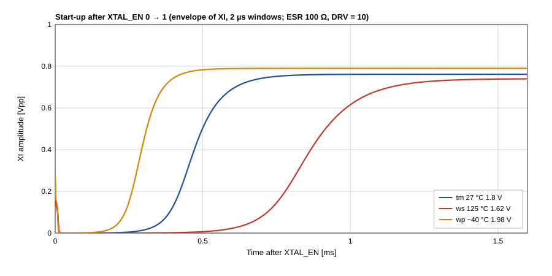

At XTAL_EN 0 → 1 the bias starts in < 1 µs and XI / XO charge through RF to V_GS(MA1) within ≈ 15 µs (R_F · C1). This step kicks the crystal; the amplitude then grows exponentially with the time constant

τ = 2 L_m / (|R_neg| − ESR) = 2 · 15.27 mH / (776 Ω − 100 Ω) = 45 µs (tm), simulated 46 µs,

until the ALC limits it. REF_CLK runs with correct periods (within 1 %) from about the moment XI exceeds a few mV (the squarer's gain and the Schmitt hysteresis suppress smaller signals). In the simulation the start comes from the XTAL_EN step, a deterministic kick of the order of the circuit's noise; a real start from thermal noise (≈ µV) adds a few τ at most.

| Corner (DRV 10, ESR 100 Ω) | Stable REF_CLK (±1 % period) | 90 % amplitude | τ (fit) | τ = 2 L_m / (|R_neg| − ESR) |
|---|---|---|---|---|
| tm 27 °C 1.8 V | 275 µs | 596 µs | 46.4 µs | 45 µs |
| ws 125 °C 1.62 V | 530 µs | 1064 µs | 82.0 µs | 80 µs |
| wp −40 °C 1.98 V | 162 µs | 376 µs | 31.5 µs | 30 µs |

With DRV = 11 (recommended) |R_neg| is 14–16 % higher and the time constants correspondingly shorter (ws 125 °C: 2 · 15.27 mH / 462 Ω = 66 µs).

Recommendation: allow **2 ms** from VDD18A good to a stable reference (≈ 3 × the worst simulated 90 % time, covering crystals with higher motional inductance). `usb_pwr_seq` waits in OFF until then automatically, because it is clocked by REF_DIG.

## 8. Frequency accuracy

The circuit sets the load capacitance the crystal sees; the crystal sets the frequency. The oscillation frequency is

f = f_s · √(1 + C_m / (C0 + C_L)),  f_s = 23.996087 MHz (series resonance of the VXM7A model, chosen so that f = 24.000000 MHz at C_L = 8 pF),

with pulling sensitivity S = −C_m / (2 (C0 + C_L)²) ≈ −19 ppm per pF of C_L (≈ −9.5 ppm per pF of C1 = C2 together, ≈ −5 ppm per pF on one pin).

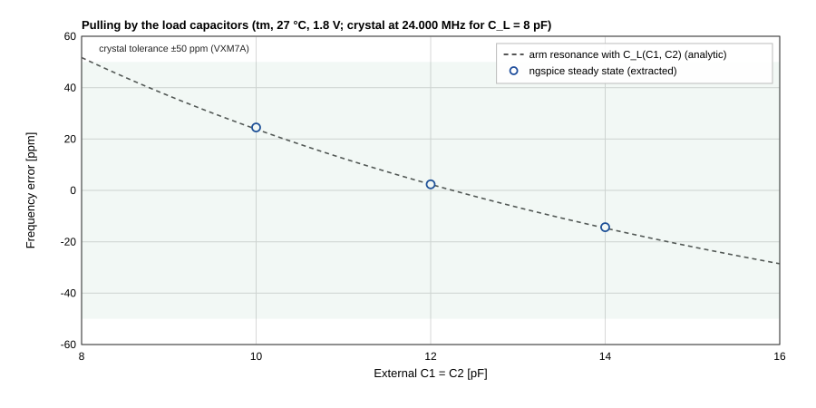

Budget against the USB limit of ±500 ppm:

| Contribution | Value | Notes |
|---|---|---|
| Crystal: initial, temperature, 10 years aging | ±50 ppm | VXM7A total stability |
| Circuit: nominal pulling (simulated, tm) | +2.4 ppm | C_L = 7.87 pF instead of 8 pF |
| Circuit: PVT (simulated corners) | +1.8 … +7.3 ppm | Amplifier capacitances vs. corner, supply, temperature |
| C1 / C2 tolerance ±2 % (±0.24 pF each) | ±2.3 ppm | −9.5 ppm/pF × 0.24 pF |
| Pin / board stray uncertainty ±1 pF | ±10 ppm | Layout dependent |
| Total | < ±70 ppm | Margin > 7× against ±500 ppm |

## 9. Amplitude regulation and drive level

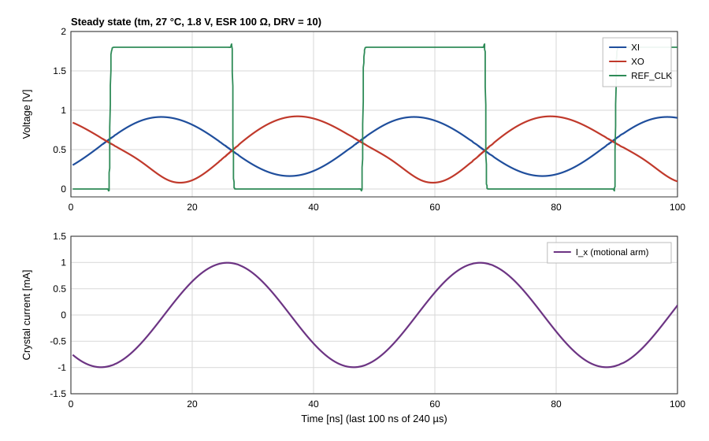

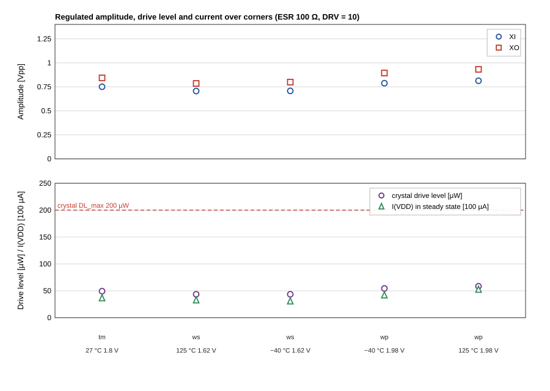

The ALC holds the XI amplitude near V_SET plus the peak detector's offset; V_SET = 0.1·VDD18A, so the amplitude scales with the supply. The crystal current is I_x ≈ ω (C1 + C_pin) V_XI,rms, and the drive level is DL = I_x,rms² · ESR, i.e. proportional to ESR at a regulated amplitude:

| ESR | DL (tm) |
|---|---|
| 100 Ω | 49.3 (43.5–58.4 over the corners) µW |
| 30 Ω | ≈ 15 (scaled; not simulated) µW |

The core current in steady state is what the crystal's loss needs: lower than the start-up current, independent of DRV (DRV only sets the start-up maximum).

## 10. Bypass mode (external clock)

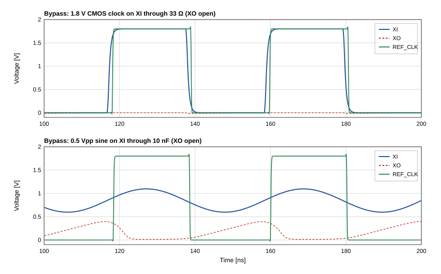

| Input (XO open) | Corner | f | Duty cycle | XI → REF_CLK delay | I(VDD) |
|---|---|---|---|---|---|
| 0 / 1.8 V square, 0.5 ns edges, through 33 Ω | tm 27 °C 1.8 V | 24.0000 MHz | 50.0 % | 0.90 ns | 0.185 mA |
| | ws 125 °C 1.62 V | 24.0000 MHz | 50.0 % | 1.47 ns | 0.142 mA |
| | wp −40 °C 1.98 V | 24.0000 MHz | 50.0 % | 0.58 ns | 0.234 mA |
| 0.5 Vpp sine through 10 nF | tm 27 °C 1.8 V | 24.0000 MHz | 48.4 % | 1.71 ns | 0.533 mA |
| | ws 125 °C 1.62 V | 24.0000 MHz | 47.8 % | 2.99 ns | 0.396 mA |
| | wp −40 °C 1.98 V | 24.0000 MHz | 48.9 % | 0.82 ns | 0.732 mA |

The delay is measured from the input crossing (VDD/2 for the square, the mean for the sine) to the REF_CLK rising edge.

The amplifier and ALC remain active (XO toggles as an inverted copy of XI if left open). With a full-swing input the ALC sees a large amplitude and turns the core current down, so the block draws less than in crystal mode.

## 11. Enable and power-up behaviour

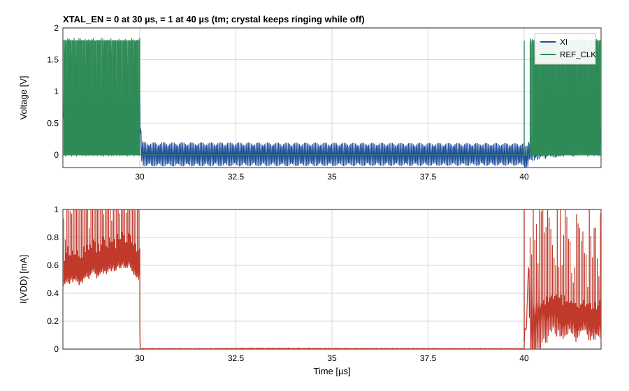

Simulated at tm (ESR 100 Ω): oscillator running, XTAL_EN = 0 at 30 µs, = 1 at 40 µs. REF_CLK goes low within the same cycle as XTAL_EN falls and stays at 0.000 V while off. I(VDD) while off averages 1.2 µA, carried by the still-ringing crystal through the pad nodes (the static value with no ringing is < 10 nA, op case). After XTAL_EN = 1 the first REF_CLK edge comes 1 ns later, because the stored crystal energy (τ = 2 L_m / ESR = 0.3 ms) restarts the clock immediately.

- REF_CLK is gated asynchronously by XTAL_EN (NAND XS3): falling XTAL_EN ends the clock at once and can truncate the last high phase. Change XTAL_EN only while the PLL is disabled.
- While off, the crystal keeps ringing for several ms (τ = 2 L_m / ESR ≈ 0.3–1 ms); a quick re-enable restarts from that energy, with edges within nanoseconds.
- Static current with XTAL_EN = 0: < 10 nA (0.2 nA typical, 6.9 nA at wp 125 °C; op case). XI and XO are held at VSS.
- XTAL_EN must not come from logic clocked by REF_DIG (that clock stops). Tie it high, or drive it from the always-on POR domain.

## 12. Typical characteristics

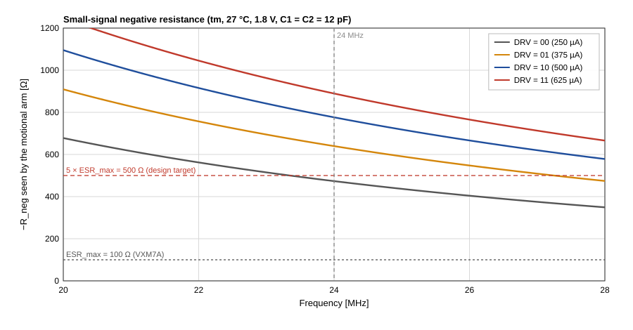

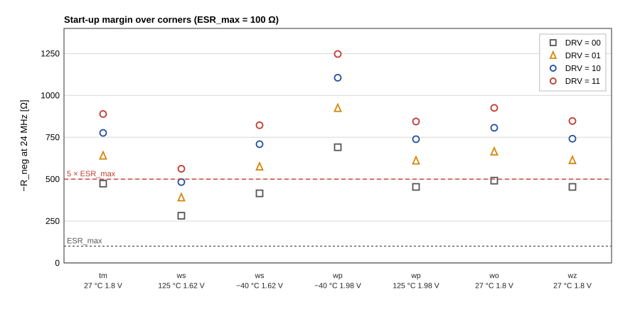

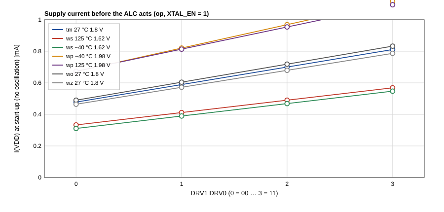

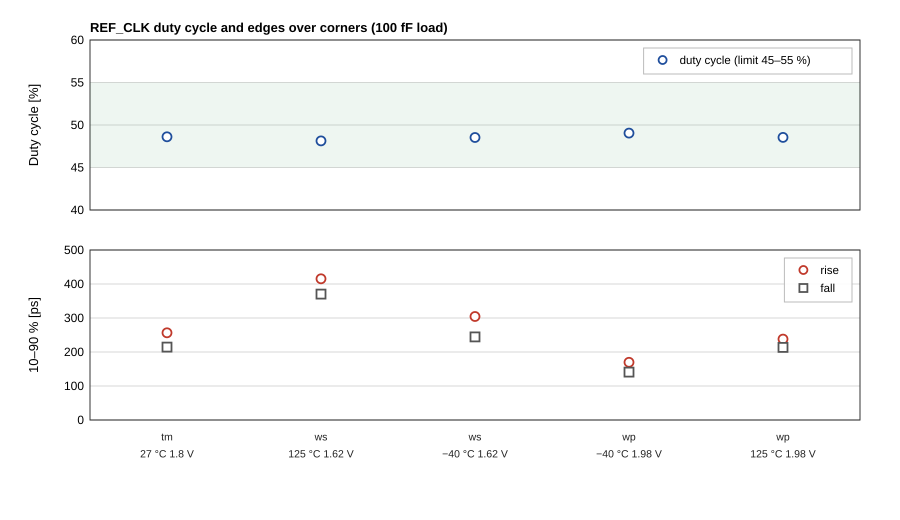

**Sweeps at tm**

| Run (tm) | XI [Vpp] | DL [µW] | I(VDD) [mA] | f [ppm] | duty [%] | start stable [µs] | τ [µs] |
|---|---|---|---|---|---|---|---|
| 27 °C, 1.8 V, ESR 100 Ω, DRV 10, C1 = C2 = 12 pF | 0.751 | 49.3 | 0.364 | +2.4 | 48.61 | 275 | 46.4 |
| C1 = C2 = 10 pF | 0.806 | 45.1 | 0.330 | +24.5 | 48.67 | — | — |
| C1 = C2 = 14 pF ¹ | 0.679 | 49.4 | 0.414 | -14.3 | 48.56 | — | — |

- tm_27_1.8_c10: −R_neg(24 MHz, DRV 10) = 951 Ω, margin 9.5
- tm_27_1.8_c14: −R_neg(24 MHz, DRV 10) = 641 Ω, margin 6.4

¹ Not fully settled (see section 6).

## 13. Application information

**Connection.** Crystal between XI and XO, C1 from XI and C2 from XO to the VSS18A pin (short, same ground). No series resistor, no external feedback resistor. REF_CLK → `CDR_FREF` of `afe_pll`, REFSEL1/0 = 01.

**Load capacitors.** C_L = C_stray + (C1 + C_pin)(C2 + C_pin) / (C1 + C2 + 2 C_pin). For equal C1 = C2: C1 = 2 (C_L − C_stray) − C_pin = 2 (8 − 0.5) − 2.5 = 12.5 pF → 12 pF E12 (the simulated C_L of 7.87 pF includes MA1's capacitances). For another crystal, keep C_L, ESR and C0 such that

g_m,crit = 4 · ESR · ω² · (C0 + C_L)² ≤ g_m / 5,

and verify with `tb_xosc_tr.py ac --cext <C1> --esr <ESR>` at the ws, 125 °C, 1.62 V corner (−R_neg ≥ 5 ESR).

**Other crystals.** At small signal −R_neg ≈ g_m / (ω² C1' C2') with C1' = C1 + C_pin, so a higher C_L costs margin quadratically: a C_L = 18 pF crystal needs C1' = C2' ≈ 35 pF and would leave only ≈ 0.8 × ESR_max at ws / 125 °C / 1.62 V (scaled from the simulated 5.2). Such crystals are not supported; use C_L ≤ 10 pF (DRV = 11 adds ≈ 15 % margin).

**Layout.** Crystal and capacitors within a few mm of the pins, guard ring / ground fill around XI / XO, no digital traces underneath, VDD18A decoupled at the pin. XI is a 1 MΩ-biased high-impedance node: keep PCB leakage < 10 nA (clean, no flux residue).

**Integration in the PHY.** The block belongs to the VDD18A (PLL) domain. REF_DIG (PLL output, always on) clocks `usb_pwr_seq`; its OFF state waits until the reference runs. The digital lock detector compares CLK_BIT_A with REF_DIG and so does not check the crystal's absolute frequency (the crystal's job, section 8).

## 14. Design parameters

| Group | Element | Value |
|---|---|---|
| Amplifier | MA1 | ne3i 200 / 0.5 µm (20 fingers) |
| | RF | 1 MΩ (rpp1k1) |
| Bias | RB, MB1 | 18 kΩ, ne3i 8 / 2 → I_REF ≈ 40 µA |
| | Bank MC1 / MC2 / MC3 | pe3i 125 / 62.5 / 125 µm, L = 1 µm (units of 125 µA) |
| ALC | V_SET | 0.1 · VDD18A (divider 600 k / 150 k / 750 kΩ) |
| | CD / RD, CPK | 1 pF / 2 MΩ, 8 pF |
| | Error pair MRA / MRB, tail | pe3i 80 / 1 µm, I_REF |
| Squarer | CC, RSB | 0.5 pF, 500 kΩ |
| | INV1 | pe3i 6 / 0.3, ne3i 2 / 0.35, header 12 / 0.3 |
| | Schmitt, gate, driver | see the description, section 4.4 |
| Totals | MOSFETs / R / C | 59 / 7 / 6 (ideal R, C) |

## 15. Simulation conditions and method

| Item | Setting |
|---|---|
| Simulator | ngspice 42, `method=trap`, reltol 1e-4, max step 0.4 ns (steady state), 1 ns (start-up), 0.2 ns (bypass) |
| Models | xh018 `ne3i` / `pe3i` BSIM3v3 (binned, X-FAB PS_018_03), corners tm, ws, wp, wo, wz at 3 σ; MOS junction diodes from the dio corner files |
| PVT runs | tm 27 °C 1.8 V (all cases); ws 125 °C 1.62 V and wp −40 °C 1.98 V (op, ac, ss, start, byp); ws −40 °C 1.62 V and wp 125 °C 1.98 V (op, ac, ss); wo, wz 27 °C 1.8 V (op, ac); tm with C1 = C2 = 10 / 14 pF (ac, ss). Enable case at tm only |
| Crystal model | Butterworth–Van Dyke: L_m = 15.2745 mH, C_m = 2.88 fF, R_m = ESR, C0 = 0.83 pF; + 0.5 pF stray across, 2.5 pF per pin to ground |
| Negative resistance | AC current injected between XI and XO (crystal removed, C0 kept): R_neg = Re(Z) at 24 MHz |
| Steady state | Motional arm pre-loaded by a 24 MHz burst for 40 µs, then free running to 240 µs; evaluation over the last 20 µs. Settled when the extracted R_ext is within 15 % of −ESR |
| Frequency | Not from the transient period (trapezoidal integration at 0.4 ns slows the arm by ≈ 300 ppm). Large-signal impedance from the fundamental phasors of the arm voltage and current, then the exact arm resonance f = f_s √(1 + C_m / C_ext). Accuracy ≈ 1 ppm |
| Start-up | XTAL_EN step at 1 µs, 1.6 ms, envelope in 2 µs windows; τ fitted on 2–30 % of the final amplitude |

## 16. Verilog-A model

`AFE/veriloga/afe_xosc.va` (module `afe_xosc`, pins XI, XO, XTAL_EN, DRV1, DRV0, REF_CLK, VDD18A, VSS18A) models the circuit function by function, so the external crystal and C1 / C2 stay in the board netlist and the model starts up, regulates and pulls the crystal like the transistor circuit:

| Function | Model |
|---|---|
| Amplifier MA1 | EKV sink current i_s · ln²(1 + exp((V_XI − V_t) / 2nU_T)) with i_s = 235 µA, nU_T = 45.5 mV, V_t = 0.741 V (fitted to −R_neg of all four DRV settings, 20–28 MHz), output conductance, triode knee at XO |
| Current bank | I_b = (250 µA + 125 µA · DRV) · f_ALC, compliance near VDD18A; `i_scale` scales all currents for corner studies |
| Feedback, device capacitance | RF = 1 MΩ; 0.385 pF at XI, 0.37 pF at XO (pads external) |
| ALC | AC-coupled peak detector, f_ALC = 1 / (1 + exp((V_pk − 0.1·VDD18A − 0.175 V) / 25 mV)) |
| Squarer | AC-coupled comparator, threshold 4.5 % of the peak above the mean (duty 48.6 %), 4 mV hysteresis, 0.85 ns delay, 0.24 ns edges, gated by XTAL_EN |
| Supply | 0.2 mA bias + bank current; 0.2 nA off |
| Ideal-clock mode | `ideal_clk = 1`: REF_CLK = ideal `f_ideal` clock from `t_start_ideal` after XTAL_EN (for system simulations that cannot afford the ms crystal start-up) |

Verification. No Verilog-A simulator is available in this environment, so the same equations are kept as B-sources in `sim/afe_xosc_beh.sp` and run through the transistor testbench (`tb_xosc_tr.py --dut beh`). Comparison at tm, 27 °C, 1.8 V, ESR 100 Ω, DRV = 10:

| Parameter | Transistor | Model |
|---|---|---|
| −R_neg at 24 MHz, DRV 00 / 01 / 10 / 11 | 473 / 640 / 776 / 889 Ω | 476 / 640 / 777 / 893 Ω |
| XI / XO DC bias; I(VDD18A) before oscillation | 0.848 V; 0.700 mA | 0.849 V; 0.700 mA |
| Frequency error (pulling) | +2.4 ppm | +3.1 ppm |
| XI / XO amplitude | 0.751 / 0.843 Vpp | 0.763 / 0.849 Vpp |
| Drive level; I(VDD18A) running | 49.3 µW; 0.364 mA | 51.0 µW; 0.353 mA |
| REF_CLK duty; rise / fall 10–90 % | 48.6 %; 256 / 214 ps | 48.6 %; 249 / 249 ps |
| Start-up: stable REF_CLK / 90 % amplitude / τ | 275 / 596 / 46.4 µs | 321 / 598 / 46.8 µs |
| Bypass, CMOS square: duty, delay, I(VDD18A) | 50.0 %, 0.90 ns, 0.19 mA | 49.9 %, 0.93 ns, 0.20 mA |
| Bypass, 0.5 Vpp sine: duty, delay, I(VDD18A) | 48.4 %, 1.71 ns, 0.53 mA | 48.6 %, 1.09 ns, 0.69 mA |
| XTAL_EN 1 → 0 → 1: REF_CLK off / first edge again | 0 ns / 1 ns | 0 ns / 20 ns |

The model is fitted at tm only; process corners are not modelled, and temperature has no effect (`i_scale` ≈ 0.7 / 1.38 approximates the ws / wp current spread). The Spectre testbench `AFE/veriloga/tb/tb_afe_xosc.scs` (start-up with the crystal, steady state, XTAL_EN off, ideal-clock mode, bypass; `AFE/veriloga/tb/run_va_tests.sh xosc`) has not been run yet (no Spectre here).

## 17. Limitations and open points

1. Ideal resistors and capacitors (no TC, voltage coefficient or parasitic capacitance). With poly resistors, I_REF gets the poly TC; the 1–2 MΩ resistors add ≈ 0.1–0.3 pF to substrate (no effect on the loop, small pulling).
2. Pads modelled as 2.5 pF only; ESD diode leakage on XI (biased through 1 MΩ) not included.
3. Phase noise / jitter and mismatch (Monte Carlo) need Spectre with the PDK.
4. The I_REF reference is supply-dependent (≈ ±25 % over the corners); the margin is met at the low end. A PTAT / bandgap current is not available before the oscillator runs.
5. The Verilog-A model (section 16) is not yet wired into the AMS system testbenches (they use an ideal 24 MHz source at CDR_FREF), and it has not been compiled by Spectre yet. No Icarus (`afe_xosc_bm.v`) model.
6. Only C_L = 8 pF crystals were simulated (plus C1 = C2 = 10 / 14 pF); start-up with ESR > 100 Ω or C_L > 10 pF is not guaranteed.

## 18. Revision history

| Rev | Date | Change |
|---|---|---|
| 0.1 | 2026-11-21 | First issue: schematic, ngspice characterisation with xh018 models |
| 0.2 | 2026-11-22 | Verilog-A model `afe_xosc.va` and its comparison with the transistor circuit (section 16) |
