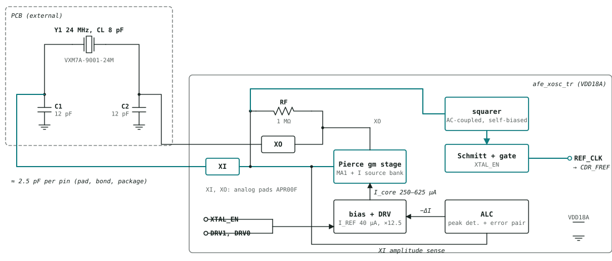
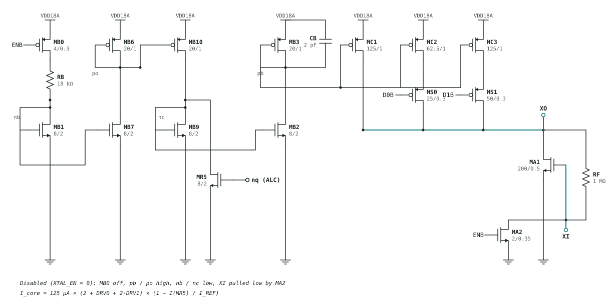
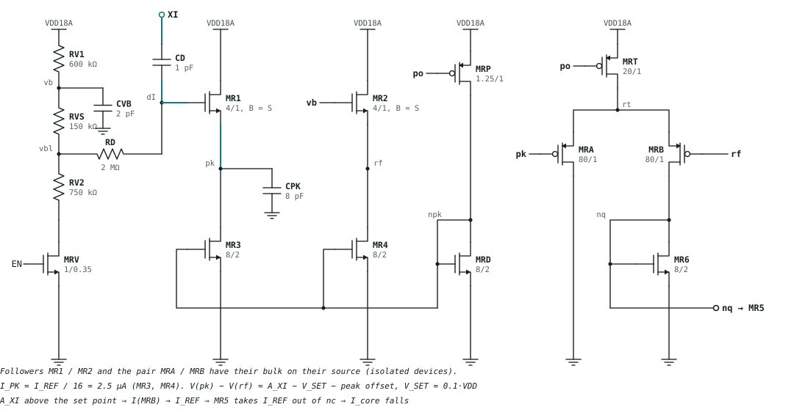
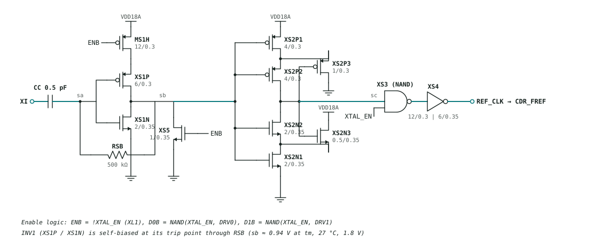

# Crystal oscillator driver — `afe_xosc_tr` (24 MHz, xh018)

*Transistor-level design of the 24 MHz crystal oscillator driver of the USB 2.0 ULPI PHY: it drives an external 24 MHz crystal through two analog pads (XI, XO) and delivers the reference clock `REF_CLK` to the PLL input `CDR_FREF` of `afe_pll` ([AFE/doc/pll_datasheet/pll_datasheet.md](../doc/pll_datasheet/pll_datasheet.md)). Process: X-FAB xh018, devices `ne3i` / `pe3i` (isolated 3.3 V MOS) from `X-FAB/spice`, supply VDD18A = 1.8 V. Simulated with ngspice 42 on the xh018 BSIM3v3 cards (converted for ngspice by `sim/xfab2ngspice.py`, output only under `build/`), tm / ws / wp / wo / wz corners at 3 σ. Prototypes: TI SN74LVC1GX04 (unbuffered inverter + buffered output, `DOC/sn74lvc1gx04.pdf`) and the crystal Vectron VXM7A-9001-24M (`DOC/VXM7A-9001-24M0000000_Jan04_2022.pdf`). Status: 2026-11-21, schematic and testbench; no layout, no Verilog-A model yet.*

The same document as a page with the drawn sheets: [xosc_description.html](xosc_description.html). The full characterisation (graphs, corner tables, limits) is the datasheet [datasheet/xosc_datasheet.md](datasheet/xosc_datasheet.md) (Word: `datasheet/xosc_datasheet.docx`).

## 1. Function and context

The PLL multiplies a 24 MHz reference by N = 20 (REFSEL = 01) to the 480 MHz bit clock. Until now the reference was an ideal source in the testbenches (`AFE/README.md`: "XO (fref 0) vsource …"); `AFE_INTEGRATION_PLAN.md` lists the crystal oscillator / REFCLK buffer as a missing block ("crystal or external clock input; enable for suspend"). `afe_xosc_tr` is that block:

```
            PCB                                  ASIC (VDD18A)
   ┌────────────────────┐          ┌───────────────────────────────────────────────────────┐
   │     Y1 24 MHz      │   XI pad │   ┌──RF 1 MΩ──┐                                        │
   │  ┌───┤▯├───┐       ├────●─────┼───┴─● MA1 gm ─┴─ XO ── I-source bank ◄─ bias ◄── ALC ◄─┐│
   │  │         │       │    │     │     │      (NMOS Pierce, 250–625 µA)               │  ││
   │ C1 12p    C2 12p   ├────┼─────┼─────┘XO pad                         peak detector ◄┘  ││
   │  ⏚         ⏚       │    │     │                                                       ││
   └────────────────────┘    └─────┼─ CC ─ INV1 (self-biased) ─ Schmitt ─ NAND(XTAL_EN) ─ INV ─► REF_CLK ─► CDR_FREF (afe_pll)
                                   └───────────────────────────────────────────────────────┘
```



The 24 MHz clock then reaches the digital twice through the PLL: as `CLK_BIT_A` / 20 (lock) and as `REF_DIG`, the always-on buffered copy that clocks `usb_pwr_seq` and the lock detector. Hence:

- The oscillator must run as soon as VDD18A is up, before any digital sequencing: `XTAL_EN` is tied high (or driven from the always-on POR domain), and the sequencer simply waits in OFF while the crystal starts. The sequencer's own counts (pwr_good → pll_en 10 µs, lock 75 µs) start after the first clean reference edges.
- `XTAL_EN` = 0 is for IDDQ test and a future deep power-down only. It stops `REF_DIG` and thereby `usb_pwr_seq`, so it must not be driven from logic clocked by `REF_DIG`.

## 2. Pins

| Pin | Dir | Level | Function |
|---|---|---|---|
| `XI` | in | analog | Crystal terminal 1 / external clock input (bypass). Pad APR00F |
| `XO` | out | analog | Crystal terminal 2 (amplifier output). Pad APR00F. Leave open in bypass |
| `XTAL_EN` | in | 1.8 V CMOS | 1 = on. 0 = bias off, XI / XO pulled to VSS, REF_CLK = 0, no static current |
| `DRV1`, `DRV0` | in | 1.8 V CMOS | Start-up (maximum) core current: 00 250 µA, 01 375 µA, 10 500 µA, **11 625 µA (recommended for ESR ≤ 100 Ω)**. Static straps (register or tie-off) |
| `REF_CLK` | out | 0 / VDD18A CMOS | 24 MHz reference to `CDR_FREF` of `afe_pll`. Load ≤ 0.2 pF |
| `VDD18A`, `VSS18A` | supply | 1.8 V | Analog supply from `afe_ldo` (shared with the PLL), analog ground |

## 3. Why this topology

**Devices.** The xh018 model library available here (`X-FAB/spice/mos`) contains only the isolated 3.3 V transistors `ne3i` / `pe3i` (tox 6.4 / 6.2 nm, |Vth| ≈ 0.65 V). The oscillator runs on VDD18A with these thick-oxide devices. This has a useful side effect: XI tolerates a 3.3 V clock at the gate oxide (the pad ESD to VDD18A still clamps it; see 7).

**No CMOS-inverter Pierce.** The SN74LVC1GX04 uses an unbuffered CMOS inverter as the gain stage. With 3.3 V devices on 1.62 V (minimum supply) a stacked inverter has no headroom: V_GS,n + |V_GS,p| ≈ 1.5–1.7 V at the bias needed. So the gain stage is a single NMOS (MA1) with a PMOS current-source load, biased through RF from XO to XI: the classic NMOS Pierce (Vittoz). XO and XI sit at V_GS(MA1) ≈ 0.75–0.92 V, leaving > 0.6 V for the PMOS sources even at 1.62 V.

**Amplitude regulation instead of rail clipping.** A Pierce oscillator without regulation grows until XO clips at the rails. For the VXM7A (C0 0.83 pF, ESR up to 100 Ω, CL 8 pF) that is ≈ 1.2 Vpp at XI and > 130 µW crystal drive level, still rising — too close to the crystal's 200 µW limit and far above its 10 µW typical. A peak detector on XI against a set point V_SET = 0.1·VDD reduces the core current once the amplitude is reached (automatic level control, ALC). Start-up runs at the full DRV current (maximum negative resistance); in steady state the ALC holds XI near 0.75 Vpp and the core current drops to what the crystal's loss needs. The ALC is proportional (no integrator), so the loop has one dominant pole (the crystal envelope) and cannot squegg.

**Squarer from XI, AC-coupled.** XI carries the crystal-filtered, nearly sinusoidal voltage; XO has the harmonics of the class-C current pulses. CC couples XI into a self-biased inverter (INV1 with RSB) that sits exactly at its own switching threshold, so the duty cycle is about 50 % regardless of the DC level of XI and of process. A Schmitt trigger (hysteresis) follows, so a small or noisy signal during start-up gives no runt pulses: REF_CLK either does not toggle or toggles with full-swing edges. In bypass mode the same path squares an external clock on XI.

## 4. Circuit

Netlist: [`afe_xosc_tr.sp`](afe_xosc_tr.sp) (subcircuit `afe_xosc_tr XI XO XTAL_EN DRV1 DRV0 REF_CLK VDD VSS`). Sizes W / L in µm. Resistors and capacitors are ideal elements in the netlist with the intended xh018 device in the comment (high-ohmic poly `rpp1k1`, MIM `cmm4`), because these PDK models are not part of `X-FAB/spice`.

### 4.1 Bias and current-source bank



| Instance | Size | Function |
|---|---|---|
| MB0 | p 4/0.3 | Enable switch of the reference branch (gate ENB) |
| RB | 18 kΩ (rpp1k1) | I_REF = (VDD − V_GS(MB1)) / RB ≈ 40 µA (tm, 1.8 V) |
| MB1 | n 8/2 | Reference diode, node `nb` |
| MB7, MB6 | n 8/2, p 20/1 | Unregulated PMOS bias `po` (I_REF): tails of the ALC |
| MB10, MB9 | p 20/1, n 8/2 | Regulated branch: I_REF into the diode MB9 (node `nc`), minus the ALC current I(MR5) |
| MB2, MB3 | n 8/2, p 20/1 | Mirror of `nc` into the PMOS diode `pb` |
| CB | 2 pF (MIM) | Filter on `pb` (bank gate) |
| MC1 | p 125/1 | Base: 2 units of 125 µA (×6.25 of MB3), always on when enabled |
| MC2 + MS0 | p 62.5/1 + p 25/0.3 | DRV0 segment: 1 unit, series switch gate D0B |
| MC3 + MS1 | p 125/1 + p 50/0.3 | DRV1 segment: 2 units, series switch gate D1B |
| MB4, MB8, MB5, MB11 | 1/0.3, 1/0.35 | Disabled: `pb`, `po` to VDD, `nb`, `nc` to VSS (no floating gates, no current) |

I_core = 125 µA × (2 + DRV0 + 2·DRV1) × (1 − I(MR5) / I_REF) nominal. I_REF follows (VDD − V_GS) / RB, i.e. ≈ ±25 % over supply and corners; the start-up margin is designed for the low end (ws, 1.62 V).

### 4.2 Pierce amplifier

| Instance | Size | Function |
|---|---|---|
| MA1 | n 200/0.5 (20 × 10/0.5) | Gain stage, gate XI, drain XO. Wide for weak / moderate inversion: gm / I_D ≈ 12 /V at 0.35 mA (tm), g_m ≈ 4–6 mS |
| RF | 1 MΩ (rpp1k1, or MOS pseudo-resistor) | DC bias XI = XO = V_GS(MA1). R_F·C1 ≈ 15 µs |
| MA2 | n 2/0.35 | Disabled: XI to VSS (MA1 off, XO follows through RF) |

Small-signal design (C1 = C2 = 12 pF external + 2.5 pF pin, C0 = 0.83 pF + 0.5 pF board):

- Critical transconductance g_m,crit = 4·ESR·ω²·(C0 + C_L)² = 4 · 100 Ω · (2π · 24 MHz)² · (8.7 pF)² ≈ 0.69 mS.
- The ac testbench measures the impedance the circuit presents to the crystal's motional arm, Z = R_neg + jX at 24 MHz. Start-up requires −R_neg > ESR; the design target is −R_neg ≥ 5 × ESR_max = 500 Ω at every corner with the recommended DRV = 11 (simulated minimum 562 Ω, ws 125 °C 1.62 V); DRV = 10 reaches 483 Ω (4.8×) there. Results: datasheet section 6.
- Load capacitance: C_L = C_stray + (C1 + C_pin)(C2 + C_pin) / (C1 + C2 + 2 C_pin) = 0.5 + 14.5 / 2 ≈ 7.75 pF; with MA1's capacitances the crystal sees 7.9 pF (simulated), i.e. +2 ppm from the 8 pF nominal.

### 4.3 Amplitude regulation (ALC)



| Instance | Size | Function |
|---|---|---|
| RV1, RVS, RV2, MRV | 600 k / 150 k / 750 kΩ, n 1/0.35 | Divider: vb = 0.6·VDD, vbl = vb − V_SET, V_SET = 0.1·VDD = 0.18 V. 1.2 µA, off when disabled |
| CVB, CVBL | 2 pF each | Divider filters |
| CD, RD | 1 pF, 2 MΩ | AC coupling of XI onto `vbl` (node `dI`), corner 80 kHz |
| MR1, CPK | n 4/1 (bulk = source), 8 pF | Peak detector: follower holds `pk` ≈ peak of dI − V_GS |
| MR2 | n 4/1 (bulk = source) | Reference follower on vb: `rf` = vb − V_GS |
| MR3, MR4 | n 8/2 | Sinks I_PK = I_REF / 16 ≈ 2.5 µA (droop of CPK 13 mV per cycle) |
| MRP, MRD | p 1.25/1, n 8/2 | I_PK reference (weak inversion, low V_DS,sat for the sinks) |
| MRT | p 20/1 | Tail I_REF of the error pair |
| MRA, MRB | p 80/1 (bulk = source) | Error pair in weak inversion: pk vs. rf |
| MR6, MR5 | n 8/2 | MRB current mirrored out of `nc` (core sheet) |

V(pk) − V(rf) ≈ A_XI − V_SET − (peak conduction offset, ≈ 0.15–0.2 V). For amplitudes below the set point MRA carries the tail and I(MR5) ≈ 0 (3 µA leakage at zero amplitude, tm); above it I(MRB) → I_REF and the core current goes to zero. The transition is ≈ 4 n·U_T ≈ 0.15 V wide in amplitude, so the regulated XI amplitude moves only by a few 10 mV between the strongest and the weakest corner, and it scales with VDD (V_SET = 0.1·VDD).

### 4.4 Squarer, Schmitt trigger and output



| Instance | Size | Function |
|---|---|---|
| CC | 0.5 pF (MIM) | AC coupling from XI (adds 0.5 pF to C1, inside the C_L budget) |
| XS1H | p 12/0.3 | Header of INV1, off when disabled (INV1 draws class-A current at its trip point) |
| XS1P, XS1N | p 6/0.3, n 2/0.35 | INV1, self-biased through RSB 500 kΩ (high-pass with CC: 0.64 MHz) |
| XS5 | n 1/0.35 | Disabled: `sb` (and through RSB `sa`) to VSS |
| XS2P1/P2/N1/N2, XS2P3, XS2N3 | p 4/0.3, n 2/0.35, p 1/0.3, n 0.5/0.35 | 6-transistor Schmitt trigger, output `sc` |
| XS3 | NAND2 p 4/0.3, n 4/0.35 | Gate with XTAL_EN |
| XS4 | p 12/0.3, n 6/0.35 | REF_CLK driver (edges 0.14–0.42 ns into 100 fF over the corners) |
| XL1–XL5 | logic | ENB = !XTAL_EN, D0B = NAND(XTAL_EN, DRV0), D1B = NAND(XTAL_EN, DRV1) |

REF_CLK is in phase with XI (four inversions: INV1, Schmitt, NAND, XS4). The PLL uses only the rising edges of CDR_FREF, so polarity and the exact duty cycle do not matter to it; the lock detector accepts 40–60 % on REF_DIG.

## 5. Board components (VXM7A-9001-24M, C_L = 8 pF)

| Item | Value | Note |
|---|---|---|
| C1 (XI), C2 (XO) | 12 pF C0G, ±2 % | C_L = C_stray + (C1 + C_pin)/2 with C_pin ≈ 2.5 pF (pad, bond, package) and C_stray ≈ 0.5 pF. Recompute for another package: C1 = C2 = 2 (C_L − C_stray) − C_pin |
| Series resistor at XO | none (0 Ω) | Drive level is set by the ALC (43–58 µW at ESR 100 Ω over the corners); the SN74LVC1GX04 application needs R_s because it has no ALC |
| Crystal | 24 MHz fundamental, C_L 8 pF, ESR ≤ 100 Ω, C0 ≤ 2 pF, DL ≥ 100 µW | Other crystals: check −R_neg ≥ 5 × ESR_max with the ac testbench (`--cext`), and the drive level |
| Layout | XI / XO traces short and guarded with ground, no digital lines under the crystal; C1 / C2 ground at the ASIC's VSS18A pin | Each pF of stray capacitance pulls ≈ −10 ppm (datasheet section 8) |

Frequency budget: the USB 2.0 reference tolerance is ±500 ppm; the crystal itself has ±50 ppm (VXM7A, including temperature and 10 years aging); the oscillator circuit adds its pulling uncertainty (C1 / C2 tolerance, pin capacitance, supply and temperature dependence of the amplifier's capacitances): datasheet section 8.

## 6. Bypass (external clock)

Leave XO open and drive XI with a 24 MHz clock: either a 0 / 1.8 V CMOS signal directly (DC-coupled; ≤ VDD18A + 0.3 V because of the pad ESD), or any clock / clipped sine of ≥ 0.3 Vpp through a 10 nF coupling capacitor (a 3.3 V oscillator output must be AC-coupled or divided). The amplifier and ALC stay on; XO then oscillates as an inverted copy and the ALC reduces the core current, so bypass draws less current than crystal mode. Results: datasheet section 10.

## 7. Integration notes

- **Connection to the PLL.** `REF_CLK` → `CDR_FREF` of `afe_pll` (`afe_pll_tr`), REFSEL1/0 = 01 (N = 20). Route as a short 1.8 V clock net inside the AFE; the PLL's input buffer XF0 is the only load. The 0.2 ns REF_DIG delay of the PLL is unchanged.
- **ESD / pads.** XI / XO use the analog pad APR00F (no series resistor) in the VDD18A (or VDD33) pad ring segment. With the ESD diodes to VDD18A, XI must not exceed VDD18A + 0.3 V; a 3.3 V external clock needs AC coupling. A pad ring on VDD33 would allow DC-coupled 3.3 V clocks (the 3.3 V gate oxide of MA1, MR1 and INV1 allows it) but needs checking against the PDK pad rules.
- **Supply.** VDD18A is shared with the PLL; the oscillator draws ≈ 0.4 mA DC with small ripple at 24 MHz (the core current is DC, the class-C pulses are filtered by C2 and the crystal). Decouple VDD18A at the ASIC pins as for the PLL.
- **Power-up.** Start-up time from VDD18A good to stable REF_CLK: datasheet section 7 (0.16–0.53 ms to a stable clock, 0.4–1.1 ms to 90 % amplitude over the simulated corners at ESR 100 Ω; allow 2 ms). This adds to the PHY's power-up time before `usb_pwr_seq` leaves OFF; it does not enter the USB timing budgets, which start at RESETB / after CLKOUT.
- **Phase noise / jitter.** Not simulated (no periodic-noise analysis in ngspice). The PLL loop (1 MHz bandwidth) passes the reference phase noise ×20 inside its bandwidth; for a crystal oscillator with a Schmitt squarer the contribution is expected far below the PLL VCO's own jitter. To be verified in Spectre (pnoise) with the PDK.

## 8. Files and how to run

| File | Content |
|---|---|
| `afe_xosc_tr.sp` | Transistor-level netlist (ngspice / Spectre `simulator lang=spice`) |
| `sim/xfab2ngspice.py` | Converts the xh018 `ne3i` / `pe3i` Spectre cards and the corner files to ngspice libraries in `build/xosc/models/` (git-ignored: confidential PDK data, never commit) |
| `sim/tb_xosc_tr.py` | Testbench: `op`, `ac` (negative resistance), `ss` (steady state, drive level, frequency, duty), `start`, `byp`, `en`. Prints `TEST PASSED` / `TEST FAILED` |
| `sim/run_all.py` | Corner and sweep regression for the datasheet, copies the results to `datasheet/data/` |
| `doc/draw_xosc.py` | Draws the schematic sheets `doc/xosc_*.svg` (+ PNG) from the netlist sizes (uses `AFE/spice/doc/draw_cdr.py`) |
| `doc/md2html.py` | Builds `xosc_description.html` from this file (inline SVG sheets) |
| `datasheet/` | Datasheet (Markdown + Word), figures (`gen_figures.py`), simulation data |

```sh
python3 "AFE/Crystal Oscillator Driver/sim/xfab2ngspice.py"          # once (needs X-FAB/spice)
python3 "AFE/Crystal Oscillator Driver/sim/tb_xosc_tr.py"            # op ac ss start byp at tm, 27 C, 1.8 V
python3 "AFE/Crystal Oscillator Driver/sim/tb_xosc_tr.py" ac ss --corner ws --temp 125 --vdd 1.62
python3 "AFE/Crystal Oscillator Driver/sim/run_all.py"               # corner regression, ≈ 6 h on 2 cores
```

Simulator notes: the motional arm (Q ≈ 23 000) makes transients long (≈ 4 min for 240 µs). The trapezoidal step of 0.4 ns slows the simulated motional resonance by ≈ 300 ppm ((ωh)²/12), so the testbench does not take the frequency from the transient period: it extracts the large-signal load impedance the circuit presents to the motional arm (fundamental phasors of the arm voltage and current) and solves the exact arm resonance with it. The same extraction gives R_ext, which must equal −ESR in steady state (the "settled" check).

## 9. Results summary

See the datasheet ([datasheet/xosc_datasheet.md](datasheet/xosc_datasheet.md)) for all corners; typical values (tm, 27 °C, 1.8 V, ESR 100 Ω, C1 = C2 = 12 pF; transients with DRV = 10) and the range over the simulated corners:

| Parameter | Typical | Corners (min … max) |
|---|---|---|
| −R_neg at 24 MHz, DRV 11 / margin vs. 100 Ω | 889 Ω / 8.9× | 562 … 1247 Ω / 5.6 … 12.5× |
| −R_neg at 24 MHz, DRV 10 | 776 Ω | 483 … 1106 Ω |
| Frequency error from the circuit (pulling) | +2.4 ppm | +1.8 … +7.3 ppm |
| XI / XO amplitude | 0.75 / 0.84 Vpp | 0.71 … 0.81 / 0.79 … 0.93 Vpp |
| Crystal drive level | 49 µW | 43 … 58 µW (limit 200 µW) |
| Supply current, running / start-up (DRV 11) / off | 0.36 mA / 0.81 mA / 0.2 nA | 0.31 … 0.52 mA / 0.55 … 1.12 mA / ≤ 6.9 nA |
| REF_CLK duty cycle, rise / fall | 48.6 %, 256 / 214 ps | 48.1 … 49.1 %, 170 … 415 ps |
| Start-up: stable REF_CLK / 90 % amplitude | 275 / 596 µs | 162 … 530 / 376 … 1064 µs |
| Bypass (CMOS in): duty, delay, current | 50.0 %, 0.90 ns, 0.19 mA | 50.0 %, 0.58 … 1.47 ns, 0.14 … 0.23 mA |
| Pulling, C1 = C2 = 10 / 14 pF | +24.5 / −14.3 ppm | — |

Two steady-state runs (ws 125 °C 1.62 V, wp 125 °C 1.98 V) had not fully settled at the end of the transient; their amplitude and drive level are a few % low (frequency unaffected). The C1 = C2 = 14 pF run likewise.

## 10. Open points

1. Resistors and capacitors are ideal; replace them by `rpp1k1` / MIM with the PDK cells (TC and voltage coefficients of RB, RF, RD; parasitic capacitance of the 1–2 MΩ poly resistors to substrate). RF and RD could become long-channel MOS pseudo-resistors to save area.
2. Pad model: only 2.5 pF per pin. Add the APR00F ESD diodes / leakage (affects XI bias through RF = 1 MΩ: 100 nA leakage shifts XI by 0.1 V) once the I/O cell SPICE models are available.
3. I_REF depends on VDD (±25 %). A β-multiplier is not possible with 3.3 V devices at 1.62 V; a bandgap-derived current from the AFE bias would need the bias up before the oscillator, which the power-up order does not allow. Accepted: the start-up margin is met at the low end.
4. Phase noise / jitter (pnoise) and a Monte-Carlo run (the X-FAB cards contain mismatch hooks `*_avt`, all 0 in the corner files) need Spectre.
5. Verilog-A / Icarus behavioural model (`afe_xosc.va`, `afe_xosc_bm.v`) with start-up delay, frequency offset and `XTAL_EN`, for the AMS system testbenches.
6. Layout: MA1 and the bank are large (≈ 200 µm + 312 µm gate width); CPK, CVB, CVBL, CB ≈ 14 pF MIM; resistors ≈ 5 MΩ of poly in total.
