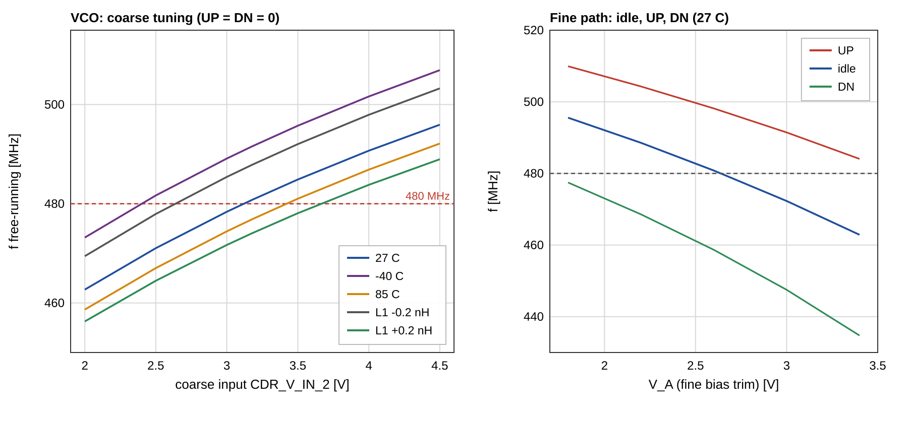
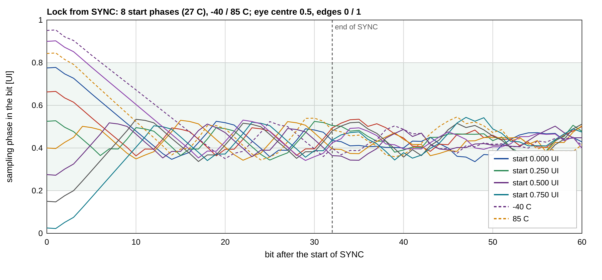
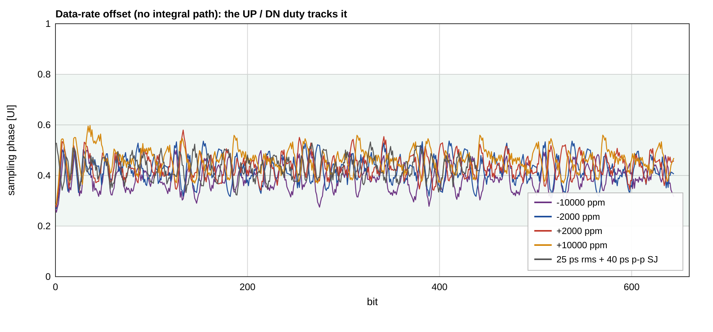

# USB 2.0 discrete CDR board (afe_cdr) — design description

Rev 0.1 · AFE/Discrete/CDR · board: 4-layer FMC LPC mezzanine · FPGA side: AMD 7-Series

Schematic symbols and footprints: **JLCEDA/EasyEDA Official Library** — https://lceda.cn/ · https://easyeda.com (copyright JLCEDA/EasyEDA).

## 1 Overview

This board is a discrete-component prototype of the PHY's clock and data recovery, the upper loop of the PLL-assisted CDR block. It recovers the 480 MHz bit clock from HS data and retimes the data with it, as the integrated CDR does. The behavioural reference is `AFE/veriloga/afe_cdr.va` (and its Verilog twin `afe_cdr_bm.v`), with the same pin names and semantics:

| afe_cdr.va pin | Board | Function |
|---|---|---|
| `CDR_DATA` | net `DAT_P/N`: MC100EP57 output | HS data: SMA pair J2 / J3 (generator, AFE receiver board) or the FPGA's 480 Mb/s pattern (FMC LA01) |
| `CDR_EN` | FPGA register CTRL[0] → `CDR_EN` (NB6L14 EN) and `CDR_SET` (MC100EP29 set inputs) | 0: CLK_RX low, HS_RXD = 1, no pump (fine node at its idle level) |
| `CDR_V_IN_2` | SMA J6 (from the PLL board's J4 `CDR_CH_OUT_PLL`) or DAC B, buffered, → R_K | coarse tuning of the VCO |
| `CLK_RX` | NB6L14 Q2 → FMC CLK0_M2C | recovered clock |
| `HS_RXD` | MC100EP29 #2 Q0 (B) → FMC LA00 | retimed data, J = 1 |
| `CDR_CH_OUT` | node P (prop driver output) averaged, buffered (MCP6001) to SMA J7, header J8, ADC | loop control voltage |
| `VDD18A` / `VSS18A` | +3V3 (ECL), +5V_A (analog) / GND | supplies (section 4.7) |

The loop is built from standard parts:

- an MC100EP57 data selector (SMA or FPGA pattern);
- an Alexander (bang-bang) phase detector from two MC100EP29 dual D flip-flops and two MC100EP08 XORs: a data sample on the rising clock edge, an edge sample on the falling edge, UP = late, DN = early, each 1 UI long;
- a discrete "charge pump": two BFR93A current switches into a 62 Ω load (node P), fed through a 47 nH RF choke to a fine-tuning varactor — the model's proportional path icp × R8;
- a discrete LC VCO (BFR93A Colpitts, two 1SV305 varactors: coarse from `CDR_V_IN_2`, fine from the driver), the same oscillator as on the PLL board with a smaller inductor;
- an NB6L14 1:4 LVPECL clock fan-out: two copies for the phase detector, one for CLK_RX, one for a monitor SMA.

The digital half is an external AMD 7-Series FPGA board over FMC LPC. The FPGA sends HS packets built by the repo's own TX back end (`usb_tx_path`: bit stuffer, NRZI, `usb_tx_serializer8`) at 480 Mb/s through an OSERDES, captures HS_RXD with CLK_RX through an ISERDES (1:8, word clock CLK_RX / 8), and decodes it with the repo's `usb_rx_decoder8`, the PHY's HS bit decoder. It measures the SYNC bits lost while the CDR locks, packet errors, PRBS7 bit errors (with an IDELAY eye scan) and the CLK_RX frequency, and it drives the tuning DACs and reads the CDR_CH_OUT ADC. A PC script drives it over UART and calibrates the free-running frequency.

```
 SMA J2/J3 ─ 50 Ω ─ AC ─┐                                  ┌──────────── FMC LPC ─────────────┐
 FPGA DPAT (LA01) ─ AC ─┤MC100EP57├─ CDR_DATA ─┬───────────┼──────────────┐                   │
                         SEL ◄── DSEL0/1       │           │              │                   │
                                     ┌─────────▼────────┐  │              │                   │
            ┌── Q0 (CK1) ──────────► │ EP29 #1  FF0 A   │ (rising)         │                   │
            │   Q0 legs swapped ───► │          FF1 T'  │ (falling)        │                   │
            │                        └──┬──────────┬────┘                  │                   │
            │                       ┌───▼──────────▼───┐                   │                   │
            ├── Q1 (CK2) ─────────► │ EP29 #2  FF0 B   │── B = HS_RXD ── AC ─► LA00 (HS_RXD)   │
            │                       │          FF1 T   │  (S0/S1 = CDR_SET)                    │
            │                       └───┬──────────┬───┘                                       │
            │                 EP08 UP = B ⊕ T   EP08 DN = T ⊕ A                                │
  NB6L14 ───┤                           │          │                                           │
  (EN =     ├── Q2 ── AC ───────────────┼──────────┼──────────────► CLK0_M2C (CLK_RX)          │
   CDR_EN)  └── Q3 ── SMA J4            ▼          ▼                                           │
       ▲         BFR93A current switches (15 mA each) into R_L 62 Ω = node P ─ avg ─ CDR_CH_OUT│
       │                                │ 47 nH                         (MCP6001, SMA J7, ADC) │
       │                                ▼ node F                                               │
   BFR93A ◄─ Colpitts: 6.2 nH ∥ 0.3 p ∥ (18 p + 1SV305 ◄ R_K ◄ coarse: SMA J6 / DAC B)         │
   buffer                              ∥ (12 p + 1SV305: cathode F, anode V_A = DAC A)         │
```

The board has no FPGA power or configuration circuitry. It is powered from the carrier's FMC 12P0V, 3P3V, VADJ and 3P3VAUX rails.

## 2 Requirements (from afe_cdr.va)

| Item | afe_cdr.va | Board target |
|---|---|---|
| Phase detector | Alexander: data on the rising CLK_RX edge, edge on the falling edge; e = d_prev → early → down, e = d → late → up; no transition → no pump | the same, in 100EP logic |
| Proportional step | icp × R8 × kvco_f = 30 MHz for one bit ≈ T/16 (130 ps) per decision | 0.041 UI (≈ T/24, 85 ps) per decision, UP / DN asymmetric (section 5.2) |
| Integral path | C2 500 pF: 125 kHz per decision, tracks ±1000 ppm | none (first-order loop): the UP / DN duty tracks the offset (section 6) |
| Lock | within the HS SYNC (32 bits; ≥ 12 after 5 hubs; the PHY's HS_ZMIN = 4 needs the last ≥ 4 + 1) | ≤ 8 bits from any start phase (simulated ≤ 7) |
| Free-running frequency | f_coarse(CDR_V_IN_2) × (1 + ppm_mis), the PLL's curve | coarse input from the PLL board's CDR_CH_OUT_PLL; the replica error is trimmed by V_A (calibration in the FPGA / host) |
| HS_RXD | rising-edge data sample, t_cq 0.3 ns after the edge; setup ≥ 0.4 ns, hold ≥ 0.1 ns at the digital | B (one bit later), 0.42 ns after the edge (EP29 tpd) |
| CDR_EN = 0 | CLK_RX low, HS_RXD = 1, CDR_CH_OUT reset to vf_mid | NB6L14 EN = 0 (outputs low on the next falling edge), EP29 set (UP = DN = 0: node P at its idle level), VCO keeps running |
| CDR_CH_OUT | filter node, 0.9 V ± | node P averaged: 2.9–5.0 V, idle 4.0 V |

## 3 Architecture

The model's loop is Alexander PD → charge pump → R8 + C2 ∥ C1 → VCO (fine input 300 MHz/V) with the coarse frequency set by the PLL's control voltage. Two features decide how a discrete version must be built:

- **The phase step must be large and fast.** A bang-bang loop must slew up to half a UI within the SYNC: at T/16 per decision that is 8 decisions. The decisions come every bit (SYNC is KJKJ…), so the frequency step must take effect within about a bit, and the loop latency must stay small against the 2.08 ns UI. A standard charge pump into a filter capacitor is far too slow at this rate; the board therefore drives the fine varactor directly with a fast current switch (BFR93A, 15 mA steps into 62 Ω: ±1.2 V at node P). The 47 nH RF choke isolates the tank from the driver; its resonance with the varactor sets the response time (≈ 3 ns to half the step).
- **The coarse frequency comes from the PLL.** The board's VCO is the PLL board's oscillator (same BFR93A / 1SV305 / R_K network) with the tank retuned for the second varactor, so the PLL's control voltage puts it near 480 MHz. A discrete "replica" does not track exactly (13.8 MHz/V here, 20.4 MHz/V on the PLL board, other temperature drift), so the fine varactor's anode voltage V_A (DAC A) trims the free-running frequency: the FPGA counts CLK_RX with an idle line (no transitions, no pump) and the host sets V_A for 480 MHz. This is the bench version of an FLL assist.

The phase detector is built from ECL flip-flops because its timing must close inside half a UI (1.04 ns): falling clock edge → T' (420 ps tpd + 100 ps setup) → retimed on the next rising edge. With 100EP parts (tpd 420 ps, setup / hold 100 ps) this closes with margin; 74LVC / AUC logic would not.

The board has no integral (frequency) path. The model's C2 adds 125 kHz per decision; on the board the equivalent would be a second, slow path. Without it the loop is first order: a frequency offset is tracked by an imbalance of UP and DN decisions, at the cost of a small static phase offset (section 5.4). With a phase step of 0.04 UI the bang-bang loop can follow far more than USB's ±1000 ppm (section 5.4).

CDR_EN is one FPGA register bit. It drives two functions:

- `CDR_EN` → NB6L14 EN: all four clock outputs stop low (synchronously, on the next falling input edge); CLK_RX is low, as in the model;
- `CDR_SET` = ¬CDR_EN ∨ FF_SET → the set inputs of both MC100EP29: A = B = T' = T = 1, so UP = DN = 0 (node P at idle) and HS_RXD = B = 1 (J).

The VCO keeps running while CDR_EN = 0 (VCO_OFF is a separate bit), so the free-running frequency can be measured with CDR_EN = 1 and an idle line.

## 4 Circuit design and component selection

### 4.1 Data input (sheet 2)

- **MC100EP57** (U6) is a 4:1 differential mux with LVPECL inputs and VBB outputs. D0 is the SMA input, D1 the FPGA pattern; SEL1 / SEL0 come from the FPGA at +3V3 (U4): 00 SMA, 01 FPGA. D2 / D3 are tied to read 0.
- **SMA pair J2 / J3.** 50 Ω to an AC-grounded centre tap (R 49.9 × 2, 100 nF), AC-coupled (100 nF) and biased to VBB1 through 1 kΩ each. A 22 kΩ pull-down on D0# gives about 90 mV offset, so an idle (constant) input reads 1 = J. Either leg alone works single-ended; drive ≥ 300 mV p-p (the EP57 needs 150 mV differential).
- **FPGA pattern.** LVDS from the FPGA (OSERDESE2 8:1, 480 Mb/s), 100 Ω across the pair, AC-coupled and biased to VBB2 through 4.7 kΩ, 100 kΩ offset on D1# (≈ 85 mV). LVDS (0.35 V per leg) is below the EP57's input common-mode range (≥ 2.0 V), hence the coupling.
- **AC coupling and NRZI.** HS packets are not DC-balanced, and the line idles between packets. With 1 kΩ / 4.7 kΩ and 100 nF the time constants are 100 µs / 470 µs, against packets of ≤ 20 µs; the offset defines the idle level. Baseline wander inside a packet stays below 5 % of the swing.

### 4.2 Phase detector (sheet 3)

Two MC100EP29 (U7, U8) and two MC100EP08 (U9, U10), all on +3V3 (VCC 3.3 V, VEE = GND):

| Flop | Clock | D | Q | Meaning at rising edge n + 1 |
|---|---|---|---|---|
| U7 FF0 | CK1 rising | CDR_DATA | A | data sample D(n + 1) |
| U7 FF1 | CK1 falling (CLK1 legs swapped) | CDR_DATA | T' | edge sample D(n + ½) |
| U8 FF0 | CK2 rising | A | B | previous data D(n) = HS_RXD |
| U8 FF1 | CK2 rising | T' | T | edge sample, retimed |

UP = B ⊕ T: the edge sample already shows the new value, so the transition came before the falling edge and the clock is late → faster. DN = T ⊕ A: the edge sample still shows the old value, the clock is early → slower. Without a transition (A = B) both are 0. UP and DN are refreshed every rising edge, so each decision lasts exactly one UI, as the model's charge pump does.

Timing (100EP at 3.3 V, typical): T' leaves U7 420 ps after the falling edge and must be stable 100 ps before the next rising edge of U8: 0.52 ns used of 1.04 ns. A → B: 0.52 ns of 2.08 ns. The two clock copies CK1 / CK2 come from the same NB6L14 (output skew ≤ 20 ps). UP / DN reach the driver bases about 0.42 + 0.3 ns after the clock edge.

The set inputs S0 / S1 of both EP29 are `CDR_SET` (LVCMOS 3.3 V from U4; the EP29 S / R inputs accept it, VIH ≥ 2.075 V); R0 / R1 are tied low. A 10 kΩ pull-up holds CDR_SET high (set) while the FPGA is unconfigured.

Every LVPECL output has 150 Ω emitter pull-downs at the driver. The receiver end of each pair has 100 Ω across it; nets with two loads (A: U8 D0 and U10 D1; B: U9 D0 and the FPGA; T: U9 D1 and U10 D0; CDR_DATA: U7 D0 and D1) are daisy-chained with the termination at the last load. On-board traces are < 25 mm.

### 4.3 Clock fan-out and outputs (sheet 3)

- **NB6L14** (U11) takes the VCO buffer's output single-ended: 100 pF into IN, IN# AC-grounded (100 nF), VT tied to VREF_AC (both inputs biased through the internal 50 Ω). The buffer sees the 50 Ω load; the simulated swing at IN is 0.31 V p-p (NB6L14: ≥ 200 mV single-ended).
- **Q0 → CK1** (U7: CLK0 true, CLK1 legs swapped), **Q1 → CK2** (U8, both true), terminated at the EP29s.
- **Q2 → CLK_RX** to FMC CLK0_M2C: AC-coupled (100 nF), biased to VBIAS = 1.245 V through 4.7 kΩ on the FPGA side, FPGA DIFF_TERM; a 220 kΩ offset makes a stopped clock read 0.
- **B → HS_RXD** to FMC LA00: the same coupling, offset to read 1 (J) when idle or disabled.
- **Q3 → SMA J4** (CLK_RX monitor, AC-coupled into the scope's 50 Ω; the complement is loaded with 49.9 Ω for balance).
- **EN** = CDR_EN (LVCMOS); 10 kΩ pull-down against the internal pull-up, so the clock is off while the FPGA is unconfigured.

HS_RXD timing at the FPGA: B changes 0.42 ns after the CK2 edge; CLK_RX comes from the same fan-out (Q1 / Q2 skew ≤ 20 ps). With matched traces the FPGA sees setup ≈ 1.6 ns and hold ≈ 0.4 ns (the model's spec: ≥ 0.4 / ≥ 0.1 ns). The FPGA's IDELAY places its own sampling point (eye scan, section 8.3).

### 4.4 VCO (sheet 4)

The oscillator is the PLL board's BFR93A Colpitts (Q1) with a base-coupled tank and a BFR93A common-emitter buffer (Q2), on a filtered +5V_VCO (10 Ω from +5V_A, 4.82 V). The tank has two varactor branches:

| Part | Value | Function |
|---|---|---|
| L1 | 6.2 nH ± 0.2 nH, LQW18AN6N2C00D | tank inductor (wire-wound, Q ≈ 40 at 480 MHz) |
| C_P | 0.3 pF C0G | centre-frequency trim (480 MHz at 3.18 V coarse) |
| C_S + D2 | 18 pF + 1SV305 | coarse branch, R_K 2.2 kΩ from the buffered coarse input |
| C_F + D3 | 12 pF + 1SV305 | fine branch: cathode = node F (driver through L2), anode = V_A |
| C_cpl | 3.3 pF | base – tank coupling |
| C1 / C2 | 10 pF / 10 pF | Colpitts divider |
| RE1 | 180 Ω | about 9 mA |

The fine varactor sees F − V_A: idle 4.0 − 2.6 = 1.4 V; UP 5.0 − 2.6 V; DN 2.9 − 2.6 V. Raising V_A raises the capacitance at every state, which lowers the free-running frequency (−20 MHz/V) and makes the steps slightly larger (section 5.2). VCO_OFF (Q3, 2N7002) pulls the base bias to ground, as on the PLL board.

### 4.5 Prop driver — the "charge pump" (sheet 4)

Two BFR93A differential pairs with 100 Ω tails (≈ 15 mA each, from the LVPECL levels: (2.29 − 0.8) V / 100 Ω):

- **UP pair** Q4 / Q5: Q4 (collector at P) conducts when UP = 0, Q5 (collector at +5V_A) when UP = 1;
- **DN pair** Q6 / Q7: Q6 (collector at P) conducts when DN = 1, Q7 otherwise.

So R_L = 62 Ω carries 15 mA at idle (P = 4.0 V), none with UP (P = 5.0 V), 30 mA with DN (P = 2.9 V). Base stoppers (47 Ω) and 100 Ω pair terminations sit at the bases. The tails never switch off, so the +5V_A load is constant (no supply modulation by the data). Node P drives node F through the 47 nH choke L2 (self-resonance ≈ 2.2 GHz); F settles to half the step in about 3 ns (section 5.2).

### 4.6 Tuning, calibration and CDR_CH_OUT (sheet 4)

- **MCP4822** (U12): DAC A = V_A (fine bias / frequency trim), DAC B = internal coarse voltage; 1 mV / LSB (2.048 V reference, gain 2), 0–4.095 V. Reset values: V_A 2600 mV, coarse 3120 mV.
- **MCP6002** (U13): A buffers V_A (1 kΩ + 100 pF + 10 nF at the anode), B buffers the selected coarse source (100 Ω + 10 nF into R_K).
- **TS5A23166** (U14): coarse source = SMA J6 (`CDR_V_IN_2`, from the PLL board's J4, 1 kΩ series, 100 kΩ to GND) or DAC B (CSRC). With both switches open the buffer input is pulled to 0 V.
- **CDR_CH_OUT**: node P through 10 kΩ / 1 nF (10 ns average of the 1-UI pulses), MCP6001 (U15) → SMA J7 (100 Ω), header J8, and MCP3201 (U16, 5.0 V reference) for the FPGA. The mean of P tells the UP / DN balance: 4.0 V = balanced; with a frequency offset it moves toward 5.0 V (data faster than the VCO) or 2.9 V.

### 4.7 Power, level translation and FMC housekeeping (sheet 1)

- **+3V3** from FMC 3P3V through a ferrite (FB1): all 100EP / NB6L14 logic and terminations, ≈ 0.45 A (ICs ≈ 0.2 A, 150 Ω pull-downs ≈ 0.25 A).
- **+5V_A** from FMC 12P0V through TPS7A4901 (U1, 5.02 V, 15 µVrms): VCO (≈ 20 mA), prop driver (30 mA), op-amps, DAC, ADC: ≈ 60 mA, 0.4 W in the regulator.
- **Level translation:** SN74LVC8T245 U3 (VADJ → +5V_A: SPI, coarse switch, VCO_OFF), U4 (VADJ → +3V3: CDR_EN, CDR_SET, DSEL0 / 1), SN74LVC1T45 U5 (ADC DOUT → VADJ). Pull resistors define every control while VADJ is down: CDR off, flip-flops set, VCO off, coarse switches open, CS# high.
- **IPMI:** AT24C02 FRU EEPROM on 3P3VAUX; power LED.

FMC LPC pin map:

| FMC signal | Pin | Net | Direction |
|---|---|---|---|
| CLK0_M2C_P / N | H4 / H5 | CLK_RX | board → FPGA (LVPECL, AC-coupled) |
| LA00_P_CC / N_CC | G6 / G7 | HS_RXD | board → FPGA (LVPECL, AC-coupled) |
| LA01_P_CC / N_CC | D8 / D9 | DPAT (pattern) | FPGA → board (LVDS) |
| LA02_P / N | H7 / H8 | CDR_EN / CDR_SET | FPGA → board |
| LA03_P / N | G9 / G10 | DSEL0 / DSEL1 | FPGA → board |
| LA04_P / N | H10 / H11 | VCO_OFF / CSW_EXT | FPGA → board |
| LA05_P / N | D11 / D12 | DAC_CS# / ADC_CS# | FPGA → board |
| LA06_P / N | C10 / C11 | SPI_SCK / SPI_SDI | FPGA → board |
| LA07_P / N | H13 / H14 | ADC_SDO / CSW_DAC | board → FPGA / FPGA → board |
| 3P3V, 12P0V, VADJ, 3P3VAUX, GA0 / GA1, SCL / SDA | | power, IPMI | |

CLK0_M2C feeds BUFIO / BUFR in the FPGA and must share a bank with LA00 (true on the usual LPC carriers; check the carrier).

## 5 Simulation results

Simulations: ngspice 42 with XSPICE (`sim/run_sims.py`). Result tables: `sim/tables.py` → `sim/results/tables.md`.

### 5.1 Testbenches

- **VCO** (`vco_*`, `vcotol_*`, `vafine`): transistor level, with the BFR93A Gummel-Poon card plus package parasitics, the 1SV305 fitted to its datasheet C–V curve and the LQW18 inductors with series resistance and self-capacitance (`sim/models/cdr_models.lib`). The driver bases sit at static LVPECL levels (idle, UP or DN). The script measures the frequency and the swing at the NB6L14 input. Corners: −40 / 27 / 85 °C, L1 ± 0.2 nH; V_A 1.8–3.4 V.
- **Loop** (`lock_*`, `ppm_*`, `jit`): mixed-mode, the full loop:
  - transistor-level VCO, buffer and prop driver (as above);
  - the NB6L14 as a comparator at VREF_AC with 450 ps delay;
  - the phase detector as XSPICE D flip-flops (420 ps) and XORs (330 ps) with 200 ps LVPECL edges into the driver bases (the XSPICE flip-flop's default 1 ns output delay is set to zero, or the edge sample would arrive after the retiming edge);
  - data: idle J, then a HS packet (32-bit SYNC, NRZI, bit-stuffed PRBS7 payload, EOP) with 150 ps edges, starting at one of 8 phases against the free-running clock; optional rate offset, random and sinusoidal jitter.
  - Measured per rising clock edge: the sampling phase inside the data bit, and whether the sample is within 100 ps (EP29 setup / hold) of a data edge. *Bits to lock*: the last bit with a sampling phase outside 0.2–0.8 UI.

### 5.2 VCO



| Case | f at coarse 3.18 V (MHz) | Coarse for 480 MHz (V) | Kc (MHz/V) | UP / DN step (MHz) | Step (UI / decision) | Node F idle / UP / DN (V) | Vpp at NB6L14 IN |
|---|---|---|---|---|---|---|---|
| 27 °C | 480.8 | 3.12 | 13.8 | +17.3 / −22.1 | 0.041 | 3.87 / 4.82 / 2.95 | 0.29 |
| −40 °C | 491.6 | 2.40 | 14.1 | +16.6 / −20.8 | 0.039 | 3.90 / 4.80 / 3.03 | 0.29 |
| 85 °C | 476.9 | 3.42 | 14.0 | +18.7 / −24.4 | 0.045 | 3.84 / 4.84 / 2.88 | 0.29 |
| L1 −0.2 nH | 487.9 | 2.64 | 14.1 | +17.5 / −22.4 | 0.042 | 3.87 / 4.82 / 2.95 | 0.29 |
| L1 +0.2 nH | 474.1 | 3.67 | 13.6 | +17.2 / −21.9 | 0.041 | 3.87 / 4.82 / 2.95 | 0.30 |

| V_A (V) | 1.8 | 2.2 | 2.6 | 3.0 | 3.4 |
|---|---|---|---|---|---|
| f idle (MHz), coarse 3.18 V | 495.6 | 488.6 | 480.8 | 472.3 | 462.9 |
| UP / DN step (MHz) | +14.4 / −18.1 | +15.7 / −20.0 | +17.3 / −22.1 | +19.1 / −24.8 | +21.2 / −28.1 |

- **Coarse tuning.** 480 MHz is reached between 2.40 V and 3.67 V over temperature and inductor tolerance, with Kc ≈ 14 MHz/V. The PLL board puts 480 MHz at 2.62–3.48 V, with Kvco ≈ 20 MHz/V. So the same control voltage leaves the CDR replica up to 2.4 % off at the temperature extremes (−40 °C: 491.6 MHz at 3.18 V). That is the replica error the V_A calibration removes.
- **Fine trim.** V_A moves the free-running frequency by about −20 MHz/V (±33 MHz over 1.8–3.4 V), enough for the replica error at any one temperature. The step size grows with V_A (0.034–0.051 UI).
- **Phase step.** UP gives +17.3 MHz and DN −22.1 MHz at 27 °C, a mean of 0.041 UI per 1-UI decision. That is two thirds of the model's T/16. The asymmetry comes from the varactor's C–V curvature. It costs a small static offset of the sampling point (eye position about 0.43 UI instead of 0.5).
- **Swing.** 0.29–0.30 V p-p at the NB6L14 input in every case (the NB6L14 needs ≥ 200 mV single-ended).

### 5.3 Lock from SYNC



| Start phase (UI) | 0 | 0.125 | 0.25 | 0.375 | 0.5 | 0.625 | 0.75 | 0.875 | 0.5, −40 °C | 0.5, 85 °C |
|---|---|---|---|---|---|---|---|---|---|---|
| Bits to lock | 0 | 0 | 0 | 0 | 0 | 4 | 6 | 5 | 7 | 3 |
| Sampling errors in SYNC | 0 | 0 | 0 | 0 | 0 | 0 | 2 | 0 | 2 | 0 |
| Errors after SYNC | 0 | 0 | 0 | 0 | 0 | 0 | 0 | 0 | 0 | 0 |
| Phase mean / p-p (UI) | 0.42 / 0.15 | 0.45 / 0.18 | 0.44 / 0.19 | 0.44 / 0.20 | 0.43 / 0.20 | 0.44 / 0.18 | 0.43 / 0.20 | 0.43 / 0.15 | 0.43 / 0.14 | 0.44 / 0.19 |
| Min. margin to an edge (ps) | 699 | 744 | 737 | 731 | 712 | 736 | 715 | 757 | 744 | 753 |

The data start at 8 phases against the free-running clock (27 °C, coarse 3.18 V, VCO 480.8 MHz, data at 480 MHz). At −40 / 85 °C the coarse input stays at 3.18 V, so the VCO runs 2.4 % fast or 0.6 % slow, without calibration.

- **Lock.** The sampling point is inside 0.2–0.8 UI after at most 7 bits; the model needs about 8 decisions of T/16 from the worst phase. A sample near an edge (within 100 ps) happens at most twice, in the first SYNC bits. So the PHY's decoder loses at most 7–8 SYNC bits, and at least 24 remain (the decoder's HS SYNC detection needs 5).
- **Tracking.** After lock the sampling phase dithers by 0.14–0.20 UI p-p (the bang-bang limit cycle: about four steps, from the 2–3 ns loop latency). The margin to the nearest data edge is ≥ 699 ps on each side, about two thirds of half a UI.
- **Uncalibrated.** The −40 °C case runs 24000 ppm fast and still locks. A first-order bang-bang loop tracks an offset as long as the transition density times the smaller step exceeds it (section 5.4). Calibration matters for long runs with few transitions.

### 5.4 Frequency offset and jitter



| Data rate vs 480 MHz | −10000 ppm | −2000 | −500 | +500 | +2000 | +10000 | 0, 25 ps rms RJ + 40 ps p-p SJ (7 MHz) |
|---|---|---|---|---|---|---|---|
| Errors (645 bits) | 0 | 0 | 0 | 0 | 0 | 0 | 0 (443 bits) |
| Phase mean / p-p (UI) | 0.39 / 0.24 | 0.43 / 0.22 | 0.43 / 0.21 | 0.43 / 0.22 | 0.44 / 0.24 | 0.46 / 0.23 | 0.43 / 0.21 |
| Min. margin (ps) | 577 | 661 | 712 | 697 | 709 | 761 | 671 |
| UP / DN duty | 0.13 / 0.32 | 0.23 / 0.23 | 0.23 / 0.20 | 0.26 / 0.20 | 0.26 / 0.18 | 0.36 / 0.08 | 0.24 / 0.20 |

The VCO free-runs at 480.8 MHz (+1700 ppm); the offsets are those of the data against 480 MHz. The payload is 600 bytes of PRBS7, bit-stuffed and NRZI-encoded.

- **Rate offset.** Without an integral path the offset is tracked by the UP / DN balance: at −10000 ppm DN outweighs UP 0.32 : 0.13, at +10000 ppm UP outweighs DN 0.36 : 0.08. The sampling point moves only 0.07 UI between the two. The tracking limit follows from the smaller step: 17.3 MHz × transition density, i.e. about 18000 ppm at a density of 0.5 and 9000 ppm at 0.25, against USB's ±1000 ppm. The worst case is a stuffed run of six equal bits (one transition in seven): about 5000 ppm over those seven bits. Even at that limit the phase drifts by only 7 × 0.005 UI = 0.035 UI before the next decision.
- **Jitter.** 25 ps rms random plus 40 ps p-p sinusoidal jitter at 7 MHz (inside the loop bandwidth) leave ≥ 671 ps margin.

### 5.5 FPGA design

`fpga/sim/run_sim.sh` (Icarus) simulates the FPGA top with the repo's CDR model `afe_cdr_bm.v` as the board (+2000 ppm free-running offset, 0.13 ns step, samples within 0.25 ns of an edge random). The primitives (MMCM, OSERDESE2, ISERDESE2, BUFIO / BUFR, IDELAYE2) have behavioural stand-ins (`fpga/sim/prims_sim.v`). The testbench checks:

- ID, reset state (CDR off, flip-flops set, DAC A / B reset values);
- the free-running CLK_RX with an idle line: rx_alive, IDELAYCTRL ready, FCNT = 2^12 / 1.002 ± 3;
- HS packets through `usb_tx_path` → CDR model → ISERDES → `usb_rx_decoder8` at three lengths / gaps (32 / 7 / 200 bytes): every packet detected and correct, SYNC bits lost ≤ 12 (measured: 0–10, mean 0.9 with 64-tick gaps that let the free-running clock drift by about a UI);
- PRBS7: no errors, psync; the clock pattern is not taken as PRBS;
- DAC A / B frames, coarse switch selection, ADC read-back;
- FF_SET, CDR_EN = 0: CLK_RX stops, rx_alive = 0, FCNT = 0.

Result: `TEST PASSED`. `fpga/synth_check.ys` (Yosys, xc7) synthesizes the design without problems: about 2500 LUTs, 1240 flip-flops, 3 BUFG, BUFIO / BUFR, 1 MMCM, OSERDESE2, ISERDESE2, IDELAYE2.

## 6 Deviations from afe_cdr.va

| Item | afe_cdr.va | Board | Consequence |
|---|---|---|---|
| Logic levels | 1.8 V CMOS | LVPECL on board, LVDS / LVCMOS at VADJ to the FPGA | none for the digital side |
| VCO | ring, coarse 200 MHz/V (the PLL's curve), fine 300 MHz/V around vf_mid 0.9 V | LC, coarse 13.8 MHz/V (PLL board 20.4 MHz/V), fine driven at three levels | the replica error is calibrated with V_A; CDR_V_IN_2 is the PLL board's 0–4.5 V |
| Proportional step | 30 MHz for one bit, symmetric (≈ T/16) | +17 / −22 MHz (0.041 UI mean), asymmetric (varactor curvature), response ≈ 3 ns | lock in ≤ 7 bits (simulated) instead of ≤ 8 decisions of T/16; a small static phase offset (eye position 0.43 UI) |
| Integral path | C2 500 pF (125 kHz per decision) | none | frequency offsets are tracked by the UP / DN duty; the phase offset grows with the offset (section 5.4); no frequency memory across idle gaps beyond the free-running calibration |
| Filter | R8 + C2 ∥ C1, CDR_CH_OUT the filter node | the prop node P (three levels) with a 10 ns average for CDR_CH_OUT | CDR_CH_OUT is 2.9–5.0 V (idle 4.0 V), a measure of the UP / DN balance |
| HS_RXD | the data sample A, t_cq 0.3 ns | B (A one bit later), 0.42 ns | one bit more latency; no effect on the PHY's decoder |
| CDR_EN = 0 | VCO stopped / CLK_RX low, CDR_CH_OUT reset to vf_mid | CLK_RX low (NB6L14 EN), flip-flops set (P idle), VCO running | the VCO is free-running and calibrated when CDR_EN rises; VCO_OFF stops it |
| Start-up phase on enable | random | the NB6L14 enables on a falling input edge: random against the data | — |
| t_amb (metastability) | parameter | EP29: 100 ps setup / hold | samples near an edge may go either way; covered by the lock definition |
| Fault injection | ppm_mis, jit_rms | external pattern / generator on J2 / J3 (any rate, jitter); V_A / coarse DACs (any free-running offset) | — |

## 7 FPGA design (fpga/)

| File | Content |
|---|---|
| `rtl/cdr_fpga_top.v` | MMCM (60 / 240 / 200 MHz), OSERDESE2 → DPAT, IBUFDS / BUFIO / BUFR for CLK_RX, IDELAYE2 + ISERDESE2 for HS_RXD, snapshot handshake and FCNT across the clock domains, board control outputs |
| `rtl/cdr_ctrl.v` | UART registers, MCP4822 / MCP3201 SPI |
| `rtl/cdr_txgen.v` | pattern generator: idle, HS packets through the repo's `usb_tx_path`, PRBS7, clock pattern |
| `rtl/cdr_rxchk.v` | the repo's `usb_rx_decoder8` with packet check, SYNC bits lost, emulated squelch; PRBS7 checker |
| `sim/` | Icarus testbench with `afe_cdr_bm.v` as the board (`run_sim.sh`), primitive models |
| `constraints/cdr_board_fmc.xdc` | FMC pin map template, clocks, CDC groups |
| `build_vivado.tcl` | non-project build: `vivado -mode batch -source build_vivado.tcl -tclargs <part> …` |
| `synth_check.ys` | Yosys xc7 smoke synthesis (no Vivado needed) |

- **Clocking.** The 60 MHz system clock drives the UART, SPI and the pattern generator; OSERDESE2 8:1 DDR with CLK = 240 MHz sends 8 line bits per 60 MHz tick, exactly the 8-bit vectors of `usb_tx_serializer8`. CLK_RX is never put on a BUFG: BUFIO clocks the ISERDESE2 (480 MHz), BUFR ÷8 is the 60 MHz word clock of the RX checker. So no fabric logic runs at 480 MHz, and every speed grade works.
- **TX.** `usb_tx_path` gets SYNC (00 00 00 80h), PID C3h and TXLEN PRBS7 bytes and produces stuffed, NRZI-encoded line bits with the HS EOP. Between packets the line is J (tx_en = 0).
- **RX.** The ISERDESE2 word (Q8 = first bit) goes straight into `usb_rx_decoder8` (8 bits per tick, `s_en = FFh`), the PHY's HS decoder. The decoder's HS SYNC detection re-arms only while the receiver is inactive; the board has no squelch, so s_act is emulated (inactive after 12 bits without a transition; a packet has at most 7). A packet is good when PID and payload match the generator and END has no error.
- **SYNC bits lost.** A parallel counter keeps the NRZI zero runs; the first run ≥ 4 of a tick is pipelined by the decoder's latency (3 ticks) and taken at its START: lost = 31 − zeros. Neither a later run (the PID C3h has four zeros) nor a later tick may be used; the testbench checks the alignment (0 lost with an ideal CDR).
- **PRBS7.** Self-synchronising checker over the received bits; one line error counts three times.
- **FCNT.** A Gray-coded counter on CLK_RX / 8, synchronised into the system domain and differenced over 2^20 system cycles: f(CLK_RX) = 8 · FCNT · 60 MHz / 2^20, 0.95 ppm resolution (plus the carrier oscillator's tolerance).
- **Snapshot.** The RX counters live in the CLK_RX domain; a toggle handshake copies them about every 2 µs into the system domain. When CLK_RX stops, the last values stay and STATUS[5] drops.

## 8 Register map and UART protocol

UART 8N1, 921600 Bd (carrier USB-UART). Write: `57h addr data`. Read: `52h addr` → `data`. Multi-byte values: read the low byte first; the higher bytes are latched with it.

| Addr | Name | Access | Content |
|---|---|---|---|
| 00h | ID | RO | 43h ('C') |
| 01h | CTRL | RW | [0] CDR_EN, [1] FF_SET, [2] DSRC (0 SMA, 1 FPGA), [4:3] CSRC (0 open, 1 SMA J6, 2 DAC B), [5] VCO_OFF, [6] LED, [7] CLR (W1: counters); reset 04h |
| 02h | TXMODE | RW | 0 idle J, 1 HS packets, 2 PRBS7, 3 clock pattern |
| 03h | TXLEN | RW | payload bytes after the PID (1–255); reset 32 |
| 04h | TXGAP | RW | idle between packets: 4 × (TXGAP + 1) ticks of 16.7 ns; reset 63 |
| 05h | IDLY | RW | [4:0] IDELAYE2 tap for HS_RXD (78 ps) |
| 06h/07h | DACA | RW | [11:0] V_A in mV, sent with the high byte; reset 2600 |
| 08h/09h | DACB | RW | [11:0] internal coarse voltage in mV; reset 3120 |
| 0Ah | STATUS | RO | [0] MMCM locked, [1] CLK_RX alive, [2] IDELAYCTRL ready, [3] PRBS in sync, [4] TX busy, [5] snapshot valid |
| 0Bh/0Ch | ADC | RO | [11:0] CDR_CH_OUT = code × 5.02 V / 4096 |
| 0Dh–0Fh | FCNT | RO | CLK_RX / 8 cycles in 2^20 system cycles |
| 10h–12h | TXPKT | RO | packets sent |
| 13h–15h | RXPKT | RO | SYNC detected |
| 16h–18h | RXOK | RO | packets received correctly |
| 19h–1Bh | LOSTS | RO | sum of SYNC bits lost |
| 1Ch / 1Dh | LOSTMAX / LOSTMIN | RO | largest / smallest SYNC bits lost |
| 1Eh–21h | PBITS | RO | PRBS checker words (8 bits) |
| 22h–25h | PERR | RO | PRBS checker errors (3 per line error) |

`host/cdr_host.py` (pyserial) implements:

- `status`, `set` (all CTRL fields, DACs, IDLY);
- `cal`: free-running CLK_RX to 480 MHz by V_A (secant search, idle line);
- `sweep va|coarse`: f and CDR_CH_OUT against a DAC;
- `packets`: SYNC bits lost (mean / max / min), missed and bad packets;
- `ber`: PRBS7 BER (or the clock pattern);
- `eye`: BER for each IDELAY tap, the HS_RXD eye at the FPGA (section 8.3 below).

### 8.3 HS_RXD capture at the FPGA

The board launches HS_RXD 0.42 ns after its CLK_RX edge; inside the FPGA the BUFIO clock arrives later than the data at the ISERDES. `eye` sweeps IDLY over 0–31 taps (0–2.4 ns) in PRBS mode; choose the centre of the error-free taps. A wide error-free range (> 1 ns) also confirms that CLK_RX and HS_RXD traces are matched.

## 9 PCB guidelines

- **Stack-up.** 4 layers: signal / GND / power / signal. Solid GND under the ECL logic and the VCO.
- **VCO.** As on the PLL board: compact tank (L1, C_P, C_S, D2, C_F, D3, C_cpl) on the top layer, no GND plane under L1, ≥ 10 mm from the ECL logic and the clock outputs.
- **Fine path.** Keep node P → L2 → F short (< 5 mm); the driver (Q4–Q7, R_L) sits next to the tank. Route UP / DN from the EP08s as 100 Ω pairs of ≤ 20 mm, terminated at the driver bases.
- **Phase detector.** U7, U8, U9, U10 and U11 in a tight cluster (all ECL traces < 25 mm, 50 Ω / 100 Ω differential). Equal lengths for CK1 and CK2 (±1 mm: 7 ps), and for the CDR_DATA branches to U7 D0 / D1.
- **FMC.** Match CLK_RX and HS_RXD (P/N and against each other) to 1 mm; AC caps and bias resistors near the connector. DPAT as a 100 Ω pair.
- **Supplies.** 100 nF at every ECL VCC pin plus 10 µF near U11; the +5V_VCO filter at the VCO; the driver's +5V_A with its own 10 µF.

## 10 Bring-up and test procedure

1. **Power.** Without the FPGA configured: +5V_A 5.02 V, +3V3; the ECL current ≈ 0.45 A. CDR_EN low (no clock at J4), CDR_SET high, VCO off.
2. **FPGA.** Load the bitstream, `cdr_host.py PORT status`: ID 43h, MMCM locked. `set --en 1`: CLK_RX alive, FCNT near 1048576 (480 MHz), VCO monitor at J5 and CLK_RX at J4 on the scope / spectrum analyser.
3. **Tuning curves.** `sweep coarse -o coarse.csv` (CSRC = DAC): 480 MHz near 3.1 V, ≈ 14 MHz/V. `sweep va -o va.csv`: ≈ −20 MHz/V. If 480 MHz lies outside 2.4–3.7 V on the coarse curve, change C_P (±0.3 pF ≈ ∓4 MHz: about 18 pF in the tank).
4. **Coarse from the PLL board.** Connect the PLL board's J4 to J6, `set --csrc sma`, then `cal`: V_A for 480 MHz ± 200 ppm. Note V_A; repeat at temperature if possible (simulated: the replica error is up to +2.4 % / −0.7 % over −40…85 °C, section 5.2).
5. **Lock with packets.** `set --dsrc fpga`, `packets --len 32 --gap 15 -t 5`: RXOK = TXPKT, SYNC lost ≤ 8 bits (simulated ≤ 7). Repeat with `--gap 255` (longer free-running drift) and at the V_A limits ±0.5 % detuned (`set --va …`).
6. **BER and eye.** `ber -t 60` (PRBS7): no errors (< 5·10⁻¹¹ at 95 %). `eye`: choose IDLY at the centre.
7. **External data.** A pattern generator (or the transmitter board) on J2 / J3 with `set --dsrc sma`: rate offset ±500…±2000 ppm and jitter tolerance; CDR_CH_OUT (J7, ADC) shows the UP / DN balance.
8. **AFE receiver board.** Chain transmitter board → USB line → receiver board → J2 / J3 for the full HS RX path.

## 11 Bill of materials

199 placed parts, 60 BOM lines: `bom/cdr_board_bom.csv` (designators, values, MPN, LCSC) and `bom/cdr_board_bom_jlcpcb.csv` (JLCPCB assembly format). Main ICs:

| Ref | Part | LCSC | Function |
|---|---|---|---|
| U6 | MC100EP57DTG | C603231 | data select (SMA / FPGA) |
| U7, U8 | MC100EP29DTG | C603222 | Alexander sampler (A, T', B, T) |
| U9, U10 | MC100EP08DG | C897711 | UP / DN XORs |
| U11 | NB6L14MNG | C897855 | 1:4 clock fan-out, EN |
| Q1, Q2 | BFR93A | C513260 | VCO oscillator, buffer |
| Q4–Q7 | BFR93A | C513260 | prop driver current switches |
| D2, D3 | 1SV305 | C2762669 | coarse / fine varactors |
| L1, L2 | LQW18AN6N2C00D / LQW18AN47NG00D | C98083 / C98076 | tank inductor, RF choke |
| U1 | TPS7A4901 | C16430 | 12 V → 5.02 V |
| U12 | MCP4822 | C16040 | V_A / coarse DACs |
| U13, U15 | MCP6002 / MCP6001 | C7377 / C116490 | buffers |
| U14 | TS5A23166 | C49148 | coarse source switch |
| U16 | MCP3201 | C511293 | CDR_CH_OUT ADC |
| U3, U4 / U5 | SN74LVC8T245 / SN74LVC1T45 | C27643 / C7843 | level translation |
| J1 | Samtec ASP-134604-01 | — | FMC LPC (order separately) |

All capacitors in the tank are C0G. Resistors are 0603 1 % (UNI-ROYAL). Stock of the ECL parts at LCSC is low (tens); order with margin or from a distributor.

## 12 Files and how to regenerate

| Path | Content | Section |
|---|---|---|
| `easyeda/cdr_parts.py` | parts and nets (single source) | 4 |
| `easyeda/gen_schematic.py` | EasyEDA Std schematic (`usb_cdr_board_sch.json`), `netlist.csv`, BOMs | 4, 11 |
| `sim/run_sims.py`, `sim/models/cdr_models.lib` | ngspice VCO and loop simulations | 5 |
| `sim/tables.py` | result tables, bang-bang figures | 5 |
| `fpga/` | FPGA design, testbench, constraints | 7 |
| `host/cdr_host.py` | PC tool | 8, 10 |
| `doc/gen_figures.py`, `doc/md2docx.js` | figures, Word version of this document | — |

```sh
cd easyeda && python3 gen_schematic.py
cd sim && JOBS=3 python3 run_sims.py && python3 tables.py      # about 40 min on 3 cores
cd fpga/sim && ./run_sim.sh                                     # TEST PASSED (~3 min)
cd fpga && yosys -q -s synth_check.ys
cd doc && python3 gen_figures.py && NODE_PATH=<npm dir>/node_modules node md2docx.js
```

## 13 Open points

- **No integral path.** The first-order loop is enough for the bench (section 5.4), but it differs from the model. If the static phase offset at ±1000 ppm matters, a slow second path (an op-amp integrator of CDR_CH_OUT into the coarse input) can be added in a later revision.
- **Replica calibration.** The free-running frequency depends on the coarse curve, which tracks the PLL board's only roughly. The FPGA / host calibration (V_A) is a bench procedure; the integrated CDR's ppm_mis is a model parameter (R3 in WORK_PLAN.md).
- **VCO and varactor models** come from datasheet curves; the tuning centre and the step size may differ by 10–20 % on the real board. C_P trims the centre; R_L (62 Ω) and the tail resistors set the step.
- **ECL timing** uses typical 100EP delays; at the slow corner (tpd up to ~550 ps) the T' path still closes (0.65 of 1.04 ns), and the loop latency grows by about 0.3 ns (slightly larger limit cycle).
- **VCO phase noise** is not simulated (no noise models), as on the PLL board.
- **FMC J1** is not stocked at LCSC (Samtec, order separately), as on the sibling boards.
- **PCB layout** is not done: the schematic places each part with net labels; place and route in EasyEDA.
