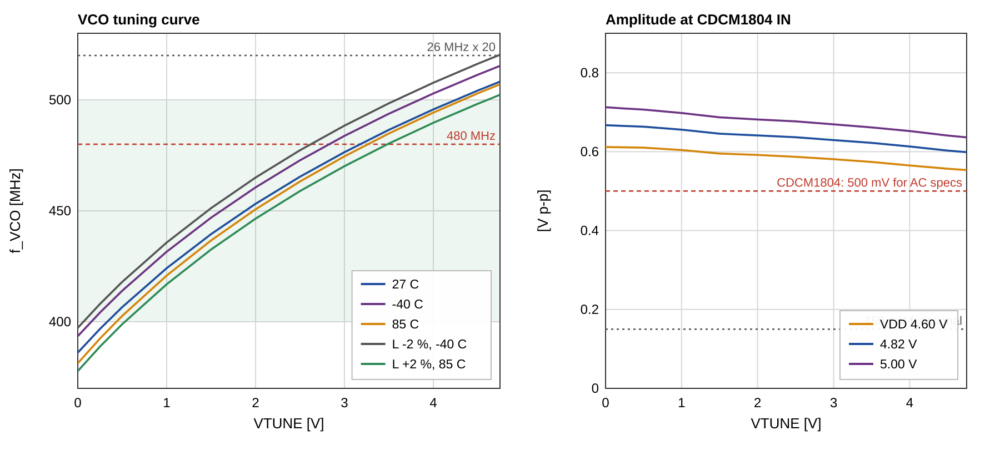
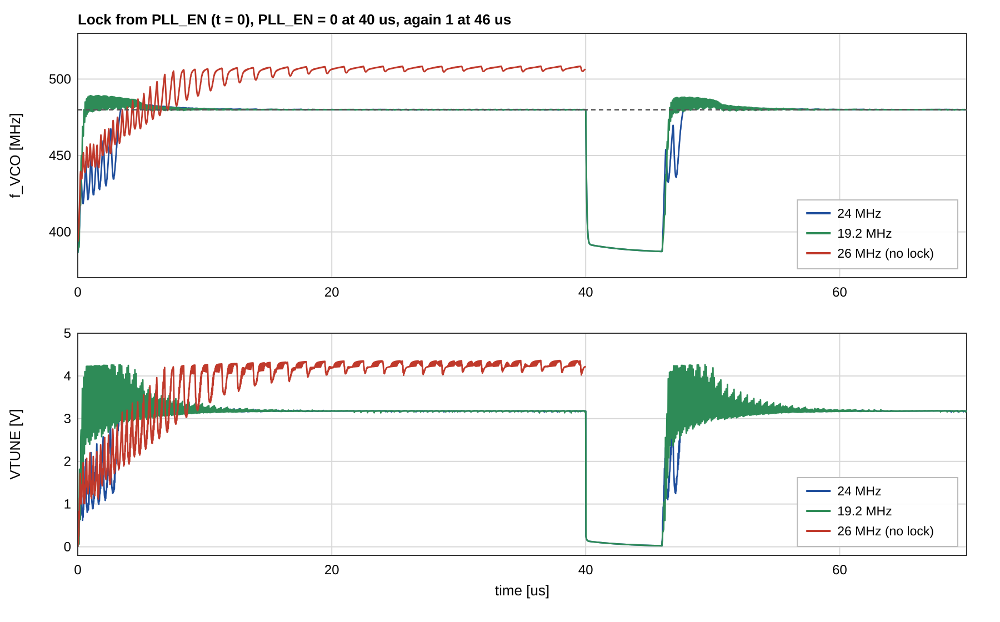
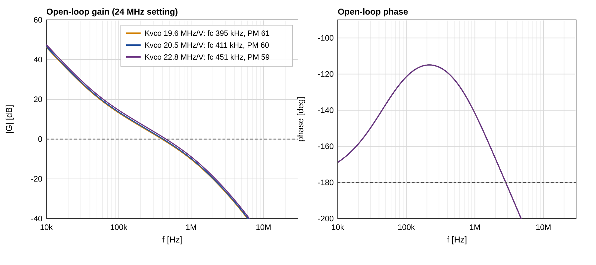

# USB 2.0 discrete PLL board (afe_pll) — design description

Rev 0.1 · AFE/Discrete/PLL · board: 4-layer FMC LPC mezzanine · FPGA side: AMD 7-Series

Schematic symbols and footprints: **JLCEDA/EasyEDA Official Library** — https://lceda.cn/ · https://easyeda.com (copyright JLCEDA/EasyEDA).

## 1 Overview

This board is a discrete-component prototype of the PHY's clock PLL, the lower loop of the PLL-assisted CDR block. It generates the 480 MHz bit clock and the 60 MHz core clock from the reference crystal clock, as the integrated PLL does. The behavioural reference is `AFE/veriloga/afe_pll.va`, with the same pin names and semantics:

| afe_pll.va pin | Board | Function |
|---|---|---|
| `CDR_FREF` | net `CDR_FREF` (test pin J3) | reference: 24 MHz oscillator, 19.2 MHz oscillator or SMA J2 (26 MHz / generator) |
| `PLL_EN` | FPGA register CTRL[0] → `ADF_CE`, `VCO_OFF`, `LF_DIS`, `CDCM_OFF` | 0: VCO stopped, outputs low, PFD / CP off, loop filter discharged |
| `REFSEL1/0` | FPGA register REFSEL → ADF4002 R / N / ICP | feedback division 25 (00) or 20 (01, 10, 11) |
| `CLK_BIT_A` | CDCM1804 Y0 → FMC CLK0_M2C | 480 MHz |
| `CLK60_A` | CDCM1804 Y2 → FMC CLK1_M2C | CLK_BIT_A / 8 |
| `REF_DIG` | 74LVC1G34 at VADJ → FMC LA00_P | buffered reference, independent of PLL_EN |
| `CDR_CH_OUT_PLL` | net `VTUNE`, buffered (MCP6001) to SMA J4 | loop filter node (control voltage) |
| `VDD18A` / `VSS18A` | +5V_A, +3V0, +3V3 / GND | supplies (section 4.6) |

The loop is built from standard parts:

- an ADF4002 phase-frequency detector with a charge pump and the R / N counters;
- a passive loop filter C4 ∥ (R2 + C3), the topology of the model;
- a discrete LC VCO (BFR93A Colpitts, 1SV305 varactor, BFR93A buffer) at 378–516 MHz;
- a CDCM1804 clock divider / LVPECL fan-out: ÷1 for CLK_BIT_A, ÷8 for CLK60_A, and ÷2 (240 MHz) for the ADF4002 RF input, which has a 400 MHz limit.

The digital half is an external AMD 7-Series FPGA board over FMC LPC. The FPGA runs the repo's own `usb_clk_gen` and `usb_pll_lock_det` RTL on CLK_BIT_A and REF_DIG. It sees the board exactly as the PHY core sees the integrated PLL: the same lock judgement, REFSEL decoding and `clk60` / `ld` generation. Around them it adds a test set: a frequency counter, lock-time timers, a CLK60_A phase check, open-loop VCO tuning through a DAC, and VTUNE read-back through an ADC. A PC script drives it over UART.

```
          24 MHz XO ─┐                                     ┌──────────── FMC LPC ─────────────┐
        19.2 MHz XO ─┤74LVC1G157├─┤74LVC1G157├─ CDR_FREF ──┼─ 74LVC1G34 ─ REF_DIG (LA00_P)    │
   SMA J2 (26 MHz) ──────────────┘      │                  │                                   │
                                        ▼ REFIN            │                                   │
                          ┌─────────── ADF4002 ───────────┐│  CE / CLK / DATA / LE (LA01..02)  │
                          │ R ─► PFD ─► CP (1.25/3.125 mA)││◄─ MUXOUT (lock detect, LA00_N)    │
                          │ N ◄─ RFINA (240 MHz, −7 dBm)  ││                                   │
                          └──────────────┬────────────────┘│                                   │
                                         │ VTUNE = CDR_CH_OUT_PLL ─ MCP6001 ─ SMA J4, MCP3201  │
            TS5A23166: LF_DIS ─ 100 Ω ─┤ ├ C4 15 p ∥ (R2 2.2 k + C3 1.5 n)                      │
                       OL_EN ─ MCP4821 ┘ │                                                     │
                                       2.2 k                                                   │
                                         ▼                                                     │
       BFR93A Colpitts, 10 nH ∥ 1.5 p ∥ (16 p + 1SV305) ─ BFR93A buffer ─► CDCM1804 IN          │
       (VCO_OFF: 2N7002 pulls the base bias)       │                         │ mode 40        │
                                                SMA J6                 Y0 ÷1 ─ AC ─ CLK_BIT_A (H4/H5)
                                                                       Y2 ÷8 ─ AC ─ CLK60_A   (G2/G3)
                                                                       Y1 ÷2 ─ att ─► ADF4002 RFINA
                                                                       Y3 ÷8 LVCMOS ─ SMA J7  │
```

The board has no FPGA power or configuration circuitry. It is powered from the carrier's FMC 12P0V, 3P3V, VADJ and 3P3VAUX rails.

## 2 Requirements (from afe_pll.va)

| Item | afe_pll.va | Board target |
|---|---|---|
| Output frequency | N × f_ref, 480 MHz at 24 MHz (÷20) and 19.2 MHz (÷25) | the same; ÷8 for CLK60_A |
| VCO range | f_min 400 MHz … f_max 500 MHz | covers 480 MHz in all corners; 26 MHz × 20 = 520 MHz must stay out of reach |
| Lock time | spec 45 µs to ±0.08 % (afe_interface_spec 4.3) | < 20 µs in all corners |
| PLL_EN = 0 | clocks low, PFD / CP off, filter discharged, restart at f_min | the same (four switched functions) |
| REFSEL | 00 → ÷25, 01 / 10 / 11 → ÷20 | the same through ADF4002 R / N |
| REF_DIG | CDR_FREF, independent of PLL_EN | the same |
| CDR_CH_OUT_PLL | loop filter node | buffered copy on an SMA |
| CLK60_A edges | rise together with CLK_BIT_A rising edges | CDCM1804 LVPECL outputs are edge aligned (output skew 15 ps typ., 30 ps max.); phase checked in the FPGA |
| Loop | fc ≈ 1 MHz, PM 56° | fc ≈ 410 kHz, PM ≈ 60° (section 4.3, 6) |

## 3 Architecture

The model's loop is PFD → charge pump → C4 ∥ (R2 + C3) → VCO → ÷N → PFD, with a ring VCO of 200 MHz/V at 1.8 V. On a board, a VCO of that gain would be hard to build cleanly. The board uses an LC VCO with about 20 MHz/V over a 0–4.5 V tuning range instead, so the charge pump needs a higher supply. This is why the ADF4002 is used: it has a 5 V charge pump (VP up to 5.5 V), a programmable current, and the R and N counters needed for both references. Its RF input has a 400 MHz limit, so it counts the VCO through the CDCM1804's ÷2 output. With R = 1 and N = 10, this gives the model's ÷20 (N_eff = 2 × N).

The CDCM1804 provides all three VCO-derived clocks from one input: ÷1, ÷2 and ÷8 on separate LVPECL outputs, plus an LVCMOS ÷8 monitor. Its outputs are edge aligned, so a CLK60_A rising edge coincides with a CLK_BIT_A rising edge, as in the model.

PLL_EN is a single FPGA register bit, fanned out to four switched functions. Each one reproduces a part of the model's behaviour when PLL_EN is low:

- `ADF_CE` low: ADF4002 power-down, charge pump three-state;
- `VCO_OFF` high: Q5 pulls the oscillator's base bias to ground, so the VCO stops;
- `LF_DIS` high: TS5A23166 switch 1 discharges VTUNE through 100 Ω, so the VCO restarts at f_min;
- `CDCM_OFF` high: Q6 pulls the CDCM1804 EN pin low, so the outputs go high-Z and read low at the FPGA (offset resistors, section 4.5).

## 4 Circuit design and component selection

### 4.1 Reference (sheet 2)

- **Sources.** Y1 is a 24 MHz CMOS oscillator (HSO321S) for REFSEL 01. Y2 is a 19.2 MHz oscillator for REFSEL 00. SMA J2 takes an external reference (26 MHz, or a signal generator): 50 Ω terminated, AC-coupled and biased to VDD/2, 1–3.3 Vpp.
- **Selection.** Two 74LVC1G157 muxes (REFSRC0, REFSRC1) select the reference. The FPGA also disables the unused oscillator (OE24 / OE19), so it cannot couple into the loop.
- **Outputs.** The selected reference is `CDR_FREF`. It drives:
  - the ADF4002 REFIN through 33 Ω and 100 nF (REFIN is self-biased);
  - a 74LVC1G34 at VADJ, which produces `REF_DIG` for the FPGA;
  - test pin J3.

### 4.2 PFD, charge pump and counters (sheet 3)

**ADF4002 supplies.** The ADF4002 runs at AVDD = DVDD = 3.0 V from an LP5907-3.0. Its logic inputs (CE, CLK, DATA, LE; VIH 1.4 V) are driven directly from the FPGA's VADJ (1.8–3.3 V) through 33 Ω. A 100 k pull-down holds CE low, so the PLL stays off while the FPGA is unconfigured.

**Charge-pump supply (VP).** VP comes from a second low-noise LDO, U17 (LP5907-4.5). The charge pump stays linear from 0.5 V to VP − 0.5 V, i.e. up to 4.0 V; above that its current collapses and VTUNE stops at about 4.25 V. That limit is what keeps the model's ÷20 at 26 MHz from locking. In the fastest VCO case (L −2 %, −40 °C) the VCO reaches 520.3 MHz at 4.75 V, and with a 5 V VP the loop locked at 26 MHz × 20 = 520 MHz in simulation (`loop_26_fast` with VP = 5 V). With 4.5 V it stops at 512 MHz, a 1.5 % margin. The slowest VCO case needs 3.48 V for 480 MHz, which is still inside the linear range.

**Charge-pump current.** RSET = 5.1 k gives ICP = 0.625 mA × (CPI + 1). The FPGA programs R, N and CPI per REFSEL, so the loop gain Icp·Kvco / N_eff stays the same for both references:

| REFSEL | f_ref | R | N | f_PFD | N_eff | CPI (ICP) | Note |
|---|---|---|---|---|---|---|---|
| 01 | 24 MHz | 1 | 10 | 24 MHz | 20 | 1 (1.25 mA) | nominal |
| 00 | 19.2 MHz | 2 | 25 | 9.6 MHz | 50 | 4 (3.125 mA) | same loop gain as 01 |
| 10 | 26 MHz | 1 | 10 | 26 MHz | 20 | 1 | model ÷20: 520 MHz, no lock (refsel_err) |
| 10 + REAL26 | 26 MHz | 13 | 120 | 2 MHz | 240 | 7 (5 mA) | test option: real 480 MHz from 26 MHz, narrow loop |
| 11 | 24 MHz | 1 | 10 | 24 MHz | 20 | 1 | model: ÷20 (refsel_err in the digital) |

**Control latches.** The function latch sets:

- positive PFD polarity (VTUNE up = frequency up);
- the 2.9 ns anti-backlash pulse;
- MUXOUT = digital lock detect (selectable: N or R divider output for debugging).

Open-loop mode sets the CP three-state bit F3.

**RF input.** RFINA receives the CDCM1804 Y1 output (240 MHz LVPECL, 150 Ω pull-downs) through 100 pF, a 100 Ω / 51 Ω attenuator and 100 pF. The result is about −7 dBm, inside the ADF4002's −10 to 0 dBm window. RFINB is decoupled with 100 pF.

### 4.3 Loop filter, PLL_EN and open-loop switches (sheet 3)

**Loop filter.** The filter has the model's topology on the CP pin (net `VTUNE` = `CDR_CH_OUT_PLL`):

- C4 = 15 pF shunt (C0G);
- R2 = 2.2 k in series with C3 = 1.5 nF (C0G).

About 12 pF of node capacitance adds to C4: the CP pin, the MCP6001 input, the switch, the pads. The VCO's varactor is fed through R_K = 2.2 k. Together with the ~24 pF at the varactor node, R_K adds a pole at ~3 MHz that also filters the reference spur.

**Dimensioning.** The values came from a grid search on the small-signal model (`sim/tables.py`):

- Kvco = 19.6–22.8 MHz/V over the VCO cases gives fc = 395–451 kHz, PM = 59–61°, GM ≥ 24 dB and closed-loop peaking < 1 dB.
- fc ≈ f_PFD / 58: the sampling effect of the PFD is negligible.

The model's 1 MHz bandwidth is not copied: with the discrete VCO's lower gain and the board's node capacitances, a 1 MHz loop would need a smaller C3. That would let more charge-pump noise and spur through, and the lock time is far inside the spec anyway (section 5).

**Switches (TS5A23166 at +5V_A, 0.9 Ω).**

- Switch 1 (`LF_DIS`) discharges VTUNE through 100 Ω while PLL_EN = 0 (VTUNE < 50 mV in 3.5 µs). The model discharges through 1 k.
- Switch 2 (`OL_EN`) connects the MCP4821 DAC (0–4.095 V, 1 mV/LSB) through 1 k to VTUNE for open-loop tuning-curve measurements. The ADF4002 charge pump is three-stated (F3) at the same time.

**Read-back.** An MCP6001 (1 pA bias, rail-to-rail) buffers VTUNE:

- to SMA J4 through 100 Ω, as `CDR_CH_OUT_PLL` for a CDR board's coarse tuning input (`CDR_V_IN_2`);
- to test pin J5;
- through a 1 k / 1 nF filter to an MCP3201 ADC (12 bit, +5V_A reference).

The buffer keeps the 50 Ω SMA load off the filter node.

### 4.4 VCO (sheet 4)

**Oscillator.** Q3 (BFR93A, fT 5 GHz) is a Colpitts oscillator in common-collector form:

- C1 = C2 = 10 pF feedback divider (base–emitter, emitter–GND);
- RE1 = 270 Ω, about 5.6 mA;
- collector at RF ground through 22 Ω and 100 pF / 10 nF.

**Tank.** The tank couples to the base through C_cpl = 3.3 pF. It consists of:

- L1, 10 nH wire-wound (LQW18AN10NG, 2 %, Q ≈ 50 at 500 MHz);
- C_P = 1.5 pF;
- the 1SV305 varactor (18.3 pF at 1 V, 6.1 pF at 4 V) in series with C_S = 16 pF.

C_S limits the varactor's share of the tank capacitance, and so the tuning range and Kvco, to about 20 MHz/V over the CP's 0.5–4.0 V linear range.

**Buffer and outputs.** Q4 (BFR93A) is a common-emitter buffer, coupled from the emitter of Q3 through 1.5 pF, with a 220 Ω load. It isolates the tank from the CDCM1804 input. It drives:

- the CDCM1804 IN through 100 pF. IN is biased to VBB through 2 k; IN# is tied to VBB, with VBB decoupled by 10 nF.
- the monitor SMA J6 through 470 Ω (about −20 dB into 50 Ω).

**VCO_OFF.** Q5 (2N7002) shorts the RB1a / RB1b junction to ground, so the base bias collapses and the oscillation stops in < 50 ns. When Q5 releases, the oscillation restarts within 0.3 µs.

**Supply.** +5V_VCO comes from +5V_A through 10 Ω and 10 µF / 100 nF / 100 pF, about 4.82 V at 18 mA.

### 4.5 CDCM1804 and outputs (sheet 4)

**Mode.** The CDCM1804 runs in mode 40: EN = S2 = S1 = VDD/2 (60.4 k pull-downs against the internal pull-ups), S0 = 0. This gives:

| Output | Division | Use |
|---|---|---|
| Y0 | ÷1 | CLK_BIT_A, 480 MHz |
| Y1 | ÷2 | ADF4002 RFINA, 240 MHz |
| Y2 | ÷8 | CLK60_A, 60 MHz |
| Y3 | ÷8, LVCMOS | monitor SMA J7 |

`CDCM_OFF` pulls EN low (Q6), which puts the outputs in high-Z.

**FPGA outputs.**

- **Termination.** The LVPECL outputs have 150 Ω emitter pull-downs.
- **Coupling.** Y0 and Y2 are AC-coupled (100 nF) to the FMC clock inputs CLK0_M2C (H4/H5) and CLK1_M2C (G2/G3).
- **Bias.** On the FPGA side each line is biased with 4.7 k to VBIAS = 1.245 V (16.5 k / 10 k from +3V3). The FPGA's 100 Ω DIFF_TERM terminates the pair.
- **Stopped clocks.** A 220 k pull-up on the N line makes a stopped clock read as a defined 0 (about +20 mV differential), as the model's outputs are low when PLL_EN = 0.

### 4.6 Power, level translation and FMC housekeeping (sheet 1)

| Rail | Source | Loads | Load current (est.) |
|---|---|---|---|
| +5V_A (5.02 V) | FMC 12P0V → ferrite → TPS7A4901 (15 µVrms) | VCO, U17 (VP), U3 (+3V0), MCP6001, MCP4821, MCP3201, TS5A23166, 8T245 #1 B side | 35 mA |
| VP (4.5 V) | +5V_A → LP5907-4.5 | ADF4002 charge pump | 2 mA |
| +3V0 | +5V_A → LP5907-3.0 | ADF4002 AVDD / DVDD | 6 mA |
| +3V3 | FMC 3P3V → ferrite | CDCM1804 (with LVPECL terminations), oscillators, muxes, 8T245 #2 B side | 150 mA |
| VADJ | FMC | 74LVC1G34, translator A sides | < 10 mA |
| 3P3VAUX | FMC | AT24C02 FRU EEPROM | < 1 mA |

**Level translation.** Three groups of translators connect the board to the FPGA's VADJ bank:

- **U4 (SN74LVC8T245, VADJ → +5V_A):** VCO_OFF, LF_DIS, OL_EN, CDCM_OFF, DAC_CS_N, ADC_CS_N, SPI_SCK, SPI_SDI.
- **U5 (VADJ → +3V3):** REFSRC0, REFSRC1, OE24, OE19.
- **SN74LVC1T45 pair (back to VADJ):** MUXOUT (from 3.0 V) and the ADC's DOUT (from 5 V).

**Power-up defaults.** 100 k pulls on the 5 V side hold the safe state while VADJ is down or the FPGA is unconfigured:

- VCO off;
- filter discharged;
- CDCM1804 outputs off;
- DAC disconnected;
- CS# lines high.

The 8T245 outputs are high-Z with VCCA = 0.

**FMC housekeeping.** PRSNT_M2C_L (H2) is tied to GND. TDI (D30) is connected to TDO (D31). The FRU EEPROM sits on the IPMI I²C bus (C30/C31) with GA0/GA1 as its address.

### 4.7 FMC LPC pin map

| FMC signal | Pin | Board signal | Dir. (board) | FMC signal | Pin | Board signal | Dir. |
|---|---|---|---|---|---|---|---|
| CLK0_M2C_P/N | H4/H5 | CLK_BIT_A | out | LA05_P | D11 | DAC_CS_N | in |
| CLK1_M2C_P/N | G2/G3 | CLK60_A | out | LA05_N | D12 | ADC_CS_N | in |
| LA00_P_CC | G6 | REF_DIG | out | LA06_P | C10 | SPI_SCK | in |
| LA00_N_CC | G7 | MUXOUT | out | LA06_N | C11 | SPI_SDI | in |
| LA01_P_CC | D8 | ADF_CLK | in | LA07_P | H13 | ADC_SDO | out |
| LA01_N_CC | D9 | ADF_DATA | in | LA07_N | H14 | REFSRC0 | in |
| LA02_P | H7 | ADF_LE | in | LA08_P | G12 | REFSRC1 | in |
| LA02_N | H8 | ADF_CE | in | LA08_N | G13 | OE24 | in |
| LA03_P | G9 | VCO_OFF | in | LA09_P | D14 | OE19 | in |
| LA03_N | G10 | LF_DIS | in | 12P0V | C35, C37 | +12V_F | — |
| LA04_P | H10 | OL_EN | in | 3P3V | C39, D36, D38, D40 | +3V3 | — |
| LA04_N | H11 | CDCM_OFF | in | VADJ | G39, H40 | VADJ | — |

REF_DIG is on a clock-capable pin (LA00_P_CC), so the FPGA can route it to a BUFG.

## 5 Simulation results

Simulations: ngspice 42 with XSPICE (`sim/run_sims.py`). Result tables: `sim/tables.py` → `sim/results/tables.md`.

### 5.1 Testbenches

- **VCO** (`vco_*`): transistor level, with the Siemens Gummel-Poon card of the BFR93A plus package parasitics, the 1SV305 fitted to its datasheet C–V curve, and the LQW18AN10NG with its series resistance and self-capacitance (`sim/models/pll_models.lib`). VTUNE is stepped from 0 to 4.75 V. The script measures the frequency and the amplitude at the CDCM1804 input after start-up. Corners: −40 / 27 / 85 °C, VDD 4.60 / 4.82 / 5.00 V, L ±2 % at the temperature extremes.
- **Loop** (`loop_*`): mixed-mode.
  - The PFD is two XSPICE D flip-flops with the AND reset after the 2.9 ns anti-backlash delay.
  - The charge pump has the ADF4002 compliance (tanh roll-off at 0.25 V and VP − 0.25 V) and a 2 % sink/source mismatch.
  - The filter is the board's, with the node capacitances.
  - The VCO is a phase integrator driven by the simulated tuning curve of the case, and ÷N_eff feeds the PFD.
  - Sequence: PLL_EN = 1 at t = 0 with VTUNE = 0, PLL_EN = 0 at 40 µs (filter discharged through 100 Ω), PLL_EN = 1 again at 46 µs.

### 5.2 VCO



| Case | f(0 V) MHz | f(4.5 V) MHz | V at 480 MHz | Kvco MHz/V | Vpp at CDCM IN |
|---|---|---|---|---|---|
| 27 °C, 4.82 V | 386.1 | 504.2 | 3.18 | 20.4 | 0.60–0.67 |
| −40 °C | 393.5 | 511.3 | 2.83 | 21.7 | 0.58–0.67 |
| 85 °C | 381.3 | 502.9 | 3.26 | 20.6 | 0.61–0.67 |
| VDD 4.60 / 5.00 V | 386.2 / 386.0 | 504.3 / 504.1 | 3.17 / 3.18 | 20.4 | 0.55–0.71 |
| L −2 %, −40 °C | 397.3 | 516.3 | 2.62 | 22.8 | 0.57–0.66 |
| L +2 %, 85 °C | 377.8 | 498.2 | 3.48 | 19.6 | 0.62–0.68 |

480 MHz is reached between 2.62 V and 3.48 V in all cases. That is inside the charge pump's linear range (0.5–4.0 V with VP = 4.5 V) with ≥ 0.5 V margin at both ends. The amplitude at the CDCM1804 input (IN against IN# = VBB) is 0.55–0.71 Vpp. The CDCM1804 needs 500 mV for its AC specifications (150 mV to function), so the worst case (VDD 4.60 V, top of the tuning range) has a 10 % margin. If the board shows less, RC2 (R36, 220 Ω) can be raised to 270 Ω. The VCO starts in 0.30 µs after VCO_OFF is released and stops within 48 ns.

### 5.3 Loop





| Case | t_lock (µs) | t_relock (µs) | VTUNE (V) | f error (ppm) | Overshoot (MHz) | Ref. spur (dBc) | Discharge to 50 mV (µs) |
|---|---|---|---|---|---|---|---|
| 24 MHz, 27 °C | 12.8 | 11.1 | 3.18 | 16 | 486.7 | −89 | 3.5 |
| 24 MHz, −40 °C | 12.1 | 11.8 | 2.83 | −6 | 486.6 | −91 | 3.1 |
| 24 MHz, 85 °C | 13.3 | 12.9 | 3.27 | 3 | 486.3 | −86 | 3.6 |
| 24 MHz, slowest VCO | 14.9 | 12.2 | 3.48 | −10 | 486.3 | −93 | 3.8 |
| 19.2 MHz, 27 °C | 11.9 | 11.5 | 3.18 | 2 | 489.3 | −79 | 3.5 |

- **Lock time.** The time to ±0.08 % is 12–15 µs, against the spec's 45 µs. A relock after a 6 µs PLL_EN = 0 pulse takes about the same, because the filter is discharged and the VCO restarts at f_min, as in the model.
- **Static error.** The residual frequency error is the averaging error of the transient (a few ppm). The loop has no static error.
- **Reference spurs.** The spurs come from the 2 % charge-pump mismatch. They are −79 to −93 dBc, i.e. < 0.1 ps periodic jitter.
- **26 MHz, REFSEL 10 (÷20, target 520 MHz).** There is no lock in either VCO case. VTUNE stops at the charge-pump limit (4.25 V) and the VCO stays at 507 MHz (−40 °C) or 512 MHz (fastest case: L −2 %, −40 °C). The digital `usb_pll_lock_det` reports refsel_err and no lock, as with the model.
- **Phase noise.** The in-band phase noise from the ADF4002 floor (PNSYNTH −222 dBc/Hz) is about −122 dBc/Hz at 480 MHz with the 24 MHz reference (−118 dBc/Hz at 19.2 MHz with a 9.6 MHz PFD). Outside the 400 kHz loop bandwidth the LC VCO dominates. It is not simulated; it is measured at J6 (section 10).

### 5.4 FPGA design

`fpga/sim/run_sim.sh` (Icarus) simulates the FPGA top with a behavioural board model. The model includes:

- the ADF4002 shift register and its decoding;
- a VCO following the simulated curve, with a 2 µs settling time constant;
- the CDCM1804 dividers;
- the oscillators and muxes;
- the DAC and ADC.

The testbench checks:

- the three ADF4002 words after reset and for every REFSEL;
- lock at 24 and 19.2 MHz through the repo's `usb_pll_lock_det`, with T_LOCK, T_DLD and FCNT;
- PLL_EN = 0: outputs off, no false loss-of-lock;
- the CLK60_A phase register against `usb_clk_gen`'s own phase over two relocks;
- 26 MHz / ÷20: no lock, refsel_err;
- REAL26 words;
- open loop: the DAC frame, CP three-state and FCNT at the DAC voltage.

Result: `TEST PASSED`. `fpga/synth_check.ys` (Yosys, xc7) synthesizes the design without problems: about 410 LUTs, 640 flip-flops, 5 BUFG, 1 MMCM.

## 6 Deviations from afe_pll.va

| Item | afe_pll.va | Board | Consequence |
|---|---|---|---|
| Logic levels | 1.8 V CMOS (VDD18A) | VADJ (1.8–3.3 V) at the FMC; 3.0 / 3.3 / 5 V on board | none for the digital side |
| VCO | ring, 200 MHz/V, 400–500 MHz, hard limits | LC, ~20 MHz/V, 378–516 MHz over corners, VTUNE limited to ~4.25 V by VP | CDR_CH_OUT_PLL is 0–4.5 V, not 0–1.8 V; a CDR board must scale it |
| Loop | icp 20 µA, R2 34.5 k, C3 15.3 p, C4 1.53 p; fc ≈ 1 MHz, PM 56° | icp 1.25 / 3.125 mA, R2 2.2 k, C3 1.5 n, C4 15 p; fc ≈ 410 kHz, PM 60° | lock 12–15 µs instead of a few µs; still < 45 µs |
| Feedback divider | ÷N on CLK_BIT_A | ÷2 (CDCM1804 Y1) and N = N_eff / 2 in the ADF4002 | equivalent |
| REFSEL 10 | ÷20, no lock (f_max 500 MHz) | ÷20, no lock (charge-pump limit, VCO ≤ 512 MHz); optional REAL26 = R 13 / N 120 | REAL26 is a board-only test mode |
| CLK60_A phase | first CLK_BIT_A edge after PLL_EN is a CLK60_A rising edge | edges aligned (CDCM1804); which of the 8 CLK_BIT_A edges is the ÷8 edge after a restart is not defined by the CDCM1804 | FPGA PHASE register shows the position against `usb_clk_gen`; the PHY must not rely on the restart phase |
| PLL_EN = 0 | clocks low at once | VCO stops in < 50 ns, outputs high-Z → read 0 (offset pull-ups) | — |
| Discharge | r_dis 1 k | 100 Ω + 0.9 Ω | faster |
| Supply-good | VDD18A < vdd_min → off | not modelled; FMC rails | — |
| Fault injection | f_err, jit_rms parameters | open-loop mode with the DAC (any frequency error), external reference on J2 (any frequency, jittered) | — |

## 7 FPGA design (fpga/)

| File | Content |
|---|---|
| `rtl/pll_fpga_top.v` | MMCM (60 MHz system clock), IBUFDS / BUFG for CLK_BIT_A, CLK60_A and REF_DIG, the repo's `usb_clk_gen` and `usb_pll_lock_det`, PLL_EN fan-out registers |
| `rtl/pll_ctrl.v` | UART registers, ADF4002 3-wire programmer, MCP4821 / MCP3201 SPI |
| `rtl/pll_meas.v` | FCNT, lock timers, CLK60_A phase check |
| `sim/` | Icarus testbench with the board model (`run_sim.sh`), primitive models |
| `constraints/pll_board_fmc.xdc` | FMC pin map template, clocks, 60↔480 multicycles, CDC groups |
| `build_vivado.tcl` | non-project build: `vivado -mode batch -source build_vivado.tcl -tclargs <part> …` |
| `synth_check.ys` | Yosys xc7 smoke synthesis (no Vivado needed) |

- **Clocking.**
  - CLK_BIT_A drives `usb_clk_gen` (clk60 / ld) and the 480 MHz islands of `usb_pll_lock_det` and `pll_meas` on a BUFG. That needs Artix-7 −2 / −3 or Kintex-7: the BUFG Fmax of the −1 grade is below 480 MHz.
  - REF_DIG clocks the lock detector's window, as `ref_clk` does in the PHY.
  - The XDC repeats the PHY SDC's 60↔480 boundary multicycles (4 / 3).
- **Lock detection.** `usb_pll_lock_det` is the PHY's own lock detector. pll_lock, lol and refsel_err therefore mean exactly what they mean in the PHY. LOL_CLR re-arms lol.
- **FCNT.** FCNT counts CLK60_A cycles over 2^14 REF_DIG cycles, so f_bit = 8 · FCNT · f_ref / 16384, with 24 ppm resolution at 24 MHz.
- **Lock timers.** T_LOCK and T_DLD measure the µs from the PLL_EN rising edge to `pll_lock` and to the ADF4002 MUXOUT digital lock detect.
- **PHASE.** CLK60_A is sampled as data on every clk_bit edge (2 FF), shifted into 8 bits, captured on `ld` (the 60↔480 boundary rule), and judged in the clk60 domain. A valid word is a rotation of 11110000. PHASE[2:0] is the `usb_clk_gen` phase (0 = E0) at which CLK60_A rises; the testbench checks it against `phase_j` directly. PH_ERR counts invalid words: glitches, or a wrong ÷8.

## 8 Register map and UART protocol

UART 8N1, 921600 Bd (carrier USB-UART). Write: `57h addr data`. Read: `52h addr` → `data`. Multi-byte values: read the low byte first; the higher bytes are latched with it.

| Addr | Name | Access | Content |
|---|---|---|---|
| 00h | ID | RO | 50h ('P') |
| 01h | CTRL | RW | [0] PLL_EN, [1] OPEN_LOOP, [3:2] REFSRC (0 24 MHz, 1 19.2 MHz, 2/3 SMA J2), [4] LED, [5] LOL_CLR (W1); reset 01h |
| 02h | REFSEL | RW | [1:0] REFSEL1/0, [7] REAL26; a write loads R / N / CPI (section 4.2) and programs the ADF4002; reset 01h |
| 03h | MUXSEL | RW | ADF4002 MUXOUT: 1 digital lock detect (reset), 2 N output, 4 R output |
| 04h/05h | R_DIV | RW | [13:0] |
| 06h/07h | N_DIV | RW | [12:0] |
| 08h | CPI | RW | [2:0], ICP = 0.625 mA × (CPI + 1) |
| 09h | PROG | W | program the ADF4002 with R_DIV / N_DIV / CPI / MUXSEL / OPEN_LOOP |
| 0Ah/0Bh | DAC | RW | [11:0] open-loop VTUNE in mV; sent with the high byte; reset 3150 (≈ 480 MHz) |
| 0Ch | STATUS | RO | [0] MMCM locked, [1] pll_lock, [2] lol, [3] refsel_err, [4] MUXOUT, [5] ADF busy, [6] PHASE valid, [7] CLK_BIT_A alive |
| 0Dh/0Eh | ADC | RO | [11:0] VTUNE = code × 5.02 V / 4096 |
| 0Fh–11h | FCNT | RO | [23:0] |
| 12h/13h | T_LOCK | RO | µs, 65535 = not locked |
| 14h/15h | T_DLD | RO | µs, 65535 = not seen |
| 16h | PHASE | RO | [2:0] usb_clk_gen phase of the CLK60_A rising edge, [7] valid |
| 17h | PH_ERR | RO | invalid phase words (saturating) |
| 18h | FB_DIV | RO | usb_pll_lock_det fb_div |

`host/pll_host.py` (pyserial) implements the commands `status`, `set`, `lock` (repeated PLL_EN cycles with lock-time statistics), `sweep` (open-loop tuning curve f(VTUNE) with Kvco at 480 MHz) and `lolclr`.

## 9 PCB guidelines

- **Stack-up.** 4 layers: signal / GND / power / signal. Solid GND under the VCO, the loop filter and the CDCM1804.
- **VCO.**
  - Keep the tank (L1, C_P, C_S, D1, C_cpl) compact on the top layer.
  - No GND plane directly under L1 (a keep-out on layer 2 keeps Q up).
  - Separate the VCO from the CDCM1804 outputs by at least 10 mm, and from the oscillators.
- **Loop filter.** Place C34, R21 and C35 next to the ADF4002 CP pin. Keep VTUNE short and guarded by GND; it is a high-impedance node (1 pA buffer).
- **Clock routing.**
  - 50 Ω single-ended / 100 Ω differential for the LVPECL outputs.
  - Length-match CLK_BIT_A P/N and CLK60_A P/N to 0.5 mm.
  - Put the AC-coupling caps and bias resistors near the FMC connector.
- **RF divider path.** The Y1 → RFINA attenuator sits next to the ADF4002.
- **Supplies.** Local 100 nF at every supply pin. The +5V_VCO filter sits at the VCO. Keep VP (U17) separate from +5V_A.

## 10 Bring-up and test procedure

1. **Power.** Without the FPGA configured, check the rails: +5V_A 5.02 V, VP 4.5 V, +3V0, +3V3. CE is low and VTUNE ≈ 0 V. The CDCM1804 outputs are off.
2. **FPGA.** Load the bitstream and run `pll_host.py PORT status`. Expect ID 50h and MMCM locked. PLL_EN is 1 after reset, so CLK_BIT_A alive and pll_lock follow within about 100 µs.
3. **VCO tuning curve.**
   - Run `pll_host.py PORT sweep -o vco.csv`.
   - Expect 480 MHz at 2.6–3.5 V and Kvco ≈ 20 MHz/V.
   - Also watch J6 with a spectrum analyser: a single clean carrier, no spurious oscillation.
   - If 480 MHz falls outside 2.5–3.6 V, adjust C_P (C50): ±0.3 pF moves the curve by about ∓0.33 V.
4. **Closed loop.**
   - `set --refsel 1 --pll-en 1`: STATUS pll_lock = 1, FCNT = 40960 ± 1, VTUNE (ADC) ≈ 3.2 V.
   - Check J7 (60 MHz) with a counter.
   - Run `lock -n 50`: T_LOCK 50–100 µs (FPGA testbench: 62–65 µs). This includes the evaluation windows of `usb_pll_lock_det` on top of the analog lock (simulated 12–15 µs). T_DLD (ADF4002 lock detect) is closer to the analog lock time.
5. **19.2 MHz.** `set --refsrc 1 --refsel 0`: lock, FCNT 51200 (2^14 × 480 / 8 / 19.2).
6. **26 MHz.** Feed 26 MHz at 1 Vpp into J2, then `set --refsrc 2 --refsel 2`: no lock, refsel_err = 1, VCO ≈ 505–512 MHz. With `--real26`: lock at 480 MHz.
7. **Phase noise and spurs.** Measure at J6 (VCO) and J7. Expect reference spurs < −75 dBc at ±24 MHz and an in-band floor near −120 dBc/Hz at 100 kHz offset (480 MHz).
8. **PHASE.** Run several PLL_EN cycles: PHASE valid, PH_ERR = 0. Record how PHASE is distributed over the restarts (section 6).

## 11 Bill of materials

162 placed parts, 63 BOM lines: `bom/pll_board_bom.csv` (designators, values, MPN, LCSC) and `bom/pll_board_bom_jlcpcb.csv` (JLCPCB assembly format). Main ICs:

| Ref | Part | LCSC | Function |
|---|---|---|---|
| U11 | ADF4002BCPZ | C578975 | PFD, charge pump, R / N counters |
| U16 | CDCM1804RGER | C914121 | ÷1 / ÷2 / ÷8 LVPECL fan-out |
| Q3, Q4 | BFR93A | C513260 | VCO oscillator, buffer |
| D1 | 1SV305 | C2762669 | varactor |
| L1 | LQW18AN10NG00D | C86131 | 10 nH tank inductor |
| U2 | TPS7A4901 | C16430 | 12 V → 5.02 V |
| U3, U17 | LP5907-3.0 / -4.5 | C475492 / C529554 | ADF4002 supply, VP |
| U12 | TS5A23166 | C49148 | LF_DIS / OL_EN switches |
| U13 | MCP4821 | C36865 | open-loop DAC |
| U14 | MCP6001 | C116490 | VTUNE buffer |
| U15 | MCP3201 | C511293 | VTUNE ADC |
| Y1, Y2 | 24 MHz, 19.2 MHz XO | C160455, C2831371 | references |
| U8, U9 | 74LVC1G157 | C135822 | reference muxes |
| U4, U5 / U6, U7 | SN74LVC8T245 / SN74LVC1T45 | C27643 / C7843 | level translation |
| J1 | Samtec ASP-134604-01 | — | FMC LPC (order separately) |

All capacitors in the VCO tank and the loop filter are C0G. Resistors are 0603 1 % (UNI-ROYAL).

## 12 Files and how to regenerate

| Path | Content | Section |
|---|---|---|
| `easyeda/pll_parts.py` | parts and nets (single source) | 4 |
| `easyeda/gen_schematic.py` | EasyEDA Std schematic (`usb_pll_board_sch.json`), `netlist.csv`, BOMs | 4, 11 |
| `sim/run_sims.py`, `sim/models/pll_models.lib` | ngspice VCO and loop simulations | 5 |
| `sim/tables.py` | result tables, small-signal loop analysis | 5 |
| `fpga/` | FPGA design, testbench, constraints | 7 |
| `host/pll_host.py` | PC tool | 8, 10 |
| `doc/gen_figures.py`, `doc/md2docx.js` | figures, Word version of this document | — |

```sh
cd easyeda && python3 gen_schematic.py
cd sim && JOBS=3 python3 run_sims.py && python3 tables.py      # about 30 min on 3 cores
cd fpga/sim && ./run_sim.sh                                     # TEST PASSED (~15 min)
cd fpga && yosys -q -s synth_check.ys
cd doc && python3 gen_figures.py && NODE_PATH=<npm dir>/node_modules node md2docx.js
```

## 13 Open points

- **VCO phase noise** is not simulated (no noise models of the BFR93A and the varactor). Measure it on the first board; if the out-of-band noise is too high, a higher-Q inductor (0805 air-core) is the first step.
- **VCO models.** The 1SV305 C–V fit and the LQW18 model come from datasheet curves. The tuning-curve centre may move by a few 100 mV on the real board; C_P is the trim (section 10).
- **CDCM1804 restart phase.** After CDCM_OFF the ÷8 output may restart on any of the 8 CLK_BIT_A edges. The FPGA measures this (PHASE), and the PHY RTL does not depend on it. Whether the integrated PLL guarantees the model's "first edge" behaviour is a question for the analog design.
- **CDR_CH_OUT_PLL range** (0–4.5 V instead of 0–1.8 V): a CDR test board needs a matching VCO or a divider.
- **FMC J1** is not stocked at LCSC (Samtec, order separately), as on the sibling boards.
- **PCB layout** is not done: the schematic places each part with net labels; place and route in EasyEDA.
