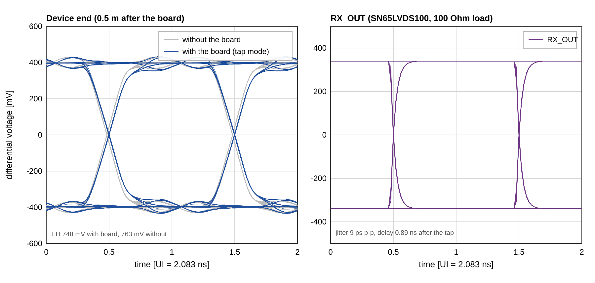
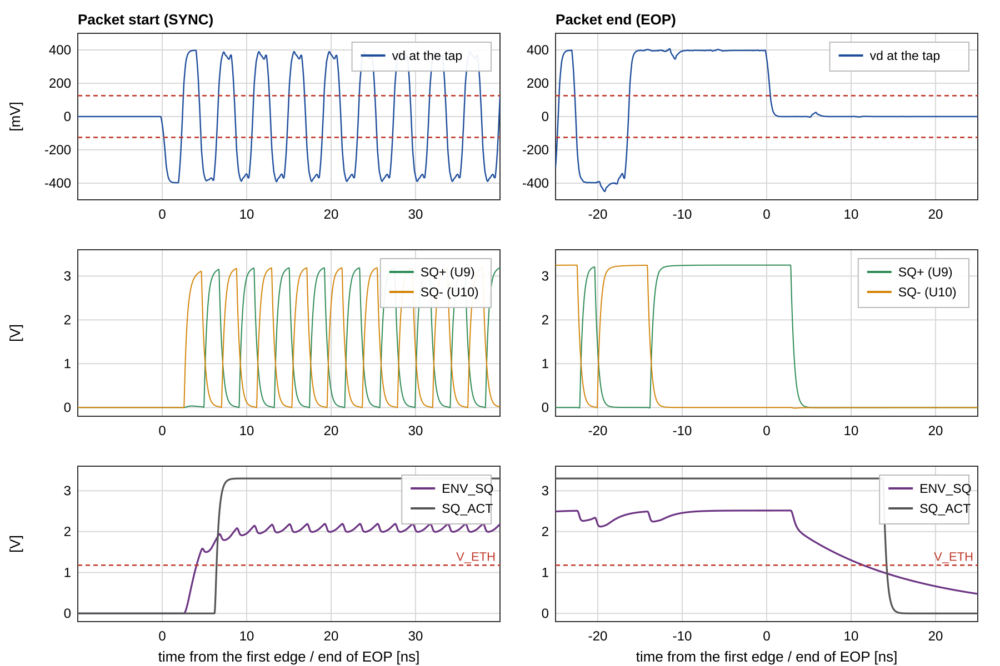
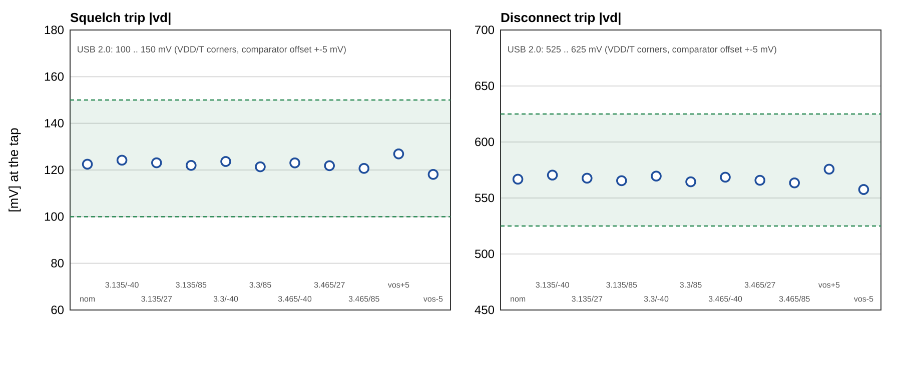

# USB 2.0 discrete receiver board (afe_receiver) — design description

Rev 0.1 · AFE/Discrete/Receiver · board: 4-layer FMC LPC mezzanine · FPGA side: AMD 7-Series

Schematic symbols and footprints: **JLCEDA/EasyEDA Official Library** — https://lceda.cn/ · https://easyeda.com (copyright JLCEDA/EasyEDA).

## 1 Overview

This board is a discrete-component prototype of the receive half of the PHY's analog front end. It covers:

- the HS receiver (`afe_hs_rx`): a differential Schmitt trigger that turns the 400 mV HS line into a logic signal (`RX_OUT`);
- the squelch detector (`afe_squelch`): `SQUELCH_A` = 1 while the differential line amplitude is below the squelch threshold (USB 2.0: squelch below 100 mV, active above 150 mV);
- the HS disconnect detector (`afe_squelch`): `DISC_A` = 1 while the amplitude exceeds the disconnect threshold (525–625 mV, used by a host during the EOP).

The behavioural reference is `AFE/veriloga/afe_receiver.va`, with the same pin names and semantics: `RX_IN_P/N`, `RX_EN`, `RX_OUT_P/N`, `SQUELCH_A`, `DISC_A`. When `RX_EN` = 0 the outputs take the isolated values of the model (`SQUELCH_A` = 1, `DISC_A` = 0). The documentation is structured like the transmitter board (`../Transmitter/doc/tx_board.md`).

The board sits **in the line** between a host and a device: USB-B (to the host) and USB-A (to the device) are connected straight through. Two emitter followers tap D+ and D− with little loading, so the board observes a real link without being part of it (tap mode). With the on-board 45 Ω termination switched in and no device, it acts as the far end itself (term mode), for example for the transmitter board.

The digital half is an external AMD 7-Series FPGA board over FMC LPC. The FPGA is a logic-analyser-style test set: it oversamples `RX_OUT` at 1.92 GS/s and `SQUELCH_A` / `DISC_A` at 960 MS/s into a triggered capture buffer, sets the thresholds through a DAC, and counts squelch and disconnect events. A PC script recovers the clock and data from a capture and decodes the packets (NRZI, unstuffing, PID, CRC) together with the squelch timing. No CDR runs in the FPGA, so the board can be checked without the PHY RTL.

The board has no FPGA power or configuration circuitry. It is powered from the carrier's FMC 3P3V and VADJ rails.

```
 host ── USB-B J2 ─┬───────────────────────────── through line D+/D− ─────────────┬─ USB-A J3 ── device
                   │ USBLC6 ESD           FSUSB42: HS_TERM_EN → 40.2 Ω + Ron = 45 Ω│
                   │                                                               │
                   └─ 22 Ω ─ BFT92 emitter followers (220 Ω to +3V3A) ─ EP / EM
                                    │
          ┌─────────────────────────┼────────────────────────────────────────────┐
          ▼                         ▼                                            ▼
  SN65LVDS100 ─ LVDS ─► RX_OUT   4 × TLV3603 window comparators              FMC LPC
  (25 mV hysteresis)  (LA02)     SQ ±0.1·V_SQ, DC ±0.5·V_DISC (offset networks)
                                    │ BAS70-05 diode-OR, R_att / C_env / R_dec
                                    ▼
                                 2 × TLV3603 envelope comparators (V_ETH, 30 mV hyst.)
                                    │ SQ_ACT, DC_ACT
                                    ▼
                         74LVC1G00 / 1G08 at VADJ, gated by RX_EN ─► SQUELCH_A, DISC_A
                         MCP4822 (SPI) ─► V_SQ, V_DISC          8T245 ◄─ HS_TERM_EN, DAC SPI
```

## 2 Requirements (from afe_receiver.va and the USB 2.0 specification)

| Item | Model / spec | Board implementation |
|---|---|---|
| HS receiver | Schmitt trigger, `v_hys` 20 mV, `t_dly` 0.3 ns, `RX_OUT_P` = 1 for J (D+ > D−) | SN65LVDS100 behind the followers: 25 mV hysteresis, LVDS output; 0.9 ns delay after the tap, 9 ps p-p jitter (simulated) |
| Line loading | (ideal: none) | Two BFT92 followers with 22 Ω base stoppers: the device-end eye loses 2 % (section 5) |
| Squelch | `v_sq` 125 mV (spec: squelch < 100 mV, active > 150 mV), `t_sq_on` 4 ns, `t_sq_off` 12 ns, bridge of 1 ns dips | Window comparators at ±0.1·V_SQ, diode-OR envelope, envelope comparator. Trip 118–127 mV over corners and ±5 mV comparator offset. t_on / t_off see section 5 |
| Disconnect | `v_disc` 575 mV (spec 525–625 mV), `t_disc` 4 ns, immediate fall | Window comparators at ±0.5·V_DISC, faster envelope. Trip 558–576 mV over corners and ±5 mV comparator offset |
| Enable | `RX_EN` = 0: `SQUELCH_A` = 1, `DISC_A` = 0, `RX_OUT_P` = 0 | `SQUELCH_A` = NAND(SQ_ACT, RX_EN), `DISC_A` = AND(DC_ACT, RX_EN); `RX_OUT` is not gated (deviation D2) |
| Supplies | `RX_VDD` 3.3 V, outputs at `RX_VDDO` | +3V3A for the analog part; outputs at VADJ (1.8 / 2.5 V), the FPGA bank voltage |
| Thresholds | fixed parameters | MCP4822 DAC, 1 mV / LSB: V_SQ and V_DISC set from the FPGA (calibration per board) |
| Digital side | `usb_afe_rx_if` (CDR, squelch synchronizer) | FPGA capture at 1.92 GS/s + PC decoder (section 7) |

## 3 Architecture

Supplies (sheet 1):

- FMC 3P3V → ferrite bead FB1 → **+3V3**: level translator, termination switch.
- FMC 3P3V → FB2 → **+3V3A**: followers, HS receiver, comparators, DAC. Kept away from the logic.
- **VADJ** (1.8 or 2.5 V) supplies the output gates and the FPGA side of the translators.
- 3P3VAUX supplies the IPMI EEPROM only.

Signal paths:

- **Line and taps (sheet 2).** D+/D− run straight from J2 (USB-B, host side) to J3 (USB-A, device side), with a USBLC6-2SC6 at the connectors. An FSUSB42 switch connects its port 2 (40.2 Ω to GND per line, 45 Ω with the switch's 4.5 Ω on-resistance) when HS_TERM_EN = 1. Each line drives the base of a BFT92 PNP follower through 22 Ω. The emitters EP / EM are ≈ 0.75 V above the line, low-impedance copies of D+ / D−.
- **HS receiver (sheet 2).** EP / EM feed an SN65LVDS100 (input range 0–4 V, so the shifted common mode is fine). Its LVDS output goes straight to the FPGA as `RX_OUT` (100 Ω termination in the FPGA).
- **Squelch and disconnect (sheet 3).** Four comparators compare the two polarities of the differential voltage with a threshold derived from V_SQ / V_DISC through resistive offset networks. For each detector a diode-OR (BAS70-05) charges an envelope capacitor while either polarity exceeds the threshold. An envelope comparator turns the envelope into SQ_ACT / DC_ACT.
- **Outputs (sheet 1).** 74LVC1G00 / 1G08 at VADJ gate SQ_ACT / DC_ACT with RX_EN and drive `SQUELCH_A` / `DISC_A` through 33 Ω.
- **Thresholds (sheet 4).** MCP4822 dual 12-bit DAC with internal 2.048 V reference, gain 2: 1 mV per LSB, filtered by 100 Ω / 100 nF.

## 4 Circuit design and component selection

### 4.1 Line taps

The HS line is 45 Ω per wire, terminated at both ends. Anything connected to it must look like a small capacitance only, at the board's tap point within a few millimetres of the line. A direct connection of a comparator array (6 inputs at ~1 pF each plus routing) would cost more eye margin and couple comparator kickback into the line. So the line drives one emitter follower per wire:

- **BFT92** (PNP, f_T 5 GHz, C_re 0.6 pF; the same transistor as the transmitter board): the base sees the line, the emitter drives everything else. A PNP follower shifts the level up by V_BE, so the HS common mode (0–400 mV) lands at 0.75–1.15 V, well inside the input ranges of the receivers. The collector is tied to GND.
- **22 Ω base stopper** at the line pad suppresses the follower's tendency to oscillate with the trace inductance (the emitter drives capacitive loads) and isolates its input capacitance a little.
- **220 Ω emitter pull-up** to +3V3A: about 11 mA at HS idle. This sets the follower's output impedance (≈ 2.5 Ω + r_e) and its slew rate into the ~5 pF of comparator inputs and routing.

In simulation the tap reduces the eye height at the device from 763 mV to 748 mV (≈ 2 %).

At FS (3.3 V on D+ or D−) the follower's base-emitter junction reverses and the emitter rises to ≈ 2.4 V via the pull-up. The polarity of RX_OUT is still correct (section 5), but the squelch and disconnect detectors indicate "active" during FS traffic, as the line amplitude exceeds every HS threshold. They are only meaningful in HS, as in the PHY.

### 4.2 HS receiver

The SN65LVDS100 is a 2 Gbit/s LVDS / LVPECL / CML repeater with a 0–4 V input common-mode range, a typical 25 mV input hysteresis (model: 20 mV) and 470 ps typical delay. Its LVDS output drives the FPGA directly over the FMC LA02 pair; the FPGA's internal 100 Ω termination ends the pair. The DNP R43 (100 Ω) can terminate it on the board instead if the FPGA bank cannot (section 4.6). The device has no enable pin; deviation D2.

### 4.3 Squelch and disconnect detectors

Requirement: decide within a few ns whether the differential amplitude |vd| exceeds 125 mV (squelch) or 575 mV (disconnect), for a signal that crosses zero at every bit transition.

**Window comparators.** Each polarity has its own comparator. For the "+" comparator (U9):

- IN+ = EP · Rb / (Ra + Rb), IN− = EM · Rb / (Ra + Rb) + V_SQ · Ra / (Ra + Rb).
- It switches at vd = EP − EM = V_SQ · Ra / Rb.

With Ra = 200 Ω, Rb = 2 kΩ the squelch trip is 0.1 · V_SQ (V_SQ = 1.32 V for 125 mV at the tap; simulated factor 0.093 due to the follower's small gain loss and the comparator offset model). The disconnect networks use Ra = 499 Ω, Rb = 1 kΩ: trip ≈ 0.5 · V_DISC. The "−" comparator (U10, U12) swaps EP and EM. A threshold from a DAC instead of a fixed divider makes the trip calibratable per board, which matters because a few mV of comparator offset is several percent of the squelch threshold.

The comparators are **TLV3603** (TI, 2.5 ns propagation delay class, push-pull output, SC70-6; the model uses the data-sheet delay at 50 mV overdrive). With the LE/HYS pin open the internal 3 mV hysteresis is active, like the TLV3601/2. The network resistances are low (≤ 2 kΩ) so the comparator input capacitance and the 0.3 pF of the pads give time constants well below 1 ns.

**Envelope.** Each comparator output drives one anode of a BAS70-05 (common-cathode pair) through R_att = 150 Ω. The cathode charges C_env = 6.8 pF; R_dec discharges it:

| Detector | R_att | C_env | R_dec | Charge τ | Decay τ |
|---|---|---|---|---|---|
| Squelch | 150 Ω | 6.8 pF | 1.5 kΩ | ≈ 1.3 ns (incl. diode) | 10 ns |
| Disconnect | 150 Ω | 6.8 pF | 680 Ω | ≈ 1.3 ns | 4.6 ns |

At every HS transition |vd| dips through zero for a fraction of a bit; the comparators drop for ~0.5 ns and the envelope bridges the dip, like `t_bridge` in the model. The squelch decay sets the release time after the EOP (`t_sq_off`). The disconnect decay is shorter, so DISC_A follows the EOP's 8 bits of constant level.

**Envelope comparators** (U13, U14, TLV3603): threshold V_ETH = 3.3 V · 10 / 28 = 1.18 V, hysteresis 30 mV set with R_HYS = 150 kΩ on the HYS pin. Outputs SQ_ACT / DC_ACT (3.3 V logic) appear on test headers J5 / J6.

The model's inertial filter (`t_sq_on`: activity shorter than 4 ns is ignored) has no exact equivalent; the RC envelope integrates instead, so very short bursts below ~2 bits do not trip the squelch either.

### 4.4 Output gates and enable (sheet 1)

The 74LVC1G00 and 74LVC1G08 run at VADJ. Their 3.3 V inputs from the TLV3603 are 5 V tolerant (LVC), so they also translate the level. RX_EN comes straight from the FPGA (VADJ logic) with a 100 kΩ pull-down, so an unconfigured FPGA leaves the outputs in their isolated state. 33 Ω series resistors damp the FMC lines.

### 4.5 Level translation and FMC housekeeping (sheet 1)

| Signal group | Device | Notes |
|---|---|---|
| HS_TERM_EN, DAC CS#/SCK/SDI | SN74LVC8T245 (A = VADJ, B = +3V3, DIR = H) | HS_TERM_EN 100 kΩ pull-down, DAC_CS_N 100 kΩ pull-up (B side) |
| VBUS_DET | SN74LVC1T45, B → A | VBUS / 47 k / 100 k → 3.4 V at 5 V VBUS |
| SQUELCH_A, DISC_A | 74LVC1G00 / 1G08 at VADJ | section 4.4 |
| RX_OUT | LVDS, direct | FPGA DIFF_TERM, or R43 |
| IPMI | AT24C02C at 3P3VAUX | A0 = GA0, A1 = GA1, A2 = GND, WP = GND |

PRSNT_M2C_L (H2) is tied to GND. TDI (D30) is connected to TDO (D31), so the board does not break the carrier's JTAG chain.

### 4.6 FMC LPC pin map

| Signal | FMC | Pin | | Signal | FMC | Pin |
|---|---|---|---|---|---|---|
| RX_OUT_P | LA02_P | H7 | | DAC_SCK | LA05_N | D12 |
| RX_OUT_N | LA02_N | H8 | | DAC_SDI | LA06_P | C10 |
| SQUELCH_A | LA03_P | G9 | | VBUS_DET | LA06_N | C11 |
| DISC_A | LA03_N | G10 | | 3P3V | | C39, D36, D38, D40 |
| RX_EN | LA04_P | H10 | | VADJ | | G39, H40 |
| HS_TERM_EN | LA04_N | H11 | | 3P3VAUX | | D32 |
| DAC_CS_N | LA05_P | D11 | | SCL / SDA, GA0 / GA1 | | C30 / C31, C34 / D35 |

LA02 is a plain (non-CC) pair on most carriers. With VADJ = 2.5 V (Artix HR bank, LVDS_25) or 1.8 V (Kintex HP bank, LVDS) the FPGA can terminate RX_OUT internally. For other bank voltages set `DIFF_TERM = "FALSE"` and fit R43 (a source-end termination, adequate only for a short route). Check the map against VITA 57.1 and the target carrier's schematic before releasing the layout.

## 5 Simulation results

### 5.1 Testbench

The setup is ngspice-42 (`sim/run_sims.py`). Models (`sim/models/rx_models.lib`):

- **BFT92:** NXP vendor SPICE card, plus 0.8 nH SOT-23 leads in the testbench.
- **BAS70:** diode model fitted to the Nexperia datasheet (V_F, C_d).
- **TLV3603:** behavioural, with the TI datasheet values: 1.9 ns fixed delay plus a 0.3 ns pre-amplifier pole (overdrive dispersion), 0.75 ns output edges, 1 pF inputs, hysteresis 3 mV or 30 mV, offset parameter `vos`. TI's own PSpice model is an ideal switch with a fixed 2.5 ns delay and would not show the overdrive dependence.
- **SN65LVDS100:** behavioural, 25 mV hysteresis, 0.32 ns + edge delay, LVDS output 340 mV into 100 Ω through a 0.4 ns 50 Ω line (FMC route).
- **Line:** an ideal HS driver (Thevenin 2 × 400 mV behind 45 Ω, 500 ps 10–90 % edges) with 2 pF, a 0.5 m 45 Ω cable, USB-B (0.5 pF), board traces with the ESD (0.85 pF), the tap pads, the FSUSB42 (1.9 pF common side), USB-A, then either a further 0.5 m cable to a device with 45 Ω ∥ 2 pF (**tap mode**) or the board termination (**term mode**).
- **Thresholds:** V_SQ = 1.320 V, V_DISC = 1.210 V (DAC codes 1320 / 1210), V_ETH from the divider.

The 74LVC1G00 / 1G08 are not simulated; their typical delay at VADJ = 2.5 V (2.5 ns) is added to t_on / t_off.

Cases:

- `eye_tap`, `eye_term`, `ref_tap`: USB 2.0 Test_Packet (SYNC … EOP, `sim/usbpat.py`) at 400 mV; eye at the device and at the tap, RX_OUT delay and jitter, squelch on/off times, glitches, disconnect events. `ref_tap` is the same line without the tap.
- `sq_<corner>`: 19 bursts of 32 SYNC bits from 80 to 170 mV in 5 mV steps; the trip lies between the largest burst that did not trigger and the smallest that did (measured |vd| at the tap).
- `dc_<corner>`: bursts of SYNC + 8-bit EOP from 480 to 680 mV in 10 mV steps.
- Corners: VDD 3.135 / 3.3 / 3.465 V × −40 / 27 / 85 °C; comparator offset ±5 mV (data-sheet maximum) at nominal.
- `fs`: FS J / K / SE0 at 3.3 V through the followers (RX_OUT polarity).

### 5.2 Eye, HS receiver and squelch timing

| Case | Device EH [mV] | Tap EH [mV] | RX_OUT delay [ns] | RX_OUT jitter [ps p-p] | Squelch t_on / t_off [ns] | Glitches | Disc. events |
|---|---|---|---|---|---|---|---|
| ref_tap | 763 | 714 | – | – | – | – | – |
| eye_tap | 748 | 725 | 0.89 | 9 | 8.7 / 16.3 | 0 | 0 |
| eye_term | 759 | 766 | 0.89 | 9 | 8.7 / 16.3 | 0 | 0 |
| tap, 3.135 V, -40 °C | 748 | 723 | 0.89 | 9 | 8.8 / 15.9 | 0 | 0 |
| tap, 3.135 V, 27 °C | 748 | 724 | 0.89 | 9 | 8.7 / 16.1 | 0 | 0 |
| tap, 3.135 V, 85 °C | 748 | 725 | 0.90 | 9 | 8.7 / 16.3 | 0 | 0 |
| tap, 3.3 V, -40 °C | 748 | 723 | 0.89 | 8 | 8.7 / 16.0 | 0 | 0 |
| tap, 3.3 V, 85 °C | 747 | 725 | 0.90 | 10 | 8.7 / 16.4 | 0 | 0 |
| tap, 3.465 V, -40 °C | 748 | 724 | 0.89 | 9 | 8.7 / 16.1 | 0 | 0 |
| tap, 3.465 V, 27 °C | 747 | 725 | 0.89 | 9 | 8.7 / 16.4 | 0 | 0 |
| tap, 3.465 V, 85 °C | 747 | 725 | 0.90 | 9 | 8.7 / 16.5 | 0 | 0 |



Squelch t_on is measured from the first transition at the tap to `SQUELCH_A` falling, t_off from the end of the EOP to `SQUELCH_A` rising, both including the gate delay. `DOC/afe_interface_spec.md` 4.2 allows a squelch release up to 12 ns without loss of SYNC bits (squelch and CDR lock run in parallel) and asks for squelch assertion within ~8 bit times (16.7 ns) after the EOP; a slower assertion only delays rearming the SYNC detector. The board's t_on is faster than 12 ns, its t_off close to the limit. The model's values are 4 / 13 ns.



### 5.3 Squelch and disconnect thresholds

| Squelch case | Highest no-trip [mV] | Lowest trip [mV] | Trip [mV] | Monotonic |
|---|---|---|---|---|
| 3.3 V, 27 °C | 120.3 | 124.7 | 122.5 | yes |
| 3.135 V, -40 °C | 122.0 | 126.4 | 124.2 | yes |
| 3.135 V, 27 °C | 120.9 | 125.3 | 123.1 | yes |
| 3.135 V, 85 °C | 119.8 | 124.2 | 122.0 | yes |
| 3.3 V, -40 °C | 121.4 | 125.9 | 123.6 | yes |
| 3.3 V, 85 °C | 119.2 | 123.5 | 121.4 | yes |
| 3.465 V, -40 °C | 120.8 | 125.2 | 123.0 | yes |
| 3.465 V, 27 °C | 119.7 | 124.0 | 121.9 | yes |
| 3.465 V, 85 °C | 118.5 | 122.9 | 120.7 | yes |
| comparator offset +5 mV | 124.7 | 129.1 | 126.9 | yes |
| comparator offset -5 mV | 115.9 | 120.3 | 118.1 | yes |

Range of the trip: 118.1 .. 126.9 mV (11 cases)

| Disconnect case | Highest no-trip [mV] | Lowest trip [mV] | Trip [mV] | Monotonic |
|---|---|---|---|---|
| 3.3 V, 27 °C | 562.2 | 571.3 | 566.8 | yes |
| 3.135 V, -40 °C | 565.9 | 575.0 | 570.4 | yes |
| 3.135 V, 27 °C | 563.2 | 572.2 | 567.7 | yes |
| 3.135 V, 85 °C | 560.9 | 570.0 | 565.5 | yes |
| 3.3 V, -40 °C | 565.0 | 574.1 | 569.6 | yes |
| 3.3 V, 85 °C | 560.0 | 569.0 | 564.5 | yes |
| 3.465 V, -40 °C | 564.0 | 573.1 | 568.6 | yes |
| 3.465 V, 27 °C | 561.2 | 570.3 | 565.8 | yes |
| 3.465 V, 85 °C | 559.0 | 568.0 | 563.5 | yes |
| comparator offset +5 mV | 571.3 | 580.2 | 575.7 | yes |
| comparator offset -5 mV | 552.9 | 562.2 | 557.6 | yes |

Range of the trip: 557.6 .. 575.7 mV (11 cases)

With the default codes the squelch trip stays within 118–127 mV (≥ 18 mV from either USB limit) and the disconnect trip within 558–576 mV (≥ 33 mV from the limits) over all VDD / temperature corners and the data-sheet comparator offset. VDD and temperature move the trips by only ±2 mV; the comparator offset dominates. The trips scale with the DAC codes (squelch ≈ 0.093 mV per code, disconnect ≈ 0.468 mV per code): code 1347 would centre the nominal squelch trip at 125 mV and 1228 the disconnect trip at 575 mV. The defaults are left at the simulated values; the bench calibration (section 10) sets the final codes.



The bars show the interval between the highest amplitude that did not trip and the lowest that did (resolution 5 / 10 mV); the dot is the estimate. The ±5 mV comparator offset cases are the data-sheet worst case; a board calibration (section 10) removes most of it.

### 5.4 FS signalling through the followers

| D+ | D− | RX_OUT VOD [V] | Tap D+ [V] | Tap D− [V] |
|---|---|---|---|---|
| 3.3 V | 0 | +0.34 | 2.36 | 0.85 |
| 0 | 3.3 V | -0.34 | 0.85 | 2.36 |
| 0 | 0 | +0.34 | 0.85 | 0.85 |

FS polarity ok: True

At FS the followers clip (the emitter cannot follow above ≈ 2.4 V), but RX_OUT keeps the right polarity for J and K. In SE0 both inputs of the SN65LVDS100 are equal and its output stays where the hysteresis leaves it; the FPGA ignores RX_OUT while SQUELCH_A = 1.

## 6 Deviations from afe_receiver.va

| # | Model | Board | Reason / consequence |
|---|---|---|---|
| D1 | Thresholds and times are parameters | V_SQ / V_DISC from a DAC, times from RC values | Calibratable; times fixed by the RC values (section 4.3) |
| D2 | RX_EN = 0 forces RX_OUT_P = 0 | RX_OUT not gated (SN65LVDS100 has no enable) | The FPGA qualifies RX_OUT with SQUELCH_A. A gated LVDS buffer would add delay and jitter |
| D3 | RX_VREF input (reference check) | not used | No reference network; the thresholds come from the DAC |
| D4 | RX_VDDO output supply | outputs at VADJ; RX_OUT is LVDS | The FPGA bank sets the logic level |
| D5 | Inertial squelch filter (`t_sq_on`, `t_bridge`) | RC envelope (integrating) | t_on 8.7 ns / t_off 15.9–16.5 ns instead of 4 / 13 ns (section 5.2) |
| D6 | Ideal input (no load) | follower taps, 2 % eye loss | Board observes a real link |
| D7 | — | Optional 45 Ω termination (FSUSB42) | Term mode: the board can be the far end |
| D8 | Noise injection `v_noise` | real noise / offset | Measured on the bench (idle-line toggling of RX_OUT) |

## 7 FPGA design (fpga/)

`rx_fpga_top` (Verilog-2001) is a capture / logic-analyser design for the board:

| Module | Function |
|---|---|
| `rx_sampler_7s` | RX_OUT → IBUFDS_DIFF_OUT → two IDELAYE2 (master tap_m, slave tap_s, default 0 / 7 ≈ UI/4) → two ISERDESE2 (NETWORKING, DDR, 1:8 at 480 MHz BUFIO / 120 MHz BUFR). The two 960 MS/s streams interleave to 4 samples per HS bit (1.92 GS/s). SQUELCH_A and DISC_A each through their own ISERDESE2 (960 MS/s) |
| `rx_capture` | One 32-bit word {DISC_A, SQUELCH_A, slave, master} × 8 samples per 120 MHz cycle into a ring buffer of 2^AW words (AW = 13: 8192 words = 68 µs, 8 BRAM36). Trigger: immediate, SQUELCH_A falling, DISC_A rising, any RX_OUT edge; pre-trigger count PRE. Free-running 16-bit counters of SQUELCH_A falls and DISC_A rises (Gray-coded across the clock domains) |
| `rx_ctrl` | UART (921600 Bd) register file, MCP4822 writer, dump of the capture |

Clocking: CLKIN (100 MHz default) → MMCME2_BASE, VCO 1200 MHz: 480 MHz (÷2.5) → BUFIO / BUFR ÷4; 200 MHz → IDELAYCTRL; 60 MHz → system clock. Reset: button or MMCM unlocked.

**Speed grade.** ISERDESE2 at 960 Mb/s (DDR, 480 MHz) needs an Artix-7 −2 in an HR bank (−1: 950 Mb/s) or a Kintex-7 (HP bank, any grade). Spartan-7 / Artix −1 can run with MMCM settings for a lower sampling rate only (not useful for HS).

PC side (`host/`):

- `rx_host.py` — `status`, `set` (RX_EN, termination, V_SQ, V_DISC, taps), `capture` (arm, wait, dump to a text file, `--decode`), `sweep-sq` (threshold sweep with SQ_CNT).
- `rx_decode.py` — per burst of RX_OUT activity: clock / data recovery (bit centre half a period after each edge, phase gain 1/4, period gain 1/64), NRZI, SYNC, unstuffing, HS EOP, PID / CRC5 / CRC16 check, and the squelch t_on / t_off and disconnect times from the captured SQUELCH_A / DISC_A.

**Verification.** `fpga/sim/run_sim.sh` (Icarus, behavioural primitives in `fpga/sim/prims_sim.v`):

- A board model sends four packets (Test_Packet DATA0, IN token, ACK, DATA1) with ±400 / ±250 ppm rate offsets and ±40 ps jitter, with SQUELCH_A falling 11 ns after the start and rising 20 ns after the end, plus one DISC_A pulse.
- Checks: ID, DAC frames after reset and after a write (0x1528 / 0x94BA / 0x1514), capture done with the trigger word at PRE, SQ_CNT = 4, DC_CNT = 1, RX_EN = 0 stops the counting, the tap registers.
- The capture is dumped over the UART and decoded by `rx_decode.py`: all four packets bit-exact with valid CRCs, and the squelch t_on / t_off recovered from the captured SQUELCH_A (7.8–9.9 ns / ≈ 19 ns; the decoder measures t_on from the first sampled RX_OUT edge and t_off from the end of the EOP, on the 1 ns sampling grid). Result: **TEST PASSED**.

`fpga/synth_check.ys` (Yosys `synth_xilinx`, `check -assert`): ≈ 445 LUT, 550 FF, 8 RAMB36E1, 4 ISERDESE2, 2 IDELAYE2, 1 IDELAYCTRL, 1 MMCME2, BUFIO, BUFR, 2 BUFG. `fpga/build_vivado.tcl` is the Vivado batch flow (not run here); `fpga/constraints/rx_board_fmc.xdc` the pin / clock constraints template.

## 8 Register map and UART protocol

UART 8N1, 921600 Bd. Write: `57h addr data` (no reply). Read: `52h addr` → data. Dump: `44h off_l off_h n_l n_h` → n words of 4 bytes, little-endian, starting at word `off` of the capture (word 0 = TRIG_ADDR − PRE).

| Addr | Name | Bits | Reset |
|---|---|---|---|
| 00h | ID | 52h ('R') | RO |
| 01h | CTRL | [0] RX_EN, [1] HS_TERM_EN, [2] LED | 01h |
| 02h | TRIG | [1:0] source: 0 immediate, 1 SQUELCH_A fall, 2 DISC_A rise, 3 RX_OUT edge; write [7] = 1 arms | 01h |
| 03h/04h | PRE | pre-trigger words | 0040h |
| 05h | TAP_M | [4:0] IDELAYE2 master tap (78.1 ps) | 00h |
| 06h | TAP_S | [4:0] slave tap | 07h |
| 07h/08h | DAC_SQ | [11:0] V_SQ code, 1 mV / LSB | 1320 |
| 09h/0Ah | DAC_DC | [11:0] V_DISC code | 1210 |
| 0Bh | STATUS | [0] mmcm_locked [1] idelay_rdy [2] armed [3] done [4] VBUS_DET [5] SQUELCH_A [6] DISC_A [7] dac_busy | RO |
| 0Ch/0Dh | TRIG_ADDR | word address of the trigger | RO |
| 0Eh/0Fh | SQ_CNT | SQUELCH_A falls (wraps) | RO |
| 10h/11h | DC_CNT | DISC_A rises | RO |
| 12h | AW | log2 of the capture depth | RO |

Multi-byte read-only values: read the low byte first; the high byte is latched with it. A DAC channel is written after reset and after a write to its high byte.

## 9 PCB guidelines

- **Stack-up.** 4 layers: signal / GND / power (+3V3, +3V3A, VADJ islands) / signal. D+/D− as a 90 Ω differential pair over unbroken GND from J2 to J3, as short as possible, with no stubs: the ESD, the switch and the two base stoppers sit directly on the pair (stub < 2 mm). RX_OUT (LA02) as a 100 Ω pair.
- **Taps.** R9 / R10 at the line pads, Q1 / Q2 right behind them; the emitter nets EP / EM fan out to U7 and the eight network resistors in a compact star, every network within ~10 mm. Keep EP / EM symmetric.
- **Detectors.** Comparator inputs short and symmetric. Keep the comparator outputs and the envelope nodes (ENV_SQ, ENV_DC: 6.8 pF) away from EP / EM and the line: a few tenths of a pF of coupling are visible at the squelch threshold.
- **Decoupling.** 100 nF at every supply pin, 10 µF per rail at the ferrite beads. The six comparators switch fast: one 100 nF per device, close.
- **FMC.** Standard VITA 57.1 mezzanine outline (69 × 76.5 mm), mounting holes, 10 mm stack height. The USB connectors on the front edge.
- **Test points.** EP, EM, ENV_SQ, ENV_DC, V_ETH, plus the headers J5 / J6 (SQ_ACT, DC_ACT) and J7 (V_SQ, V_DISC).

## 10 Bring-up and test procedure

1. **Unpowered.** Resistance from 3P3V and VADJ to GND (> 100 Ω). Through line: J2 ↔ J3 pin to pin < 1 Ω.
2. **Power.** On the carrier with VADJ = 2.5 V (or 1.8 V). Check +3V3, +3V3A, V_ETH = 1.18 V, EP / EM ≈ 0.75 V with the line idle. Expected 3P3V current roughly 0.1 A (followers 2 × 11 mA, SN65LVDS100, six comparators).
3. **Bitstream.** `led_locked` lights; `R 00` → 52h; STATUS bits 0 and 1 set. J7: V_SQ = 1.320 V, V_DISC = 1.210 V.
4. **Squelch calibration.** Connect a source of known HS amplitude, e.g. the transmitter board running the Test_Packet in a loop, with this board in term mode (CTRL = 03h). Measure the differential amplitude at J2 with a scope. `rx_host.py … sweep-sq` steps V_SQ and counts packets (SQ_CNT): the code at which the count drops to zero gives the trip for that amplitude. Scale V_SQ for 125 mV (the trip is proportional to V_SQ). Vary the amplitude with the transmitter's TX_AMP trim to check 100 / 150 mV.
5. **Disconnect calibration.** Same with V_DISC and DC_CNT, at amplitudes around 575 mV (transmitter in chirp-level mode or without far-end termination: 800 mV single-ended).
6. **Capture.** `rx_host.py … capture --trig squelch --decode`: packets decoded with CRC ok; t_on / t_off comparable to section 5.2. Adjust TAP_S if the decoder reports bit errors at the edges.
7. **Tap mode against a real link.** Host on J2, HS device on J3. The link must still enumerate at HS (loading check). Capture SOF and data packets; check that the 125 µs SOF packets are all decoded.
8. **RX_EN.** CTRL = 00h: SQUELCH_A = 1, DISC_A = 0, the counters stop.

## 11 Bill of materials

The full list is in `bom/rx_board_bom.csv`: 104 parts, 40 lines, with LCSC numbers (R43 DNP). `bom/rx_board_bom_jlcpcb.csv` is the JLCPCB assembly format and omits DNP parts. Parts not stocked at LCSC:

| Ref | Part | Source |
|---|---|---|
| J1 | Samtec ASP-134604-01 (FMC LPC mezzanine) | Samtec / Mouser |
| Q1, Q2 | NXP BFT92,215 (SOT-23) | Mouser / DigiKey. The LCSC entry C9994 (symbol used here, SOT-23-3 footprint) may be stocked as the SOT-323 BFT92W: check the package before ordering |

Main active parts:

| Part | Function |
|---|---|
| SN65LVDS100DGKR (C529293) | HS receiver |
| TLV3603DCKR (C5213955), 6× | Window and envelope comparators |
| BAS70-05 (C194653), 2× | Diode-OR envelopes |
| MCP4822-E/SN (C16040) | Threshold DAC |
| FSUSB42MUX (C11355) | HS termination switch |
| USBLC6-2SC6 (C7519) | ESD protection |
| SN74LVC8T245PWR (C27643) | Level translator, slow controls |
| SN74LVC1T45DBVR (C7843) | VBUS_DET translator |
| SN74LVC1G00DBVRG4 (C2877887), SN74LVC1G08DBVR (C7666) | Output gates |
| AT24C02C (C6203) | IPMI EEPROM |
| USB-B (C46392), USB-A (C168707) | Line connectors |

Check LCSC stock before ordering; the TLV3603 and SN65LVDS100 had low stock when this was written.

## 12 Files and how to regenerate

| Path | Content / command |
|---|---|
| `easyeda/gen_schematic.py` | Writes `usb_rx_board_sch.json` (EasyEDA Std, 4 sheets), `netlist.csv` and the BOMs: `python3 gen_schematic.py` |
| `easyeda/usb_rx_board_sch.json` | Open in EasyEDA Std: Design → File Source → paste → *Create New Document*. Checked in EasyEDA 6.5: all components and the 65 named nets as in `netlist.csv` |
| `easyeda/lib/*.json` | Cached symbols / footprints. Source: **JLCEDA/EasyEDA Official Library** (https://lceda.cn/, https://easyeda.com); the copyright of the library data belongs to JLCEDA/EasyEDA. Every sheet carries this note |
| `sim/run_sims.py` | ngspice characterisation (`JOBS=2 python3 run_sims.py [filters]`, results in `sim/results/summary.json`; waveforms kept only for the figure cases); `sim/tables.py` prints the tables of section 5 |
| `sim/models/rx_models.lib` | BFT92 (NXP), BAS70, TLV3603, SN65LVDS100 |
| `doc/gen_figures.py`, `doc/md2docx.js` | Figures (SVG + PNG); this document as Word (`node md2docx.js`) |
| `fpga/` | Section 7 |
| `host/` | `rx_host.py`, `rx_decode.py` (pyserial) |

## 13 Open points

- PCB layout (EasyEDA: Design → Convert to PCB). Footprints come with the library symbols.
- The comparator and LVDS models are behavioural from data-sheet values; the trips and times must be calibrated on the bench (section 10). Keep 0603 footprints for R_att, C_env and R_dec.
- t_off is close to the ~16.7 ns the digital prefers (section 5.2). A smaller R_dec shortens it at the cost of envelope ripple: tune on the bench.
- The FMC pin map must be checked against the target carrier; VADJ must be 2.5 V or 1.8 V for the internal RX_OUT termination.
- Vivado timing closure (not run in this environment); ISERDESE2 at 960 Mb/s needs Artix-7 −2 or Kintex-7.
- An FPGA CDR (and the repo RX RTL) on the captured stream is a possible extension; the current design decodes on the PC.
