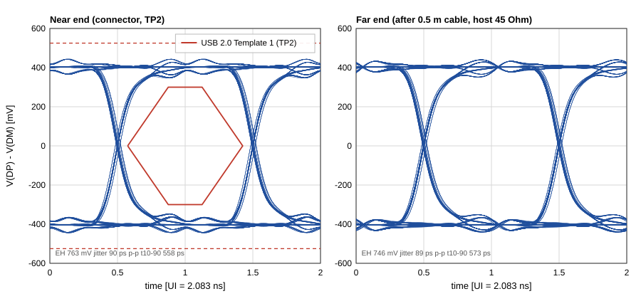
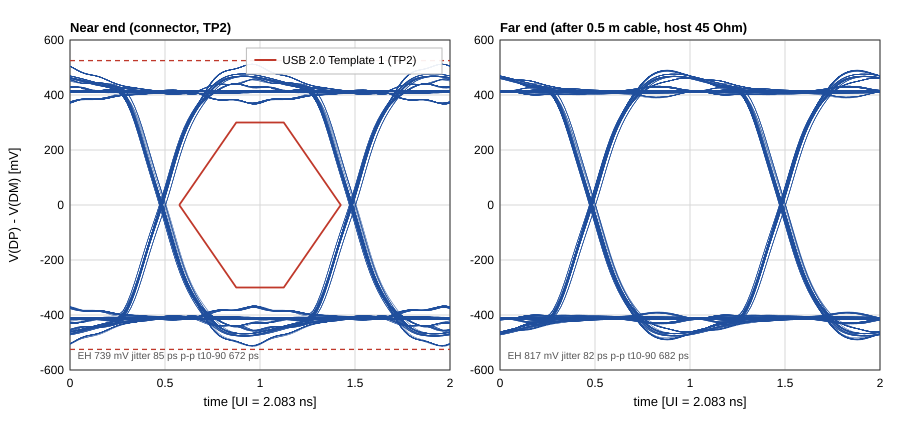
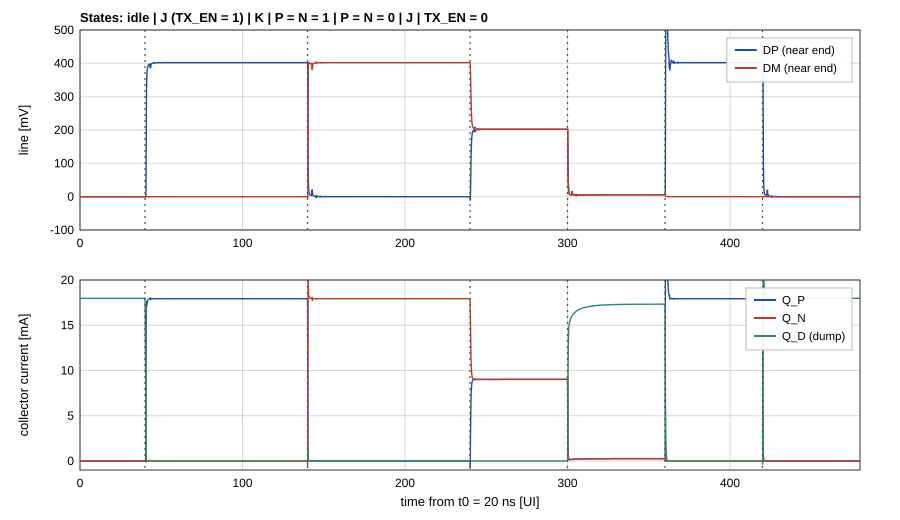
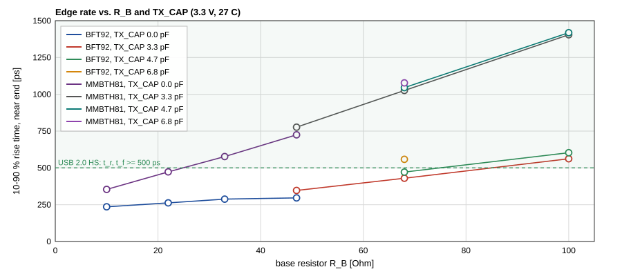
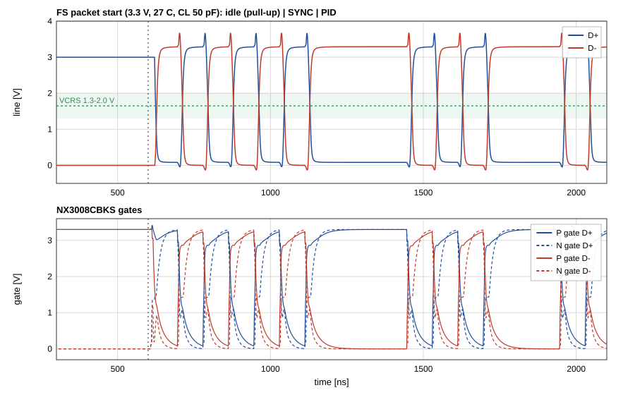
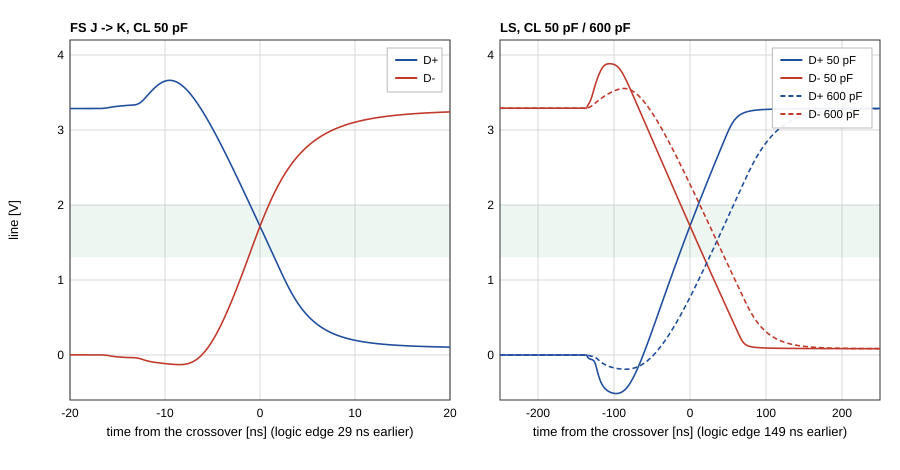

# USB 2.0 discrete transmitter board (afe_transceiver TX) — design description

Rev 0.2 · AFE/Discrete/Transmitter · board: 4-layer FMC LPC mezzanine · FPGA side: AMD 7-Series

## 1 Overview

This board is a discrete-component prototype of the transmit half of the PHY's analog front end. It covers:

- the HS current-steering driver (`afe_hs_tx`);
- the FS/LS driver (`afe_fsls_xcvr`);
- the line terminations and pulls (`afe_term`).

The behavioural reference is `AFE/veriloga/afe_transceiver.va`. The board uses the same pin names and pin semantics: `TX_IN_P/N`, `TX_EN`, `FS_OE/DAT/SE0/LS`, `DP_PULLUP_EN`, `HS_TERM_EN`, `PD_EN0/1`. The documentation is structured like the analog block descriptions (`AFE/doc/pll.md`, i.e. `afe_pll.va`).

The digital half comes from an external AMD 7-Series FPGA board over FMC LPC. The FPGA runs the repo RTL TX chain:

- `usb_tx_path` → `usb_afe_tx_if8`;
- then a 7 × OSERDESE2 serializer (`tx_piso_7s`), which replaces the ASIC's `usb_tx_piso`.

So the bit stream on the board pins is the one the ASIC digital would produce, at 480 Mbit/s. A UART register interface starts patterns, sets the trims and terminations, and reads back the FS receiver.

The board has no FPGA power or configuration circuitry. It is powered from the carrier's FMC 3P3V and VADJ rails.

```
 FPGA carrier (FMC LPC)                     transmitter board                                   USB-C
 ───────────────────────       ┌──────────────────────────────────────────────────────────┐
 TX_IN_P  LVDS  LA02 ─────────►│ SN65LVDT101 ─Z─ 130/82 ─ R_B ─► Q_P (BFT92) ─▶├┐ RB751    │
 TX_IN_N  LVDS  LA03 ─────────►│ SN65LVDT101 ─Z─ 130/82 ─ R_B ─► Q_N (BFT92) ─▶├┼─ DP/DM ──┼──► D+/D−
 TX_EN    LA04_P ─ 1T45 ──────►│ divider 237/255/549 ──────────► Q_D (dump)   │   │       │
 V_CTL ◄─ MCP4821 DAC (SPI)    │ U7B+Q5: I_CTL=V_CTL/Rg → Rr ; U7A+Q4: tail I=V(Rr)/Rs ─┘ │
 FS_OE/DAT/SE0/LS ─ 8T245 ────►│ LVC138 + 4×LVC1G11 (+LVC125) ─ NX3008CBKS ─33R─ HSD1 ┐   │
 HS_TERM_EN ─ 8T245 ──────────►│        FSUSB42, OE# = NOR(FS_OE, HS_TERM_EN), 40.2R ─ HSD2 ┴─D┘ USBLC6 │
 PD_EN0/1, DP_PULLUP_EN ──────►│ 2N7002DW + 15k pull-downs, NX3008CBKS switch + 1.5k pull-up │
 RXRCV/RXDP/RXDM ◄────────────│ TLV3502 (VP/VM) + TLV3501 (RCV) behind 1k, LVC3G04 to VADJ │
 └───────────────────────       └──────────────────────────────────────────────────────────┘
```

## 2 Requirements (from afe_transceiver.va and the USB 2.0 specification)

| Item | Model / spec | Board implementation |
|---|---|---|
| HS drive | 17.78 mA steered into DP or DM; 400 mV into 2 × 45 Ω | PNP current-steering triple fed by a regulated tail of 18.9 mA. About 17.93 mA reaches the line (BFT92 base current), through RB751S40 blocking diodes |
| Chirp | 800 mV into 45 Ω (near-end termination off) | Same current source, HS_TERM_EN = 0 |
| TX_EN | Current dumped internally when 0; t_en ≤ 20 ns | Q_D dump transistor; t_en 1.7–2.5 ns |
| Edges | 10–90 % ≥ 500 ps (USB 2.0 7.1.2.2) | R_B + TX_CAP select the edge rate: 566–689 ps (BFT92) |
| Amplitude trim | TX_AMP (TRIM_TX[3:0]), bias_mode 0/1/2 | MCP4821 DAC (TX_AMP), TX_VREF / 2, or TX_I_5U × 120 kΩ (jumper J3) |
| FS/LS driver | 45 Ω, FS 4–20 ns, LS 75–300 ns, FS J = DP high, LS J = DM high; USB 2.0: Z_DRV 28–44 Ω, VCRS 1.3–2.0 V, t_r/t_f 90–111 % (FS) / 80–125 % (LS) | Discrete CMOS driver: NX3008CBKS complementary pairs + 33 Ω, slew control by Miller capacitors, LVC decode logic (section 4.4). 37.6–42.0 Ω, FS 10.3–12.7 ns, LS 95–150 ns |
| Terminations | 1.5 kΩ pull-up, 45 Ω HS termination, 15 kΩ pull-downs | NX3008CBKS P switch + 1.5 kΩ, FSUSB42 switch + 40.2 Ω, 2N7002DW + 15 kΩ |
| RX status | RXRCV / RXDP / RXDM | TLV3502 single-ended (Schmitt) and TLV3501 differential comparators on the line, LVC3G04 to VADJ |
| Digital side | 480 Mbit/s pin vectors from `usb_afe_tx_if8` | OSERDESE2 DDR 8:1 at 240 MHz per pin |

## 3 Architecture

Supplies (sheet 1):

- FMC 3P3V → ferrite bead FB1 → **+3V3**, for the FS/LS driver and receivers, the switch and the translators.
- FMC 3P3V → FB2 → **+3V3A**, for the HS driver, the op-amp, the DAC and the TX_EN translator. +3V3A is kept away from the switching logic.
- **VADJ** (1.65–3.6 V) supplies the FPGA side of every translator and the receiver output inverter (LVC3G04).
- 3P3VAUX supplies the IPMI EEPROM only.

Signal paths:

- **HS (sheet 2).** The LVDS pairs TX_IN_P and TX_IN_N each feed an SN65LVDT101 (LVDS → LVPECL, internal 110 Ω input termination). The *inverting* output Z drives the base of the matching steering transistor through a Thevenin termination and the base resistor R_B. TX_IN_P = 1 therefore pulls Q_P's base low and Q_P conducts into DP. TX_EN, translated to 3.3 V, sets the base of the dump transistor Q_D.
- **FS/LS (sheet 3).** The FS pins go through an SN74LVC8T245 to 3.3 V. An SN74LVC138 decodes (FS_OE, FS_DAT, FS_LS, FS_SE0) into the line state, and four SN74LVC1G11 form the gate commands of two NX3008CBKS complementary MOSFET pairs, one per wire. The drains drive the line through 33 Ω and the FSUSB42 switch (port 1). Port 2 of the same switch is the 40.2 Ω HS termination. HS_TERM_EN selects "FS driver" or "45 Ω termination", break-before-make. The switch is enabled only while FS_OE or HS_TERM_EN is set, so the FS driver is off the line in receive mode. The receivers (two comparators) sit on the line side of the switch.
- **Bias (sheet 4).** V_CTL sets the HS current. It comes from the DAC (TX_AMP trim), from TX_VREF / 2, or from TX_I_5U into 120 kΩ (bias_mode 2 with an external 5 µA source).

## 4 Circuit design and component selection

### 4.1 HS current-steering driver

The emitters of Q_P, Q_N and Q_D form one node (NEM), fed by the tail current source. Exactly one of the three bases is pulled at least ~0.5 V below the other two. That transistor takes the whole tail current:

| TX_EN | TX_IN_P | TX_IN_N | Q_P base | Q_N base | Q_D base | Current to |
|---|---|---|---|---|---|---|
| 0 | x | x | ≥ 1.69 V | ≥ 1.69 V | 0.60 V | dump (GND) |
| 1 | 1 | 0 | ≈ 1.69 V (VOL) | ≈ 2.28 V (VOH) | 2.00 V | DP (J) |
| 1 | 0 | 1 | ≈ 2.28 V | ≈ 1.69 V | 2.00 V | DM (K) |
| 1 | 1 | 1 | low | low | 2.00 V | DP and DM, half each (≈ 200 mV each) |
| 1 | 0 | 0 | high | high | 2.00 V | dump: both lines 0 V (deviation, section 6) |

**Steering transistors.** BFT92 (NXP/Nexperia, PNP, f_T 5 GHz, C_re 0.45 pF, SOT-23) is the primary choice. MMBTH81 (onsemi, PNP, f_T 600 MHz, SOT-23, LCSC C190349, pin-compatible) is the second-source assembly variant. Both have the pinout 1 = B, 2 = E, 3 = C. LCSC lists only the BFT92W (SOT-323, C9994, low stock), which does **not** fit the SOT-23 footprint, so order the BFT92 from Mouser/DigiKey. The two variants differ only in R_B and TX_CAP (section 4.3).

**Collector blocking diodes (D6, D7).** Each steering collector reaches its line through an RB751S40 Schottky diode (anode at the collector). Without them, the FS/LS levels would forward-bias a collector–base junction. In FS/LS operation the FPGA holds the idle HS inputs at TX_IN_P = 1 / TX_IN_N = 0 (`tx_piso_7s` idle vectors), so Q_P's base sits at LVPECL VOL = 1.69 V. When the FS driver or the 1.5 kΩ pull-up drives D+ high, D+ → C → B conducts into the base termination. The simulation without the diodes (`fs_nodiode`) shows:

- idle D+ clamped to 2.42 V by the pull-up, below VOH min 2.8 V;
- VOH while driving 2.92 V;
- falling edges distorted, t_r/t_f 62 %.

The same defect was in Rev 0.1 (with the TUSB1105). The diodes cost about 0.3 V of collector headroom. At the chirp level (DM ≈ 0.8 V) the collector sits at ≈ 1.1 V, still below the base (≥ 1.69 V), so the transistor stays in the active region. The diode capacitance (2.6 pF at 0 V, in series with the high-impedance collector) does not load the line.

**Base drive.** The SN65LVDT101 output is LVPECL: VOH = VCC − 1.02 V ≈ 2.28 V, VOL = VCC − 1.61 V ≈ 1.69 V. Its emitter-follower outputs need a Thevenin termination to VCC − 2 V. Here that is **130 Ω to +3V3A and 82 Ω to GND**, i.e. 50.3 Ω to 1.276 V. The unused Y outputs get the same termination, so both output stages carry equal current.

The SN65LVDT101 (internal 110 Ω) is not stocked at LCSC. The pin-compatible SN65LVDS101 (C181531) works with the 100 Ω resistors R40/R41 across A/B, which are DNP for the LVDT101.

**Dump base (Q_D).** The SN74LVC1T45 output (0 / 3.3 V) drives the divider Ra = 237 Ω (series), Rb = 255 Ω (to GND), Rc = 549 Ω (to +3V3A):

- TX_EN = 0: V_BD = 3.3 · (237 ∥ 255) / (549 + 237 ∥ 255) = **0.60 V**. Q_D's base is at least 1.1 V below the pair bases, so the whole current is dumped.
- TX_EN = 1: V_BD = 3.3 · 255 / (237 ∥ 549 + 255) = **2.00 V**. This lies between VOL and VOH, so the active line transistor (base at VOL = 1.69 V) wins. When both pair bases are high (P = N = 0), Q_D still conducts and the tail never saturates.

**Tail current source (U7A, Q4).** U7A forces the drop across Rs = 15 Ω (to +3V3A) equal to the drop across Rr. The output stage is the MMBT3906 Q4 (collector → NEM), with 1 kΩ base resistor R23 and 10 nF C17 from base to +3V3A for loop compensation.

**I_CTL generator (U7B, Q5).** U7B forces V_CTL across Rg = 3.57 kΩ. Q5 (MMBT3904) sinks that current from Rr = 1.69 kΩ (C16 = 100 nF across Rr). Hence:

  I_tail = V_CTL · Rr / (Rg · Rs) = 0.600 V · 1690 / (3570 · 15) = **18.94 mA**

The ~6 % above 17.78 mA covers the base current of the active BFT92 (β ≈ 34 at 18 mA): the simulated collector current is 17.93 mA, giving 402 mV on the line (DC; 395 mV in the Test_Packet, where the receivers' 1 kΩ input resistors load the line).

U7 is an MCP6V02 (zero-drift, rail-to-rail, 1.3 MHz). An OPA2333 is an alternative. The supply sensitivity is set only by the Rr/Rs ratio, so 0.1 % / 25 ppm resistors are preferred for Rs, Rr and Rg.

**Headroom.** At 3.3 V: ET ≈ 3.03 V, NEM ≈ 2.58 V, so Q4 runs with V_EC = 0.37–0.74 V over the corners (table in 5.2) and still regulates: the line level moves by < 1 %. The line swing is limited by the compliance of the steering transistors. At the chirp level (DM ≈ 0.8 V) V_EC(Q_N) is about 1.8 V.

### 4.2 Amplitude trim and bias modes (sheet 4)

J3 selects V_CTL. Exactly one jumper may be fitted:

| J3 jumper | bias_mode | V_CTL source | Nominal |
|---|---|---|---|
| 1–2 | 0 (trim) | MCP4821 VOUT, 0.5 mV/LSB (internal 2.048 V reference, gain 1) | code 1200 → 0.600 V |
| 3–4 | 1 | TX_VREF (J4) / 2: 10 kΩ / 10 kΩ divider | 1.2 V → 0.600 V |
| 5–6 | 2 | TX_I_5U (J5) into R38 = 120 kΩ | 5 µA → 0.600 V |

V_CTL is filtered by R39 = 1 kΩ and C31 = 100 nF. The FPGA writes the DAC from TRIM_TX[3:0] = TX_AMP:

  code = 1200 + 30 · (TX_AMP − 8)

That is 2.5 % per step, −20 % … +17.5 %, so TX_AMP = 0…15 gives about 322–473 mV. The simulated transfer from V_CTL to the line current is linear within **0.6 %** over 0.3–0.9 V (figure 5).

### 4.3 Edge-rate control: R_B and TX_CAP

Unbraked, the BFT92 switches in about 240 ps (10–90 %). That violates the HS minimum of 500 ps and rings on the connector stub. Two components set the edge rate:

- the base resistor R_B, together with the base diffusion capacitance;
- TX_CAP_P/N (C18/C19): the model's TX_CAP pins, realised as small capacitors from each line node to GND.

Figure 4 shows the sweep at 3.3 V / 27 °C. The chosen assembly variants:

| Variant | R_B (R15, R16) | TX_CAP (C18, C19) | t_r near end, nominal | Over corners |
|---|---|---|---|---|
| BFT92 (primary) | 68 Ω | 6.8 pF | 596 ps | 566–689 ps |
| MMBTH81 | 33 Ω | DNP | 672 ps | 650–716 ps |

The RB751S40 collector diodes (2.6 pF) and the receiver inputs slowed the edges by ≈ 40 ps (BFT92) and ≈ 95 ps (MMBTH81) compared with Rev 0.1. The variants are kept: BFT92 with 4.7 pF would start at ≈ 525 ps nominal and fall below 500 ps at −40 °C, and MMBTH81 with R_B = 22 Ω (542 ps nominal) is the faster alternative.

### 4.4 Discrete FS/LS driver, receivers and terminations (sheet 3)

The FS/LS driver replaces Rev 0.1's TUSB1105 transceiver and its XOR glue. The transmitter is an open-loop CMOS driver per wire whose edge rate is set by Miller capacitors. The receivers are comparators on the line. All values below come from `sim/run_fsls.py` (`VAL`, section 5.3) and must stay equal to `FSV` in `easyeda/gen_schematic.py`.

```
 FS_OE ─┐        U9 LVC138            U10 LVC1G11  GP_P = Y1#·Y2#          ──┐   +3V3
 FS_DAT ┼ U8 ─ A ┐ G1 = FS_OE          U14 LVC1G11  GN_P = OE·Y1#·Y2#         │  ┌─┴─┐ TR2 (P)
 FS_LS  ┼ 8T245 B ┼ Y0#..Y3#  ───────► U15 LVC1G11  GP_M = Y0#·Y3#          gate │  │   │
 FS_SE0 ┘ (3.3 V)C ┘ (C = SE0 → all     U16 LVC1G11  GN_M = OE·Y0#·Y3#      net  ├──┤ D ├── R25 33R ── FSUSB42 HSD1 ── D+
                       Y0..3 high)       │ R_LS (always) ──────────────────────┤  │   │      (R26 for D−)
                                         │ LVC125 (OE# = FS_LS) ─ R_FS ─────────┤  └─┬─┘ TR1 (N)
                                         │ BAT54WS: fast turn-off ─────────────┤    GND
                                         │ C_M drain → gate (Miller)            │  Q7 / Q8 NX3008CBKS
```

**Line-state decode.** FS_OE, FS_DAT, FS_SE0 and FS_LS (VADJ) are translated by U8 (SN74LVC8T245, A = VADJ, B = +3V3; channel 5 carries DP_PULLUP_EN). U9 (SN74LVC138) decodes A = DAT, B = LS, C = SE0 with G1 = FS_OE:

| Code (SE0, LS, DAT) | Line state | D+ | D− |
|---|---|---|---|
| 0 (0, 0, 0) | FS K | low | high |
| 1 (0, 0, 1) | FS J | high | low |
| 2 (0, 1, 0) | LS K | high | low |
| 3 (0, 1, 1) | LS J | low | high |
| 4–7 | SE0 | low | low |
| FS_OE = 0 | off | off | off |

With the active-low outputs Y0#–Y3#, a wire is high only for its two codes:

- P gate D+: GP_P = Y1#·Y2#;
- N gate D+: GN_P = OE·Y1#·Y2#;
- the same for D− with Y0#/Y3#.

These are four SN74LVC1G11 (AND3; unused C inputs tied high). OE also enters the N gates directly: with FS_OE = 0 every Y# is high, so the P gates are high (off) and the N gates low (off). Because the OE path to the N gates (8T245 + 1G11) is 4.5 ns faster than the path through the '138, the N gates get a ≈ 4.5 ns "on" command when FS_OE rises. The gate RC filters it, and the FSUSB42 is still off at that time (below), so it never reaches the line.

**Output stage.** Q7 (D+) and Q8 (D−) are NX3008CBKS (Nexperia, SOT-363: TR1 N 1.0 Ω at 4.5 V, TR2 P 2.8 Ω at −4.5 V). The P source is at +3V3 and the N source at GND; both drains feed R25/R26 = 33 Ω. With the switch's 4.5 Ω the output impedance is 37.6–42.0 Ω, inside both USB 2.0 Z_DRV (28–44 Ω) and the model's 45 Ω ± 10 %. VOH = 3.29 V and VOL = 0.08 V against the 1.5 kΩ / 15 kΩ loads.

**Edge-rate control.** Each gate has:

- **R_LS** from its LVC1G11 output, always in circuit;
- **R_FS** from an SN74LVC125 output (U17) in parallel with R_LS. U17 is enabled while FS_LS = 0, so FS gets a stronger gate drive;
- a **BAT54WS** from the LVC1G11 output that turns the gate off without the resistor (P gate: anode at the logic; N gate: cathode at the logic). Turn-on is slow and turn-off fast, so the two transistors of a wire do not conduct together (break-before-make);
- a Miller capacitor **C_M** from the drain to the gate. While the drain swings, the gate current through R flows into C_M, so dV/dt ≈ I_gate / C_M, nearly independent of the load (50 pF and 600 pF give LS edges of 101 and 137 ns).

| Component | N gates (GN_P, GN_M) | P gates (GP_P, GP_M) | Function |
|---|---|---|---|
| R_LS (R42–R45) | 560 Ω | 1.2 kΩ | LS edge rate |
| R_FS (R46–R49) | 18 Ω | 43 Ω | FS edge rate (+ 25 Ω LVC125 output) |
| C_M (C34–C37) | 150 pF | 8.2 pF | Miller capacitor; the P transistor has 7 × lower K_P and is device-limited at FS |
| C_KF (C53, C54) | 39 pF across R_FS | — | FS crossover: the N side starts earlier |
| C_K (C38, C39) | — | 10 pF across R_LS | LS crossover: the P side starts earlier |
| C_M2 + R_M2 (C40/C41, R50/R51) | — | 47 pF + 470 Ω | Second Miller capacitor that only the slow LS edges see (τ = 22 ns). It keeps the weak P's LS rise load-independent without slowing FS |

All capacitors are C0G. The P values are lower because the NX3008CBKS P channel has 7 × less transconductance. The asymmetric C_KF / C_K centre the crossover voltage: the N side is pulled forward at FS and the P side at LS.

**DP pull-up (Q9).** The third NX3008CBKS replaces the TUSB1105 SOFTCON switch:

- TR2 (P) switches +3V3 to R31 = 1.5 kΩ, which goes to the line DP, so the pull-up works in every switch state, as in `afe_term`;
- TR1 (N), driven by DP_PULLUP_EN at 3.3 V (U8 channel 5, 100 kΩ pull-down R53), pulls the P gate low against R54 = 10 kΩ.

Like `afe_term`, the board has no D− pull-up, so it cannot attach as an LS device.

**Receivers.** R55/R56 = 1 kΩ isolate the comparator inputs (≈ 4 pF per wire) from the line. At HS this is a 1 kΩ load per wire (−1 % amplitude, included in the HS simulation). At FS it adds 4 ns of delay.

- **VP, VM:** U18 TLV3502 (dual, 4.5 ns, 3.3 V). The line goes to IN−; IN+ gets the Schmitt network 13 kΩ (+3V3) / 10 kΩ (GND) / 82 kΩ (from OUT), giving thresholds of 1.56 V rising and 1.34 V falling (USB VSE 0.8–2.0 V).
- **RCV:** U19 TLV3501, IN+ = D−, IN− = D+ (6 mV internal hysteresis, SHDN tied low = enabled).
- **Outputs:** both comparator outputs are inverted. U20 (SN74LVC3G04 at VADJ, 5.5 V-tolerant inputs) inverts them back and translates to VADJ for RXDP, RXDM and RXRCV.

The model pin FS_RX_EN is still emulated in the FPGA (TERM[5]). Unlike Rev 0.1, the receivers follow the line in every switch state, including HS.

**HS termination switch.** The FSUSB42MUX has 4.5 Ω typical R_on, 3.7 pF C_on and 720 MHz bandwidth. SEL = HS_TERM_EN (3.3 V from U2):

- SEL = 0: common D± → HSD1, the FS/LS driver through 33 Ω;
- SEL = 1: common D± → HSD2, i.e. R27/R28 = 40.2 Ω to GND, so 40.2 + 4.5 ≈ 45 Ω.

OE# = NOR(FS_OE, HS_TERM_EN) (U21, SN74LVC1G02), so both ports are off while the board neither transmits FS/LS nor terminates HS. Otherwise C_M (150 pF on the N side) would load the line through 37.5 Ω whenever a host transmits. The simulation with the driver connected but idle slowed a host's 6.3 ns FS edges to ≈ 30 ns (limit 20 ns); with the switch off they stay at 6.3 ns (`fs_host`).

The switch's t_ON (13 ns typ, 30 ns max) adds to the 8T245 + NOR delay: the line is connected ≈ 20 ns (≤ 38 ns) after FS_OE rises. The driver's own delay to the first crossover is ≈ 29 ns, so only the first SYNC transition from idle can be affected, and USB excludes it from the timing specs.

The HS steering collectors connect to the switch's common side, i.e. directly to the line (through D6/D7).

**Pull-downs.** R29/R30 = 15 kΩ to the drains of the 2N7002DW. The switch sits on the ground side so its capacitance is isolated from the line. PD_EN0 controls DP and PD_EN1 controls DM, as in `afe_term`. 100 kΩ gate pull-downs R4–R6 (sheet 1) keep HS_TERM_EN and PD_EN0/1 off while VADJ is down. R52 does the same for FS_OE, keeping the driver off.

**FS_SUSPND.** The pin has no function on this board. The discrete driver has no suspend mode, so FMC C11 is left unconnected and TERM[4] has no effect.

**Line and connector.** The line has USBLC6-2SC6 ESD protection and a TYPE-C-31-M-12 receptacle with CC1/CC2 = 5.1 kΩ to GND (Rd). The receptacle supports both plug orientations: A6/B6 → DP, A7/B7 → DM. R34/R35 (45.3 Ω, DNP) emulate the host termination when the board is measured with a high-impedance probe and no host.

### 4.5 Level translation and FMC housekeeping (sheet 1)

| Signal group | Device | Notes |
|---|---|---|
| HS_TERM_EN, PD_EN0/1, DAC CS#/SCK/SDI | SN74LVC8T245 U2 (A = VADJ, B = +3V3, DIR = H) | B7, B8 unused, A7, A8 tied low |
| FS_OE/DAT/SE0/LS, DP_PULLUP_EN | SN74LVC8T245 U8 (sheet 3) | B6–B8 unused, A6–A8 tied low |
| TX_EN | SN74LVC1T45 (B = +3V3A) | ~3 ns extra delay, covered by TX_LEAD (section 7) |
| VBUS_DET | SN74LVC1T45, B → A | VBUS / 47 k / 100 k → 3.4 V at 5 V VBUS |
| RXRCV/DP/DM | SN74LVC3G04 at VADJ (sheet 3) | inverts the comparator outputs; FS_SUSPND not connected |
| IPMI | AT24C02C at 3P3VAUX | A0 = GA0, A1 = GA1, A2 = GND, WP = GND |

PRSNT_M2C_L (H2) is tied to GND. TDI (D30) is connected to TDO (D31), so the board does not break the carrier's JTAG chain.

### 4.6 FMC LPC pin map

| Signal | FMC | Pin | | Signal | FMC | Pin |
|---|---|---|---|---|---|---|
| TX_IN_P (+/−) | LA02_P/N | H7/H8 | | DAC_CS_N | LA09_P | D14 |
| TX_IN_N (+/−) | LA03_P/N | G9/G10 | | DAC_SCK | LA09_N | D15 |
| TX_EN | LA04_P | H10 | | DAC_SDI | LA10_P | C14 |
| FS_OE | LA04_N | H11 | | VBUS_DET | LA10_N | C15 |
| FS_DAT | LA05_P | D11 | | RXRCV | LA11_P | H16 |
| FS_SE0 | LA05_N | D12 | | RXDP | LA11_N | H17 |
| FS_LS | LA06_P | C10 | | RXDM | LA12_P | G15 |
| FS_SUSPND | LA06_N | C11 | | 3P3V | | C39, D36, D38, D40 |
| DP_PULLUP_EN | LA07_P | H13 | | VADJ | | G39, H40 |
| HS_TERM_EN | LA07_N | H14 | | 3P3VAUX | | D32 |
| PD_EN0 | LA08_P | G12 | | SCL / SDA | | C30 / C31 |
| PD_EN1 | LA08_N | G13 | | GA0 / GA1 | | C34 / D35 |

LA02/LA03 were chosen because they are plain (non-CC) pairs on most carriers. All other signals are single-ended. Before releasing the layout, check the map against VITA 57.1 and the target carrier's schematic, including its VADJ setting.

## 5 Simulation results

### 5.1 HS testbench

The setup is ngspice-42 (`sim/run_sims.py`). Models:

- **Transistors:** vendor SPICE cards (NXP BFT92, onsemi MMBTH81). MMBT3904/3906 use generic models.
- **Op-amp:** linear, 1.3 MHz GBW.
- **SN65LVDT101:** PWL source, 200 ps edges, VOH/VOL from the datasheet, 7 Ω output, a 50 Ω / 60 ps trace to the Thevenin termination.
- **Parasitics:** SOT-23 leads 0.8 nH; RB751S40 collector diodes; switch 1.9 pF + 4.5 Ω; ESD 2.5 pF; FS/LS receivers 1 kΩ + 4 pF per wire.
- **Line:** 8 mm board trace to the connector (**near end**, TP2), then a 0.5 m 45 Ω cable to a host with 2 pF ∥ 45 Ω (**far end**).

The stimulus is the USB 2.0 Test_Packet (SYNC … EOP, 522 line bits, generated by `sim/usbpat.py`, which also generates the FPGA ROM and the RTL testbench reference). Corners: VDD 3.135 / 3.465 V × −40 / 85 °C.

### 5.2 HS results



*Figure 1 – Test_Packet eye, BFT92 (R_B 68 Ω, TX_CAP 6.8 pF), 3.3 V, 27 °C. Near end with USB 2.0 Template 1 (TP2).*



*Figure 2 – Test_Packet eye, MMBTH81 (R_B 33 Ω, no TX_CAP).*

**BFT92 - eye (Test_Packet)**

| Corner | J near [mV] | EH near [mV] | t_r [ps] | t_f [ps] | jitter p-p [ps] | EH far [mV] | t_r far [ps] | delay [ns] |
|---|---|---|---|---|---|---|---|---|
| 3.300 V, 27 C | 395 | 728 | 596 | 595 | 83 | 746 | 625 | 3.15 |
| 3.135 V, -40 C | 394 | 731 | 566 | 565 | 83 | 743 | 591 | 3.14 |
| 3.135 V, 85 C | 397 | 734 | 598 | 599 | 84 | 754 | 625 | 3.17 |
| 3.465 V, -40 C | 392 | 722 | 628 | 629 | 82 | 739 | 662 | 3.13 |
| 3.465 V, 85 C | 394 | 719 | 688 | 689 | 83 | 742 | 724 | 3.17 |

**BFT92 - static states**

| Corner | J [mV] | I dump [mA] | P=N=1 DP [mV] | P=N=0 DP [mV] | t_en [ns] | t_dis [ns] | tail V_EC [V] | idle leakage [uA] |
|---|---|---|---|---|---|---|---|---|
| 3.300 V, 27 C | 402 | 17.97 | 202 | 5.8 | 1.9 | 1.1 | 0.47 | 0.00 |
| 3.135 V, -40 C | 400 | 17.87 | 201 | 6.7 | 1.7 | 1.1 | 0.37 | 0.00 |
| 3.135 V, 85 C | 403 | 18.02 | 203 | 31.2 | 1.7 | 1.2 | 0.53 | 0.00 |
| 3.465 V, -40 C | 400 | 17.88 | 201 | 0.1 | 2.0 | 1.0 | 0.40 | 0.00 |
| 3.465 V, 85 C | 401 | 18.03 | 203 | 2.2 | 2.1 | 1.0 | 0.56 | 0.00 |

**MMBTH81 - eye (Test_Packet)**

| Corner | J near [mV] | EH near [mV] | t_r [ps] | t_f [ps] | jitter p-p [ps] | EH far [mV] | t_r far [ps] | delay [ns] |
|---|---|---|---|---|---|---|---|---|
| 3.300 V, 27 C | 416 | 739 | 672 | 672 | 85 | 817 | 682 | 3.33 |
| 3.135 V, -40 C | 413 | 737 | 650 | 649 | 85 | 811 | 658 | 3.33 |
| 3.135 V, 85 C | 418 | 743 | 688 | 688 | 85 | 819 | 700 | 3.33 |
| 3.465 V, -40 C | 413 | 738 | 667 | 666 | 85 | 810 | 675 | 3.32 |
| 3.465 V, 85 C | 418 | 746 | 716 | 715 | 85 | 819 | 731 | 3.32 |

**MMBTH81 - static states**

| Corner | J [mV] | I dump [mA] | P=N=1 DP [mV] | P=N=0 DP [mV] | t_en [ns] | t_dis [ns] | tail V_EC [V] | idle leakage [uA] |
|---|---|---|---|---|---|---|---|---|
| 3.300 V, 27 C | 416 | 18.60 | 208 | 0.3 | 2.2 | 1.3 | 0.63 | 0.01 |
| 3.135 V, -40 C | 413 | 18.45 | 207 | 0.8 | 1.9 | 1.4 | 0.52 | 0.00 |
| 3.135 V, 85 C | 418 | 18.68 | 209 | 5.0 | 2.0 | 1.4 | 0.71 | 0.05 |
| 3.465 V, -40 C | 413 | 18.45 | 207 | 0.0 | 2.3 | 1.2 | 0.55 | 0.00 |
| 3.465 V, 85 C | 418 | 18.68 | 209 | 0.1 | 2.5 | 1.3 | 0.74 | 0.05 |

- chirp BFT92: DM 805 mV, DP 96 mV, DM-DP 709 mV

- chirp MMBTH81: DM 835 mV, DP 96 mV, DM-DP 739 mV
- skew_BFT92 (TX_IN_N 150 ps late): near EH 731 mV, jitter 85 ps, t_r 606 / t_f 623 ps
- trim: alpha 0.9426 .. 0.9539, linearity 0.65 %



*Figure 3 – Static states and TX_EN timing (BFT92).*



*Figure 4 – Edge rate vs. R_B and TX_CAP.*


*Figure 5 – Q_P current vs. V_CTL (amplitude trim).*


*Figure 6 – Device chirp K (HS termination off, 1.5 kΩ pull-up on).*

Summary:

- **Amplitude.** 400–403 mV (BFT92) and 413–418 mV (MMBTH81) static over the corners, 392–397 / 413–418 mV in the Test_Packet; nominal 400 mV ± 10 %. The higher MMBTH81 level comes from its higher β. Trim it with TX_AMP = 7 (−2.5 %) or with Rg. The MMBTH81 variant also overshoots to ≈ 510 mV after isolated bits, close to the 525 mV limit of Template 1 (figure 2). This is one more reason to prefer the BFT92.
- **Eye.** Near-end eye height ≥ 719 mV. The eye stays clear of Template 1 (figure 1). Deterministic jitter ≈ 85 ps p-p: data-dependent, from the edge-rate control (figure 4) and the termination mismatch of the 8 mm stub.
- **Delay.** TX_IN (LVDS at the board pins) → far end 3.1–3.3 ns, of which the cable is 2.5 ns, so board latency ≈ 0.6–0.8 ns. An extra 150 ps P/N skew (`skew_BFT92`) does not change the eye height (731 mV); jitter stays 85 ps p-p.
- **TX_EN.** t_en 1.7–2.5 ns, t_dis 1.0–1.4 ns, far below the model's 20 ns budget. Idle leakage into the line is ≤ 0.05 µA at every corner.
- **Chirp.** DM 805 mV (BFT92) / 835 mV (MMBTH81). Against the 1.5 kΩ pull-up, DP − DM = −709 / −739 mV, inside VCHIRPK = −900 … −500 mV (USB 2.0 table 7-3). The FS/LS driver is off the line during chirp (FSUSB42 OE# high).
- **Corrected design error.** The first termination was 82 Ω to VCC / 130 Ω to GND (Thevenin 2.02 V instead of 1.28 V). That would turn the real LVPECL emitter followers off at VOL and leave Q_P with only ≈ 0.56 V V_EB. It was corrected to 130 / 82 Ω before the results above.

### 5.3 FS/LS driver

The FS/LS testbench is `sim/run_fsls.py` (ngspice). It contains the complete sheet 3 signal path:

- the decode logic as Boolean functions with datasheet delays (8T245 4.0 ns, LVC138 4.5 ns, LVC1G11 / LVC125 / LVC1G02 3.5 ns, 25 Ω outputs);
- the gate networks and the NX3008CBKS pairs;
- R_S, the FSUSB42 as an OE#-controlled switch (t_ON 13 ns);
- the HS driver as it sits on the line in FS/LS idle (BFT92 collectors through D6/D7, bases at the LVPECL idle levels, tail current in the dump), TX_CAP, the USBLC6;
- the receivers behind 1 kΩ (comparators as tanh sources with 4.5 ns delay);
- the USB 2.0 test loads:
  - FS: CL 50 pF, 1.5 kΩ pull-up on D+, host 15 kΩ pull-downs;
  - LS (PHY as host): CL 50 / 600 pF, board 15 kΩ pull-downs, device 1.5 kΩ on D−.

The stimulus is a DATA0 packet: SYNC, PID, 8 (FS) or 3 (LS) payload bytes with stuffing, CRC16, EOP. It is generated with `sim/usbpat.py`.

**MOSFET model.** `sim/models/fsls_models.lib` holds VDMOS fits of the NX3008CBKS datasheet:

- V_GSth 0.9 V typ (N and P);
- R_DSon 1.05 / 1.44 / 2.06 Ω (N at 4.5 / 2.5 / 1.8 V) and 2.85 / 5.36 Ω (P);
- gate charge Q_G 0.50 nC.

The corners add V_th ± 0.2/0.25 V (datasheet 0.6–1.1 V) and C_GS / C_GD × 0.7 / 1.3.

The figures of merit follow USB 2.0 7.1.2 and the USB3320 table 4-6:

- 10–90 % t_r / t_f, between the median VOL and VOH;
- t_r / t_f matching of each transition;
- VCRS at every J/K crossover except the first transition from idle;
- data jitter of the crossovers against the bit grid;
- shoot-through current (both transistors of a wire above threshold);
- receiver errors, sampled at ¾ bit.



*Figure 7 – FS packet start at 3.3 V / 27 °C: line and the four gates. The dotted line marks FS_OE.*



*Figure 8 – One FS and one LS (50 / 600 pF) transition. The green band is VCRS 1.3–2.0 V.*

**FS, CL 50 pF**

| Corner | VOH / VOL [V] | t_r [ns] | t_f [ns] | t_r/t_f [%] | VCRS [V] | jitter p-p [ns] | line max / min [V] | crowbar peak [mA] |
|---|---|---|---|---|---|---|---|---|
| 3.300 V, 27 C | 3.29 / 0.083 | 11.5 | 11.3 | 101 | 1.67-1.75 | 0.4 | 3.67 / -0.14 | 7 |
| 3.135 V, -40 C | 3.13 / 0.078 | 10.6 | 11.7 | 91 | 1.75-1.83 | 0.5 | 3.57 / -0.23 | 0 |
| 3.135 V, 85 C | 3.13 / 0.079 | 12.7 | 11.5 | 110 | 1.47-1.54 | 0.4 | 3.48 / -0.14 | 8 |
| 3.465 V, -40 C | 3.46 / 0.086 | 10.3 | 11.2 | 92 | 1.92-2.00 | 0.4 | 3.85 / -0.14 | 7 |
| 3.465 V, 85 C | 3.45 / 0.087 | 12.2 | 11.1 | 109 | 1.60-1.67 | 0.4 | 3.79 / -0.12 | 19 |
| C_gs / C_gd x 0.7 | 3.29 / 0.083 | 11.0 | 11.2 | 98 | 1.84-1.90 | 0.3 | 3.68 / -0.15 | 9 |
| C_gs / C_gd x 1.3 | 3.29 / 0.083 | 12.0 | 11.5 | 105 | 1.51-1.60 | 0.5 | 3.65 / -0.13 | 6 |
| no RB751 collector diodes | 2.92 / 0.083 | 8.6 | 13.7 | 62 | 1.59-1.81 | 0.5 | 3.47 / -0.14 | 7 |
| V_th N +0.20 / P +0.20 | 3.29 / 0.083 | 11.8 | 12.1 | 98 | 1.70-1.79 | 0.5 | 3.79 / -0.32 | 0 |
| V_th N +0.20 / P -0.25 | 3.29 / 0.083 | 10.6 | 12.1 | 87 | 2.20-2.26 | 0.4 | 3.68 / -0.17 | 8 |
| V_th N -0.25 / P +0.20 | 3.29 / 0.083 | 12.9 | 10.6 | 122 | 1.06-1.13 | 0.4 | 3.61 / -0.14 | 13 |
| V_th N -0.25 / P -0.25 | 3.29 / 0.083 | 11.8 | 10.7 | 111 | 1.45-1.49 | 0.3 | 3.54 / -0.09 | 44 |

**LS, CL 50 pF**

| Corner | VOH / VOL [V] | t_r [ns] | t_f [ns] | t_r/t_f [%] | VCRS [V] | jitter p-p [ns] | line max / min [V] | crowbar peak [mA] |
|---|---|---|---|---|---|---|---|---|
| 3.300 V, 27 C | 3.29 / 0.083 | 101.3 | 111.4 | 91 | 1.69-1.78 | 7.2 | 3.91 / -0.52 | 0 |
| 3.135 V, -40 C | 3.13 / 0.083 | 109.9 | 121.2 | 91 | 1.60-1.71 | 10.1 | 3.85 / -0.60 | 0 |
| 3.135 V, 85 C | 3.13 / 0.083 | 100.7 | 108.7 | 93 | 1.58-1.66 | 6.8 | 3.64 / -0.45 | 0 |
| 3.465 V, -40 C | 3.45 / 0.083 | 102.2 | 114.5 | 89 | 1.80-1.90 | 7.4 | 4.18 / -0.58 | 0 |
| 3.465 V, 85 C | 3.45 / 0.083 | 95.0 | 104.2 | 91 | 1.78-1.85 | 5.0 | 3.97 / -0.45 | 0 |
| C_gs / C_gd x 0.7 | 3.29 / 0.083 | 96.7 | 109.9 | 88 | 1.85-1.91 | 5.3 | 3.91 / -0.51 | 0 |
| C_gs / C_gd x 1.3 | 3.29 / 0.083 | 106.5 | 112.8 | 94 | 1.54-1.66 | 9.5 | 3.90 / -0.53 | 0 |
| V_th N +0.20 / P +0.20 | 3.29 / 0.083 | 113.0 | 122.6 | 92 | 1.62-1.72 | 8.9 | 3.92 / -0.59 | 0 |
| V_th N +0.20 / P -0.25 | 3.29 / 0.083 | 87.9 | 122.7 | 72 | 2.35-2.42 | 5.4 | 3.82 / -0.56 | 0 |
| V_th N -0.25 / P +0.20 | 3.29 / 0.083 | 115.0 | 99.8 | 115 | 1.03-1.15 | 9.1 | 3.89 / -0.41 | 0 |
| V_th N -0.25 / P -0.25 | 3.29 / 0.083 | 88.9 | 99.8 | 89 | 1.78-1.85 | 5.5 | 3.74 / -0.28 | 0 |

**LS, CL 600 pF**

| Corner | VOH / VOL [V] | t_r [ns] | t_f [ns] | t_r/t_f [%] | VCRS [V] | jitter p-p [ns] | line max / min [V] | crowbar peak [mA] |
|---|---|---|---|---|---|---|---|---|
| 3.300 V, 27 C | 3.29 / 0.083 | 137.3 | 125.7 | 109 | 1.50-1.59 | 7.5 | 3.58 / -0.19 | 0 |
| 3.135 V, -40 C | 3.13 / 0.083 | 141.0 | 133.9 | 105 | 1.43-1.54 | 10.0 | 3.44 / -0.22 | 0 |
| 3.135 V, 85 C | 3.13 / 0.083 | 141.5 | 124.5 | 114 | 1.38-1.47 | 7.2 | 3.39 / -0.18 | 0 |
| 3.465 V, -40 C | 3.45 / 0.083 | 132.5 | 127.1 | 104 | 1.62-1.72 | 7.5 | 3.77 / -0.21 | 0 |
| 3.465 V, 85 C | 3.45 / 0.083 | 134.7 | 119.9 | 112 | 1.56-1.65 | 5.5 | 3.71 / -0.17 | 0 |
| C_gs / C_gd x 0.7 | 3.29 / 0.083 | 131.3 | 124.0 | 106 | 1.65-1.73 | 5.6 | 3.57 / -0.18 | 0 |
| C_gs / C_gd x 1.3 | 3.29 / 0.083 | 143.7 | 127.3 | 113 | 1.35-1.47 | 9.8 | 3.58 / -0.20 | 0 |
| V_th N +0.20 / P +0.20 | 3.29 / 0.083 | 148.0 | 135.9 | 109 | 1.44-1.55 | 9.3 | 3.63 / -0.26 | 0 |
| V_th N +0.20 / P -0.25 | 3.29 / 0.083 | 124.8 | 136.3 | 92 | 2.11-2.20 | 6.3 | 3.58 / -0.19 | 0 |
| V_th N -0.25 / P +0.20 | 3.29 / 0.083 | 150.6 | 115.4 | 130 | 0.90-1.02 | 8.9 | 3.52 / -0.16 | 0 |
| V_th N -0.25 / P -0.25 | 3.29 / 0.083 | 126.9 | 115.8 | 110 | 1.57-1.66 | 5.9 | 3.48 / -0.10 | 0 |

Other results:

- **Output impedance** (10 mA step, R_S + R_on + transistor): 37.6–41.3 Ω at 27 °C, 37.7–42.0 Ω at 85 °C.
- **EOP.** SE0 lasts 166 ns at FS (TEOPT 160–175 ns) and 1.32 µs at LS (1.25–1.50 µs).
- **Receivers.** No receiver errors in any case. Idle D+ = 3.00 V with the pull-up.
- **Receive mode** (`fs_host`, `ls_host`: a 36 Ω / 4 ns host driver sends, the board's driver is off and the FSUSB42 is open). The host's edges at the connector are 6.3 / 6.5 ns at FS and 80 ns at LS. VCRS is 1.65–1.68 V and there are no receiver errors.

Summary:

- **Within specification over temperature, supply and capacitance corners.** FS: t_r / t_f 10.3–12.7 ns, matching 91–110 %, VCRS 1.47–2.00 V. LS: 95–150 ns over 50–600 pF, matching 88–114 %, VCRS 1.38–1.91 V. FS data jitter ≤ 0.6 ns p-p (TDJ1 ±3.5 ns). LS jitter ≤ 10 ns p-p (±25 ns). The FS corners sit close to the limits: matching 110 % at 85 °C (limit 111.1 %) and VCRS 2.00 V at 3.465 V / −40 °C (limit 2.0 V).
- **Temperature.** The P transistor's edge slows by ≈ 18 % from −40 to 85 °C while the N edge, set by C_M, stays put. This moves the FS matching by ±9 % and VCRS by ±0.25 V. The values above are centred in that range.
- **Threshold mismatch is the limit of this circuit.** With the N and P thresholds at opposite datasheet extremes (N −0.25 / P +0.20 V, or the reverse), VCRS moves by ≈ ±0.55 V: 1.0–1.1 V or 2.2–2.4 V. That violates 1.3–2.0 V, and the matching moves to 87–130 %. When both thresholds shift in the same direction, everything stays within specification. Since the two transistors are separate dies, the mismatch is a per-reel property, and the board provides the trim (section 6, D10). This is the main deviation from a monolithic driver, whose N/P ratio tracks over process.
- **Shoot-through.** Normally ≤ 19 mA peak for a few ns. Both thresholds low (−0.25 V): 44 mA peak, harmless for the parts.
- **Over/undershoot.** At the start of a transition the turned-off gate kicks the drain through C_M / C_M2 (figure 8). The line reaches 3.5–3.9 V / −0.15 V at FS and up to 4.2 V / −0.6 V at LS. This is inside the USB 2.0 maximum input waveform (4.6 V / −1.0 V, figure 7-4), but visible on a scope.

## 6 Deviations from afe_transceiver.va

| # | Model | Board | Consequence |
|---|---|---|---|
| D1 | P = N = 0 with TX_EN = 1: current split / undefined | Current goes to the dump, both lines ≈ 0 V (≤ 31 mV at 3.135 V / 85 °C) | The digital never sends P = N = 0 with TX_EN = 1 (usb_tx_piso drives P = ¬N). Only an RTL fault would show it |
| D2 | t_en = 20 ns | 1.6–2.3 ns (plus ~3 ns translator) | Conservative. TX_LEAD (default 10 bits = 21 ns) covers both |
| D3 | t_dly 0.5 ns, t_rf_hs 0.625 ns | ≈ 0.6–0.8 ns board; t_r 0.57–0.69 ns | Matches. FPGA OSERDES latency comes on top, the same for all pins |
| D4 | FS driver, HS termination and pulls in parallel on DP/DM | FS/LS driver and 45 Ω termination behind one 2:1 switch, disabled (OE#) when neither is used | The FS/LS driver is connected only while FS_OE = 1 (t_ON ≈ 13 ns after FS_OE; may shorten the first SYNC transition). The receivers and pulls are on the line in every state |
| D5 | FS_RX_EN pin | No receiver enable; emulated in the FPGA (TERM[5]) | Same values at the digital inputs |
| D6 | TX_CAP_P/N: pins for external capacitors | C18/C19 = 6.8 pF from the line nodes to GND | Same function (edge rate); value per transistor variant |
| D7 | VDD33 from the PHY supply | FMC 3P3V via ferrite beads | — |
| D8 | bias_mode 0: ideal i_hs, trim by i_scale | DAC: 2.5 % / step, same TX_AMP encoding | Same register semantics (DOC/afe_interface_spec.md 6, TRIM_TX 30h) |
| D9 | FS_SUSPND (TERM[4]) | Not connected; the discrete driver has no suspend mode | The bit has no effect |
| D10 | Ideal FS/LS edges (t_fs 12.5 ns / t_ls 187.5 ns ramps, symmetric) | Discrete N/P pair: VCRS and t_r/t_f matching depend on the N/P threshold difference of the NX3008CBKS reel | In specification over temperature, supply and capacitance (section 5.3). With opposite threshold extremes VCRS leaves 1.3–2.0 V. Select-on-test trim per reel (table below) |
| D11 | Single-ended levels 0 / VDD33 | Turn-off kick through C_M at the start of each transition: up to 3.9 V / −0.15 V (FS), 4.2 V / −0.6 V (LS) | Within the USB 2.0 maximum input waveform (4.6 / −1.0 V) |

**FS/LS crossover trim (D10).** Measure VCRS on the first board of a reel: FS with 50 pF, LS with 50 and 600 pF, using the bring-up step 8 patterns. If VCRS is outside about 1.45–1.85 V, refit the P-side resistors (simulated at the threshold corners):

| Measured | Cause | FS fix | LS fix | Result (simulated) |
|---|---|---|---|---|
| VCRS low (≈ 1.0 V FS / 0.9–1.1 V LS) | N threshold low, P high | R46/R48 (R_FS P) 43 → 15 Ω | R42/R44 (R_LS P) 1.2 k → 820 Ω, C38/C39 (C_K) 10 → 33 pF | FS VCRS 1.49–1.52 V, t_r/t_f 112 %; LS VCRS 1.56–1.83 V, 81–105 % |
| VCRS high (≈ 2.2 V FS / 2.1–2.4 V LS) | N threshold high, P low | R46/R48 43 → 82 Ω | C38/C39 DNP, R43/R45 (R_LS N) 560 → 470 Ω, R42/R44 → 1.5 kΩ | FS VCRS 1.74–1.89 V, 99 %; LS VCRS 1.45–1.76 V, 105–120 % |

Keep these resistors and capacitors in 0603 on accessible pads (section 9).

To use the board timing in mixed-signal simulations, instantiate `afe_transceiver` with `t_en = 3e-9`, `t_dly = 0.6e-9` (plus cable), and `i_hs` = the measured line current (17.95 mA simulated). For the edge rate, instantiate `afe_hs_tx` directly with `t_rf_hs = 0.7e-9`: a 0–100 % ramp, ≈ 0.56 ns 10–90 %. The `afe_transceiver` wrapper does not pass `t_rf_hs` on.

## 7 FPGA design (fpga/)

```
CLKIN ─ MMCME2 (VCO 960 MHz) ─┬─ clk60  (/16, BUFG) ─ tx_ctrl, tx_seq, usb_tx_path, usb_afe_tx_if8, tx_piso_7s (CLKDIV)
                              └─ clk240 (/4,  BUFG) ─ OSERDESE2 CLK (DDR → 480 Mbit/s)
UART ─ tx_ctrl ─ registers ─ tx_seq ─ bytes ─ usb_tx_path ─ txd_v/tx_en_v/tx_se0_v ─ usb_afe_tx_if8
     ─ pin vectors ─ tx_piso_7s ─ 7 × OSERDESE2 ─ OBUFDS (TX_IN_P, TX_IN_N) / OBUF (TX_EN, FS_*)
```

| File | Content |
|---|---|
| `rtl/tx_fpga_top.v` | Top level: MMCM (CLKIN_MHZ / MMCM_MULT / MMCM_DIV parameters, 100 or 200 MHz input), reset synchroniser, input synchronisers, FS_RX_EN emulation, output buffers |
| `rtl/tx_seq.v` | Packet sequencer: Test_Packet ROM, 64-byte user buffer, Test_J/K, chirp K, PRBS7 + CRC16; SYNC (4 bytes HS / 1 byte FS/LS); repeat with gap |
| `rtl/tx_ctrl.v` | UART register file, MCP4821 SPI writer |
| `rtl/tx_piso_7s.v` | 8:1 serializer per pin (OSERDESE2 DDR, D1 = bit 0 first) and the idle clamp |
| Repo RTL | `usb_bit_stuffer`, `usb_nrzi_encoder`, `usb_tx_serializer8`, `usb_tx_path`, `usb_afe_tx_if8` (unchanged) |
| `constraints/tx_board_fmc.xdc` | FMC LA map (carrier package pins to fill in), I/O standards for VADJ 2.5 / 1.8 V, false paths |
| `build_vivado.tcl` | Non-project Vivado build: `vivado -mode batch -source build_vivado.tcl -tclargs <part> [clk mult div diff]` |
| `sim/tb_tx_fpga_top.v`, `sim/run_sim.sh` | Icarus self-checking testbench (behavioural OSERDESE2 with `-DTX_PISO_SIM`) |
| `synth_check.ys` | Yosys `synth_xilinx -family xc7` smoke synthesis |

Differences from the ASIC's `usb_tx_piso`:

1. The idle clamp (`drv_dis`, `iso_en`) acts on whole 8-bit vectors (up to 10 bit times of latency instead of 2). The rest of an interrupted packet is dropped until a vector without driver enables has passed.
2. FS_LS is a serialized pin vector.
3. The OSERDESE2 latency replaces LAT = 9 clk_bit cycles. It is equal on all seven pins, so TX_LEAD / TX_LAG stay exact.

**Verification.** `fpga/sim/run_sim.sh` passes (`TEST PASSED`). It checks:

1. UART register read/write;
2. DAC SPI words: reset value 1200, TX_AMP = 10 → 1260, override;
3. that the HS Test_Packet on TX_IN_P equals `usbpat.hs_packet_line()` bit for bit (522 bits after TX_LEAD = 10 J bits), with TX_IN_N = ¬TX_IN_P;
4. TX_LEAD = 4 / TX_LAG = 3;
5. an HS PRBS7 packet, decoded (NRZI, unstuffing, CRC16 residual B001h);
6. an FS packet (40 samples per bit, SYNC, EOP = 2 × SE0 + J);
7. an LS packet (320 samples per bit, FS_LS = 1);
8. chirp K with lead_first;
9. the TERM outputs and the FS_RX_EN emulation;
10. the idle clamp in mid-packet.

**Resources.** Yosys `synth_xilinx` (`fpga/synth_check.ys`), `check -assert` clean:

| Resource | Count |
|---|---|
| LUTs | 1 790 |
| Flip-flops | 665 |
| CARRY4 | 191 |
| RAM64M | 3 |
| OSERDESE2 | 7 |
| MMCME2 | 1 |
| BUFG | 2 |
| OBUFDS | 2 |

This fits any Artix-7. Timing closure of the 240 MHz OSERDES clock and the clk60 logic is to be confirmed in Vivado.

## 8 Register map and UART protocol

UART: 115 200 Bd, 8N1, binary. Write: `57h addr data` (no reply). Read: `52h addr` → `data`.

| Addr | Name | Bits | Reset |
|---|---|---|---|
| 00h | ID | RO 54h ('T') | 54h |
| 01h | CTRL | [0] go (rising edge starts), [1] rpt, [3:2] speed (00 HS, 01 FS, 10 LS, 11 FS rate), [4] sync_dis, [5] drv_dis (idle clamp), [6] iso_en | 00h |
| 02h | PATTERN | [2:0] 0 Test_Packet, 1 user buffer, 2 Test_J, 3 Test_K, 4 chirp K, 5 PRBS7 | 00h |
| 03h/04h | LEN_L/H | Bytes (user / J / K / chirp / PRBS7); chirp 1 ms = 60 000 | 0040h |
| 05h/06h | GAP_L/H | Gap between repeated packets in clk60 ticks | 0100h |
| 07h | BUF_ADDR | User-buffer write pointer (auto-increment) | 00h |
| 08h | BUF_DATA | WO, user-buffer byte | — |
| 09h | TRIM_LEAD | [4:0] TX_LEAD, [7:5] TX_LAG (as spec register 31h) | 0Ah |
| 0Ah | TRIM_TX | [3:0] TX_AMP (as spec register 30h) | 08h |
| 0Bh/0Ch | DAC_L/H | [11:0] direct DAC code, [15] override enable | 0000h |
| 0Dh | TERM | [0] DP_PULLUP_EN, [1] HS_TERM_EN, [2] PD_EN0, [3] PD_EN1, [4] FS_SUSPND (no effect on this board, D9), [5] FS_RX_EN | 20h |
| 0Eh | STATUS | RO [0] seq_busy, [1] tx_active, [2] mmcm_locked, [3] RXRCV, [4] RXDP, [5] RXDM, [6] VBUS_DET, [7] dac_busy | — |
| 0Fh | PKT_CNT | RO, packets sent (wraps) | 00h |

Examples:

- HS Test_Packet loop: `W 0D 02` (HS termination on), `W 02 00`, `W 01 03`.
- Chirp K for 1 ms: `W 0D 01` (pull-up on, termination off), `W 02 04`, `W 03 60`, `W 04 EA`, `W 01 01`.

## 9 PCB guidelines

- **Stack-up.** 4 layers: signal / GND / power (+3V3, +3V3A, VADJ islands) / signal. Route D+/D− as a 90 Ω differential pair (45 Ω single-ended) over unbroken GND. Route the FMC LVDS pairs (LA02, LA03) as 100 Ω pairs, length-matched within 0.5 mm, and keep the carrier's P/N assignment.
- **The 8 mm rule.** Q_P/Q_N collectors, FSUSB42 common pins, USBLC6 and the connector must lie within ~8 mm of the connector. In simulation a 25 mm stub between driver and connector produced ringing and an eye-height loss. Place C18/C19 at the collector pads, and R_B and the termination resistors at the bases.
- **Analog island.** Keep the tail (Q4, R20, U7) and the bias network on the +3V3A island with a solid ground. Keep R20/R21/R22 thermally coupled (same orientation, close together).
- **Decoupling.** 100 nF at every supply pin, 10 µF per rail at the ferrite beads.
- **FMC.** The ASP-134604-01 needs the standard VITA 57.1 mezzanine outline (69 × 76.5 mm, LPC connector at the standard position), with mounting holes at the VITA positions and the 10 mm stack height.
- **Test points.** Add pads on V_CTL, ET, NEM, VR, BD, TX_EN_3V3 and SMA/U.FL footprints (DNP) on DP/DM next to the connector for direct scope measurements. Add pads on the four FS/LS gate nets (GP_P, GN_P, GP_M, GN_M) for the crossover trim.
- **FS/LS driver.** Place Q7/Q8, R25/R26 and the gate networks next to the FSUSB42 HSD1 pins, with C_M / C_M2 directly between drain and gate pads (short loops: C_M sets the edge rate). Keep R42–R51, C38–C41 and C53/C54 on 0603 pads with room for rework (select-on-test trim, section 6). Route the receiver inputs (R55/R56) from the line side of the switch with short stubs; the 1 kΩ resistors sit at the line.
- **D6/D7.** The RB751S40 diodes go between the BFT92 collectors and the line, inside the 8 mm area.

## 10 Bring-up and test procedure

1. **Unpowered.** Check the resistance from 3P3V and VADJ to GND (> 100 Ω). Check the jumper on J3 (1–2).
2. **Power.** Plug onto the carrier with VADJ = 2.5 V (or 1.8 V). Check +3V3 and +3V3A. Expect roughly 0.15 A from 3P3V: four LVPECL terminations at ≈ 25 mA each plus the 19 mA tail, which runs into the dump while TX_EN = 0.
3. **Bitstream.** Load the bitstream and check that the carrier LED driven by `led_locked` lights. Over the UART: `R 00` → 54h. `R 0E` should show mmcm_locked = 1.
4. **Bias.** V_CTL = 0.600 V (DAC). Check V(+3V3A) − V(ET) = 284 mV ± 1 % (18.9 mA in Rs). For TX_AMP 0…15, check V_CTL against the code table (2.5 % per step).
5. **HS static.**
   - HS_TERM_EN = 1, pattern Test_J (2), rpt: DP ≈ 400 mV, DM ≈ 0 V with a 45 Ω host load (R34/R35 fitted, or a host).
   - Test_K: the mirror image.
   - CTRL.drv_dis = 1: both lines ≤ 10 mV.
6. **HS eye.** Run the Test_Packet with rpt and a gap. Measure at the connector with a ≥ 4 GHz differential probe, or SMA into a 50 Ω scope with R34/R35 removed. Compare against Template 1 and figures 1/2. Measure the 10–90 % times at the J/K transitions of the 0x00 / 0xFF sequences.
7. **Chirp.** TERM = 01h, pattern 4, LEN 60000: DM ≈ 800 mV for 1 ms against a host.
8. **FS/LS.**
   - speed 01 / 10, user packet, 50 pF (and 600 pF for LS) to GND on each wire, 15 kΩ pull-downs (PD_EN0/1) and the 1.5 kΩ pull-up (FS) or a 1.5 kΩ D− pull-up (LS) on the test fixture.
   - Check FS edges 4–20 ns, LS 75–300 ns, t_r/t_f matching (FS 90–111 %, LS 80–125 %) and the crossover voltage 1.3–2.0 V on every transition.
   - If VCRS is outside about 1.45–1.85 V, apply the select-on-test trim of section 6 (D10) and repeat; record the values for the reel.
   - With FS_OE = 0 and HS_TERM_EN = 0, drive the line from a host or generator: the edges must be unchanged (FSUSB42 open).
   - STATUS RXDP/RXDM/RXRCV reflect the line when TERM[5] = 1, in every switch state.
9. **Terminations.** DP_PULLUP_EN: DP ≈ 3.3 V open circuit. PD_EN0/1: 15 kΩ to GND, measured with an ohmmeter while unpowered or through the line level.
10. **Against a real host.** With an external link (or the full PHY RTL later), check the HS handshake: chirp K, then the host's KJKJ.

## 11 Bill of materials

The full list is in `bom/tx_board_bom.csv`: 161 parts, 66 lines, with LCSC numbers. `bom/tx_board_bom_jlcpcb.csv` is the JLCPCB assembly format and omits DNP parts. Parts not stocked at LCSC:

| Ref | Part | Source |
|---|---|---|
| J1 | Samtec ASP-134604-01 (FMC LPC mezzanine) | Samtec / Mouser |
| Q1–Q3 | NXP BFT92,215 (SOT-23) | Mouser / DigiKey. Alternative: MMBTH81 C190349 with R15/R16 = 33 Ω (C23140) and C18/C19 not fitted |
| U5, U6 | TI SN65LVDT101DGK | TI / Mouser. Alternative: SN65LVDS101DGK (C181531) with R40/R41 fitted |

Main active parts:

| Part | Function |
|---|---|
| MCP6V02-E/SN (C47081) | Op-amp |
| MCP4821-E/SN (C36865) | DAC |
| NX3008CBKS,115 (C456076) | FS/LS driver pairs Q7/Q8, DP pull-up switch Q9 |
| SN74LVC138APWR (C485077) | FS/LS line-state decoder |
| SN74LVC1G11DBVR (C22046) | Gate commands (4×) |
| SN74LVC125APWR (C7813) | FS gate-drive path |
| SN74LVC1G02DCKR (C113520) | FSUSB42 OE# |
| BAT54WS-7-F (C124205) | Gate turn-off diodes |
| RB751S40,115 (C477990) | HS collector blocking diodes |
| TLV3502AIDCNR (C48618), TLV3501AIDBVR (C193413) | FS/LS receivers |
| SN74LVC3G04DCTR (C139324) | Receiver output inverter / translator |
| FSUSB42MUX (C11355) | HS termination switch |
| SN74LVC8T245PWR (C27643) | Level translators U2 (slow controls), U8 (FS/LS inputs) |
| SN74LVC1T45DBVR (C7843) | TX_EN and VBUS_DET translators |
| 2N7002DW (C194045) | Pull-down switches |
| MMBT3906 (C53444), MMBT3904 (C20526) | Tail and I_CTL transistors |
| USBLC6-2SC6 (C7519) | ESD protection |
| TYPE-C-31-M-12 (C165948) | USB-C receptacle |
| AT24C02C (C6203) | IPMI EEPROM |

Plus one 2.54 mm jumper for J3. Check LCSC stock before ordering. The gate-network capacitors are C0G (FH 0603) and the resistors 1 % (UNI-ROYAL 0603); order a few spare values for the select-on-test trim (15, 82 Ω; 470 Ω, 820 Ω, 1.5 kΩ; 33 pF).

Rev 0.1 → 0.2: the TUSB1105 (U8) and the two SN74LVC2G86 (U9, U10) are removed; the designators U8–U10 are reused for the new 8T245, '138 and the first LVC1G11.

## 12 Files and how to regenerate

| Path | Content / command |
|---|---|
| `easyeda/gen_schematic.py` | Writes `usb_tx_board_sch.json` (EasyEDA Std, 4 sheets), `netlist.csv` and the BOMs: `python3 gen_schematic.py` |
| `easyeda/usb_tx_board_sch.json` | Open in EasyEDA Std: Design → File Source → paste → *Create New Document* (or File → Open → EasyEDA Source). Rev 0.1 was checked in EasyEDA 6.5.61 (components and nets identical to `netlist.csv`). Rev 0.2 (161 parts, 110 nets) passes the generator's own checks (no errors; the only single-pin net is FS_SUSPND_F); the EasyEDA import check is still open (section 13). Unconnected pins: unused FMC pins (including C11 FS_SUSPND), SBU1/2, U2 B7/B8, U8 B6–B8, the LVDT101 NC pins |
| `easyeda/lib/*.json` | Cached symbols / footprints. Source: JLCEDA/EasyEDA official library (https://easyeda.com, https://lceda.cn) |
| `sim/run_sims.py` | HS ngspice characterisation (`python3 run_sims.py [filters]`, results in `sim/results/summary.json`; waveforms kept only for the figure cases) |
| `sim/run_fsls.py` | FS/LS ngspice characterisation (`JOBS=n python3 run_fsls.py [--force] [filters]`, results in `sim/results/fsls_summary.json`); the component values are its `VAL` dict |
| `sim/tables.py` | Prints the tables of section 5 (HS and FS/LS) |
| `sim/models/tx_models.lib` | BFT92 (NXP), MMBTH81 (onsemi), generic 3904/3906, op-amp |
| `sim/models/fsls_models.lib` | NX3008CBKS N/P VDMOS fits, BAT54WS, RB751S40 |
| `doc/gen_figures.py`, `doc/md2docx.js` | Figures (SVG + PNG); this document as Word (`node md2docx.js`) |
| `fpga/` | See section 7 |

## 13 Open points

- Import the Rev 0.2 schematic into EasyEDA and compare its netlist with `netlist.csv` (done for Rev 0.1 only).
- PCB layout (EasyEDA: Design → Convert to PCB). The footprints come with the library symbols. Add test points and SMA footprints (section 9).
- The LVPECL driver is modelled as an ideal source. Bench measurements decide the final R_B / TX_CAP values: keep 0603 footprints so they can be changed.
- The FMC pin map must be checked against the target carrier. VADJ must be set to 2.5 V or 1.8 V by the carrier.
- FS/LS N/P threshold mismatch (D10): the trim table is simulated only. Characterise VCRS on the first boards of each NX3008CBKS reel; if the spread is large, consider a matched complementary pair or a per-wire trim pot.
- The NX3008CBKS model is a datasheet fit (no vendor SPICE model with gate charge). Bench edges decide the final C_M / R values.
- FSUSB42 t_ON (≤ 30 ns) may shorten the first SYNC transition; check with a real host that the first packet after idle is received.
- No D− pull-up: no LS device attach, as in `afe_term`. An optional 1.5 kΩ to D− with its own switch can be added if LS device tests are needed.
- Vivado timing closure (not run in this environment).
