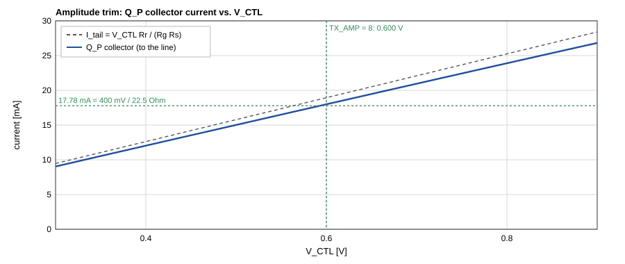
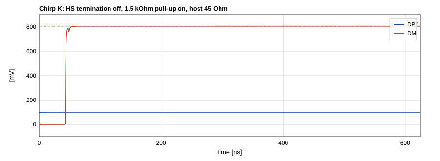

# USB 2.0 discrete transmitter board (afe_transceiver TX) — design description

Rev 0.1 · AFE/Discrete/Transmitter · board: 4-layer FMC LPC mezzanine · FPGA side: AMD 7-Series

## 1 Overview

This board is a discrete-component prototype of the transmit half of the PHY's analog front end. It covers:

- the HS current-steering driver (`afe_hs_tx`);
- the FS/LS driver (`afe_fsls_xcvr`);
- the line terminations and pulls (`afe_term`).

The behavioural reference is `AFE/veriloga/afe_transceiver.va`. The board uses the same pin names and pin semantics: `TX_IN_P/N`, `TX_EN`, `FS_OE/DAT/SE0/LS`, `DP_PULLUP_EN`, `HS_TERM_EN`, `PD_EN0/1`. The documentation is structured like the analog block descriptions (`AFE/doc/pll.md`, i.e. `afe_pll.va`).

The digital half comes from an external AMD 7-Series FPGA board over FMC LPC. The FPGA runs the repo RTL TX chain:

- `usb_tx_path` → `usb_afe_tx_if8`;
- then a 7 × OSERDESE2 serializer (`tx_piso_7s`), which replaces the ASIC's `usb_tx_piso`.

So the bit stream on the board pins is the one the ASIC digital would produce, at 480 Mbit/s. A UART register interface starts patterns, sets the trims and terminations, and reads back the FS receiver.

The board has no FPGA power or configuration circuitry. It is powered from the carrier's FMC 3P3V and VADJ rails.

```
 FPGA carrier (FMC LPC)                     transmitter board                                   USB-C
 ───────────────────────       ┌──────────────────────────────────────────────────────────┐
 TX_IN_P  LVDS  LA02 ─────────►│ SN65LVDT101 ─Z─ 130/82 ─ R_B ─► Q_P (BFT92) ─┐           │
 TX_IN_N  LVDS  LA03 ─────────►│ SN65LVDT101 ─Z─ 130/82 ─ R_B ─► Q_N (BFT92) ─┼─ DP/DM ───┼──► D+/D−
 TX_EN    LA04_P ─ 1T45 ──────►│ divider 237/255/549 ──────────► Q_D (dump)   │   │       │
 V_CTL ◄─ MCP4821 DAC (SPI)    │ U7B+Q5: I_CTL=V_CTL/Rg → Rr ; U7A+Q4: tail I=V(Rr)/Rs ─┘ │
 FS_OE/DAT/SE0/LS ─ 2×LVC2G86 ►│ TUSB1105 (VO/FSE0 mode) ─33R─ FSUSB42 HSD1 ┐  │          │
 HS_TERM_EN ─ 8T245 ──────────►│                       40.2R ─ FSUSB42 HSD2 ┴─D┘ USBLC6   │
 PD_EN0/1, DP_PULLUP_EN ──────►│ 2N7002DW + 15k pull-downs, 1.5k pull-up (SOFTCON)        │
 RXRCV/RXDP/RXDM ◄────────────│ TUSB1105 receivers                                       │
 └───────────────────────       └──────────────────────────────────────────────────────────┘
```

## 2 Requirements (from afe_transceiver.va and the USB 2.0 specification)

| Item | Model / spec | Board implementation |
|---|---|---|
| HS drive | 17.78 mA steered into DP or DM; 400 mV into 2 × 45 Ω | PNP current-steering triple fed by a regulated tail of 18.9 mA. About 17.95 mA reaches the line (BFT92 base current) |
| Chirp | 800 mV into 45 Ω (near-end termination off) | Same current source, HS_TERM_EN = 0 |
| TX_EN | Current dumped internally when 0; t_en ≤ 20 ns | Q_D dump transistor; t_en 1.6–2.3 ns |
| Edges | 10–90 % ≥ 500 ps (USB 2.0 7.1.2.2) | R_B + TX_CAP select the edge rate: 521–654 ps (BFT92) |
| Amplitude trim | TX_AMP (TRIM_TX[3:0]), bias_mode 0/1/2 | MCP4821 DAC (TX_AMP), TX_VREF / 2, or TX_I_5U × 120 kΩ (jumper J3) |
| FS/LS driver | 45 Ω, FS 4–20 ns, LS 75–300 ns, FS J = DP high, LS J = DM high | TUSB1105 + 33 Ω; XOR glue for LS polarity and SPEED |
| Terminations | 1.5 kΩ pull-up, 45 Ω HS termination, 15 kΩ pull-downs | SOFTCON pull-up, FSUSB42 switch + 40.2 Ω, 2N7002DW + 15 kΩ |
| RX status | RXRCV / RXDP / RXDM | TUSB1105 RCV / VP / VM to the FPGA |
| Digital side | 480 Mbit/s pin vectors from `usb_afe_tx_if8` | OSERDESE2 DDR 8:1 at 240 MHz per pin |

## 3 Architecture

Supplies (sheet 1):

- FMC 3P3V → ferrite bead FB1 → **+3V3**, for the FS transceiver, the switch and the translators.
- FMC 3P3V → FB2 → **+3V3A**, for the HS driver, the op-amp, the DAC and the TX_EN translator. +3V3A is kept away from the switching logic.
- **VADJ** (1.65–3.6 V) supplies the FPGA side of every translator and the TUSB1105 VCC(I/O).
- 3P3VAUX supplies the IPMI EEPROM only.

Signal paths:

- **HS (sheet 2).** The LVDS pairs TX_IN_P and TX_IN_N each feed an SN65LVDT101 (LVDS → LVPECL, internal 110 Ω input termination). The *inverting* output Z drives the base of the matching steering transistor through a Thevenin termination and the base resistor R_B. TX_IN_P = 1 therefore pulls Q_P's base low and Q_P conducts into DP. TX_EN, translated to 3.3 V, sets the base of the dump transistor Q_D.
- **FS/LS (sheet 3).** The FS pins are converted by two SN74LVC2G86 into the TUSB1105's single-ended (MODE = 0) inputs. The TUSB1105 drives the line through 33 Ω and the FSUSB42 switch (port 1). Port 2 of the same switch is the 40.2 Ω HS termination. HS_TERM_EN therefore selects "FS driver / FS receiver" or "45 Ω termination", break-before-make.
- **Bias (sheet 4).** V_CTL sets the HS current. It comes from the DAC (TX_AMP trim), from TX_VREF / 2, or from TX_I_5U into 120 kΩ (bias_mode 2 with an external 5 µA source).

## 4 Circuit design and component selection

### 4.1 HS current-steering driver

The emitters of Q_P, Q_N and Q_D form one node (NEM), fed by the tail current source. Exactly one of the three bases is pulled at least ~0.5 V below the other two. That transistor takes the whole tail current:

| TX_EN | TX_IN_P | TX_IN_N | Q_P base | Q_N base | Q_D base | Current to |
|---|---|---|---|---|---|---|
| 0 | x | x | ≥ 1.69 V | ≥ 1.69 V | 0.60 V | dump (GND) |
| 1 | 1 | 0 | ≈ 1.69 V (VOL) | ≈ 2.28 V (VOH) | 2.00 V | DP (J) |
| 1 | 0 | 1 | ≈ 2.28 V | ≈ 1.69 V | 2.00 V | DM (K) |
| 1 | 1 | 1 | low | low | 2.00 V | DP and DM, half each (≈ 200 mV each) |
| 1 | 0 | 0 | high | high | 2.00 V | dump: both lines 0 V (deviation, section 6) |

**Steering transistors.** BFT92 (NXP/Nexperia, PNP, f_T 5 GHz, C_re 0.45 pF, SOT-23) is the primary choice. MMBTH81 (onsemi, PNP, f_T 600 MHz, SOT-23, LCSC C190349, pin-compatible) is the second-source assembly variant. Both have the pinout 1 = B, 2 = E, 3 = C. LCSC lists only the BFT92W (SOT-323, C9994, low stock), which does **not** fit the SOT-23 footprint, so order the BFT92 from Mouser/DigiKey. The two variants differ only in R_B and TX_CAP (section 4.3).

**Base drive.** The SN65LVDT101 output is LVPECL: VOH = VCC − 1.02 V ≈ 2.28 V, VOL = VCC − 1.61 V ≈ 1.69 V. Its emitter-follower outputs need a Thevenin termination to VCC − 2 V. Here that is **130 Ω to +3V3A and 82 Ω to GND**, i.e. 50.3 Ω to 1.276 V. The unused Y outputs get the same termination, so both output stages carry equal current.

The SN65LVDT101 (internal 110 Ω) is not stocked at LCSC. The pin-compatible SN65LVDS101 (C181531) works with the 100 Ω resistors R40/R41 across A/B, which are DNP for the LVDT101.

**Dump base (Q_D).** The SN74LVC1T45 output (0 / 3.3 V) drives the divider Ra = 237 Ω (series), Rb = 255 Ω (to GND), Rc = 549 Ω (to +3V3A):

- TX_EN = 0: V_BD = 3.3 · (237 ∥ 255) / (549 + 237 ∥ 255) = **0.60 V**. Q_D's base is at least 1.1 V below the pair bases, so the whole current is dumped.
- TX_EN = 1: V_BD = 3.3 · 255 / (237 ∥ 549 + 255) = **2.00 V**. This lies between VOL and VOH, so the active line transistor (base at VOL = 1.69 V) wins. When both pair bases are high (P = N = 0), Q_D still conducts and the tail never saturates.

**Tail current source (U7A, Q4).** U7A forces the drop across Rs = 15 Ω (to +3V3A) equal to the drop across Rr. The output stage is the MMBT3906 Q4 (collector → NEM), with 1 kΩ base resistor R23 and 10 nF C17 from base to +3V3A for loop compensation.

**I_CTL generator (U7B, Q5).** U7B forces V_CTL across Rg = 3.57 kΩ. Q5 (MMBT3904) sinks that current from Rr = 1.69 kΩ (C16 = 100 nF across Rr). Hence:

  I_tail = V_CTL · Rr / (Rg · Rs) = 0.600 V · 1690 / (3570 · 15) = **18.94 mA**

The ~6 % above 17.78 mA covers the base current of the active BFT92 (β ≈ 34 at 18 mA): the simulated collector current is 17.95 mA, giving 403 mV on the line.

U7 is an MCP6V02 (zero-drift, rail-to-rail, 1.3 MHz). An OPA2333 is an alternative. The supply sensitivity is set only by the Rr/Rs ratio, so 0.1 % / 25 ppm resistors are preferred for Rs, Rr and Rg.

**Headroom.** At 3.3 V: ET ≈ 3.03 V, NEM ≈ 2.58 V, so Q4 runs with V_EC = 0.37–0.74 V over the corners (table in 5.2) and still regulates: the line level moves by < 1 %. The line swing is limited by the compliance of the steering transistors. At the chirp level (DM ≈ 0.8 V) V_EC(Q_N) is about 1.8 V.

### 4.2 Amplitude trim and bias modes (sheet 4)

J3 selects V_CTL. Exactly one jumper may be fitted:

| J3 jumper | bias_mode | V_CTL source | Nominal |
|---|---|---|---|
| 1–2 | 0 (trim) | MCP4821 VOUT, 0.5 mV/LSB (internal 2.048 V reference, gain 1) | code 1200 → 0.600 V |
| 3–4 | 1 | TX_VREF (J4) / 2: 10 kΩ / 10 kΩ divider | 1.2 V → 0.600 V |
| 5–6 | 2 | TX_I_5U (J5) into R38 = 120 kΩ | 5 µA → 0.600 V |

V_CTL is filtered by R39 = 1 kΩ and C31 = 100 nF. The FPGA writes the DAC from TRIM_TX[3:0] = TX_AMP:

  code = 1200 + 30 · (TX_AMP − 8)

That is 2.5 % per step, −20 % … +17.5 %, so TX_AMP = 0…15 gives about 322–473 mV. The simulated transfer from V_CTL to the line current is linear within **0.6 %** over 0.3–0.9 V (figure 5).

### 4.3 Edge-rate control: R_B and TX_CAP

Unbraked, the BFT92 switches in about 240 ps (10–90 %). That violates the HS minimum of 500 ps and rings on the connector stub. Two components set the edge rate:

- the base resistor R_B, together with the base diffusion capacitance;
- TX_CAP_P/N (C18/C19): the model's TX_CAP pins, realised as small capacitors from each line node to GND.

Figure 4 shows the sweep at 3.3 V / 27 °C. The chosen assembly variants:

| Variant | R_B (R15, R16) | TX_CAP (C18, C19) | t_r near end, nominal | Over corners |
|---|---|---|---|---|
| BFT92 (primary) | 68 Ω | 6.8 pF | 558 ps | 521–654 ps |
| MMBTH81 | 33 Ω | DNP | 577 ps | 559–612 ps |

### 4.4 FS/LS transceiver and terminations (sheet 3)

**TUSB1105.** The TUSB1105 is used with MODE = 0 (VO / FSE0 inputs), VCC(I/O) = VADJ, and Vreg(3.3) = VCC(5.0) = +3V3. The glue logic (2 × SN74LVC2G86 at VADJ) gives every path the same gate delay:

| TUSB1105 pin | Function | Gate |
|---|---|---|
| VO | FS_DAT ⊕ FS_LS (LS J = DM high) | U9 gate 1 |
| FSE0 | FS_SE0 ⊕ 0 | U9 gate 2 |
| OE# | FS_OE ⊕ 1 | U10 gate 1 |
| SPEED | FS_LS ⊕ 1 (1 = FS edges) | U10 gate 2 |

SUSPND comes directly from the FPGA. RCV, VP and VM return to the FPGA as RXRCV, RXDP and RXDM. The model pin FS_RX_EN has no TUSB1105 counterpart; the FPGA emulates it (TERM[5] = 0 forces RXRCV = 1 and RXDP = RXDM = 0).

**FS pull-up.** The 1.5 kΩ pull-up R31 runs from the TUSB1105 VPU(3.3) pin (switched by SOFTCON = DP_PULLUP_EN) to the **line** DP. It therefore works in every switch state, as in `afe_term`. Like `afe_term`, the board has no D− pull-up, so it cannot attach as an LS device.

**HS termination switch.** The FSUSB42MUX has 4.5 Ω typical R_on, 3.7 pF C_on and 720 MHz bandwidth. SEL = HS_TERM_EN (3.3 V from U2):

- SEL = 0: common D± → HSD1 (TUSB1105 through 33 Ω);
- SEL = 1: common D± → HSD2 (R27/R28 = 40.2 Ω to GND), so 40.2 + 4.5 ≈ 45 Ω.

The HS steering collectors connect to the switch's common side, i.e. directly to the line. The 33 Ω series resistors R25/R26 bring the TUSB1105's ~10 Ω driver to the 28–44 Ω FS impedance.

**Pull-downs.** R29/R30 = 15 kΩ to the drains of the 2N7002DW. The switch sits on the ground side so its capacitance is isolated from the line. PD_EN0 controls DP and PD_EN1 controls DM, as in `afe_term`. 100 kΩ gate pull-downs R4–R6 (sheet 1) keep HS_TERM_EN and PD_EN0/1 off while VADJ is down.

**Line and connector.** The line has USBLC6-2SC6 ESD protection and a TYPE-C-31-M-12 receptacle with CC1/CC2 = 5.1 kΩ to GND (Rd). The receptacle supports both plug orientations: A6/B6 → DP, A7/B7 → DM. R34/R35 (45.3 Ω, DNP) emulate the host termination when the board is measured with a high-impedance probe and no host.

### 4.5 Level translation and FMC housekeeping (sheet 1)

| Signal group | Device | Notes |
|---|---|---|
| HS_TERM_EN, PD_EN0/1, DAC CS#/SCK/SDI | SN74LVC8T245 (A = VADJ, B = +3V3, DIR = H) | B7, B8 unused, A7, A8 tied low |
| TX_EN | SN74LVC1T45 (B = +3V3A) | ~3 ns extra delay, covered by TX_LEAD (section 7) |
| VBUS_DET | SN74LVC1T45, B → A | VBUS / 47 k / 100 k → 3.4 V at 5 V VBUS |
| FS_OE/DAT/SE0/LS, SUSPND, DP_PULLUP_EN, RXRCV/DP/DM | direct (VADJ logic) | TUSB1105 VCC(I/O) = VADJ |
| IPMI | AT24C02C at 3P3VAUX | A0 = GA0, A1 = GA1, A2 = GND, WP = GND |

PRSNT_M2C_L (H2) is tied to GND. TDI (D30) is connected to TDO (D31), so the board does not break the carrier's JTAG chain.

### 4.6 FMC LPC pin map

| Signal | FMC | Pin | | Signal | FMC | Pin |
|---|---|---|---|---|---|---|
| TX_IN_P (+/−) | LA02_P/N | H7/H8 | | DAC_CS_N | LA09_P | D14 |
| TX_IN_N (+/−) | LA03_P/N | G9/G10 | | DAC_SCK | LA09_N | D15 |
| TX_EN | LA04_P | H10 | | DAC_SDI | LA10_P | C14 |
| FS_OE | LA04_N | H11 | | VBUS_DET | LA10_N | C15 |
| FS_DAT | LA05_P | D11 | | RXRCV | LA11_P | H16 |
| FS_SE0 | LA05_N | D12 | | RXDP | LA11_N | H17 |
| FS_LS | LA06_P | C10 | | RXDM | LA12_P | G15 |
| FS_SUSPND | LA06_N | C11 | | 3P3V | | C39, D36, D38, D40 |
| DP_PULLUP_EN | LA07_P | H13 | | VADJ | | G39, H40 |
| HS_TERM_EN | LA07_N | H14 | | 3P3VAUX | | D32 |
| PD_EN0 | LA08_P | G12 | | SCL / SDA | | C30 / C31 |
| PD_EN1 | LA08_N | G13 | | GA0 / GA1 | | C34 / D35 |

LA02/LA03 were chosen because they are plain (non-CC) pairs on most carriers. All other signals are single-ended. Before releasing the layout, check the map against VITA 57.1 and the target carrier's schematic, including its VADJ setting.

## 5 Simulation results

### 5.1 Testbench

The setup is ngspice-42 (`sim/run_sims.py`). Models:

- **Transistors:** vendor SPICE cards (NXP BFT92, onsemi MMBTH81). MMBT3904/3906 use generic models.
- **Op-amp:** linear, 1.3 MHz GBW.
- **SN65LVDT101:** PWL source, 200 ps edges, VOH/VOL from the datasheet, 7 Ω output, a 50 Ω / 60 ps trace to the Thevenin termination.
- **Parasitics:** SOT-23 leads 0.8 nH; switch 1.9 pF + 4.5 Ω; ESD 2.5 pF.
- **Line:** 8 mm board trace to the connector (**near end**, TP2), then a 0.5 m 45 Ω cable to a host with 2 pF ∥ 45 Ω (**far end**).

The stimulus is the USB 2.0 Test_Packet (SYNC … EOP, 522 line bits, generated by `sim/usbpat.py`, which also generates the FPGA ROM and the RTL testbench reference). Corners: VDD 3.135 / 3.465 V × −40 / 85 °C.

### 5.2 Results


*Figure 1 – Test_Packet eye, BFT92 (R_B 68 Ω, TX_CAP 6.8 pF), 3.3 V, 27 °C. Near end with USB 2.0 Template 1 (TP2).*


*Figure 2 – Test_Packet eye, MMBTH81 (R_B 33 Ω, no TX_CAP).*

**BFT92 - eye (Test_Packet)**

| Corner | J near [mV] | EH near [mV] | t_r [ps] | t_f [ps] | jitter p-p [ps] | EH far [mV] | t_r far [ps] | delay [ns] |
|---|---|---|---|---|---|---|---|---|
| 3.300 V, 27 C | 402 | 763 | 558 | 558 | 90 | 746 | 573 | 3.10 |
| 3.135 V, -40 C | 399 | 766 | 521 | 521 | 89 | 737 | 538 | 3.08 |
| 3.135 V, 85 C | 404 | 758 | 551 | 551 | 90 | 756 | 565 | 3.12 |
| 3.465 V, -40 C | 399 | 765 | 602 | 600 | 89 | 735 | 616 | 3.08 |
| 3.465 V, 85 C | 402 | 749 | 654 | 652 | 90 | 749 | 668 | 3.13 |

**BFT92 - static states**

| Corner | J [mV] | I dump [mA] | P=N=1 DP [mV] | P=N=0 DP [mV] | t_en [ns] | t_dis [ns] | tail V_EC [V] | idle leakage [uA] |
|---|---|---|---|---|---|---|---|---|
| 3.300 V, 27 C | 403 | 17.97 | 202 | 5.8 | 1.8 | 1.0 | 0.47 | 0.00 |
| 3.135 V, -40 C | 401 | 17.87 | 201 | 6.8 | 1.7 | 1.0 | 0.37 | 0.00 |
| 3.135 V, 85 C | 404 | 18.02 | 203 | 31.4 | 1.6 | 1.1 | 0.53 | 0.00 |
| 3.465 V, -40 C | 401 | 17.88 | 201 | 0.2 | 1.9 | 0.9 | 0.40 | 0.00 |
| 3.465 V, 85 C | 402 | 18.03 | 203 | 2.2 | 2.0 | 1.0 | 0.56 | 0.00 |

**MMBTH81 - eye (Test_Packet)**

| Corner | J near [mV] | EH near [mV] | t_r [ps] | t_f [ps] | jitter p-p [ps] | EH far [mV] | t_r far [ps] | delay [ns] |
|---|---|---|---|---|---|---|---|---|
| 3.300 V, 27 C | 418 | 757 | 577 | 577 | 92 | 817 | 596 | 3.23 |
| 3.135 V, -40 C | 415 | 753 | 559 | 559 | 91 | 808 | 580 | 3.21 |
| 3.135 V, 85 C | 420 | 758 | 591 | 591 | 94 | 822 | 608 | 3.24 |
| 3.465 V, -40 C | 415 | 754 | 571 | 570 | 91 | 809 | 590 | 3.21 |
| 3.465 V, 85 C | 420 | 760 | 612 | 611 | 94 | 824 | 628 | 3.24 |

**MMBTH81 - static states**

| Corner | J [mV] | I dump [mA] | P=N=1 DP [mV] | P=N=0 DP [mV] | t_en [ns] | t_dis [ns] | tail V_EC [V] | idle leakage [uA] |
|---|---|---|---|---|---|---|---|---|
| 3.300 V, 27 C | 416 | 18.60 | 208 | 0.3 | 2.0 | 1.2 | 0.64 | 0.01 |
| 3.135 V, -40 C | 413 | 18.45 | 207 | 0.8 | 1.8 | 1.3 | 0.52 | 0.00 |
| 3.135 V, 85 C | 418 | 18.68 | 209 | 5.0 | 1.9 | 1.3 | 0.71 | 0.05 |
| 3.465 V, -40 C | 413 | 18.45 | 207 | 0.0 | 2.2 | 1.1 | 0.55 | 0.00 |
| 3.465 V, 85 C | 418 | 18.68 | 209 | 0.1 | 2.3 | 1.2 | 0.74 | 0.05 |

- chirp BFT92: DM 806 mV, DP 96 mV, DM-DP 710 mV

- chirp MMBTH81: DM 835 mV, DP 96 mV, DM-DP 739 mV
- skew_BFT92 (TX_IN_N 150 ps late): near EH 752 mV, jitter 69 ps, t_r 589 / t_f 566 ps
- trim: alpha 0.9442 .. 0.9548, linearity 0.60 %


*Figure 3 – Static states and TX_EN timing (BFT92).*


*Figure 4 – Edge rate vs. R_B and TX_CAP.*



*Figure 5 – Q_P current vs. V_CTL (amplitude trim).*



*Figure 6 – Device chirp K (HS termination off, 1.5 kΩ pull-up on).*

Summary:

- **Amplitude.** 400–404 mV (BFT92) and 413–420 mV (MMBTH81) over the corners; nominal 400 mV ± 10 %. The higher MMBTH81 level comes from its higher β. Trim it with TX_AMP = 7 (−2.5 %) or with Rg. The MMBTH81 variant also overshoots to ≈ 510 mV after isolated bits, close to the 525 mV limit of Template 1 (figure 2). This is one more reason to prefer the BFT92.
- **Eye.** Near-end eye height ≥ 749 mV. The eye stays clear of Template 1 (figure 1). Deterministic jitter ≈ 90 ps p-p: data-dependent, from the edge-rate control (figure 4) and the termination mismatch of the 8 mm stub.
- **Delay.** TX_IN (LVDS at the board pins) → far end 3.1–3.2 ns, of which the cable is 2.5 ns, so board latency ≈ 0.6 ns. An extra 150 ps P/N skew (`skew_BFT92`) costs ≈ 10 mV of eye height; jitter stays 69 ps p-p.
- **TX_EN.** t_en 1.6–2.3 ns, t_dis 0.9–1.3 ns, far below the model's 20 ns budget. Idle leakage into the line is ≤ 0.05 µA at every corner.
- **Chirp.** DM 806 mV (BFT92) / 835 mV (MMBTH81). Against the 1.5 kΩ pull-up, DP − DM = −710 / −739 mV, inside VCHIRPK = −900 … −500 mV (USB 2.0 table 7-3).
- **Corrected design error.** The first termination was 82 Ω to VCC / 130 Ω to GND (Thevenin 2.02 V instead of 1.28 V). That would turn the real LVPECL emitter followers off at VOL and leave Q_P with only ≈ 0.56 V V_EB. It was corrected to 130 / 82 Ω before the results above.

## 6 Deviations from afe_transceiver.va

| # | Model | Board | Consequence |
|---|---|---|---|
| D1 | P = N = 0 with TX_EN = 1: current split / undefined | Current goes to the dump, both lines ≈ 0 V (≤ 31 mV at 3.135 V / 85 °C) | The digital never sends P = N = 0 with TX_EN = 1 (usb_tx_piso drives P = ¬N). Only an RTL fault would show it |
| D2 | t_en = 20 ns | 1.6–2.3 ns (plus ~3 ns translator) | Conservative. TX_LEAD (default 10 bits = 21 ns) covers both |
| D3 | t_dly 0.5 ns, t_rf_hs 0.625 ns | ≈ 0.6 ns board; t_r 0.52–0.65 ns | Matches. FPGA OSERDES latency comes on top, the same for all pins |
| D4 | FS driver, HS termination and pulls in parallel on DP/DM | FS transceiver and 45 Ω termination behind one 2:1 switch | With HS_TERM_EN = 1 the FS receiver is disconnected, so RXDP/RXDM/RXRCV do not follow the line in HS mode. The ASIC uses the squelch / HS receivers there |
| D5 | FS_RX_EN pin | No TUSB1105 equivalent; emulated in the FPGA (TERM[5]) | Same values at the digital inputs |
| D6 | TX_CAP_P/N: pins for external capacitors | C18/C19 = 6.8 pF from the line nodes to GND | Same function (edge rate); value per transistor variant |
| D7 | VDD33 from the PHY supply | FMC 3P3V via ferrite beads | — |
| D8 | bias_mode 0: ideal i_hs, trim by i_scale | DAC: 2.5 % / step, same TX_AMP encoding | Same register semantics (DOC/afe_interface_spec.md 6, TRIM_TX 30h) |

To use the board timing in mixed-signal simulations, instantiate `afe_transceiver` with `t_en = 3e-9`, `t_dly = 0.6e-9` (plus cable), and `i_hs` = the measured line current (17.95 mA simulated). For the edge rate, instantiate `afe_hs_tx` directly with `t_rf_hs = 0.7e-9`: a 0–100 % ramp, ≈ 0.56 ns 10–90 %. The `afe_transceiver` wrapper does not pass `t_rf_hs` on.

## 7 FPGA design (fpga/)

```
CLKIN ─ MMCME2 (VCO 960 MHz) ─┬─ clk60  (/16, BUFG) ─ tx_ctrl, tx_seq, usb_tx_path, usb_afe_tx_if8, tx_piso_7s (CLKDIV)
                              └─ clk240 (/4,  BUFG) ─ OSERDESE2 CLK (DDR → 480 Mbit/s)
UART ─ tx_ctrl ─ registers ─ tx_seq ─ bytes ─ usb_tx_path ─ txd_v/tx_en_v/tx_se0_v ─ usb_afe_tx_if8
     ─ pin vectors ─ tx_piso_7s ─ 7 × OSERDESE2 ─ OBUFDS (TX_IN_P, TX_IN_N) / OBUF (TX_EN, FS_*)
```

| File | Content |
|---|---|
| `rtl/tx_fpga_top.v` | Top level: MMCM (CLKIN_MHZ / MMCM_MULT / MMCM_DIV parameters, 100 or 200 MHz input), reset synchroniser, input synchronisers, FS_RX_EN emulation, output buffers |
| `rtl/tx_seq.v` | Packet sequencer: Test_Packet ROM, 64-byte user buffer, Test_J/K, chirp K, PRBS7 + CRC16; SYNC (4 bytes HS / 1 byte FS/LS); repeat with gap |
| `rtl/tx_ctrl.v` | UART register file, MCP4821 SPI writer |
| `rtl/tx_piso_7s.v` | 8:1 serializer per pin (OSERDESE2 DDR, D1 = bit 0 first) and the idle clamp |
| Repo RTL | `usb_bit_stuffer`, `usb_nrzi_encoder`, `usb_tx_serializer8`, `usb_tx_path`, `usb_afe_tx_if8` (unchanged) |
| `constraints/tx_board_fmc.xdc` | FMC LA map (carrier package pins to fill in), I/O standards for VADJ 2.5 / 1.8 V, false paths |
| `build_vivado.tcl` | Non-project Vivado build: `vivado -mode batch -source build_vivado.tcl -tclargs <part> [clk mult div diff]` |
| `sim/tb_tx_fpga_top.v`, `sim/run_sim.sh` | Icarus self-checking testbench (behavioural OSERDESE2 with `-DTX_PISO_SIM`) |
| `synth_check.ys` | Yosys `synth_xilinx -family xc7` smoke synthesis |

Differences from the ASIC's `usb_tx_piso`:

1. The idle clamp (`drv_dis`, `iso_en`) acts on whole 8-bit vectors (up to 10 bit times of latency instead of 2). The rest of an interrupted packet is dropped until a vector without driver enables has passed.
2. FS_LS is a serialized pin vector.
3. The OSERDESE2 latency replaces LAT = 9 clk_bit cycles. It is equal on all seven pins, so TX_LEAD / TX_LAG stay exact.

**Verification.** `fpga/sim/run_sim.sh` passes (`TEST PASSED`). It checks:

1. UART register read/write;
2. DAC SPI words: reset value 1200, TX_AMP = 10 → 1260, override;
3. that the HS Test_Packet on TX_IN_P equals `usbpat.hs_packet_line()` bit for bit (522 bits after TX_LEAD = 10 J bits), with TX_IN_N = ¬TX_IN_P;
4. TX_LEAD = 4 / TX_LAG = 3;
5. an HS PRBS7 packet, decoded (NRZI, unstuffing, CRC16 residual B001h);
6. an FS packet (40 samples per bit, SYNC, EOP = 2 × SE0 + J);
7. an LS packet (320 samples per bit, FS_LS = 1);
8. chirp K with lead_first;
9. the TERM outputs and the FS_RX_EN emulation;
10. the idle clamp in mid-packet.

**Resources.** Yosys `synth_xilinx` (`fpga/synth_check.ys`), `check -assert` clean:

| Resource | Count |
|---|---|
| LUTs | 1 790 |
| Flip-flops | 665 |
| CARRY4 | 191 |
| RAM64M | 3 |
| OSERDESE2 | 7 |
| MMCME2 | 1 |
| BUFG | 2 |
| OBUFDS | 2 |

This fits any Artix-7. Timing closure of the 240 MHz OSERDES clock and the clk60 logic is to be confirmed in Vivado.

## 8 Register map and UART protocol

UART: 115 200 Bd, 8N1, binary. Write: `57h addr data` (no reply). Read: `52h addr` → `data`.

| Addr | Name | Bits | Reset |
|---|---|---|---|
| 00h | ID | RO 54h ('T') | 54h |
| 01h | CTRL | [0] go (rising edge starts), [1] rpt, [3:2] speed (00 HS, 01 FS, 10 LS, 11 FS rate), [4] sync_dis, [5] drv_dis (idle clamp), [6] iso_en | 00h |
| 02h | PATTERN | [2:0] 0 Test_Packet, 1 user buffer, 2 Test_J, 3 Test_K, 4 chirp K, 5 PRBS7 | 00h |
| 03h/04h | LEN_L/H | Bytes (user / J / K / chirp / PRBS7); chirp 1 ms = 60 000 | 0040h |
| 05h/06h | GAP_L/H | Gap between repeated packets in clk60 ticks | 0100h |
| 07h | BUF_ADDR | User-buffer write pointer (auto-increment) | 00h |
| 08h | BUF_DATA | WO, user-buffer byte | — |
| 09h | TRIM_LEAD | [4:0] TX_LEAD, [7:5] TX_LAG (as spec register 31h) | 0Ah |
| 0Ah | TRIM_TX | [3:0] TX_AMP (as spec register 30h) | 08h |
| 0Bh/0Ch | DAC_L/H | [11:0] direct DAC code, [15] override enable | 0000h |
| 0Dh | TERM | [0] DP_PULLUP_EN, [1] HS_TERM_EN, [2] PD_EN0, [3] PD_EN1, [4] FS_SUSPND, [5] FS_RX_EN | 20h |
| 0Eh | STATUS | RO [0] seq_busy, [1] tx_active, [2] mmcm_locked, [3] RXRCV, [4] RXDP, [5] RXDM, [6] VBUS_DET, [7] dac_busy | — |
| 0Fh | PKT_CNT | RO, packets sent (wraps) | 00h |

Examples:

- HS Test_Packet loop: `W 0D 02` (HS termination on), `W 02 00`, `W 01 03`.
- Chirp K for 1 ms: `W 0D 01` (pull-up on, termination off), `W 02 04`, `W 03 60`, `W 04 EA`, `W 01 01`.

## 9 PCB guidelines

- **Stack-up.** 4 layers: signal / GND / power (+3V3, +3V3A, VADJ islands) / signal. Route D+/D− as a 90 Ω differential pair (45 Ω single-ended) over unbroken GND. Route the FMC LVDS pairs (LA02, LA03) as 100 Ω pairs, length-matched within 0.5 mm, and keep the carrier's P/N assignment.
- **The 8 mm rule.** Q_P/Q_N collectors, FSUSB42 common pins, USBLC6 and the connector must lie within ~8 mm of the connector. In simulation a 25 mm stub between driver and connector produced ringing and an eye-height loss. Place C18/C19 at the collector pads, and R_B and the termination resistors at the bases.
- **Analog island.** Keep the tail (Q4, R20, U7) and the bias network on the +3V3A island with a solid ground. Keep R20/R21/R22 thermally coupled (same orientation, close together).
- **Decoupling.** 100 nF at every supply pin, 10 µF per rail at the ferrite beads.
- **FMC.** The ASP-134604-01 needs the standard VITA 57.1 mezzanine outline (69 × 76.5 mm, LPC connector at the standard position), with mounting holes at the VITA positions and the 10 mm stack height.
- **Test points.** Add pads on V_CTL, ET, NEM, VR, BD, TX_EN_3V3 and SMA/U.FL footprints (DNP) on DP/DM next to the connector for direct scope measurements.

## 10 Bring-up and test procedure

1. **Unpowered.** Check the resistance from 3P3V and VADJ to GND (> 100 Ω). Check the jumper on J3 (1–2).
2. **Power.** Plug onto the carrier with VADJ = 2.5 V (or 1.8 V). Check +3V3 and +3V3A. Expect roughly 0.15 A from 3P3V: four LVPECL terminations at ≈ 25 mA each plus the 19 mA tail, which runs into the dump while TX_EN = 0.
3. **Bitstream.** Load the bitstream and check that the carrier LED driven by `led_locked` lights. Over the UART: `R 00` → 54h. `R 0E` should show mmcm_locked = 1.
4. **Bias.** V_CTL = 0.600 V (DAC). Check V(+3V3A) − V(ET) = 284 mV ± 1 % (18.9 mA in Rs). For TX_AMP 0…15, check V_CTL against the code table (2.5 % per step).
5. **HS static.**
   - HS_TERM_EN = 1, pattern Test_J (2), rpt: DP ≈ 400 mV, DM ≈ 0 V with a 45 Ω host load (R34/R35 fitted, or a host).
   - Test_K: the mirror image.
   - CTRL.drv_dis = 1: both lines ≤ 10 mV.
6. **HS eye.** Run the Test_Packet with rpt and a gap. Measure at the connector with a ≥ 4 GHz differential probe, or SMA into a 50 Ω scope with R34/R35 removed. Compare against Template 1 and figures 1/2. Measure the 10–90 % times at the J/K transitions of the 0x00 / 0xFF sequences.
7. **Chirp.** TERM = 01h, pattern 4, LEN 60000: DM ≈ 800 mV for 1 ms against a host.
8. **FS/LS.**
   - speed 01 / 10, user packet: check FS edges 4–20 ns and LS 75–300 ns, and the crossover voltage 1.3–2.0 V.
   - STATUS RXDP/RXDM reflect the line when TERM[5] = 1 and HS_TERM_EN = 0.
9. **Terminations.** DP_PULLUP_EN: DP ≈ 3.3 V open circuit. PD_EN0/1: 15 kΩ to GND, measured with an ohmmeter while unpowered or through the line level.
10. **Against a real host.** With an external link (or the full PHY RTL later), check the HS handshake: chirp K, then the host's KJKJ.

## 11 Bill of materials

The full list is in `bom/tx_board_bom.csv`: 101 parts, 46 lines, with LCSC numbers. `bom/tx_board_bom_jlcpcb.csv` is the JLCPCB assembly format and omits DNP parts. Parts not stocked at LCSC:

| Ref | Part | Source |
|---|---|---|
| J1 | Samtec ASP-134604-01 (FMC LPC mezzanine) | Samtec / Mouser |
| Q1–Q3 | NXP BFT92,215 (SOT-23) | Mouser / DigiKey. Alternative: MMBTH81 C190349 with R15/R16 = 33 Ω (C23140) and C18/C19 not fitted |
| U5, U6 | TI SN65LVDT101DGK | TI / Mouser. Alternative: SN65LVDS101DGK (C181531) with R40/R41 fitted |

Main active parts:

| Part | Function |
|---|---|
| MCP6V02-E/SN (C47081) | Op-amp |
| MCP4821-E/SN (C36865) | DAC |
| TUSB1105RGTR (C133946) | FS/LS transceiver |
| FSUSB42MUX (C11355) | HS termination switch |
| SN74LVC8T245PWR (C27643) | Level translator, slow controls |
| SN74LVC1T45DBVR (C7843) | TX_EN and VBUS_DET translators |
| SN74LVC2G86DCTR (C130023) | XOR glue |
| 2N7002DW (C194045) | Pull-down switches |
| MMBT3906 (C53444), MMBT3904 (C20526) | Tail and I_CTL transistors |
| USBLC6-2SC6 (C7519) | ESD protection |
| TYPE-C-31-M-12 (C165948) | USB-C receptacle |
| AT24C02C (C6203) | IPMI EEPROM |

Plus one 2.54 mm jumper for J3. Check LCSC stock before ordering; low-stock items when this was written were TUSB1105 and SN74LVC2G86.

## 12 Files and how to regenerate

| Path | Content / command |
|---|---|
| `easyeda/gen_schematic.py` | Writes `usb_tx_board_sch.json` (EasyEDA Std, 4 sheets), `netlist.csv` and the BOMs: `python3 gen_schematic.py` |
| `easyeda/usb_tx_board_sch.json` | Open in EasyEDA Std: Design → File Source → paste → *Create New Document* (or File → Open → EasyEDA Source). Checked in EasyEDA 6.5.61: all components and the 80 nets are identical to `netlist.csv`. The only unconnected pins are the unused FMC pins, SBU1/2, the 8T245 B7/B8 and the LVDT101 NC pins |
| `easyeda/lib/*.json` | Cached symbols / footprints. Source: JLCEDA/EasyEDA official library (https://easyeda.com, https://lceda.cn) |
| `sim/run_sims.py` | ngspice characterisation (`python3 run_sims.py [filters]`, results in `sim/results/summary.json`; waveforms kept only for the figure cases); `sim/tables.py` prints the tables of section 5 |
| `sim/models/tx_models.lib` | BFT92 (NXP), MMBTH81 (onsemi), generic 3904/3906, op-amp |
| `doc/gen_figures.py`, `doc/md2docx.js` | Figures (SVG + PNG); this document as Word (`node md2docx.js`) |
| `fpga/` | See section 7 |

## 13 Open points

- PCB layout (EasyEDA: Design → Convert to PCB). The footprints come with the library symbols. Add test points and SMA footprints (section 9).
- The LVPECL driver is modelled as an ideal source. Bench measurements decide the final R_B / TX_CAP values: keep 0603 footprints so they can be changed.
- The FMC pin map must be checked against the target carrier. VADJ must be set to 2.5 V or 1.8 V by the carrier.
- No D− pull-up: no LS device attach, as in `afe_term`. An optional 1.5 kΩ to D− with its own switch can be added if LS device tests are needed.
- Vivado timing closure (not run in this environment).
