# afe_ldo — 1.8 V Low-Dropout Regulator for the Analog Domain — Datasheet

*Datasheet of the transistor-level LDO `afe_ldo_tr` (`AFE/LDO analog part/afe_ldo_tr.sp`) of the USB 2.0 ULPI PHY. It makes the analog 1.8 V supply VDD18A (PLL, CDR, crystal oscillator) from VDD33 and supervises it. Revision 0.1, 2026-11-22. All values come from ngspice 42 simulations with the X-FAB xh018 BSIM3v3 models of `ne3i` / `pe3i` (3.3 V isolated MOS) and a JUNCAP2-based model of the p+/n-well diode `dp3` (`sim/xfab2ngspice_ldo.py`; worst-case corners at 3 σ). Resistors and capacitors are ideal and there is no layout extraction: the values are pre-layout estimates, not sign-off data. Typical: tm, 27 °C, VIN = 3.3 V, COUT = 1 µF (ESR 10 mΩ).*

Figures: `fig/` (SVG; PNG copies for Word), generated by `gen_figures.py` from the simulation results in `data/` (`sim/run_all.py`). Related documents: [../ldo_description.md](../ldo_description.md) (circuit description, schematic sheets), `AFE/veriloga/afe_ldo.va` (behavioural model, same pins), `DOC/afe_interface_spec.md` (supplies and power sequence).

## 1. Overview

`afe_ldo` is a PMOS-pass low-dropout regulator with an on-chip bandgap reference, soft start, current limit, under-voltage lockout (UVLO), active output discharge and a power-good / power-on-reset supervisor. It needs a single external ceramic capacitor (1 µF recommended, 0.47–2.2 µF rated) and no minimum load.

**Features**

- VIN 2.97–3.63 V (VDD33), VOUT 1.80 V, 0–20 mA rated load (PLL + CDR + XOSC ≈ 3.5 mA).
- Output voltage 1.799 V typical; untrimmed −3.8 % / +3.1 % over the 3 σ process corners, −40…125 °C, line and load (1.732–1.856 V); a trim is recommended (section 16).
- Bandgap from dp3 diodes: 1.182–1.187 V from −40 to 125 °C (26 ppm/K box, tm).
- Quiescent current 91 µA (74–115 µA over corners, including the 10 µA feedback divider); ≤ 30 nA when disabled.
- Load regulation −2.0 mV (0 → 20 mA), line regulation ≤ 1.3 mV/V.
- Phase margin ≥ 55° from no load to 20 mA over all PVT corners (COUT 1 µF), crossover 2.4 kHz (no load) to 620 kHz (20 mA).
- PSRR ≥ 40 dB up to 1 MHz at 20 mA over all corners (62 dB at 1 kHz typical); load step 1 ↔ 20 mA in 1 µs: ±8 mV typical, ±10.5 mV worst.
- Current limit 62–86 mA, short-circuit current 84 mA typical, recovery without overshoot.
- UVLO 2.65 V rising / 2.50 V falling (typ.), 145 mV hysteresis; the output stays in regulation down to the UVLO.
- Soft start: LDO_EN → VOUT 90 % in 122 µs (108–142 µs), monotonic, inrush limited by the current limit.
- PWR_GOOD ≈ 10 µs after VOUT crosses 0.9·VOUT(nom), low at once below ≈ 0.86·VOUT(nom); POR_N ≈ 100 µs after PWR_GOOD.
- LDO_EN with an absolute threshold of 0.63–0.85 V: 1.8 V or 3.3 V logic, or tied to VIN.
- Active output discharge (≈ 0.6 kΩ) while disabled or in UVLO.
- Only 3.3 V thick-oxide devices; logic outputs swing 0…VOUT.

**Views and status**

| View | File | Status |
|---|---|---|
| Transistor schematic | `afe_ldo_tr.sp` | Simulated with ngspice 42 and the xh018 models at the corners of section 14. No layout |
| Testbench | `sim/tb_ldo_tr.py` | 16 cases; prints TEST PASSED / FAILED |
| Regression | `sim/run_all.py` | 9 runs (PVT, COUT); results in `data/` |
| Schematic sheets | `doc/ldo_{block,bandgap,regulator,supervisor}.svg` | Generated by `doc/draw_ldo.py` |
| Behavioural model | `AFE/veriloga/afe_ldo.va` | Same pins; parameters to be aligned with this datasheet (section 15) |

## 2. Block diagram

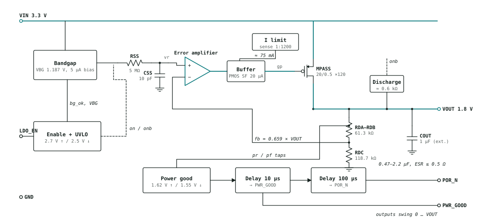

The bandgap (VBG = 1.187 V) is filtered by RSS / CSS (soft start) into the reference vr of the error amplifier. Through a PMOS source follower, the amplifier drives the gate of the 2400 µm / 0.5 µm pass device. The divider closes the loop at fb = 0.659·VOUT. The current limit senses a 1 : 1200 copy of the pass current. The supervisor (VIN domain) enables the regulator when LDO_EN is high and VIN is above the UVLO, compares VOUT with the power-good thresholds and times PWR_GOOD and POR_N; their output inverters are supplied by VOUT. The transistor-level sheets are in section 12.

## 3. Pin description

| Pin | Type | Description |
|---|---|---|
| VIN | supply | Input supply VDD33, 2.97–3.63 V |
| VOUT | analog out | Regulated 1.8 V; connect COUT (1 µF ceramic) to GND close to the pin |
| GND | supply | Ground (bandgap, divider and pass device return) |
| LDO_EN | digital in | Enable, high-active, threshold 0.63–0.85 V absolute; no internal pull, must be driven |
| PWR_GOOD | digital out | High (= VOUT) when VOUT is in regulation; 0 while disabled, in UVLO or when VOUT drops below the lower threshold |
| POR_N | digital out | Power-on reset, low-active; goes high ≈ 100 µs after PWR_GOOD, falls with it |

## 4. Absolute maximum ratings

| Parameter | Min | Max | Unit | Note |
|---|---|---|---|---|
| VIN | −0.3 | 3.96 | V | 3.3 V device rating (+10 %) |
| VOUT | −0.3 | VIN + 0.3 | V | pass-device body diode to VIN |
| LDO_EN | −0.3 | 3.96 | V | gate input |
| Output current | — | internally limited | | 62–99 mA peak |
| Junction temperature | −40 | 125 | °C | simulated range |

## 5. Recommended operating conditions

| Parameter | Min | Typ | Max | Unit | Note |
|---|---|---|---|---|---|
| VIN | 2.97 | 3.3 | 3.63 | V | |
| Load current, COUT ≥ 1 µF | 0 | 3.5 | 20 | mA | |
| Load current, COUT = 0.47 µF | 0 | 3.5 | 5 | mA | GM 6 dB at 20 mA |
| COUT (effective, after DC-bias derating) | 0.47 | 1.0 | 2.2 | µF | 10 µF only with load ≥ 1 mA (section 7) |
| COUT ESR | 0.005 | 0.01 | 0.5 | Ω | |
| LDO_EN high / low | 1.2 / — | | — / 0.4 | V | |
| Temperature | −40 | 27 | 125 | °C | |

## 6. Electrical characteristics

VIN = 2.97–3.63 V, −40…125 °C, all simulated corners (tm, ws, wp, wo, wz), COUT = 1 µF, unless noted. Typical: tm, 27 °C, VIN = 3.3 V. Min / max are the extremes of the corner runs of section 14 (not statistical limits).

### 6.1 Output and reference

| Parameter | Conditions | Min | Typ | Max | Unit |
|---|---|---|---|---|---|
| Output voltage VOUT | no load | 1.734 | 1.799 | 1.856 | V |
| | 20 mA | 1.732 | 1.798 | 1.853 | V |
| Output accuracy, untrimmed | all corners, line, load, temperature | −3.8 | | +3.1 | % |
| Temperature drift VOUT | tm, −40…125 °C, 5 mA | | 7.6 | | mV (box) |
| Bandgap voltage VBG | corner runs (section 13) | 1.144 | 1.187 | 1.224 | V |
| Bandgap TC (box method) | −40…125 °C | | 26 (tm) | 95 (ws) | ppm/K |
| Line regulation | VIN 2.97 → 3.63 V, 1 mA | −2.0 | −0.5 | 0 | mV/V |
| | VIN 2.97 → 3.63 V, 20 mA | −1.3 | 0.05 | 1.05 | mV/V |
| Load regulation | 0 → 20 mA, VIN 2.97 / 3.3 V | −3.8 | −2.0 | −1.7 | mV |
| Dropout voltage (VOUT −50 mV) | 1 mA, UVLO overridden | 46 | 127 | 228 | mV |
| | 20 mA, UVLO overridden | 440 | 555 | 674 | mV |
| Minimum VIN for regulation | 20 mA | | below UVLO falling threshold | | |

The 20 mA dropout (≤ 0.67 V) is below VIN(min) − VOUT − margin (2.97 − 1.86 = 1.11 V) at every corner; in practice the regulator stays in regulation until the UVLO switches it off (section 9).

### 6.2 Supply current

| Parameter | Conditions | Min | Typ | Max | Unit |
|---|---|---|---|---|---|
| Quiescent current IQ | no load, incl. 10 µA divider | 74 | 91 | 115 | µA |
| Ground current | 20 mA | 91 | 109 | 133 | µA |
| Ground current vs temperature | tm, 5 mA, −40…125 °C | 103 | 116 | 137 | µA |
| Off current | LDO_EN = 0 | | 1.1 | 29 | nA |

### 6.3 Current limit and protection

| Parameter | Conditions | Min | Typ | Max | Unit |
|---|---|---|---|---|---|
| Current limit (VOUT −100 mV) | load ramp | 62 | 76 | 86 | mA |
| Maximum output current (foldback knee) | load ramp | 79 | 90 | 99 | mA |
| Short-circuit current | 1 Ω to GND | | 84 | | mA |
| Peak current at short | 1 Ω, transient | | 97 | | mA |
| Recovery after short | to 98 % of VOUT | | 23 | | µs |
| Overshoot after short | | | 1.2 | | mV |
| Output discharge resistance | disabled / UVLO | | 0.6 | 1.0 | kΩ |

### 6.4 AC characteristics

| Parameter | Conditions | Min | Typ | Max | Unit |
|---|---|---|---|---|---|
| DC loop gain | 0 … 20 mA | 76 | 82–98 | 100 | dB |
| Crossover frequency | no load | 1.8 | 2.4 | 2.4 | kHz |
| | 20 mA | 430 | 621 | 700 | kHz |
| Phase margin | 0 … 20 mA, COUT 1 µF | 55 | 60 | | ° |
| Gain margin | 0 … 20 mA, COUT 1 µF | 11.7 | 12.5 | | dB |
| PSRR | 1 kHz, 20 mA | 40.5 | 62 | | dB |
| | 1 kHz, 1 mA | 40.7 | 68 | | dB |
| | 100 kHz, 20 mA | 47 | 55 | | dB |
| | 1 MHz, 20 mA | 54 | 58 | | dB |
| Output impedance | 100 Hz, 20 mA | | 36 | | mΩ |
| | peak, 20 mA (40 kHz) | | 260 | | mΩ |
| Output noise | 10 Hz – 100 kHz, 5 mA | | 237 | | µV rms |
| Noise density | 1 kHz / 100 kHz | | 2.9 / 0.07 | | µV/√Hz |

### 6.5 Enable, UVLO and supervisor

| Parameter | Conditions | Min | Typ | Max | Unit |
|---|---|---|---|---|---|
| LDO_EN threshold | rising ≈ falling | 0.63 | 0.76 | 0.85 | V |
| UVLO rising threshold | VIN ramp 1 V/ms | 2.551 | 2.645 | 2.728 | V |
| UVLO falling threshold | | 2.408 | 2.497 | 2.575 | V |
| UVLO hysteresis | | 143 | 148 | 153 | mV |
| PWR_GOOD rising threshold | VOUT rising (= VBG / 0.7325) | 1.560 | 1.619 | 1.670 | V |
| PWR_GOOD delay t_PG | after the PG comparator | 7.8 | 10.7 | 14.0 | µs |
| POR_N delay t_POR | after PWR_GOOD | 77 | 106 | 139 | µs |
| PWR_GOOD fall | LDO_EN ↓ | | 25 | 38 | ns |
| Output levels PWR_GOOD / POR_N | | 0 | | VOUT | V |

## 7. Stability

The loop has a dominant pole at the pass-device gate, compensated by a series REA (2 MΩ) / CEA (50 pF) network from the error-amplifier output to the gate buffer. Its zero at 1.6 kHz cancels the output pole at light load; the load pole moves with the pass current from ≈ 10 Hz (no load) to > 100 kHz (20 mA), so the crossover moves from 2.4 kHz to 620 kHz (Figure 4).

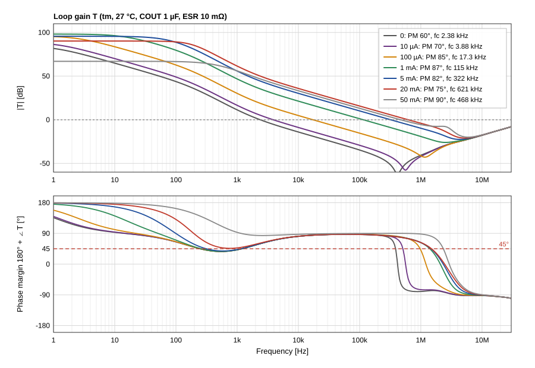

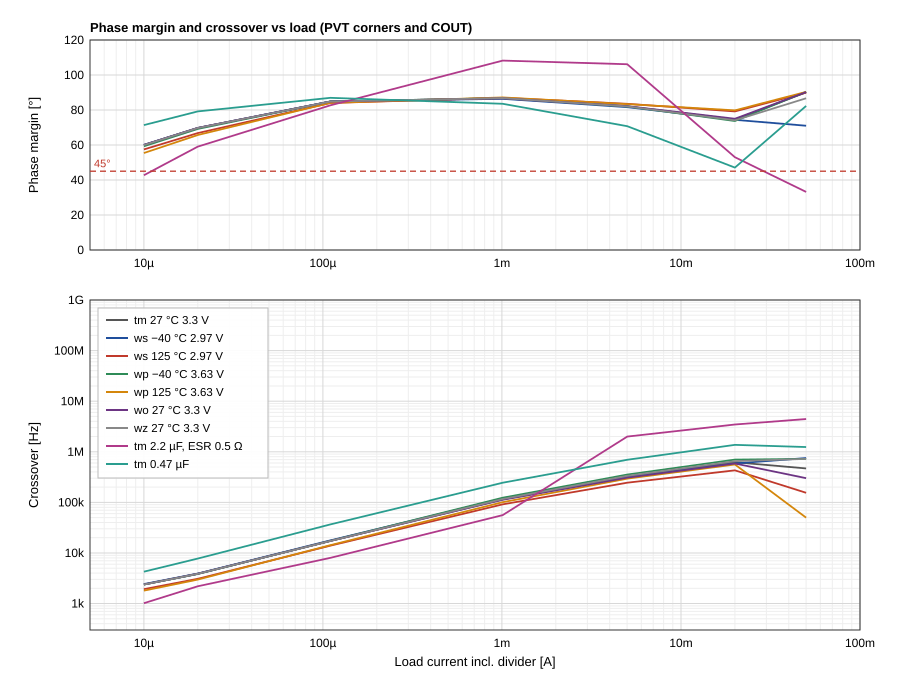

At 50 mA (above the rated load, inside the current limit) the margin stays ≥ 71° (COUT 1 µF) with a gain margin ≥ 7 dB. Between ≈ 100 Hz and 1 kHz, where |T| is still 40–90 dB, the phase dips to about 37°: the loop is conditionally stable there, but no crossover can fall into that range at any rated load or corner, so this has no effect on transient behaviour (no ringing in the load steps of section 8).

**Output capacitor.** The phase margin over COUT and ESR is shown in Figure 4 and the table below. With 0.47 µF the 20 mA crossover reaches 1.4–3.5 MHz, where the gate-buffer pole costs margin (GM 6 dB); 0.47 µF is therefore rated only to 5 mA (PM ≥ 71°). With 2.2 µF the no-load crossover falls to 1 kHz, below the REA / CEA zero, and the phase margin drops to 43°. A 10 µF capacitor with no load gives no crossover within the analysed band (|T| below 0 dB only below 1 Hz) and is allowed only with a load ≥ 1 mA (PM 83°).

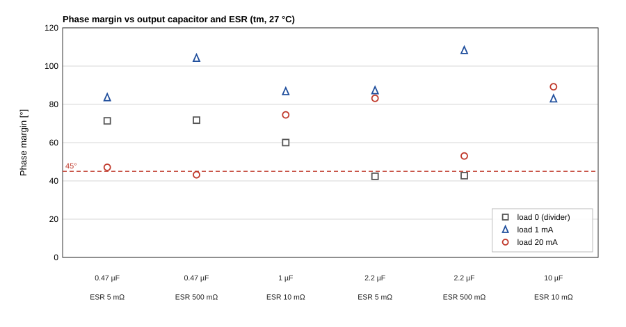

| COUT | ESR | Load | Crossover [kHz] | PM [°] | GM [dB] |
|---|---|---|---|---|---|
| 0.47 µF | 5 mΩ | 0 / 1 mA / 20 mA | 4.3 / 245 / 1370 | 71 / 84 / 47 | 56 / 20 / 6 |
| 0.47 µF | 0.5 Ω | 0 / 1 mA / 20 mA | 4.3 / 262 / 3500 | 72 / 104 / 43 | 18 / 20 / 10 |
| 1 µF | 10 mΩ | 0 / 1 mA / 20 mA | 2.4 / 115 / 621 | 60 / 87 / 75 | 18 / 26 / 13 |
| 2.2 µF | 5 mΩ | 0 / 1 mA / 20 mA | 1.0 / 52 / 279 | 42 / 87 / 83 | 18 / 31 / 19 |
| 2.2 µF | 0.5 Ω | 0 / 1 mA / 20 mA | 1.0 / 56 / 3460 | 43 / 108 / 53 | 18 / 21 / 11 |
| 10 µF | 10 mΩ | 0 / 1 mA / 20 mA | – / 11.6 / 61 | – / 83 / 89 | 18 / 18 / 32 |

## 8. Transient characteristics

| Parameter | Conditions | Min | Typ | Max | Unit |
|---|---|---|---|---|---|
| Load step undershoot | 1 → 20 mA in 1 µs | 7.2 | 7.9 | 10.5 | mV |
| Load step overshoot | 20 → 1 mA in 1 µs | 7.0 | 7.7 | 10.3 | mV |
| Settling to ±2 mV | load step | 73 | 86 | 98 | µs |
| Line transient | VIN 3.0 ↔ 3.6 V in 1 µs, 5 mA | | ±0.84 | | mV |
| Start-up, LDO_EN ↑ → VOUT 90 % | 0.1 mA | 108 | 122 | 142 | µs |
| VOUT rise time 10–90 % | | 58 | 75 | 108 | µs |
| Inrush current | COUT 1 µF | 58 | 74 | 84 | mA |
| Start-up overshoot | | | 0 | | mV |
| Discharge, LDO_EN ↓ → VOUT < 10 % | COUT 1 µF, 0.1 mA | 0.95 | 1.40 | 2.33 | ms |

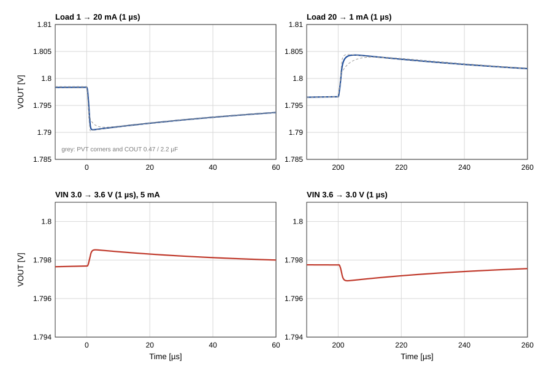

**Soft start.** The bandgap is filtered by RSS / CSS (τ = 50 µs) into the reference. Because the error amplifier has NMOS inputs, it can only start regulating when the reference has risen by ≈ 0.4 V; until then the pass device is fully on and the output charges at the current limit, so VOUT jumps to ≈ 1.2 V before following the RC ramp. The inrush current is therefore the current limit (58–84 mA) for ≈ 20 µs; it is monotonic and has no overshoot.

## 9. Supervisor timing

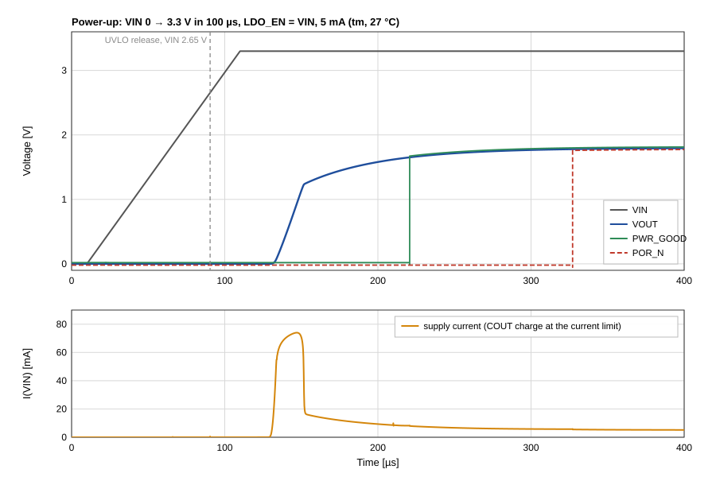

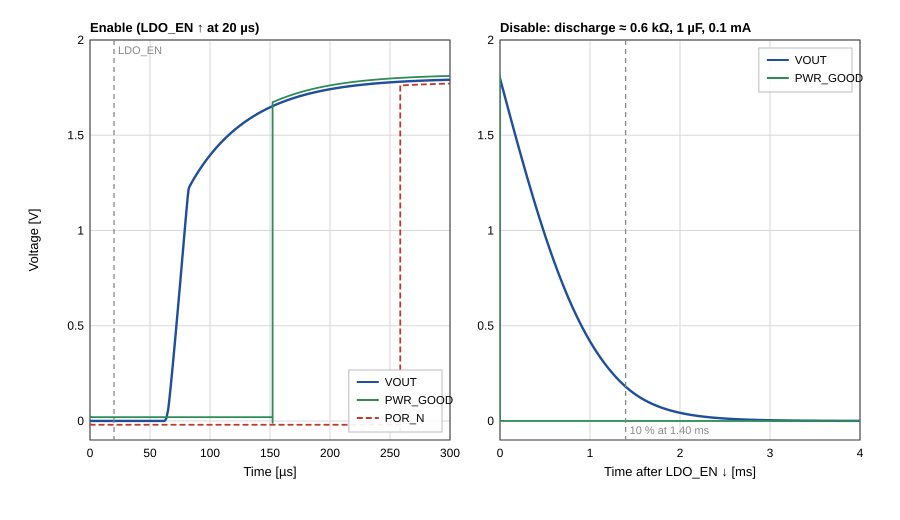

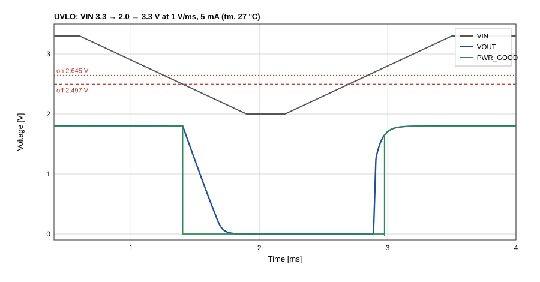

Sequence: LDO_EN = 1 and VIN above the UVLO rising threshold (with the bandgap running, bg_ok) → `on` = 1, soft start → VOUT above the PG comparator threshold → after t_PG PWR_GOOD = 1 → after t_POR POR_N = 1. Any of LDO_EN = 0, VIN below the UVLO falling threshold or VOUT below the lower PG threshold clears PWR_GOOD and POR_N at once (≤ 40 ns), and in the first two cases switches the regulator off and turns the discharge on.

The thresholds of UVLO and power good are derived from VBG, so they move with it over the process corners (ws: +3 %, wp: −3.6 %). t_PG and t_POR come from current-source / capacitor delays biased from the bandgap mirror (≈ ±30 % over corners).

## 10. Typical characteristics

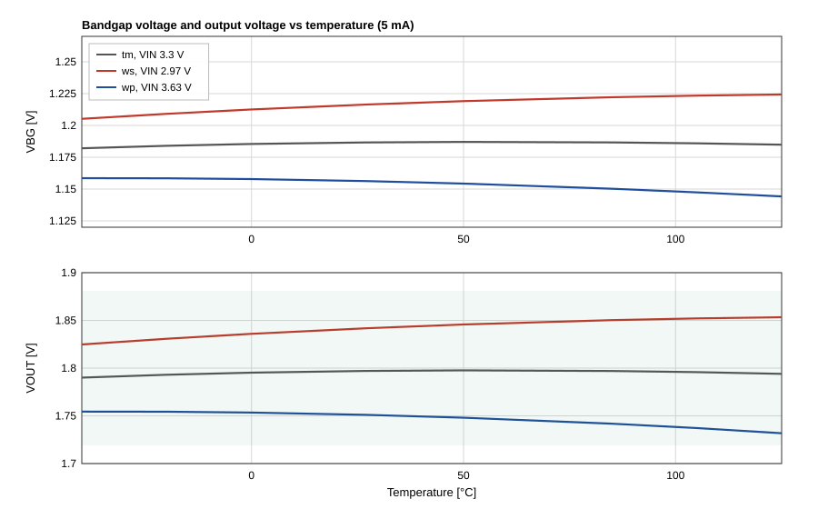

| T [°C] | −40 | −20 | 0 | 27 | 50 | 85 | 105 | 125 |
|---|---|---|---|---|---|---|---|---|
| VBG [V] | 1.1820 | 1.1840 | 1.1854 | 1.1866 | 1.1870 | 1.1867 | 1.1859 | 1.1849 |
| VOUT [V] (5 mA) | 1.7900 | 1.7931 | 1.7953 | 1.7971 | 1.7976 | 1.7970 | 1.7958 | 1.7940 |
| I_GND [µA] (5 mA) | 103 | 106 | 110 | 116 | 121 | 128 | 132 | 137 |

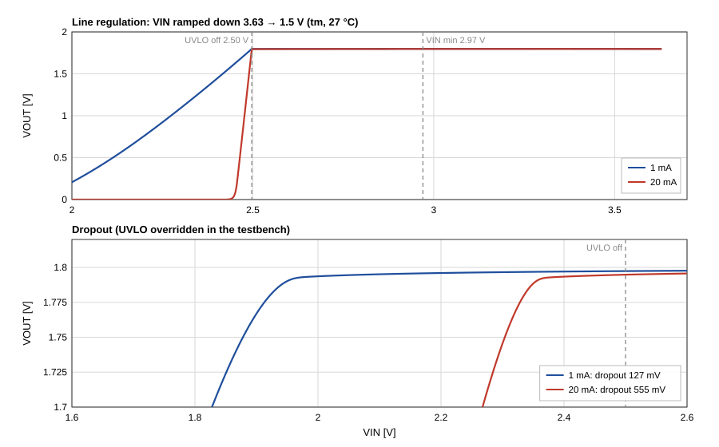

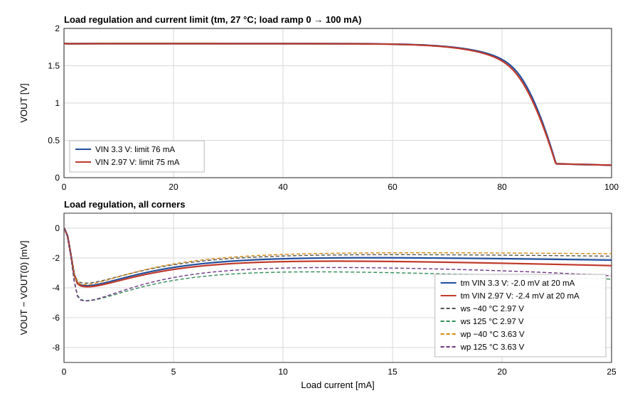

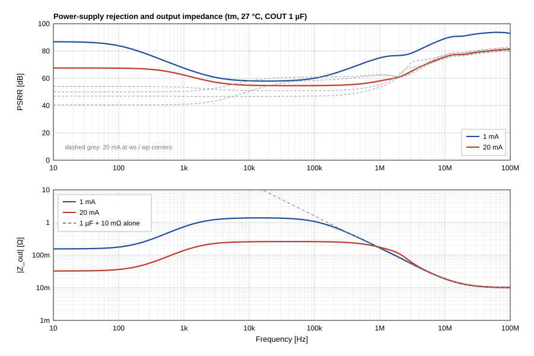

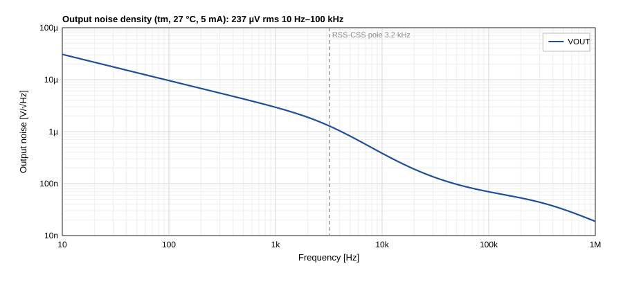

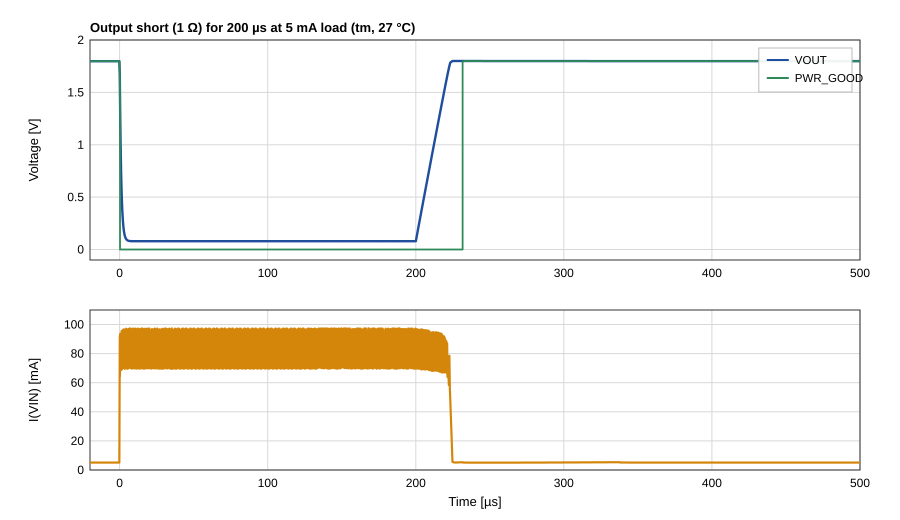

## 11. Application information

- **COUT**: 1 µF X5R / X7R ceramic, 0402 or 0603, placed next to the VOUT pin with a short GND return. Account for DC-bias derating: the effective value must stay within 0.47–2.2 µF (0.47 µF only for loads ≤ 5 mA).
- **Input**: VIN is the 3.3 V pad supply VDD33; a local 100 nF decoupling capacitor at the VIN pin is recommended (the PSRR figures assume a stiff source).
- **LDO_EN**: may be tied to VIN (always on), or driven by 1.8 V / 3.3 V logic. There is no internal pull: do not leave it floating.
- **PWR_GOOD / POR_N** swing 0…VOUT and can drive the 1.8 V core logic directly (e.g. the PLL / CDR reset). Use POR_N as the analog-domain reset; it guarantees ≥ 77 µs of stable supply.
- **Load**: PLL + CDR + crystal oscillator ≈ 3.5 mA; the rated 20 mA leaves margin for later analog blocks. No minimum load is needed.
- **Accuracy**: the 1.8 V analog blocks tolerate ±10 %, so the untrimmed −3.8 / +3.1 % is acceptable; for tighter accuracy add a trim (section 16).

## 12. Design parameters

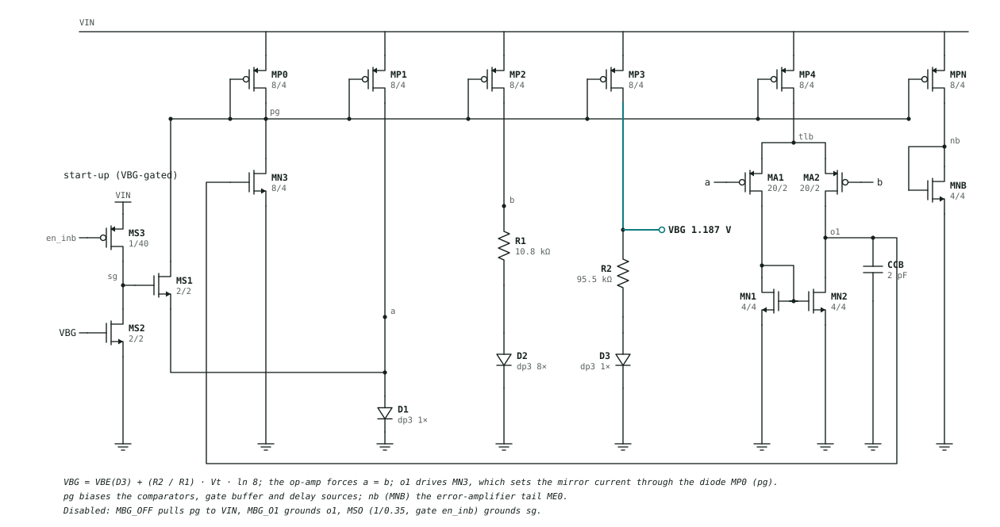

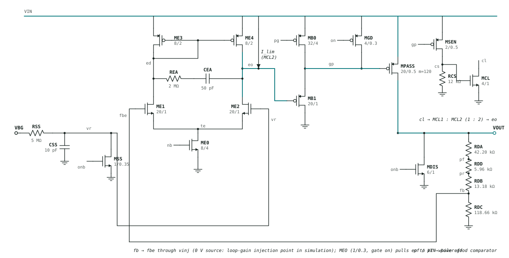

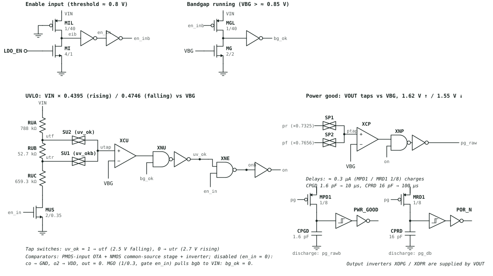

| Block | Element | Value | Function |
|---|---|---|---|
| Bandgap | D1 / D2 / D3 | dp3 1× / 8× / 1× | ΔVBE = Vt·ln 8 |
| | R1 / R2 | 10.8 kΩ / 95.5 kΩ | PTAT current ≈ 5 µA, VBG = VBE + (R2/R1)·ΔVBE |
| | MP0–MP4, MPN | 8/4 µm | current mirror |
| | MA1/MA2, MN1/MN2 | 20/2, 4/4 µm | op-amp, CCB 2 pF |
| | MS1–MS3 | 2/2, 2/2, 1/40 µm | start-up, gated by VBG |
| Soft start | RSS / CSS | 5 MΩ / 10 pF | τ = 50 µs |
| Error amplifier | ME1 / ME2 20/1 µm, tail ME0 8/4 µm (2 × MNB) | ≈ 10 µA | DC gain ≈ 45 dB |
| Compensation | REA / CEA | 2 MΩ / 50 pF | zero at 1.6 kHz |
| Gate buffer | MB0 / MB1 | 32/4 / 20/1 µm, 20 µA | PMOS source follower |
| Pass device | MP | 20/0.5 µm × 120 (2400 µm) | |
| Current limit | sense 1 : 1200 | | ≈ 75 mA |
| Divider | RDA + RDD / RDB + RDC | 42.2 k + 5.96 k / 13.18 k + 118.66 k | fb = 0.659·VOUT, PG tap; 10 µA |
| UVLO divider | RUA / RUB / RUC | 788 k / 52.7 k / 659.3 k | tap-switch hysteresis |
| Comparators | `ldo_comp` | 5 µA OTA + 1.25 µA CS stage | UVLO, PG |
| Delays | CPGD / CPRD | 1.6 pF / 16 pF | t_PG 10 µs / t_POR 100 µs |
| Discharge | MDIS | 6/1 µm | ≈ 0.6 kΩ |
| Disable | MBG_OFF, MBG_O1, MSO, MGO, MEO | 1–2 µm / 0.3–0.35 µm | no floating node while off |

## 13. Corner tables

| Corner | VOUT 0 / 20 mA [V] | IQ [µA] | Line reg. 20 mA [mV/V] | ΔVOUT 0→20 mA [mV] | I_lim [mA] | PM min, 0–20 mA [°] | PSRR 1 kHz 20 mA [dB] | Step 1↔20 mA [mV] | UVLO on / off [V] | t_PG / t_POR [µs] | Dropout 20 mA [mV] |
|---|---|---|---|---|---|---|---|---|---|---|---|
| tm 27 °C 3.3 V | 1.7990 / 1.7975 | 91 | 0.05 | −2.05 | 76 | 60 | 62 | −7.9 / +7.7 | 2.645 / 2.497 | 10.7 / 106 | 555 |
| ws −40 °C 2.97 V | 1.8269 / 1.8254 | 74 | 0.41 | −1.81 | 86 | 60 | 53 | −8.0 / +7.9 | 2.687 / 2.536 | 12.5 / 124 | 609 |
| ws 125 °C 2.97 V | 1.8558 / 1.8529 | 111 | 1.05 | −3.17 | 73 | 57 | 47 | −10.5 / +10.3 | 2.728 / 2.575 | 7.8 / 77 | 621 |
| wp −40 °C 3.63 V | 1.7562 / 1.7552 | 80 | −0.27 | −1.67 | 76 | 59 | 51 | −7.2 / +7.0 | 2.584 / 2.439 | 14.0 / 139 | 502 |
| wp 125 °C 3.63 V | 1.7337 / 1.7318 | 115 | −1.30 | −2.86 | 62 | 55 | 41 | −8.6 / +8.6 | 2.551 / 2.408 | 8.9 / 88 | 514 |
| wo 27 °C 3.3 V | 1.7989 / 1.7974 | 91 | 0.42 | −2.17 | 72 | 60 | – | −8.2 / +8.1 | – | – | 674 |
| wz 27 °C 3.3 V | 1.7990 / 1.7977 | 92 | −0.24 | −1.95 | 79 | 60 | – | −7.6 / +7.4 | – | – | 440 |
| tm, COUT 2.2 µF ESR 0.5 Ω | – | – | – | – | – | 43 (no load) | – | −7.5 / +7.4 | – | – | – |
| tm, COUT 0.47 µF | – | – | – | – | – | 71 (0–5 mA) | – | −8.0 / +7.8 | – | – | – |

Corner names (xh018): tm typical; ws slow MOS and diode high-VBE; wp fast MOS and diode low-VBE; wo / wz the crossed MOS corners. ws runs at VIN = 2.97 V and wp at 3.63 V (worst case for dropout and for power / stress respectively). The full numbers per run are in `data/<run>/log.txt` and `data/tables.md`.

## 14. Simulation method

- **Simulator / models**: ngspice 42; xh018 `ne3i` / `pe3i` BSIM3v3 corner models; `dp3` diodes as JUNCAP2-derived B-sources (ideal current, `sim/xfab2ngspice_ldo.py`). The converted models are written to `build/` only; the PDK data (`X-FAB/`) is never copied into the repository.
- **Testbench** `sim/tb_ldo_tr.py`: 16 cases (op, temp, line, load, ac, capsweep, psrr, zout, noise, start, uvlo, step, line_step, en, enth, short) with pass / fail limits; `sim/run_all.py` runs the 9 corner / COUT runs of section 13 and copies the results to `data/`.
- **Operating points**: the supervisor latches and the bandgap make the DC problem multi-stable. The line and load sweeps are therefore slow transient ramps (4 ms), the temperature points short power-up transients, and the op / ac / noise analyses start from a 1 ms transient operating point (`optran`), not a plain DC solve.
- **Loop gain**: voltage injection (`vinj`) between fb and the amplifier input, T = −v(fb) / v(fbe); PM / GM are read below 10 MHz.
- **Limits**: VOUT 1.719–1.881 V; IQ ≤ 120 µA; dropout (20 mA) ≤ 0.70 V; current limit 40–120 mA; PM ≥ 45° (40° for 2.2 µF at no load), GM ≥ 10 dB at the rated loads; PSRR (1 kHz) ≥ 40 dB; load step ≤ 50 mV; UVLO and PG / POR timing windows.
- **Not included**: layout parasitics, resistor and capacitor models (rhr poly, MIM / MOS caps with TC and voltage coefficients), mismatch (Monte Carlo), package / bond-wire inductance.

## 15. Relation to the behavioural model `afe_ldo.va`

`AFE/veriloga/afe_ldo.va` has the same pins and is used in the AMS system testbenches. Its parameters should be aligned with this transistor-level design:

| Parameter | afe_ldo.va | afe_ldo_tr (typ, range) | Action |
|---|---|---|---|
| `i_lim` | 50 mA | 76 mA (62–86) | set 75e-3 |
| `i_q` | 50 µA | 91 µA (74–115) | set 90e-6 |
| `v_drop` | 0.2 V | 0.56 V at 20 mA (0.13 V at 1 mA) | set 0.5 or model R_on ≈ 28 Ω |
| `r_out` | 0.05 Ω | 0.10 Ω (DC) | set 0.1 |
| `psrr_db` | 40 dB | 62 dB (≥ 40.5) | keep 40 (worst case) |
| `t_ss` | 50 µs | τ = 50 µs, 10–90 % 75 µs | keep |
| `r_dis` | 1 kΩ | 0.6 kΩ (≤ 1 kΩ) | set 600 |
| `vth_en` | 0.9 V | 0.76 V (0.63–0.85) | set 0.76 |
| `uvlo_r` / `uvlo_f` | 2.7 / 2.5 V | 2.645 / 2.497 V | set 2.65 / 2.50 |
| `pg_r` / `pg_f` | 1.62 / 1.55 V | 1.62 / ≈ 1.55 V | keep |
| `t_pg` / `t_por` | 10 / 100 µs | 10.7 / 106 µs | keep |

## 16. Limitations and open points

1. **Accuracy without trim**: VOUT spreads −3.8 / +3.1 % over the 3 σ diode corners, dominated by VBG (VBE of dp3). A 4-bit trim of R2 (bandgap) or of the divider (RDA) with ≈ 0.6 % steps would bring it to about ±1 %; the AFE trim registers (vendor 30h–3Fh) can hold it.
2. **Noise**: 237 µV rms (10 Hz–100 kHz) is dominated by the flicker noise of the bandgap op-amp load MN1 / MN2 (4/4 µm). Larger devices (8/32 µm, with a 40/4 µm input pair) reduce it to ≈ 90 µV but slow the bandgap down at −40 °C; an RC filter on VBG (in addition to RSS / CSS) is the alternative.
3. **Soft start**: the NMOS-input error amplifier only regulates once the reference is above ≈ 0.4 V, so the first ≈ 1.2 V are charged at the current limit (section 8). A PMOS-input or rail-to-rail amplifier would give a fully controlled ramp.
4. **COUT range**: 2.2 µF at no load has 43° phase margin and 10 µF needs ≥ 1 mA of load (section 7). A larger divider current (e.g. 30 µA) or a load-tracking zero would widen the range.
5. **Ideal passives**: resistors and capacitors are ideal. The real rhr poly resistors (TC, voltage coefficient) and the MIM / MOS capacitors (CEA 50 pF, CPRD 16 pF) must be added before layout; RSS (5 MΩ) and REA (2 MΩ) are large and need care with leakage.
6. **Mismatch**: no Monte Carlo yet. The bandgap op-amp offset (MA1 / MA2) multiplies into VBG by ≈ 1 + R2/R1 ≈ 10 and is the main expected statistical error.
7. **dp3 leakage**: at 125 °C the diode leakage of the off state reaches 29 nA (wp); harmless here.
8. **No layout**; no ESD, latch-up or EM checks.

## 17. Revision history

| Revision | Date | Changes |
|---|---|---|
| 0.1 | 2026-11-22 | First release: transistor-level design, PVT corner simulations, figures |
