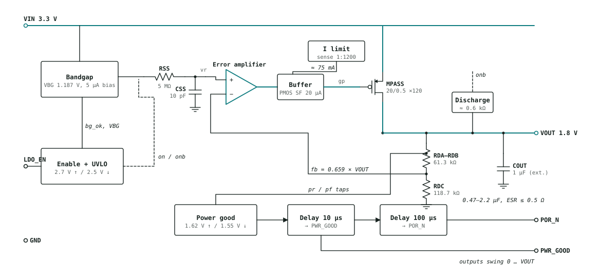
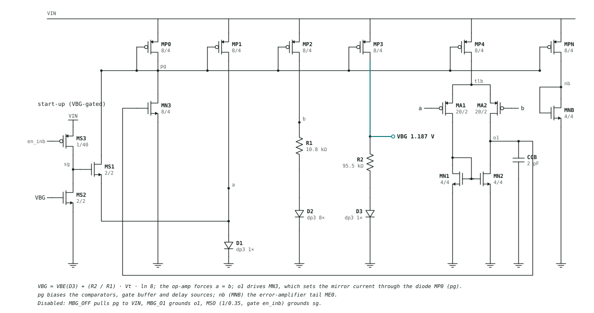
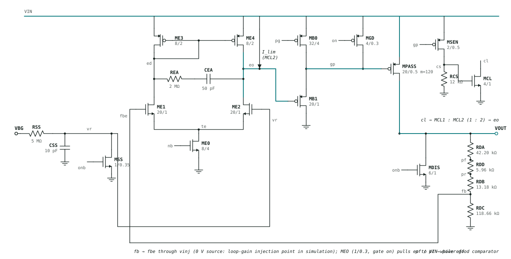
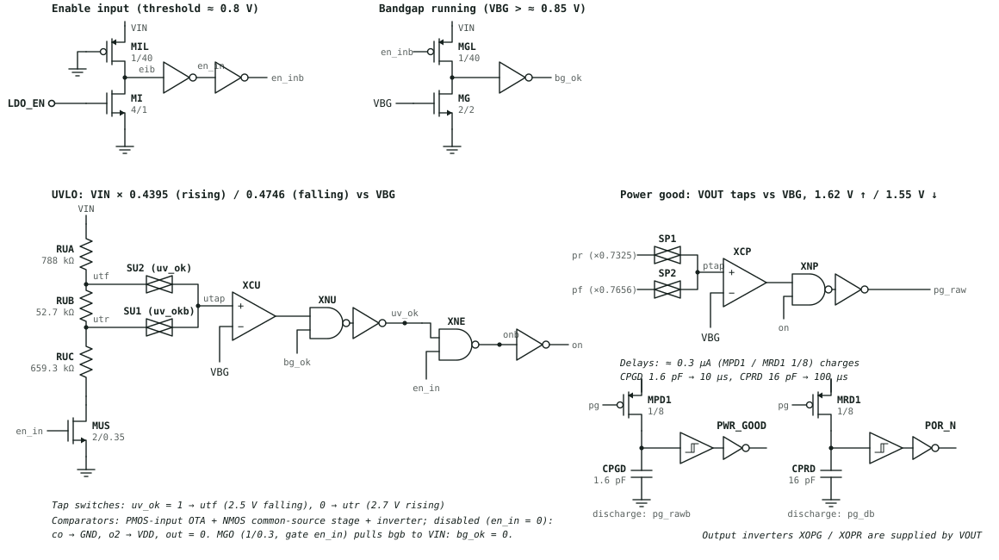

# 1.8 V LDO regulator — `afe_ldo_tr` (3.3 V → 1.8 V, xh018)

Transistor-level low-dropout regulator for the analog 1.8 V domain VDD18A (PLL, CDR, crystal oscillator) of the
USB 2.0 ULPI PHY.  Netlist: [`afe_ldo_tr.sp`](afe_ldo_tr.sp); datasheet: [`datasheet/ldo_datasheet.md`](datasheet/ldo_datasheet.md)
(Word: `datasheet/ldo_datasheet.docx`).  Same pins and function as the behavioural model
[`AFE/veriloga/afe_ldo.va`](../veriloga/afe_ldo.va).  All values below are ngspice simulations with the
X-FAB xh018 models (corner tm, 27 °C, VIN = 3.3 V, COUT = 1 µF) unless stated otherwise.

## 1. Function and context

The PHY's analog blocks run from 1.8 V, the chip is supplied with 3.3 V (VDD33, 2.97–3.63 V).  `afe_ldo_tr` makes the
1.8 V from VDD33 and supervises it:

- regulated VOUT = 1.80 V (bandgap reference × 1.517), 0–20 mA (current limit ≈ 75 mA);
- **UVLO**: the regulator runs only when VIN > 2.65 V (rising) and stays on down to 2.50 V (falling);
- **LDO_EN**: enable input with an absolute threshold, works with 1.8 V or 3.3 V logic;
- **soft start** from the RC-filtered reference, active output **discharge** (≈ 0.6 kΩ) while off;
- **PWR_GOOD** 10 µs after VOUT > 1.62 V, cleared at once below 1.55 V; **POR_N** 100 µs after PWR_GOOD
  (power-on reset of the digital core).

Expected load: PLL ≈ 1.5 mA, CDR ≈ 1.3 mA, crystal oscillator 0.4–0.8 mA, about 3.5 mA in total; 20 mA is the
rated maximum.



## 2. Pins

| Pin | Dir | Description |
|---|---|---|
| VIN | supply | 3.3 V (VDD33), 2.97–3.63 V |
| VOUT | out | 1.8 V output; external capacitor 1 µF (0.47–2.2 µF, ESR ≤ 0.5 Ω; 0.47 µF only up to 5 mA) to GND |
| GND | supply | ground |
| LDO_EN | in | enable, high-active, threshold 0.63–0.85 V (all corners, −40…125 °C; 1.8 V or 3.3 V CMOS) |
| PWR_GOOD | out | 1 (= VOUT) when VOUT is in regulation, VOUT-supplied inverter |
| POR_N | out | power-on reset, low-active; releases 100 µs after PWR_GOOD |

## 3. Why this topology

- **PMOS pass device** (common source): the only way to get a low dropout from 3.3 V to 1.8 V with 3.3 V devices
  and no charge pump.  W/L = 2400 µm / 0.5 µm gives 20 mA at a V_SD of ≈ 0.25 V with the gate ≈ 1.1 V below VIN.
- **External 1 µF output capacitor, output pole dominant**: the PLL / CDR draw fast current pulses; a µF at the
  pin supplies them directly, and the loop only has to restore the charge.  The loop is then stable with any
  ceramic capacitor from 0.47 µF up and needs no ESR zero.
- **Source-follower gate buffer**: the 2400 µm gate (≈ 3 pF plus Miller) would put a low-frequency pole at the
  error-amplifier output; the 20 µA PMOS follower moves it above 1 MHz.
- **Bandgap with diodes**: xh018 has no bipolar devices in this kit; the p+/n-well diode dp3 (cathode on
  ground) gives the V_BE.  An op-amp forces the two diode branches to the same voltage (no cascodes needed with
  the 3.3 V headroom), and the same PTAT current (5 µA) biases everything else.
- **Supervisor in the VIN domain, outputs in the VOUT domain**: the comparators and delays run from VIN
  (they must work before VOUT exists); PWR_GOOD and POR_N come from inverters supplied by VOUT, so they are
  valid 1.8 V logic levels and low whenever VOUT is missing.

## 4. Circuit

### 4.1 Bandgap and bias



- D1 (1×, 100 µm²) on node a; R1 = 10.8 kΩ and D2 (8×) on node b.  The op-amp MA1 / MA2 (PMOS input, 20/2) with
  mirror MN1 / MN2 drives MN3, which sets the current of the diode-connected MP0 (gate node pg); MP1–MP3 copy it.
  With a = b the branch current is the PTAT current I = Vt·ln 8 / R1 = 4.97 µA.
- The output branch MP3 → R2 = 95.5 kΩ → D3 (1×) gives VBG = V_BE + (R2 / R1)·Vt·ln 8 = 0.712 V + 0.475 V =
  1.187 V.  R2 / R1 was swept for the flattest VBG from −40 to 125 °C: 1.182–1.187 V (25 ppm/K box).
- CCB (2 pF) on the op-amp output compensates the bandgap loop.
- **Start-up**: the bandgap has a second, zero-current state.  MS3 (long PMOS, ≈ 2 µA) pulls sg to VIN while
  MS2 (gate VBG) is off; MS1 then pulls pg down and feeds current into node a, so the whole mirror runs.
  When VBG exceeds ≈ 0.86 V, MS2 grounds sg and MS1 turns off.  (A first version with a diode-referenced sg
  stopped at a = 0.35 V at −40 °C: the start-up NMOS went subthreshold before the op-amp had any bias.)
- pg biases every current source (5 µA unit, 8/4); MPN + MNB make the NMOS bias nb for the error-amplifier tail.
- LDO_EN = 0 forces pg to VIN, o1 and sg to ground (bandgap off).

### 4.2 Reference and soft start

VBG → RSS (5 MΩ) → vr with CSS (10 pF): τ = 50 µs.  The RC sets the soft start and filters the bandgap noise
above 3.2 kHz.  MSS discharges CSS while the regulator is off, so every enable starts from 0.

Because the error amplifier has NMOS inputs, it needs ≈ 0.9 V of common mode: VOUT stays at 0 until vr passes
that level (≈ 40 µs after enable), rises at the current limit (≈ 70 mA into 1 µF) to ≈ 1.2 V in ≈ 15 µs, and
then follows the RC reference.  The result is monotonic, without overshoot; 10–90 % takes 75 µs, 90 % is
reached 120 µs after enable.

### 4.3 Error amplifier, buffer, pass device



- **Error amplifier**: NMOS pair ME1 / ME2 (20/1) with tail ME0 (10 µA), PMOS mirror ME3 / ME4 (8/2).
  ME1 takes the feedback fb, ME2 the reference vr; the output eo drives the buffer.
- **Compensation**: REA = 2 MΩ in series with CEA = 50 pF from eo to the mirror diode node ed.  At DC the
  amplifier keeps its full gain (≈ 45 dB; regulation error < 0.2 %); above the zero 1 / (2π·REA·CEA) = 1.6 kHz
  REA lowers the mid-band gain, which keeps the crossover low enough at light load, where the output pole
  1 / (2π·R_load·COUT) is lowest.  The choice came from a sweep of REA / CEA over 0–50 mA (section 5).
- **Buffer**: PMOS source follower MB1 (20/1) with a 20 µA source MB0 (32/4); gp = eo + V_SG.  MGD pulls gp to
  VIN while off.
- **Pass device**: MPASS, pe3i 20 µm / 0.5 µm × 120.
- **Feedback divider**: RDA 42.20 kΩ, RDD 5.96 kΩ, RDB 13.18 kΩ, RDC 118.66 kΩ (180 kΩ, 10 µA):
  fb = 0.6592·VOUT, so VOUT = VBG × 1.517 = 1.800 V.  The taps pr (×0.7325) and pf (×0.7656) feed the power-good
  comparator.
- **vinj** (0 V source between fb and the ME1 gate) is the loop-gain injection point for the simulation; it
  has no function in silicon.

### 4.4 Current limit

MSEN (2/0.5, 1 : 1200 of the pass device, same gate and source) drives its current into RCS = 12 kΩ.  At about
75 mA load the sense voltage reaches the threshold of MCL (≈ 0.75 V); MCL's current, mirrored 1 : 2 by
MCL1 / MCL2, pulls eo up and so gp up, which limits the pass device.  Measured: VOUT −100 mV at 75 mA, 84 mA into
a 1 Ω short; the output recovers in 23 µs without overshoot when the short is removed.

### 4.5 Enable, UVLO, power good



- **LDO_EN**: NMOS MI (4/1) against a 1/40 PMOS load (≈ 2 µA): threshold 0.76 V at 27 °C (0.83 V at −40 °C,
  0.66 V at 125 °C), independent of the logic level driving it; two inverters give en_in / en_inb.
- **bg_ok**: MG (2/2, gate VBG) against a long PMOS: high once VBG > ≈ 0.85 V.  The UVLO comparator output is
  only trusted with bg_ok (the comparators are unbiased while the bandgap is off).  While disabled, MGO pulls
  bgb to VIN (bg_ok = 0).
- **UVLO**: VIN divider RUA 788 kΩ / RUB 52.7 kΩ / RUC 659.3 kΩ (1.5 MΩ, switched off by MUS while disabled).
  A tap switch selects utr (×0.4395, VIN = 2.70 V at VBG) while the regulator is off and utf (×0.4746,
  2.50 V) while on, which gives the hysteresis.  Simulated: on at 2.645 V, off at 2.497 V.
- **on** = en_in · uv_ok enables the soft start, the buffer and the discharge.
- **Power good**: the same tap scheme on the VOUT divider: pr (1.62 V) while PWR_GOOD is low, pf (1.55 V)
  while high, compared with VBG; gated with on.
- **Comparators** (`ldo_comp`): PMOS-input OTA (5 µA), NMOS common-source second stage with a 1.25 µA load and an
  inverter.  The second stage swings rail to rail, so the logic after it draws no shoot-through current.  The
  enable pins en / enb pull the internal nodes to defined levels while disabled (co low, o2 high, out low).
- **Delays**: a ≈ 0.3 µA source (MPD1, 1/8) charges CPGD = 1.6 pF to the trip point of a Schmitt trigger: 10.4 µs to
  PWR_GOOD.  The second stage (CPRD = 16 pF) gives 106 µs to POR_N.  Both capacitors are discharged at once when the
  input falls, so PWR_GOOD falls 25 ns after VOUT drops below 1.55 V or the regulator is disabled.
- **Discharge**: MDIS (6/1, ≈ 0.6 kΩ at tm, ≈ 1 kΩ at ws 125 °C) pulls VOUT to ground while off: VOUT < 10 %
  1.4 ms after LDO_EN = 0 with 1 µF.
- **No floating node while disabled**: besides MGO and the comparator enables, MSO grounds the start-up gate sg
  and MEO pulls eo to VIN (MB1 off).  A first version without them drew up to 170 µA of shoot-through current
  in the off state (bgb floating at mid-supply at ws, −40 °C); now the off current is ≈ 1 nA.

## 5. Loop stability

Loop gain T = −v(fb) / v(fbe), injected with vinj (tm, 27 °C, COUT = 1 µF, ESR 10 mΩ):

| Load | DC gain | Crossover | Phase margin | Gain margin |
|---|---|---|---|---|
| 0 (divider only, 10 µA) | 82 dB | 2.4 kHz | 60° | 18 dB |
| 10 µA | 86 dB | 3.9 kHz | 70° | 58 dB |
| 100 µA | 95 dB | 17 kHz | 85° | 18 dB |
| 1 mA | 98 dB | 115 kHz | 87° | 25 dB |
| 5 mA | 96 dB | 322 kHz | 82° | 17 dB |
| 20 mA | 90 dB | 621 kHz | 75° | 12 dB |
| 50 mA | 67 dB | 468 kHz | 90° | 9 dB |

No load is the critical case: the output pole is at its lowest (R_load = the 180 kΩ divider).  The compensation
sweep (300 kΩ / 20 pF: 17° at no load; 1 MΩ / 20 pF: 30°; 2 MΩ / 20 pF: 49°; 2 MΩ / 50 pF: 59°; 4 MΩ / 20 pF had a
gain peak at 1.7 MHz at 20 mA) led to 2 MΩ / 50 pF, and doubling the buffer current to 20 µA added 5° at 20 mA.
Over the PVT corners (tm, ws, wp, wo, wz; −40 / 125 °C; VIN 2.97 / 3.63 V) the phase margin stays ≥ 55° and
the gain margin ≥ 11.7 dB from no load to 20 mA.  The output capacitor sets the limits of the rated range:

| COUT (ESR) | No load | 1 mA | 20 mA |
|---|---|---|---|
| 0.47 µF (5 mΩ) | 71° | 84° | 47°, GM 6 dB → rated to 5 mA only |
| 1 µF (10 mΩ) | 60° | 87° | 75° |
| 2.2 µF (5 mΩ / 0.5 Ω) | 42° / 43° | 87° / 108° | 83° / 53° |
| 10 µF (10 mΩ) | no crossover above 1 Hz | 83° | 89° → only with ≥ 1 mA |

With large COUT and no load the crossover falls below the REA / CEA zero (1.6 kHz), so the zero no longer adds
phase; with small COUT at high load the crossover reaches the MHz range, where the gate-buffer pole costs margin.
The datasheet (`datasheet/ldo_datasheet.md`, section 7) has the plots.

## 6. Board / integration

- COUT: X7R / X5R ceramic, 1 µF (0.47–2.2 µF effective, including DC-bias derating), ESR ≤ 0.5 Ω, placed at the
  VDD18A pin.  10 µF is stable only with a load of at least 1 mA (section 5) and slows the soft start
  (current limit).
- The loads (PLL, CDR, XOSC) should have their own local decoupling; the LDO does not need a minimum load
  (the divider is its load).
- LDO_EN can be tied to VIN for an always-on supply; the UVLO and POR_N then sequence the power-up.
- Resistors: high-resistance poly (rhr, ≈ 1 kΩ/□) for RSS, REA, the dividers and the bandgap; R1 / R2 and the
  divider sections should be built from one unit resistor for ratio matching.  Capacitors: MIM (or MOS for CEA,
  CSS).  The netlist uses ideal R / C (the PDK resistor models were not converted).

## 7. Files and how to run

| File | Content |
|---|---|
| `afe_ldo_tr.sp` | the circuit (subckt `afe_ldo_tr`, cells `ldo_inv`, `ldo_nand2`, `ldo_schmitt`, `ldo_comp`) |
| `sim/xfab2ngspice_ldo.py` | builds `build/ldo/models/xh018_<corner>.lib` (MOS from the XOSC converter + a dp3 diode B-source with the JUNCAP2 ideal current) |
| `sim/tb_ldo_tr.py` | testbench, 16 cases (op, temp, line, load, ac, capsweep, psrr, zout, noise, start, uvlo, step, line_step, en, short) |
| `sim/run_all.py` | PVT regression → `datasheet/data/<run>/` |
| `doc/draw_ldo.py` | schematic sheets `doc/ldo_*.svg/.png` |
| `doc/md2html.py` | this file → `ldo_description.html` |
| `datasheet/gen_figures.py` | datasheet figures `datasheet/fig/` and tables |

```sh
python3 "AFE/LDO analog part/sim/xfab2ngspice_ldo.py"          # models (needs X-FAB/, output in build/: never commit)
python3 "AFE/LDO analog part/sim/tb_ldo_tr.py"                  # tm, 27 C, 3.3 V, all cases, ~15 min on 4 cores
python3 "AFE/LDO analog part/sim/tb_ldo_tr.py" ac --corner ws --temp 125 --vin 2.97
python3 "AFE/LDO analog part/sim/run_all.py"                    # PVT regression for the datasheet
python3 "AFE/LDO analog part/datasheet/gen_figures.py"
python3 "AFE/LDO analog part/doc/draw_ldo.py"; python3 "AFE/LDO analog part/doc/md2html.py"
```

Simulation notes: the UVLO / power-good latches and the bandgap make the DC problem multi-stable.  The line and
load sweeps are therefore slow transient ramps, the temperature points short power-up transients, the transient
cases start with a VIN ramp, and the operating point of the op / ac / noise analyses is a 1 ms transient
operating point (`optran 0 0 0 100n 1m 0`): the plain DC solve stopped in a non-converged off state at ws,
−40 °C.

## 8. Results summary (tm, 27 °C, VIN 3.3 V, COUT 1 µF)

| Parameter | Value |
|---|---|
| VOUT, no load / 20 mA | 1.7990 V / 1.7975 V |
| VBG, −40…125 °C | 1.1820–1.1870 V |
| VOUT, −40…125 °C (5 mA) | 1.790–1.798 V |
| Quiescent current (no load, incl. 10 µA divider) | 91 µA |
| Ground current at 20 mA | 109 µA |
| Off current (LDO_EN = 0) | 1 nA |
| Line regulation 2.97–3.63 V (20 mA) | 0.05 mV/V |
| Load regulation 0–20 mA | −2.0 mV (0.10 Ω) |
| Dropout at 20 mA / 1 mA (UVLO overridden) | 555 mV / 127 mV |
| Current limit (VOUT −100 mV) / short-circuit current | 75 mA / 84 mA |
| PSRR at 1 kHz / 100 kHz / 1 MHz (20 mA) | 62 / 55 / 58 dB |
| Output impedance at 100 Hz / peak (20 mA) | 36 mΩ / 260 mΩ at 40 kHz |
| Output noise 10 Hz–100 kHz (5 mA) | 237 µV rms |
| Load step 1 ↔ 20 mA in 1 µs | −7.9 / +7.7 mV, settles (2 mV) in 86 µs |
| Line step 3.0 ↔ 3.6 V in 1 µs | ±0.8 mV |
| UVLO on / off | 2.645 V / 2.497 V |
| Soft start, LDO_EN → VOUT 90 % | 122 µs |
| PWR_GOOD / POR_N delay | 10.7 µs / 106 µs |
| Discharge, LDO_EN ↓ → VOUT < 10 % (1 µF) | 1.4 ms |
| LDO_EN threshold | 0.76 V |

The dropout is measured with the UVLO overridden in the testbench; in operation the UVLO switches the regulator
off at 2.50 V, where the headroom (0.70 V) is still larger than the 20 mA dropout, so VOUT stays in regulation
(1.795 V at VIN = 2.55 V, 20 mA) down to the UVLO.

**Over the corners** (`datasheet/ldo_datasheet.md`, sections 6 and 13): VOUT 1.732–1.856 V (−3.8 / +3.1 %,
dominated by VBG = 1.144–1.224 V at the 3 σ diode corners), IQ 74–115 µA, current limit 62–86 mA, PSRR at
1 kHz ≥ 40.5 dB, load step ≤ ±10.5 mV, UVLO on 2.55–2.73 V / off 2.41–2.58 V, t_PG 7.8–14 µs, t_POR 77–139 µs,
dropout at 20 mA 440–674 mV, off current ≤ 29 nA.

## 9. Open points

- **Noise**: 237 µV rms, mostly below 1 kHz: flicker noise of the bandgap op-amp's NMOS mirror MN1 / MN2 (4/4),
  amplified by ≈ 10 in the bandgap and only filtered above 3.2 kHz.  Larger devices (MN1 / MN2 8/32, MA1 / MA2
  40/4) give 88 µV, but slow the bandgap loop (VBG settles in ≫ 300 µs at −40 °C and rings on line steps):
  this needs a re-compensated bandgap op-amp.  The PLL tracks supply noise below its loop bandwidth, so
  low-frequency noise matters less there than for the CDR.
- **Soft start**: the NMOS-input error amplifier gives the current-limited first part of the start-up (section
  4.2).  A PMOS-input pair (or a level-shifted feedback) would make the whole start a linear 50 µs ramp.
- **Resistors / capacitors** are ideal: the poly resistor TC and voltage coefficient, the MIM / MOS capacitor
  models, and the layout parasitics (pass-device gate, VOUT routing) still need to be included.
- **Accuracy / trim**: untrimmed −3.8 / +3.1 % over the 3 σ process corners.  A 4-bit trim of R2 or of the
  divider (≈ 0.6 % steps, AFE trim registers 30h–3Fh) would give about ±1 %.
- **Mismatch**: no Monte Carlo (the dp3 model is a hand-written B-source).  VBG offset from MA1 / MA2 mismatch is
  amplified by ≈ 10, another reason for the trim.
- **COUT range**: 2.2 µF at no load has 43° phase margin, 10 µF needs ≥ 1 mA of load (section 5); a larger
  divider current would widen the range.
- The dp3 model covers only the ideal diode current; high-temperature leakage of the junctions is not modelled.
