# afe_ref — Bandgap Reference and Bias Block for the Analog Section — Datasheet

*Datasheet of the transistor-level reference block `afe_ref_tr` (`AFE/REF/afe_ref_tr.sp`) of the USB 2.0 ULPI PHY. It supplies the 1.200 V references `TX_VREF` (HS transceiver) and `RX_VREF` (HS receiver) and the 5 µA reference current `TX_I_5U`. Revision 0.2, 2026-11-23. All values come from ngspice 42 simulations with the X-FAB xh018 BSIM3v3 models of `ne3i` / `pe3i` (3.3 V isolated MOS) and a JUNCAP2-based model of the p+/n-well diode `dp3` (`AFE/LDO analog part/sim/xfab2ngspice_ldo.py`; worst-case corners at 3 σ). Resistors and capacitors are ideal and there is no layout extraction: the values are pre-layout estimates, not sign-off data. Typical: tm, 27 °C, VDD33 = 3.3 V, RBIAS = 12.0 kΩ, 10 pF at each output, TX_I_5U into 0.6 V, trim code 1000b.*

Figures: `fig/` (SVG; PNG copies for Word), generated by `gen_figures.py` from the simulation results in `data/` (`sim/run_all.py`). Related documents: [../ref_description.md](../ref_description.md) (circuit description, schematic sheets), `AFE/veriloga/afe_ref.va` (behavioural model, same pins, section 16), `DOC/afe_interface_spec.md` (Q9, power sequence), `AFE/spice/afe_transceiver_tr.sp` / `afe_receiver_tr.sp` (the consumers).

## 1. Overview

`afe_ref` is a trimmable diode bandgap reference with a precision gain stage, two independent unity-gain reference buffers and an external-resistor current reference. It is switched by `BIAS_EN` from the power sequencer and settles within the sequencer's BIAS_CYC = 10 µs.

**Features**

- VDD33 2.97–3.63 V, −40…125 °C; one external 12.0 kΩ 1 % resistor at RBIAS, no other external parts.
- TX_VREF = RX_VREF = 1.200 V; untrimmed 1.159–1.239 V (−3.4 / +3.3 %) over the 3 σ process corners, −40…125 °C and the supply range; trimmed at 27 °C: 1.1948–1.2028 V (−0.43 / +0.24 %).
- 4-bit trim of the bandgap's PTAT gain: 7.2 mV (0.6 %) per code, monotonic (DNL < 0.001 LSB), range −4.8 / +4.2 %. Trimming the value also restores the zero temperature coefficient: 24–28 ppm/K (box) after trim.
- TX_I_5U = VREF / RBIAS / 20 = 5.00 µA, sourced; 4.966–5.007 µA over PVT with an ideal resistor; compliance 0 … ≥ 2.42 V, output resistance ≈ 0.9 GΩ.
- Supply current 251 µA typical, of which 105 µA are the RBIAS and TX_I_5U currents; ≤ 297 µA over PVT; ≤ 5.4 nA when disabled (125 °C).
- Line regulation +0.65 mV/V (≤ 1.45 mV/V); PSRR 61 dB at 1 kHz (≥ 45 dB over PVT), ≥ 38.6 dB at every frequency (minimum near 0.7–0.9 MHz).
- Noise 148 µV rms (10 Hz–100 kHz) at TX_VREF.
- Stable with 0–100 pF at TX_VREF / RX_VREF (PM ≥ 80°) and 0–100 pF at RBIAS (PM ≥ 52°).
- Settling after BIAS_EN to 0.5 %: 6.6 µs typical, ≤ 8.3 µs over PVT with 10 pF (inside BIAS_CYC = 10 µs); 9.0 / ≤ 11.4 µs with 100 pF; no overshoot.
- TX and RX references isolated: a 10 µA pulse into TX_VREF moves RX_VREF by 12 µV.
- BIAS_EN and TRIM inputs with an absolute threshold (≈ 0.8 V): 1.8 V or 3.3 V logic.

## 2. Block diagram

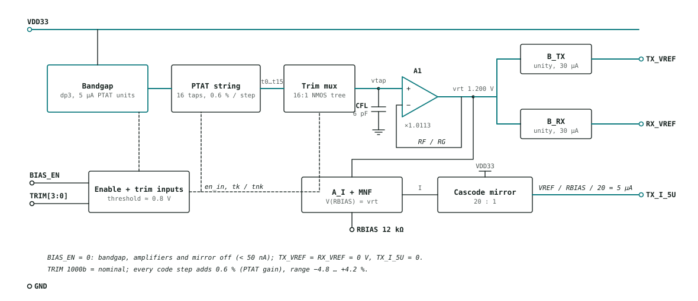

The bandgap (dp3 diodes, 5 µA PTAT mirror) drives a PTAT resistor with 16 taps; the trim mux selects one tap (vtap, 1.187 V at code 1000b), A1 amplifies it by 1.0113 to vrt = 1.200 V. Two unity followers B_TX / B_RX drive the output pins. The current loop A_I + MNF forces V(RBIAS) = vrt, and a 20 : 1 cascode mirror returns 1/20 of the RBIAS current at TX_I_5U.

## 3. Pin description

| Pin | Type | Description |
|---|---|---|
| VDD33 | supply | 3.3 V analog supply, 2.97–3.63 V |
| GND | supply | ground (bandgap diodes, string, RBIAS return) |
| BIAS_EN | digital in | enable, high-active; threshold ≈ 0.8 V absolute; no internal pull, must be driven (`bias_en` of `usb_pwr_seq`) |
| TRIM3…TRIM0 | digital in | trim code, binary, TRIM3 = MSB; 1000b = nominal; ignored (code 0000b) and current-free while BIAS_EN = 0 |
| RBIAS | analog | external resistor to GND, 12.0 kΩ, 1 %, ≤ 100 ppm/K; the pin is held at VREF (100 µA). Keep the trace short; ≤ 100 pF |
| TX_VREF | analog out | 1.200 V for the HS transmitter (bias OTA and UVLO comparator gates); 2 pF on chip, ≤ 100 pF external |
| RX_VREF | analog out | 1.200 V for the HS receiver (bias OTA gate); as TX_VREF |
| TX_I_5U | analog out | 5 µA current source (sources into the load); load voltage 0 … VDD33 − 0.55 V |

## 4. Absolute maximum ratings

| Parameter | Min | Max | Unit | Note |
|---|---|---|---|---|
| VDD33 | −0.3 | 3.96 | V | 3.3 V device rating (+10 %) |
| BIAS_EN, TRIM[3:0] | −0.3 | 3.96 | V | gate inputs |
| RBIAS, TX_VREF, RX_VREF, TX_I_5U | −0.3 | VDD33 + 0.3 | V | |
| RBIAS short to GND | | continuous | | 32 µA at TX_I_5U, 0.82 mA supply |
| Junction temperature | −40 | 125 | °C | simulated range |

## 5. Recommended operating conditions

| Parameter | Min | Typ | Max | Unit | Note |
|---|---|---|---|---|---|
| VDD33 | 2.97 | 3.3 | 3.63 | V | |
| RBIAS | 6 | 12.0 | 24 | kΩ | TX_I_5U = VREF / RBIAS / 20; 12.0 kΩ for 5 µA |
| Capacitance at TX_VREF / RX_VREF (external) | 0 | 10 | 100 | pF | ≤ 10 pF for the 10 µs settling (section 8) |
| DC load at TX_VREF / RX_VREF | −0.1 | 0 | 0.1 | µA | gate loads; ±10 µA → ±74 mV |
| Capacitance at RBIAS | 0 | 10 | 100 | pF | |
| Voltage at TX_I_5U | 0 | 0.6 | VDD33 − 0.55 | V | |
| BIAS_EN, TRIM high / low | 1.2 / — | | — / 0.4 | V | |
| Temperature | −40 | 27 | 125 | °C | |

## 6. Electrical characteristics

VDD33 = 2.97–3.63 V, −40…125 °C, all simulated corners (tm, ws, wp, wo, wz), RBIAS = 12.0 kΩ (ideal), trimmed (best code at 27 °C per corner), unless noted. Typical: tm, 27 °C, 3.3 V. Min / max are the extremes of the corner runs of section 13 (not statistical limits; mismatch is not included, section 15).

### 6.1 Voltage references

| Parameter | Condition | Min | Typ | Max | Unit |
|---|---|---|---|---|---|
| TX_VREF, RX_VREF, untrimmed | code 1000b, all corners, T, VDD33 | 1.1588 | 1.2009 | 1.2392 | V |
| TX_VREF, RX_VREF, trimmed | code per corner, T, VDD33 | 1.1948 | 1.2009 | 1.2028 | V |
| Temperature coefficient (box), trimmed | −40…125 °C, 3.3 V | | 26 | 28 | ppm/K |
| RX_VREF − TX_VREF | | −0.01 | 0 | 0.01 | mV |
| Trim step (LSB) | | 7.20 | 7.20 | 7.20 | mV |
| Trim range below / above code 1000b | | | −4.79 / +4.20 | | % |
| Differential non-linearity | | | < 0.001 | | LSB |
| Line regulation | 2.97–3.63 V | | +0.65 | 1.45 | mV/V |
| Minimum VDD33 for 0.5 % accuracy | | | 1.86 | 2.07 | V |
| Output resistance (DC) | ±10 µA | | 7.4 | | kΩ |
| Load-current sensitivity | DC | | 7.4 | | mV/µA |

### 6.2 Current reference

| Parameter | Condition | Min | Typ | Max | Unit |
|---|---|---|---|---|---|
| V(RBIAS) | trimmed | | 1.1994 | | V |
| V(RBIAS) − TX_VREF | | −8.8 | −1.5 | −1.0 | mV |
| TX_I_5U | RBIAS 12.0 kΩ ideal, trimmed, 0.6 V | 4.966 | 4.999 | 5.007 | µA |
| TX_I_5U · RBIAS · 20 / VREF | RBIAS 6–24 kΩ | 0.999 | 1.000 | 1.000 | |
| Compliance (1 % from the value at 0.6 V) | | 2.42 | 2.86 | | V |
| Output resistance | 0.2–1.8 V | | 0.89 | | GΩ |
| Supply sensitivity of TX_I_5U | 2.97–3.63 V | | +0.16 | +0.55 | %/V |
| TX_I_5U, RBIAS shorted / open | | | 31.9 / 0 | | µA |

### 6.3 Supply current and logic inputs

| Parameter | Condition | Min | Typ | Max | Unit |
|---|---|---|---|---|---|
| IDD33, enabled | incl. 100 µA RBIAS + 5 µA TX_I_5U | 218 | 251 | 297 | µA |
| IDD33, core only | without RBIAS and TX_I_5U | | 146 | | µA |
| IDD33, disabled | BIAS_EN = 0 | | 0.6 | 5.4 | nA |
| IDD33 peak at enable | | | 645 | | µA |
| BIAS_EN / TRIM threshold | | | ≈ 0.8 | | V |
| Output voltage while disabled (TX_VREF, RX_VREF) | | | < 0.1 | | mV |

### 6.4 AC characteristics

| Parameter | Condition | Min | Typ | Max | Unit |
|---|---|---|---|---|---|
| PSRR TX_VREF | 100 Hz / 1 kHz | 45.2 | 61.5 | | dB |
| | 100 kHz | | 49.2 | | dB |
| | 1 MHz | | 39.9 | | dB |
| | 10 MHz | | 54.0 | | dB |
| | minimum (any frequency) | 38.6 | 39.8 @ 0.9 MHz | | dB |
| Supply rejection TX_I_5U | 1 kHz / 1 MHz | | −57 / −40 | | dB re 1/V |
| Noise density TX_VREF | 1 kHz / 100 kHz | | 1.04 / 0.36 | | µV/√Hz |
| Integrated noise TX_VREF | 10 Hz–100 kHz / 10 Hz–10 MHz | | 148 / 233 | | µV rms |
| Noise TX_I_5U | 1 kHz; 10 Hz–100 kHz | | 5.2 pA/√Hz; 0.70 nA rms | | |
| Output impedance TX_VREF | 100 Hz / 1 MHz | | 7.3 / 6.4 | | kΩ |

### 6.5 Dynamic characteristics

| Parameter | Condition | Min | Typ | Max | Unit |
|---|---|---|---|---|---|
| Settling TX_VREF / RX_VREF to 0.5 % after BIAS_EN ↑ | 10 pF | | 6.6 | 8.3 | µs |
| | 100 pF | | 9.0 | 11.4 | µs |
| Settling to 0.1 % | 10 / 100 pF | | 7.7 / 10.2 | | µs |
| TX_I_5U to 1 % after BIAS_EN ↑ | | | 6.2 | | µs |
| Overshoot | | | 0 | | mV |
| Turn-off (to 10 %) after BIAS_EN ↓ | 10 / 100 pF | | 43 / 207 | | ns |
| VDD33 step 3.0 ↔ 3.6 V in 1 µs | TX_VREF peak | | +3.1 / −2.6 | +3.6 / −2.9 | mV |
| | TX_I_5U | | 0.4 | | % |
| 10 µA, 2 µs pulse into TX_VREF | TX_VREF / RX_VREF | | 74 mV / 12 µV | | |

## 7. Stability

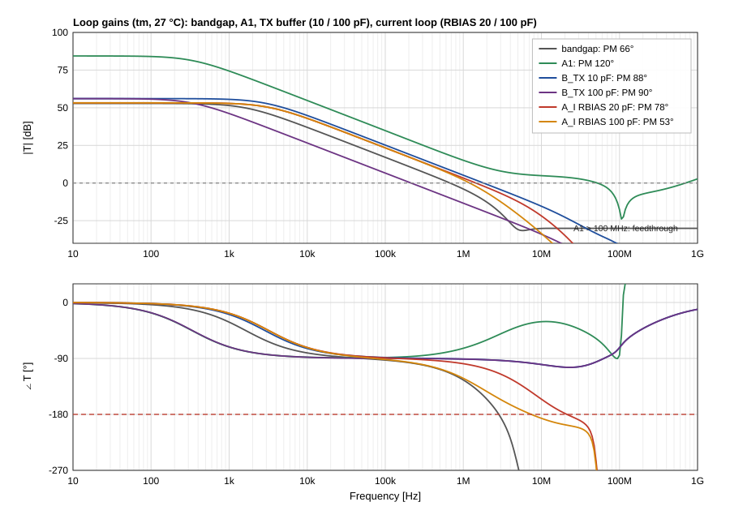

The block has four loops, each measured by voltage injection (a 0 V source in the loop that carries the AC stimulus; T = −v(return) / v(drive)):

| Loop | Injection | Load | DC gain [dB] | Crossover | PM [°] | GM [dB] | PM min over PVT [°] |
|---|---|---|---|---|---|---|---|
| Bandgap | op-amp output o1 → MN3 | CCB 4 pF | 52.9 | 675 kHz | 66 | 18.9 | 65 |
| A1 (×1.0113) | divider fbn → MGA_A | B_TX, B_RX, A_I gates | 84.4 | 52 MHz | 120 | > 40 | 117 |
| B_TX / B_RX | output → inverting input | 0 / 10 / 100 pF | 56.1 | 10 / 1.8 / 0.21 MHz | 80 / 88 / 90 | > 40 | 80 / 88 / 90 |
| Current loop A_I + MNF | RBIAS → A_I | 0 / 20 / 100 pF at RBIAS | 53.3 | 1.5 / 1.4 / 1.2 MHz | 87 / 78 / 53 | 49 / 36 / 28 | 87 / 76 / 50 |

The A1 loop gain stays slightly above 0 dB between 2 MHz and 50 MHz (flat gain gm·RZ of the nulling resistor) with a phase between −30° and −90°, and shows capacitive feedthrough above 100 MHz with the phase near 0°: there is no −180° crossing. The buffers are single-stage OTAs with the dominant pole at the output: more load capacitance only lowers the crossover. The current loop has its dominant pole at the follower gate (CGF 5 pF); RBIAS capacitance adds the second pole 1 / (2π · CRBIAS / gm(MNF)), hence the PM drop at 100 pF.

## 8. Start-up and transient characteristics

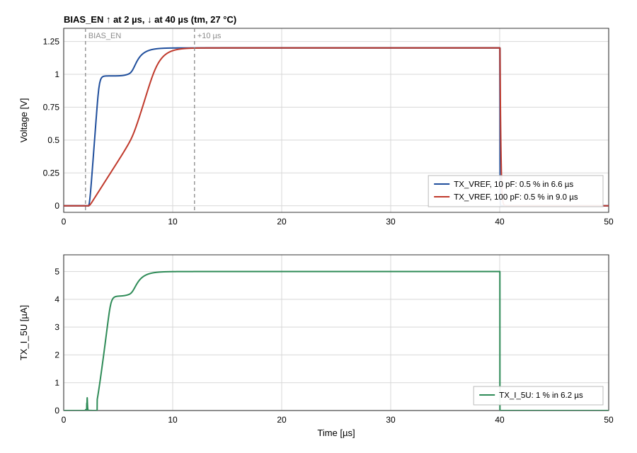

- The bandgap starts through MS1–MS3 (start-up kick while the string top is below ≈ 0.86 V); TX_VREF first follows the bandgap to ≈ 0.99 V (≈ 1.5 µs), then the CFL / string filter (≈ 0.5 µs) and the bandgap loop settle the last 20 % (≈ 3 µs). With 100 pF, the buffer slew rate (0.3 V/µs) adds ≈ 2.5 µs.
- The sequencer waits BIAS_CYC = 10 µs after `bias_en` before it enables the PLL. With ≤ 10 pF per output (the real consumers are a few pF of gates) the worst case is 8.3 µs (ws, −40 °C, 2.97 V). With 100 pF the buffers slew-limit and the worst case is 11.4 µs: set BIAS_CYC to 12 µs (288 REF_DIG cycles) if large capacitors are added at the reference pins.
- When VDD33 ramps up with BIAS_EN tied high, the references follow the supply without overshoot (0.3 mV).
- Disable: the off pull devices discharge the outputs within 0.2 µs (100 pF).

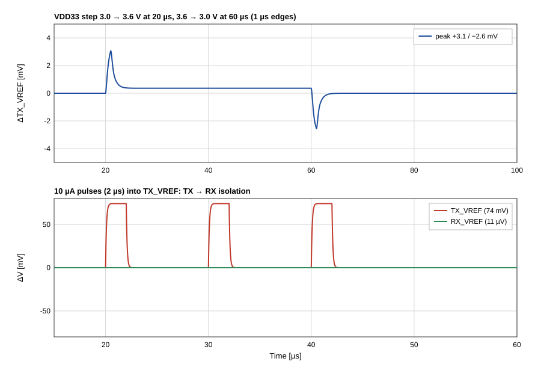

## 9. Trim

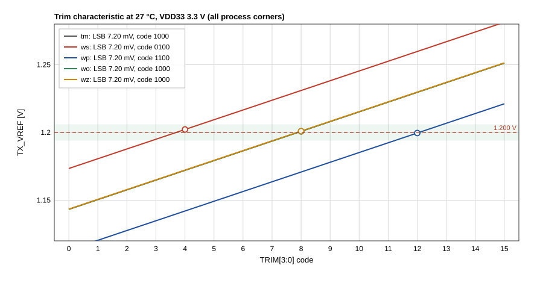

- The code selects the PTAT resistor tap: VBG(k) = VBE + I_PTAT · (84.04 kΩ + k · 1.4325 kΩ). One step adds 7.2 mV (0.6 %) of PTAT voltage, i.e. also +20 ppm/K of slope.
- The diode corners (ws: high VBE, wp: low VBE) shift VREF by +2.6 % (ws, 1.2310 V) and −2.5 % (wp, 1.1708 V) at code 1000b. The code that brings VREF back to 1.200 V at 27 °C also cancels the temperature slope caused by the VBE spread (Figure 6, untrimmed vs trimmed curves).
- Selected codes: tm, wo, wz 1000b; ws 0100b; wp 1100b (27 °C, 3.3 V).
- Trim procedure at test: enable the block, measure TX_VREF (or V(RBIAS)) at 27 °C with code 1000b, compute k = 8 + round((1.200 V − V) / 7.2 mV), store k in the AFE trim register (proposal: vendor register `TRIM_REF`, 4 bits, reset value 1000b).

## 10. Typical characteristics

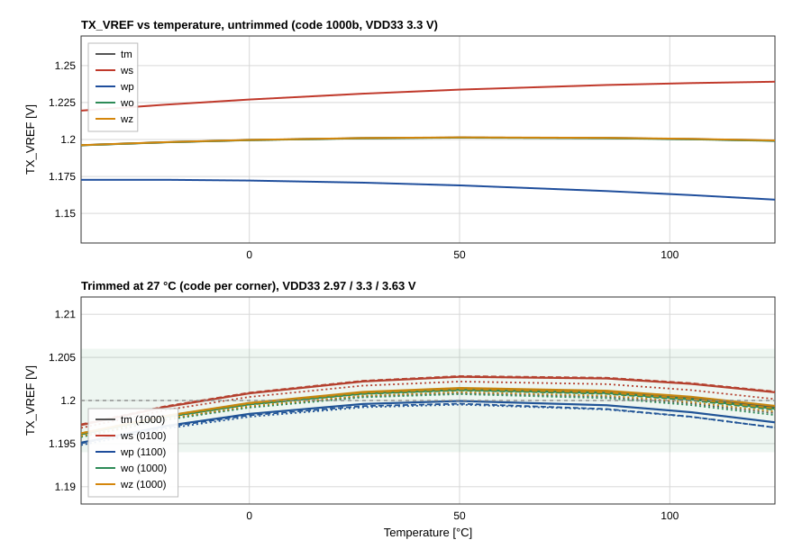

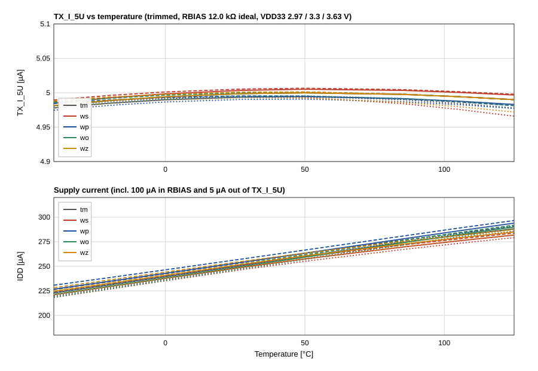

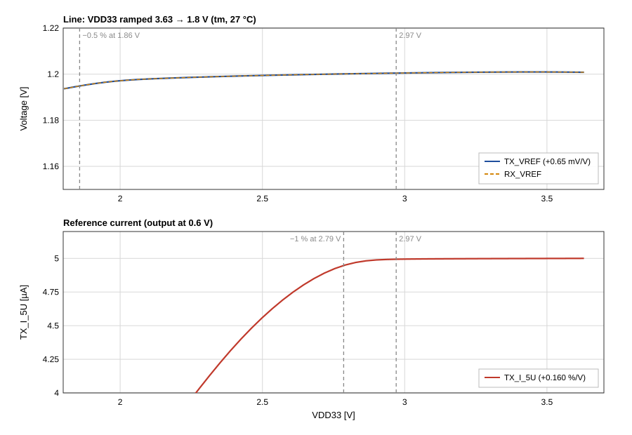

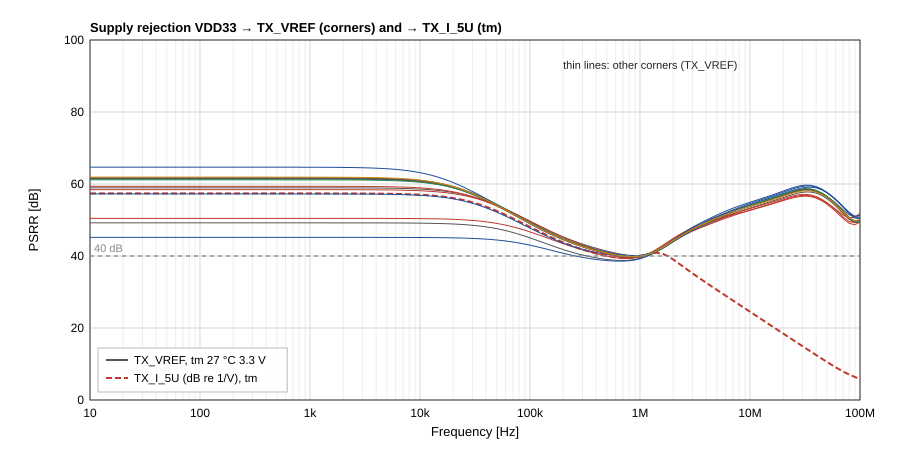

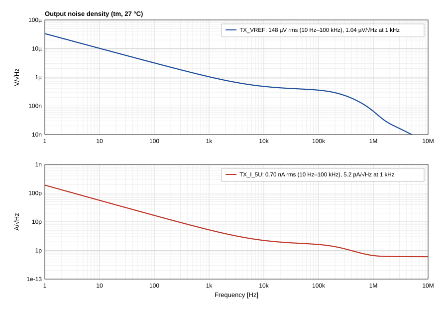

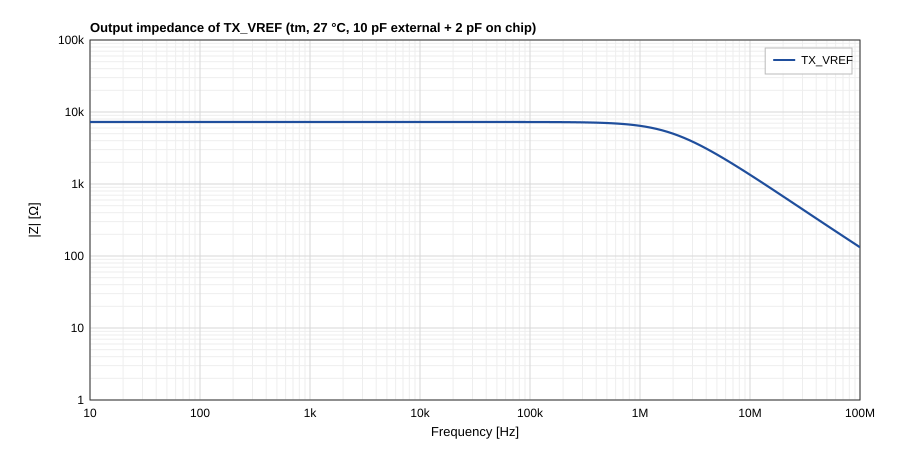

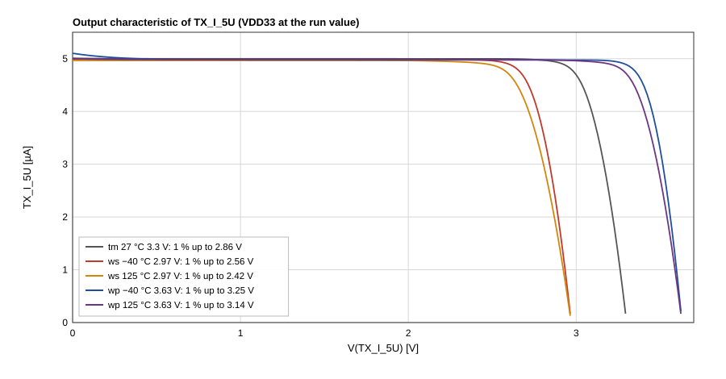

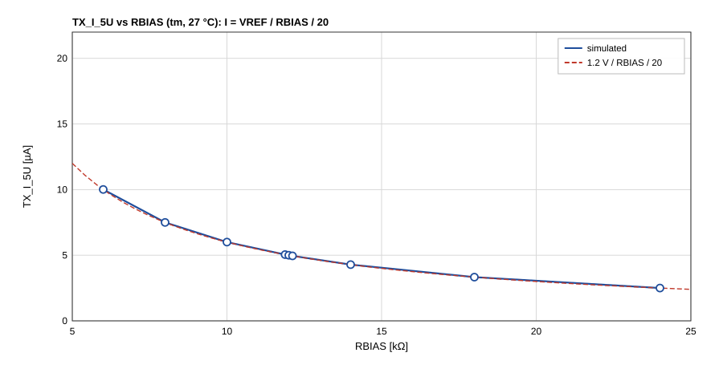

**Temperature table (tm, trimmed code, 3.3 V)**

| T [°C] | -40 | -20 | 0 | 27 | 50 | 85 | 105 | 125 |
|---|---|---|---|---|---|---|---|---|
| TX_VREF [V] | 1.1961 | 1.1981 | 1.1996 | 1.2009 | 1.2013 | 1.2010 | 1.2003 | 1.1992 |
| VBG code 1000b [V] | 1.1820 | 1.1839 | 1.1853 | 1.1865 | 1.1869 | 1.1865 | 1.1858 | 1.1847 |
| TX_I_5U [µA] | 4.981 | 4.989 | 4.994 | 4.999 | 5.000 | 4.998 | 4.994 | 4.990 |
| IDD [µA] | 223 | 231 | 240 | 251 | 260 | 274 | 281 | 288 |

**Error budget (sensitivity of the outputs, tm, 27 °C)** — systematic shifts applied one at a time in the netlist (`offset` case):

| Error source | ΔTX_VREF [mV] | ΔTX_I_5U [%] |
|---|---|---|
| 1 mV offset, bandgap op-amp (MA1) | +9.39 | +0.78 |
| 1 mV offset, gain stage A1 (MGA_B) | +1.01 | +0.08 |
| 1 mV offset, TX buffer (B_TX) | +1.00 | 0 |
| 1 mV offset, current OTA A_I | 0 | +0.08 |
| PTAT string R2 +1 % | +4.21 | +0.35 |
| R1 +1 % | −5.00 | −0.42 |
| D2 area +1 % | +2.42 | +0.20 |
| MP2 / MP1 current ratio +1 % | −7.39 | −0.62 |

The bandgap op-amp offset is multiplied by ≈ 1 + R2/R1 ≈ 9.4 and the mirror ratio MP2/MP1 enters likewise; these dominate the statistical error. The trim at 27 °C removes all of them in value. A VBE (diode) error is removed in slope as well, but an offset or a ratio error is not: correcting 1 mV of bandgap op-amp offset (9.4 mV, 1.3 codes) changes the PTAT slope by ≈ 26 ppm/K, which then adds to the box TC. The buffer and A_I offsets pass 1 : 1 and are not trimmed (each 1 mV = 0.08 %).

## 11. Application information

- **RBIAS**: 12.0 kΩ, 1 %, ≤ 100 ppm/K thin-film resistor from the RBIAS pin to the analog ground, close to the pin. The TX_I_5U accuracy is that of the resistor plus ≈ ±0.5 % (trimmed VREF and mirror).
- **TX_VREF / RX_VREF** are references, not supplies: connect them only to gates (the transceiver and receiver bias OTAs, comparators). Route them as shielded analog nets; ≤ 100 pF in total. A DC load of 100 nA costs 0.06 %.
- **Consumers in this AFE**: `afe_transceiver_tr` builds every bias current from TX_VREF over its internal 12 kΩ RREF (the Verilog-A model's `bias_mode 1`); `afe_receiver_tr` builds its 20 µA from RX_VREF. TX_I_5U is not used by `afe_transceiver_tr` (1 GΩ termination) but matches `bias_mode 2` of `afe_transceiver.va` (5 µA into a node at 0.6 V); it is the option for an HS amplitude set by an external precision resistor instead of the on-chip poly RREF.
- **BIAS_EN** comes from `usb_pwr_seq` (`bias_en`, REF_DIG domain, 1.8 V logic); BIAS_CYC = 10 µs is sufficient (section 8). Do not leave BIAS_EN floating.
- **Trim**: program the code before the HS transmitter is used; the reset default 1000b gives 1.159–1.239 V (−3.4 / +3.3 %) (untrimmed).
- **Supply**: VDD33 with the usual 100 nF decoupling; the references hold 0.5 % down to ≈ 1.9 V, so a sagging VDD33 is detected by the supervisors before the references move.

## 12. Design parameters

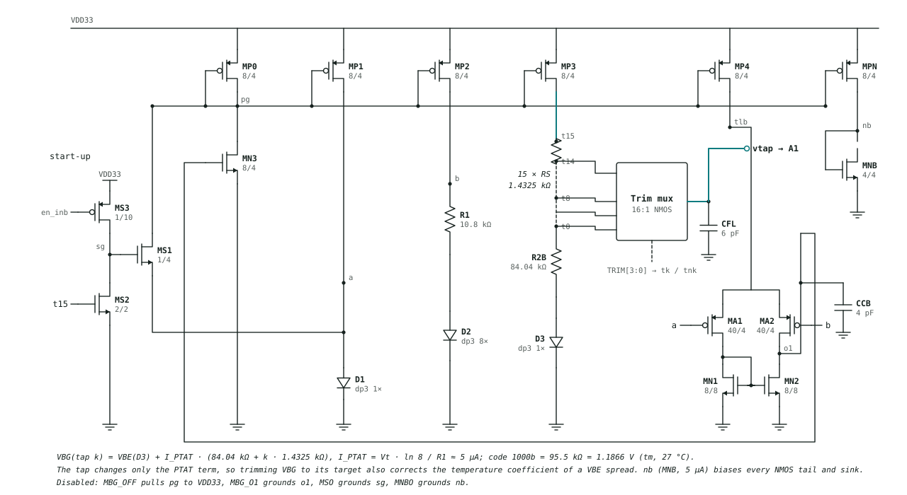

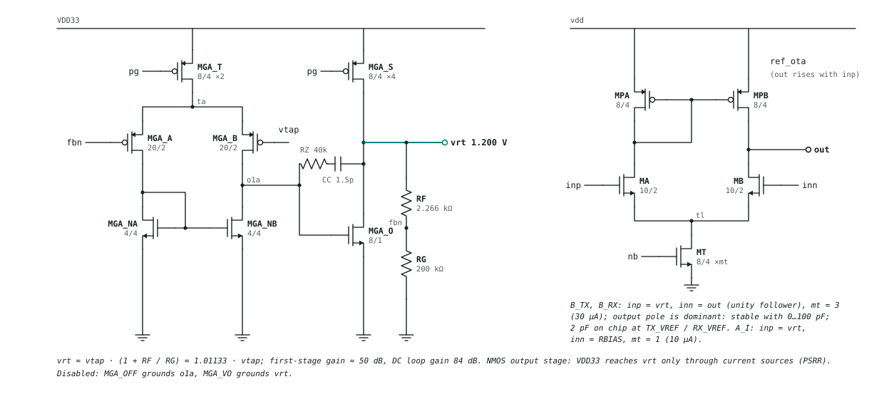

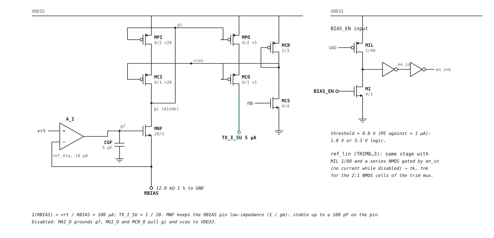

| Block | Element | Value | Function |
|---|---|---|---|
| Bandgap | D1 / D2 / D3 | dp3 1× / 8× / 1× (100 µm² unit) | ΔVBE = Vt·ln 8 |
| | R1 | 10.8 kΩ | I_PTAT ≈ 5 µA |
| | R2B + string | 84.04 kΩ + 15 × 1.4325 kΩ | taps t0…t15, t8 = 95.5 kΩ |
| | MP0–MP4, MPN | 8/4 µm | 5 µA mirror |
| | MA1 / MA2, MN1 / MN2 | 40/4, 8/8 µm | op-amp (offset, 1/f), CCB 4 pF |
| | MS1 / MS2 / MS3 | 1/4, 2/2, 1/10 µm | start-up |
| Trim | 15 × `ref_mux2` | NMOS 1/0.35 µm | 16:1 tree, no DC current |
| Filter | CFL | 6 pF | ≈ 300 kHz with the string |
| A1 | MGA_A / MGA_B, tail MGA_T | 20/2 µm, 2 × 8/4 µm (10 µA) | PMOS input |
| | MGA_NA / MGA_NB | 4/4 µm | mirror |
| | MGA_O, MGA_S | 8/1 µm, 4 × 8/4 µm (20 µA) | NMOS CS output |
| | RZ / CC | 40 kΩ / 1.5 pF | Miller compensation |
| | RF / RG | 2.266 kΩ / 200 kΩ | gain 1.01133 |
| Buffers | `ref_ota` mt = 3 | NMOS 10/2, PMOS 8/4, tail 3 × 8/4 (30 µA) | unity followers, 2 pF on chip |
| Current loop | A_I `ref_ota` mt = 1 | 10 µA | CGF 5 pF |
| | MNF | 20/1 µm | source follower on RBIAS |
| | MPI / MCI | 4/2 · 20, 4/1 · 20 µm | mirror input (100 µA) |
| | MPO / MCO | 4/2, 4/1 µm | output (5 µA) |
| | MCB / MCS | 1/3, 4/4 µm | cascode bias, vcas ≈ 1.70 V |
| Inputs | MI / MIL | 4/1, 1/40 µm | BIAS_EN, ≈ 0.8 V threshold |
| | `ref_lin` | 4/1 + 4/1, load 1/80 µm | TRIM inputs, gated by en_in |
| Disable | MBG_OFF, MBG_O1, MSO, MNBO, MGA_OFF, MGA_VO, BT_O, BR_O, MAI_O, MGI_O, MCB_O | 1–2 µm / 0.3–0.35 µm | no floating node while off |

## 13. Corner tables

**Corner runs** (trimmed code of the corner; PSRR min over 10 Hz–100 MHz; PM min over the loops of section 7)

| Run | Code | TX_VREF [V] | RX−TX [mV] | V(RBIAS) [V] | TX_I_5U [µA] | IDD [µA] | Line [mV/V] | PSRR min [dB] | PM min [°] | Settle 10 / 100 pF [µs] | Compliance [V] |
|---|---|---|---|---|---|---|---|---|---|---|---|
| tm 27 °C 3.3 V | 1000 | 1.2009 | +0.00 | 1.1994 | 4.999 | 251 | +0.65 | 39.8 | 53 | 6.6 / 9.0 | 2.86 |
| tm −40 °C 2.97 V | 1000 | 1.1958 | +0.00 | 1.1943 | 4.978 | 220 | +0.53 | 40.1 | 56 | 8.0 / 10.5 | 2.58 |
| tm 125 °C 3.63 V | 1000 | 1.1990 | +0.00 | 1.1971 | 4.990 | 290 | +0.90 | 38.7 | 49 | 5.7 / 8.4 | 3.11 |
| ws −40 °C 2.97 V | 0100 | 1.1968 | +0.00 | 1.1950 | 4.981 | 218 | +0.68 | 39.8 | 57 | 8.3 / 11.4 | 2.56 |
| ws 125 °C 2.97 V | 0100 | 1.2002 | +0.00 | 1.1914 | 4.966 | 279 | +1.45 | 39.3 | 63 | 6.1 / 10.0 | 2.42 |
| wp −40 °C 3.63 V | 1100 | 1.1950 | +0.00 | 1.1940 | 4.984 | 231 | +0.38 | 39.8 | 57 | 7.3 / 9.0 | 3.25 |
| wp 125 °C 3.63 V | 1100 | 1.1969 | +0.00 | 1.1950 | 4.981 | 297 | +0.21 | 38.6 | 50 | 5.5 / 7.7 | 3.14 |
| ws 27 °C 3.3 V | 0100 | 1.2022 | +0.00 | 1.2006 | 5.003 | 249 | +0.94 | 39.5 | 53 | 6.8 / 9.8 | 2.84 |
| wp 27 °C 3.3 V | 1100 | 1.1996 | +0.00 | 1.1982 | 4.994 | 254 | +0.34 | 40.1 | 54 | 6.4 / 8.4 | 2.88 |
| wo 27 °C 3.3 V | 1000 | 1.2008 | +0.00 | 1.1995 | 4.999 | 250 | +0.70 | 39.7 | 53 | 6.6 / 8.9 | 2.85 |
| wz 27 °C 3.3 V | 1000 | 1.2010 | +0.00 | 1.1994 | 4.999 | 252 | +0.61 | 39.8 | 53 | 6.7 / 9.1 | 2.88 |

**Trim and temperature per corner** (−40…125 °C, 2.97 / 3.3 / 3.63 V)

| Corner | Code | Untrimmed (1000b) min / max [V] | Trimmed min / max [V] | Trimmed error [%] | TC trimmed [ppm/K] | TX_I_5U min / max [µA] |
|---|---|---|---|---|---|---|
| tm | 1000 | 1.1958 / 1.2013 | 1.1958 / 1.2013 | -0.35 / +0.11 | 26 | 4.978 / 5.001 |
| ws | 0100 | 1.2192 / 1.2392 | 1.1968 / 1.2028 | -0.26 / +0.24 | 28 | 4.966 / 5.007 |
| wp | 1100 | 1.1588 / 1.1727 | 1.1948 / 1.1999 | -0.43 / -0.00 | 24 | 4.975 / 4.995 |
| wo | 1000 | 1.1958 / 1.2012 | 1.1958 / 1.2012 | -0.35 / +0.10 | 26 | 4.978 / 5.001 |
| wz | 1000 | 1.1959 / 1.2015 | 1.1959 / 1.2015 | -0.34 / +0.12 | 27 | 4.972 / 5.001 |

Corner names (xh018): tm typical; ws slow MOS and diode high-VBE; wp fast MOS and diode low-VBE; wo / wz the crossed MOS corners. The temperature / supply extremes run ws at 2.97 V and wp at 3.63 V (and tm at both), with the trim code found at 27 °C for the same corner. The full numbers per run are in `data/<run>/log.txt` and `data/tables.md`.

## 14. Simulation method

- **Simulator / models**: ngspice 42; xh018 `ne3i` / `pe3i` BSIM3v3 corner models; `dp3` diodes as JUNCAP2-derived B-sources. The converted models are written to `build/` only; the PDK data (`X-FAB/`) is never copied into the repository.
- **Testbench** `sim/tb_ref_tr.py`: 13 cases (op, trim, temp, line, psrr, noise, stab, zout, comply, rbias, start, tran, offset) with pass / fail limits; `--code auto` runs the trim sweep first and uses the best code. `sim/run_all.py` runs the 11 corner runs of section 13 and copies the results to `data/`.
- **Operating points**: the bandgap has a zero-current state, so every op / ac / noise analysis starts from a transient operating point (`optran`: supplies ramped from 0), and the line and compliance sweeps are slow transient ramps instead of DC sweeps.
- **Loop gain**: 0 V sources placed in each loop (`vinjb`, `vinja`, `vinjt`, `vinji`) carry the AC stimulus in a copy of the netlist.
- **Verdicts**: all 11 runs pass the limits below. The `data/<run>/log.txt` files of the four first-stage runs (tm, ws, wp, wo at 27 °C) and of four temperature runs were written before three limits were finalised (IDD max 260 → 320 µA, PSRR 1 kHz 50 → 40 dB, 100 pF settling 10 → 12 µs) and still print TEST FAILED for exactly those items; the stored results were re-checked against the final limits.
- **Limits** (`LIMITS` in the testbench): untrimmed 1.14–1.26 V; trimmed 1.188–1.212 V; LSB 4–10 mV; trim range 3.5–7 % each side; |RX − TX| ≤ 2 mV; TX_I_5U ±2 %; IDD ≤ 320 µA; off ≤ 0.1 µA; line ≤ 5 mV/V; PSRR (1 kHz) ≥ 40 dB; PM ≥ 45°, GM ≥ 10 dB; settling ≤ 10 µs (10 pF) / 12 µs (100 pF); compliance ≥ 2.0 V.
- **Not included**: layout parasitics, resistor and capacitor models (rhr poly TC and voltage coefficient, MIM caps), mismatch (Monte Carlo), package.

## 15. Limitations and open points

1. **Mismatch**: no Monte Carlo yet (the PDK statistical models are not converted). The error budget of section 10 gives the sensitivities; with the 40/4 µm op-amp pair a 1 σ offset of the order of 0.5 mV would give ≈ ±1.2 % (3 σ) before trim, inside the ±4.5 % trim range. After trim, every 1 mV of offset leaves ≈ 26 ppm/K of slope (section 10), so the trimmed TC of a real part will be worse than the ≈ 30 ppm/K simulated here; a two-temperature trim or a separate offset trim would be needed for < 30 ppm/K guaranteed.
2. **Ideal passives**: R2 string, R1, RF / RG should be the same high-resistance poly (ratios only; the absolute value cancels in VBG and in vrt). Their TC changes I_PTAT but not the ratio. CFL, CCB, CC, CGF are MIM.
3. **Output impedance**: single-stage buffers, ≈ 7 kΩ. Adequate for gate loads only; a consumer that draws DC current needs its own buffer.
4. **PSRR near 1 MHz** 38.6–40 dB, set by the bandgap mirror and CFL. A larger CFL (e.g. 20 pF) gives ≈ +10 dB but adds ≈ 4 µs to the start-up.
5. **Trim register**: `TRIM_REF` is not yet in the `usb_afe_trim_regs` map (interface spec section 6, Q11); it needs 4 bits with reset value 1000b, and the isolation cells must clamp the bits to that value.
6. **Current-loop headroom at ws, 125 °C, 2.97 V**: V(RBIAS) is 8.8 mV (0.7 %) below TX_VREF and TX_I_5U holds 1 % only down to VDD33 = 2.93 V (40 mV below the rated minimum; supply sensitivity 0.55 %/V there). The input branch (RBIAS 1.2 V + MNF + MCI + MPI diode) runs out of headroom. Wider MPI / MCI (lower V_SG) or a smaller V(RBIAS) (e.g. VREF / 2 on a 6 kΩ resistor) would restore the margin.
7. **Settling with 100 pF** is 11.4 µs worst case (section 8): BIAS_CYC 12 µs for large loads.
8. **Behavioural model** `afe_ref.va` (section 16) exists but has not been compiled or run in Spectre (no simulator here); its equations are verified through the ngspice copy only. The AMS system testbenches still drive TX_VREF / RX_VREF from ideal sources.
9. **No layout**; no ESD, latch-up or EM checks.

## 16. Behavioural model `afe_ref.va`

`AFE/veriloga/afe_ref.va` (module `afe_ref`, same pins and pin order as `afe_ref_tr`) is the Verilog-A model for the mixed-signal simulation of the PHY. One equation per transistor-level function:

| Function | Model | Parameters (default = tm, 27 °C fit) |
|---|---|---|
| Reference | v_nom(T) (cubic fit of the circuit, −40…125 °C) + line · (VDD33 − 3.3) + (dv_proc + lsb · (code − 8)) · T / T0; soft droop at low VDD33 | `v0` 1.200977, `c1…c3`, `line` 0.44 mV/V (+ droop tail = 0.65), `lsb` 7.2 mV, `dv_proc` 0, `h_dr` / `w_dr` |
| Process | the diode (VBE) spread as a PTAT offset, like the trim: the trim code that cancels it at 27 °C also cancels its slope | `dv_proc` = +30.1 mV (ws) / −30.1 mV (wp) |
| Start-up | ramp to `k1` = 82 % after `t_d1` in `t_r1`, rest after `t_d2` through a lag `tau2` | 0.35 µs, 1.15 µs, 4.3 µs, 0.6 µs |
| Noise | flicker + white voltage noise at the reference node | `k_fn` 1.08e-9 V², `s_wn` 1.3e-13 V²/Hz |
| Buffers | current-limited transconductors (1 / `g_buf` = 7.3 kΩ, `i_buf` 23 µA effective slew current, following the bias start-up), 2 pF on chip, 1 kΩ off pull | `g_buf`, `i_buf`, `c_out`, `r_off` |
| Current reference | source-only follower holding V(RBIAS) = vrt + `v_rb_off`, limited to 640 µA and by a square-law input-branch ceiling; TX_I_5U = I / 20 with 894 MΩ and the cascode compliance | `g_rb`, `i_rb_max`, `k_hd`, `v_hd`, `p_hd`, `ratio`, `r_o5`, `g_c`, `v_c`, `p_c` |
| Supply | i_core · (T / T0)^0.82 + I(RBIAS) + I(TX_I_5U) + buffer currents + leakage | `i_core` 145.8 µA, `x_core` 0.82, `i_leak` 0.6 nA |
| Control | BIAS_EN and TRIM thresholds 0.8 V absolute, off below `vdd_min` = 1.5 V | `v_th`, `vdd_min` |

**Verification.** No Verilog-A simulator is available here, so the same equations are kept as B-sources in `sim/afe_ref_beh.sp` (subcircuit `afe_ref_tr`, same pins) and run through the transistor testbench unchanged: `python3 sim/tb_ref_tr.py op trim temp line zout comply rbias start tran --netlist sim/afe_ref_beh.sp --tag _beh --code 8` (TEST PASSED, results in `data/tm_27_3.3_beh/`).

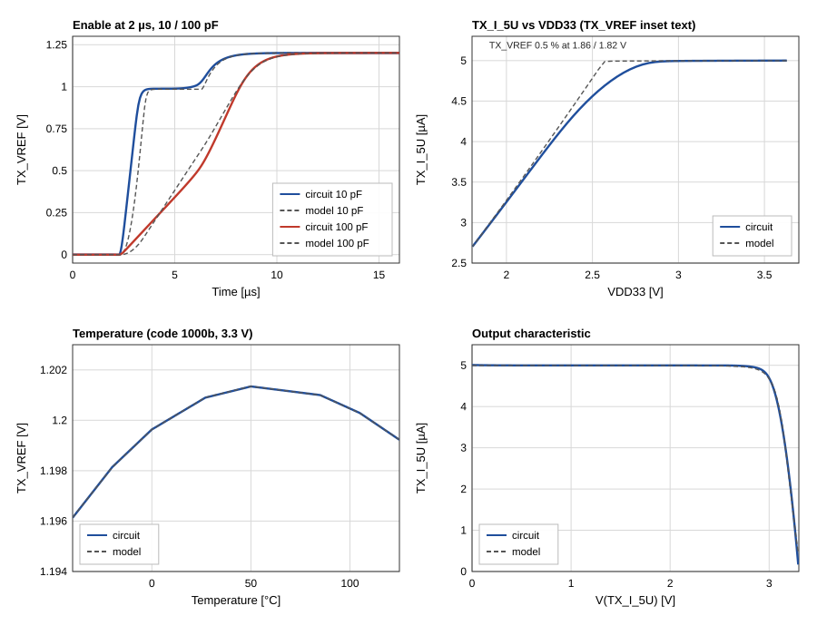

| Quantity (tm, 27 °C) | Circuit | Model |
|---|---|---|
| TX_VREF / V(RBIAS) | 1.20090 / 1.19943 V | 1.20090 / 1.19941 V |
| TX_I_5U / IDD33 | 4.9986 µA / 250.8 µA | 4.9975 µA / 250.7 µA |
| Trim LSB, range | 7.20 mV, −4.79 / +4.20 % | 7.20 mV, −4.80 / +4.20 % |
| TX_VREF −40…125 °C (1000b), box TC | 1.19583–1.20134 V, 26.3 ppm/K | 1.19588–1.20154 V, 26.3 ppm/K |
| ws corner, trimmed (0100b) | 1.19682–1.20283 V, 28.2 ppm/K | 1.19689–1.20294 V, 28.3 ppm/K |
| ws corner, untrimmed (1000b) | 96.3 ppm/K | 96.7 ppm/K |
| Line regulation; 0.5 % droop | +0.65 mV/V; 1.86 V | +0.67 mV/V; 1.82 V |
| TX_I_5U 1 % point vs VDD33 | 2.79 V | 2.55 V (sharper knee) |
| Compliance (1 %); Rout | 2.86 V; 894 MΩ | 2.80 V; 721 MΩ |
| I(RBIAS) · RBIAS / V, 6–24 kΩ; RBIAS short | 0.999–1.000; 31.9 µA | 0.997–1.000; 31.1 µA |
| Zout at 100 Hz / 1 MHz; 10 µA DC load | 7.27 / 6.43 kΩ; −74 mV | 7.30 / 6.39 kΩ; −78 mV |
| Settling 0.5 % (10 / 100 pF); 0.1 % | 6.60 / 8.96 µs; 7.66 / 10.18 µs | 6.56 / 9.02 µs; 7.52 / 10.22 µs |
| Turn-off to 10 % (10 / 100 pF) | 43 / 207 ns | 42 / 249 ns |
| VDD33 step 3.0 ↔ 3.6 V | +3.1 / −2.6 mV | ±0.4 mV (DC line term only) |
| Enable current peak | 645 µA | not modelled (≤ 292 µA) |

Not modelled: AC supply rejection (the line term is static, so supply steps and ripple are under-estimated), the enable current peak, mismatch, and the corner dependence of everything except the reference value (supply current, headroom and timing vary by up to ≈ 15 % over the corners, sections 6 and 13). The Spectre testbench `AFE/veriloga/tb/tb_afe_ref.scs` with checker `tb_afe_ref.va` (sequence in `AFE/README.md`) uses these values; it has not been run.

## 17. Revision history

| Revision | Date | Changes |
|---|---|---|
| 0.1 | 2026-11-22 | First release: transistor-level design, PVT corner simulations, figures |
| 0.2 | 2026-11-23 | Section 16: behavioural model `afe_ref.va` and its comparison with the circuit |
