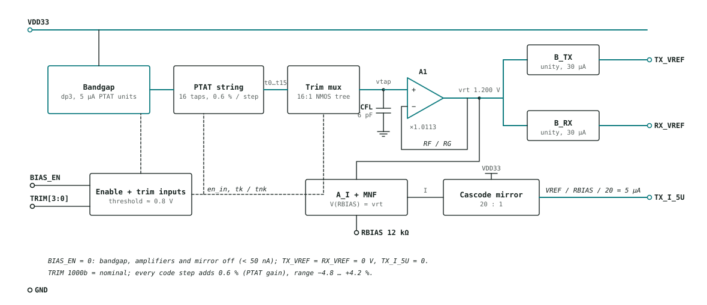
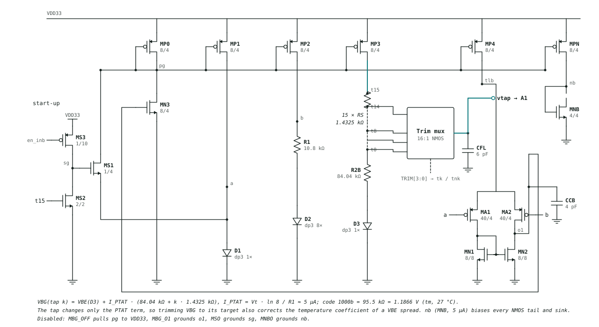
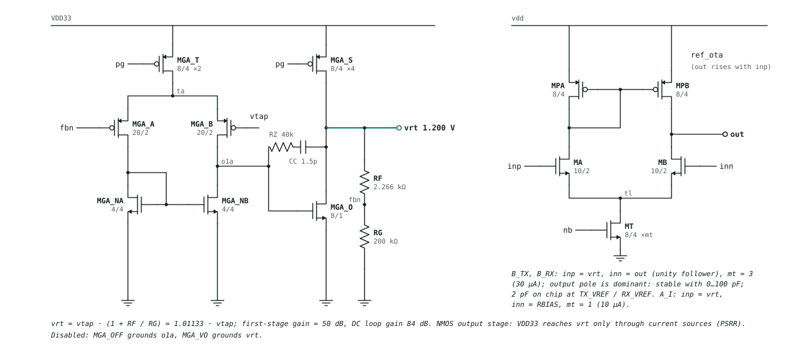
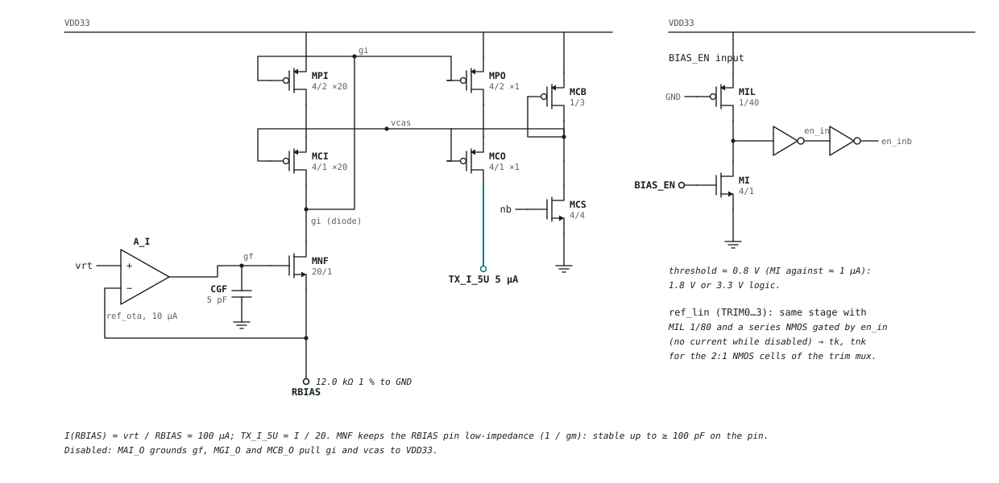

# Reference block — `afe_ref_tr` (1.200 V references and 5 µA bias current, xh018)

Transistor-level reference / bias block of the analog section of the USB 2.0 ULPI PHY.  It generates the voltage
references of the HS transmitter and receiver (`TX_VREF`, `RX_VREF`) and the 5 µA reference current `TX_I_5U`
from a trimmable bandgap and one external precision resistor.  Netlist: [`afe_ref_tr.sp`](afe_ref_tr.sp);
datasheet: [`datasheet/ref_datasheet.md`](datasheet/ref_datasheet.md) (Word: `datasheet/ref_datasheet.docx`);
testbench: [`sim/tb_ref_tr.py`](sim/tb_ref_tr.py).  All values below are ngspice simulations with the X-FAB xh018
models (corner tm, 27 °C, VDD33 = 3.3 V, RBIAS = 12.0 kΩ, 10 pF at each output, trim code 1000b) unless stated
otherwise.

## 1. Function and context

The open interface question Q9 / item I9 (`DOC/afe_interface_spec.md`, `AFE_INTEGRATION_PLAN.md`) asks who
supplies `TX_VREF`, `RX_VREF` and the 5 µA: this block.  It is enabled by the power sequencer (`bias_en` of
`usb_pwr_seq`, pin `BIAS_EN`), which waits BIAS_CYC = 10 µs before it starts the PLL, so every output must be
settled within 10 µs.

- **TX_VREF = 1.200 V** — reference of the HS current driver of the transceiver (which builds its driver current
  from it and its internal 12 kΩ RREF); own unity buffer.
- **RX_VREF = 1.200 V** — reference of the HS receiver / squelch thresholds; separate buffer, so current pulses
  drawn by the transmitter do not reach the receiver.
- **TX_I_5U = 5.00 µA** — reference current sourced into the load: VREF / RBIAS / 20 with the external
  12.0 kΩ 1 % resistor, so the current is as accurate as that resistor and not as the on-chip poly.
- **TRIM[3:0]** — 4-bit trim of the bandgap PTAT gain (0.6 % per code, −4.8 … +4.2 %), from the AFE trim
  register set (`usb_afe_trim_regs`, proposal for a `TRIM_REF` field, Q11).
- **BIAS_EN = 0** — everything off (≤ 6 nA at 125 °C), TX_VREF = RX_VREF = 0 V, TX_I_5U = 0.

## 2. Pins

| Pin | Dir | Description |
|---|---|---|
| VDD33 | supply | 3.3 V analog supply, 2.97–3.63 V |
| GND | supply | ground |
| BIAS_EN | in | enable, high-active, absolute threshold ≈ 0.8 V (1.8 V or 3.3 V CMOS) |
| TRIM3…TRIM0 | in | trim code, 1.8 V or 3.3 V CMOS; 1000b = nominal |
| RBIAS | analog | external resistor to GND, 12.0 kΩ 1 % (≤ 100 ppm/K); held at VREF, 100 µA |
| TX_VREF | out | 1.200 V, for gate (high-impedance) loads; 0–100 pF external |
| RX_VREF | out | 1.200 V, as TX_VREF |
| TX_I_5U | out | 5 µA current source to the load, compliance 0 … VDD33 − 0.55 V (worst case) |

## 3. Why this topology

- **Bandgap from the LDO**: the core of `afe_ldo_tr` (dp3 p+/n-well diodes 1× / 8×, op-amp-forced equal branch
  voltages, 5 µA PTAT units from one PMOS mirror) is already characterised over the xh018 corners; xh018 has no
  bipolar devices in this kit.  For a reference its op-amp is made 4× larger (input pair 40/4, mirror 8/8): the
  op-amp offset and flicker noise appear at the output multiplied by ≈ 9.4, so they dominate both the accuracy
  and the noise.
- **Trim by the PTAT tap, not by a gain resistor**: the untrimmed spread of a bandgap comes from the V_BE (diode
  saturation current) spread.  Choosing the tap of the PTAT resistor changes only the PTAT term, so the code that
  puts VBG on target also puts the bandgap back on its zero-TC point; a trimmed part keeps ≈ 30 ppm/K at every
  corner.  The 16:1 mux is a binary tree of NMOS switches into a gate (A1), so it carries no DC current and its
  on-resistance does not matter.
- **Gain stage A1 instead of a different string**: the bandgap gives its natural ≈ 1.187 V; a non-inverting gain
  of 1.0113 sets the exact 1.200 V and isolates the string from the buffers.  A1 has an NMOS common-source output
  stage: the supply then reaches the output only through current sources, which keeps the PSRR high at high
  frequency (a PMOS output stage passes VDD33 ripple above its gain-bandwidth).
- **Two separate unity buffers** for TX and RX: single-stage 5-transistor OTAs whose dominant pole is the output
  node, so they are stable with any capacitive load (PM ≥ 80° from 0 to 100 pF) and need no compensation.
- **Current reference with an external resistor and a source follower**: an OTA alone driving the RBIAS pin is
  unstable with the pin capacitance (≥ 20 pF of pad, ESD and board).  The NMOS source follower MNF makes the pin a
  1 / gm node; the OTA A_I sets the follower's gate (5 pF on that node).  The drain current runs through a
  wide-swing cascode mirror (20 : 1), giving a 900 MΩ output resistance and ≥ 2.8 V compliance.

## 4. Circuit

### 4.1 Bandgap, PTAT string and trim mux

- D1 (1×, 100 µm²) on node a; R1 = 10.8 kΩ and D2 (8×) on node b.  The op-amp MA1 / MA2 (PMOS input 40/4, tail
  MP4 5 µA) with mirror MN1 / MN2 (8/8) drives MN3, which sets the current of the diode-connected MP0 (node pg);
  MP1–MP4 and MPN copy it (all 8/4).  I_PTAT = V_T · ln 8 / R1 ≈ 5 µA.  CCB = 4 pF at the op-amp output gives
  66° phase margin.
- MP3 drives the PTAT string: D3 (1×), R2B = 84.04 kΩ, then 15 segments of 1.4325 kΩ (taps t0…t15).  The voltage
  of tap k is VBE(D3) + I_PTAT · (84.04 kΩ + k · 1.4325 kΩ); tap 8 (95.5 kΩ, code 1000b) = 1.1865 V.
- The 4-bit mux (15 `ref_mux2` cells, NMOS 1/0.35 µm, gates at VDD33 levels) selects one tap as vtap.  CFL = 6 pF
  at vtap with the ≈ 90 kΩ string is a 300 kHz low pass for the supply ripple that MP3's drain capacitance couples
  into the string; it keeps the PSRR at ≥ 38.6 dB at every frequency (minimum near 0.7–0.9 MHz) and costs ≈ 2 µs of settling.
- MPN / MNB (4/4 diode) give `nb`, 5 µA, for all NMOS tails and sinks.
- **Start-up**: while the string top t15 is below ≈ 0.86 V, MS2 is off, MS3 (1/10, gate en_inb) pulls `sg` high and
  the weak MS1 (1/4) pulls pg down into node a, so the loop leaves the zero-current state.  In operation MS2 holds
  `sg` at ≈ 20 mV; MS3 is long enough that this costs no accuracy.
- **Off**: MBG_OFF pulls pg to VDD33, MBG_O1 grounds o1, MSO grounds sg, MNBO grounds nb.

### 4.2 Gain stage A1 and output buffers

- A1: PMOS input pair MGA_A / MGA_B (20/2) with a 10 µA tail (MGA_T, 2 × 8/4 from pg), NMOS mirror (4/4), NMOS
  common-source output MGA_O (8/1) with a 20 µA PMOS load (MGA_S).  Miller compensation RZ = 40 kΩ + CC = 1.5 pF.
  Feedback RF = 2.266 kΩ / RG = 200 kΩ: vrt = 1.01133 · vtap.  DC loop gain 84 dB, PM 120°.
- B_TX, B_RX: `ref_ota` cells (NMOS pair 10/2, PMOS mirror 8/4, tail 3 × 8/4 = 30 µA) as unity followers.  The
  30 µA tail gives a 0.3 V/µs slew rate into 100 pF.  2 pF on chip at each output.
- Off: MGA_OFF grounds o1a, MGA_VO grounds vrt, BT_O / BR_O ground the outputs.

### 4.3 Current reference, enable and trim inputs

- A_I (`ref_ota`, 10 µA) compares vrt with the RBIAS pin and drives the gate `gf` (CGF = 5 pF) of MNF (20/1),
  whose source is RBIAS: V(RBIAS) = vrt, I = 1.2 V / 12 kΩ = 100 µA.
- MNF's drain is the diode node `gi` of the mirror MPI (4/2 × 20) / MCI (4/1 × 20); MPO / MCO (1 unit) give
  TX_I_5U = 5 µA.  The cascode gate `vcas` (≈ 1.70 V) comes from MCB (1/3, diode) with a 5 µA sink MCS.
- Off: MAI_O grounds gf, MGI_O and MCB_O pull gi and vcas to VDD33.
- BIAS_EN: NMOS MI (4/1) against the weak PMOS MIL (1/40, ≈ 1 µA) and two inverters (en_in, en_inb): threshold
  ≈ 0.8 V independent of the logic supply.  TRIM inputs (`ref_lin`): the same stage with a 1/80 load and a series
  NMOS gated by en_in, so the four inputs draw nothing while the block is off and the mux sees code 0000b.

## 5. Key results (tm, 27 °C, 3.3 V)

| Parameter | Value |
|---|---|
| TX_VREF / RX_VREF, code 1000b | 1.2009 V / 1.2009 V |
| V(RBIAS), TX_I_5U | 1.1994 V, 4.999 µA |
| Supply current (incl. 100 µA in RBIAS, 5 µA out) | 251 µA; off 0.6 nA |
| Trim LSB, range | 7.2 mV (0.60 %), −4.8 / +4.2 % |
| Trimmed, −40…125 °C, 2.97–3.63 V | −0.35 / +0.11 %, ≈ 26 ppm/K |
| Line regulation | +0.7 mV/V |
| PSRR TX_VREF 1 kHz / 100 kHz / worst | 61 / 49 / 39.8 dB @ 0.9 MHz |
| Noise TX_VREF 10 Hz–100 kHz | 148 µV rms (1.04 µV/√Hz at 1 kHz) |
| Phase margins (bandgap / A1 / buffers / current loop) | 66° / 120° / 80–90° / ≥ 53° |
| Settling after BIAS_EN (0.5 %), 10 pF / 100 pF | 6.6 µs / 9.0 µs |
| TX_I_5U compliance (1 %), output resistance | 0 … 2.86 V, 0.9 GΩ |

The full characterisation over the five process corners, −40…125 °C and 2.97–3.63 V is in the datasheet.

## 6. Usage notes and limits

- **Program the trim.**  Untrimmed, the process spread of the diodes moves VREF by −3.4 / +3.3 %; trimmed it stays within −0.43 / +0.24 % over all corners, −40…125 °C and 2.97–3.63 V; the trim code is
  found at test (measure TX_VREF or V(RBIAS) at 27 °C, pick the nearest code) and stored by the link in the
  vendor trim register.  The simulation picks the best code per corner automatically (`--code auto`).
- **Loads must be gates.**  The buffers' output resistance is ≈ 7 kΩ at DC (single-stage OTA, no output-stage
  gain); a DC load current of ±10 µA moves TX_VREF by ±74 mV.  Keep the DC load ≤ ±100 nA (0.06 %), or add a
  local buffer at a current-consuming user.
- **PSRR around 1 MHz** is 38.6–40 dB depending on the corner, set by CFL and A1.  The PLL / CDR supply ripple
  is on VDD18A, not on VDD33; a larger CFL raises the PSRR at the cost of the 10 µs settling budget.
- **Settling**: ≤ 8.3 µs over PVT with 10 pF per output; with 100 pF up to 11.4 µs (slew-limited buffers), so BIAS_CYC must then be 12 µs.
- **Current-loop headroom**: at ws, 125 °C, 2.97 V the RBIAS loop is at its limit (V(RBIAS) 0.7 % low, TX_I_5U holds 1 % only down to 2.93 V).
- **Mismatch** is not in these simulations (no Monte Carlo models used); the offset table of the datasheet gives
  the sensitivities (1 mV of bandgap op-amp offset → 9.4 mV at VREF), which the trim removes at 27 °C.
- RBIAS short to GND: 32 µA at TX_I_5U, 0.82 mA supply current (no damage); RBIAS open: TX_I_5U = 0, the voltage
  references stay correct.

## 7. Files

| File | Content |
|---|---|
| `afe_ref_tr.sp` | transistor netlist (subcircuit `afe_ref_tr`) |
| `sim/tb_ref_tr.py` | ngspice testbench (cases op, trim, temp, line, psrr, noise, stab, zout, comply, rbias, start, tran, offset) |
| `sim/run_all.py` | corner regression, copies results to `datasheet/data/` |
| `doc/draw_ref.py`, `doc/ref_*.svg` | schematic sheets |
| `doc/md2html.py` | this page → `ref_description.html` |
| `datasheet/gen_figures.py` | datasheet figures and tables |

The xh018 models are converted at run time from the PDK (`AFE/LDO analog part/sim/xfab2ngspice_ldo.py` →
`build/ldo/models/`); no PDK data is stored in this directory.
