# afe_cdr — 480 Mbit/s Bang-Bang Clock and Data Recovery — Datasheet

*Datasheet of the CDR model `AFE/veriloga/afe_cdr.va`, the upper loop of the PLL-assisted CDR block of the USB 2.0 ULPI PHY. Revision 0.1, 2026-11-20. It describes the behaviour of the Verilog-A model with its default parameters. Where the transistor-level design `AFE/spice/afe_cdr_tr.sp` already exists, its simulated values are listed next to the model values. Those simulations use ngspice 42 and the placeholder 180 nm models `generic180.lib`, not the xh018 PDK. The Verilog-A model has not been run in Spectre yet. The loop curves in this datasheet come from a behavioural simulation that uses the same equations as the model, evaluated once per bit (see 15).*

Figures: `fig/` (SVG; PNG copies for Word), generated by `gen_figures.py`. Related documents: [AFE/doc/cdr.md](../cdr.md) (model description), [AFE/doc/cdr_schematic.md](../cdr_schematic.md) (transistor schematic), [AFE/doc/pll_datasheet/pll_datasheet.md](../pll_datasheet/pll_datasheet.md) (the PLL that sets the coarse frequency), `DOC/afe_interface_spec.md` sections 2, 3.2 and 4.2 (AFE ↔ digital interface).

## 1. Overview

`afe_cdr` recovers the 480 MHz receive clock `CLK_RX` and the retimed data `HS_RXD` from the high-speed receiver output. It is a bang-bang (Alexander) CDR whose ring VCO is a matched copy of the PLL's VCO: the PLL's control voltage sets the coarse frequency, and the CDR's own loop only corrects phase and the remaining frequency error. Without data it free-runs near 480 MHz, so the digital receive clock never stops while the CDR is on.

**Features**

- Alexander phase detector: data sample on the rising, edge sample on the falling `CLK_RX` edge; one charge-pump decision per data transition, held for one bit.
- Proportional step 0.0625 UI (130 ps) per decision, integral step 260 ppm per net decision (transistor: 0.0627 UI, 1633 ppm).
- Two-input ring VCO: coarse input `CDR_V_IN_2` (from the PLL's `CDR_CH_OUT_PLL`, same curve as the PLL VCO), fine input from the CDR loop filter (300 MHz/V).
- Lock within 4 bits from the start of SYNC for every start phase without jitter (requirement: correct bits from the 7th bit); 99 % of packets within 8 bits at ±0.15 UI data jitter.
- Tracks ±1000 ppm (host ±500 ppm, own ±500 ppm) without errors, minimum sampling margin 0.40 UI.
- Retimed data `HS_RXD` (1 = J), `t_cq` = 0.3 ns after the rising `CLK_RX` edge: setup 1.78 ns, hold 0.3 ns at the digital capture flop (requirement 0.4 / 0.1 ns).
- Free-running `CLK_RX` = f_coarse(`CDR_V_IN_2`) · (1 + `ppm_mis`) while there are no transitions (assumption D1 of the digital).
- Off state (`CDR_EN` = 0 or supply below 1.5 V): `CLK_RX` stopped low, `HS_RXD` = 1 (isolated J), loop filter reset to 0.9 V.
- No lock-detect output: the digital derives `hs_cdr_lock` from squelch (`usb_afe_rx_if`, `LOCK_DLY`).
- Model-only options: coarse mismatch `ppm_mis`, VCO period jitter `jit_rms`, sampler ambiguity window `t_amb`.

**Views and status**

| View | File | Status |
|---|---|---|
| Verilog-A model | `AFE/veriloga/afe_cdr.va` | Written 2026-11-11. Not simulated in Spectre (no simulator here) |
| Spectre testbench | `AFE/veriloga/tb/tb_afe_cdr.scs` + checker `tb_afe_cdr.va` | Written, not run |
| Icarus behavioural model | `afe_cdr_bm.v` (repository root) | Same loop as a phase-step model (`P_STEP` 0.13 ns). Used by `tb_afe_hs_chain`, `tb_usb_afe_rx_if` and the AMS shadows. Source of the spec 4.2 lock statistics |
| Transistor schematic | `AFE/spice/afe_cdr_tr.sp` (+ `afe_cells.sp`) | ngspice: closed loop passes at tt; VCO run at five corners (13.1, 13.2). No layout |
| AMS system tests | `AFE/ams/tb_ams_link.vams`, `tb_ams_mouse.vams`, `tb_ams_msc.vams` | Instantiate `afe_cdr` (host and device side). Not run |

## 2. Block diagram

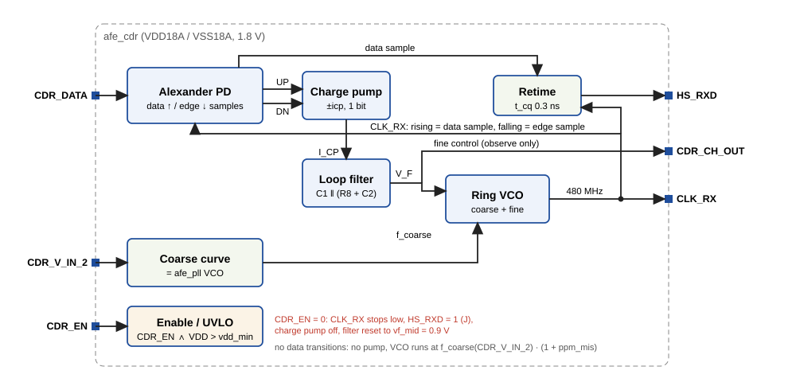

The loop: the phase detector compares the data transitions of `CDR_DATA` with the falling `CLK_RX` edge. For each transition it decides "clock early" (DN) or "clock late" (UP), and the charge pump drives ±icp into the loop filter for one bit. The filter voltage `V_F` (pin `CDR_CH_OUT`) is the fine input of the ring VCO; its coarse input comes from the PLL. The rising-edge data sample is retimed onto `HS_RXD`.

The CDR has no reference clock and no frequency detector of its own. Frequency acquisition relies on the coarse input: with `CDR_V_IN_2` tied to the PLL's control voltage, the CDR VCO already runs within the VCO mismatch (risk R3) of 480 MHz, and the bang-bang loop only has to pull in that error plus the ±1000 ppm of the link.

## 3. Pin description

| Pin | Type | Direction | Level | Function |
|---|---|---|---|---|
| `CDR_DATA` | logic | in | 1.8 V CMOS, threshold `vth_logic` = 0.9 V | Data from the HS receiver (`RX_OUT_P` of `afe_receiver`). High = J (DP > DM) |
| `CDR_EN` | logic | in | 1.8 V CMOS | 1 = CDR on. 0 = `CLK_RX` low, `HS_RXD` = 1, filter reset. Driven by `cdr_en` of `usb_afe_rx_if` (HS mode with `RX_EN`) |
| `CDR_V_IN_2` | analog | in | 0 … VDD18A | Coarse tuning voltage, from `CDR_CH_OUT_PLL` of `afe_pll`. Gate only, high impedance |
| `CLK_RX` | logic | out | 0 / VDD18A, edges `t_rf` = 50 ps | Recovered clock `clk_rx` of the digital (`usb_afe_rx_if`, `usb_rx_hs_sipo`). Rising edge = data sample |
| `HS_RXD` | logic | out | 0 / VDD18A | Retimed data `hs_rxd_a`. Changes `t_cq` after the rising `CLK_RX` edge. 1 = J |
| `CDR_CH_OUT` | analog | inout | 0.1 … 1.7 V | Fine loop-filter node. Observe through a high-impedance analog test bus only (any leakage is a frequency offset of the integral path) |
| `VDD18A` | supply | — | 1.8 V | Analog supply, from `afe_ldo`; shared with the PLL |
| `VSS18A` | supply | — | 0 V | Analog ground. All voltages refer to it |

All logic inputs of the model are ideal threshold comparators at `vth_logic` with no input current. Logic outputs are ideal voltage sources switching between 0 and V(VDD18A) with a linear edge of `t_rf`. They have no output resistance and no load dependence.

## 4. Operating conditions

| Parameter | Min | Typ | Max | Unit | Notes |
|---|---|---|---|---|---|
| Supply VDD18A | 1.62 | 1.80 | 1.98 | V | ±10 % corners of the transistor simulations. Model: on above `vdd_min` = 1.5 V |
| Junction temperature | −40 | 27 | 125 | °C | Corners of the transistor VCO simulations. The model has no temperature dependence |
| Data rate | 479.52 | 480 | 480.48 | Mbit/s | ±1000 ppm against the CDR's own reference (host ±500 ppm, own crystal ±500 ppm) |
| Data jitter at `CDR_DATA` | — | — | ±0.15 | UI | 70 % eye, the assumption of the spec 4.2 statistics. Not a USB requirement at this node |
| Transition density | 1/7 | 0.5 | 1 | — | NRZI with bit stuffing: at most 6 bits without a transition (7 at the EOP) |
| Coarse voltage `CDR_V_IN_2` | 0.5 | 0.9 | 1.4 | V | Whatever the PLL needs for 480 MHz; 0.9 V in the model, 0.917 V for the transistor VCO at tt |
| Load on `CLK_RX` | — | 100 | — | fF | Transistor testbench load. The model is load-independent |
| Load on `HS_RXD` | — | 50 | — | fF | Transistor testbench load |
| Load on `CDR_CH_OUT` | — | gate | — | — | High impedance only. Capacitance adds to C1 |

## 5. Electrical characteristics

### 5.1 Summary

Model: `afe_cdr.va` defaults, values from the equations and the behavioural simulation. Transistor: `afe_cdr_tr.sp`, ngspice (from `AFE/doc/cdr_schematic.md` section 4 and the waveforms of those runs). "tt values" / "ss values": the behavioural simulation with the transistor loop constants of that corner (icp 50 µA, R8 2 kΩ, C2 40 pF, K_fine of the corner), where no transistor closed-loop run exists. Corners: tt 27 °C 1.8 V, ss 125 °C 1.62 V, ff −40 °C 1.98 V.

| Parameter | Condition | Model | Transistor tt | ss | ff | Requirement (source) |
|---|---|---|---|---|---|---|
| Lock time (bits from the SYNC start to the last edge with margin < 0.15 UI) | 0 ppm, no jitter, random start phase | worst 4, mean 0.8 (1000 packets) | worst 4, mean 1.2 (12 packets, ngspice) | **worst 7**, mean 1.2, 0.2 % > 6 (ss values) | — | correct bits by the 7th bit (spec 4.2, Q2) |
| Lock time (bits to the last wrong sample) | ±0.15 UI jitter, ±1000 ppm | 99 % ≤ 8, 1.4 % > 6, worst 24 | 99 % ≤ 7, 1.2 % > 6 (tt values) | 4.1 % > 6 (ss values) | — | as above, statistic (spec 4.2) |
| Frequency tracking | ±1000 ppm, 1600-bit packet | no errors, min margin 0.40 UI | no errors, min margin 0.38 / 0.17 UI (+ / −) | no errors (ss values) | — | ±1000 ppm (spec 4.2) |
| Proportional step | per decision | 0.0625 UI (130 ps) | 0.0627 UI (131 ps) | **0.029 UI (60 ps)** | 0.074 UI (154 ps) | about UI/16 (A1) |
| Integral step | per net decision | 260 ppm | 1633 ppm | 754 ppm | 1926 ppm | below the tracking range, see 7.4 |
| Sampling-phase dither after lock | 0 ppm | 0.044 UI rms, 0.19 UI p-p | 0.041–0.044 UI rms, 0.22–0.25 UI p-p (ngspice, 3 runs) | 0.020 UI rms (ss values) | — | — |
| Sinusoidal jitter tolerance | 1 MHz / ≥ 20 MHz | 4.5 / 0.45 UI p-p | 8.4 / 0.45 UI p-p (tt values) | 4.8 / 0.5 UI p-p (ss values) | — | — (no USB mask at this node) |
| Free-running `CLK_RX` | `CDR_V_IN_2` at the 480 MHz point, after reset | 480 MHz · (1 + `ppm_mis`) | 480.12 MHz (+245 ppm) | — | — | 480 MHz ± 0.25 % (tb_afe_cdr, D1) |
| Free-running `CLK_RX` after a packet | after ±1000 ppm data | +1262 / −851 ppm (one integral step) | +1630 / −827 ppm | — | — | 480 MHz ± 0.25 % |
| Coarse gain K_coarse | 0.5–1.0 V | 200 MHz/V | 184 MHz/V | 83 MHz/V | 219 MHz/V | = PLL VCO |
| Fine gain K_fine | 0.8–1.0 V | 300 MHz/V | 301 MHz/V | **139 MHz/V** | 355 MHz/V | — |
| VCO at coarse 0.9 V / fine 0.9 V | | 480 MHz | 476.6 MHz | 451.5 MHz | 454.0 MHz | 480 MHz reachable through the coarse input |
| `HS_RXD` setup / hold to the next rising `CLK_RX` | | 1.78 / 0.30 ns | 1.67 / 0.285 ns | — | — | ≥ 0.4 / ≥ 0.1 ns (spec 4.2) |
| `HS_RXD` latency | | 1 `CLK_RX` cycle | 1 cycle | — | — | — |
| Sampling instant against the `CLK_RX` pin | | at the edge | 207 ps before the `CLK_RX` crossing | — | — | — (enters the Spectre checker as `t_smp`) |
| `CLK_RX` duty cycle | | 50 % | 49.3 % | 50.4 % | 48.9 % | 50 ± 5 % |
| `CLK_RX` period jitter | | `jit_rms` (default 0) | not simulated (no noise sources) | — | — | — |
| Supply current | receiving | not modelled | 1.29 mA (average); VCO alone 1.21 mA | VCO 1.19 mA | VCO 1.33 mA | — |
| Supply current | `CDR_EN` = 0 | not modelled | 47 µA (reset divider) | — | — | — |
| `CDR_EN` = 0 | | `CLK_RX` low, `HS_RXD` = 1, `CDR_CH_OUT` → 0.9 V | 0 edges, 0.00 V; 1.80 V; 0.900 V | — | — | low and quiet; `HS_RXD` = 1 (spec 3.2) |

### 5.2 Loop constants

| Quantity | Formula | Model | Transistor tt | Unit |
|---|---|---|---|---|
| Charge-pump current | icp | 100 | 50 | µA |
| Proportional voltage step | icp · R8 | 0.10 | 0.10 | V |
| Proportional frequency step | icp · R8 · K_fine | 30.0 | 30.1 | MHz (for one bit) |
| Proportional phase step φ_p | icp · R8 · K_fine / f_bit | 0.0625 (130 ps) | 0.0627 (131 ps) | UI |
| Integral voltage step | icp · T_bit / C2 | 0.42 | 2.6 | mV |
| Integral frequency step Δf_i / f | icp · T_bit · K_fine / (C2 · f_bit) | 260 | 1633 | ppm |
| Filter zero | 1 / (2π · R8 · C2) | 0.318 | 1.99 | MHz |
| Stability factor ξ | T_bit / (R8 · C2) = (Δf_i / f) / φ_p | 0.0042 | 0.026 | — |
| Integral time constant | R8 · C2 / T_bit | 240 | 38 | bits |
| High-frequency pole | 1 / (2π · R8 · C1) | 1.6 | 0.6 | GHz |

## 6. Functional description

### 6.1 Data input

`CDR_DATA` is the single-ended 1.8 V output of the HS receiver (`RX_OUT_P`). The model compares it with `vth_logic`. The transistor design buffers it with two inverters (XB0, XB1), which restore the edges and drive the four sampling flip-flops; the buffer delays the data by about 80 ps.

### 6.2 Alexander phase detector

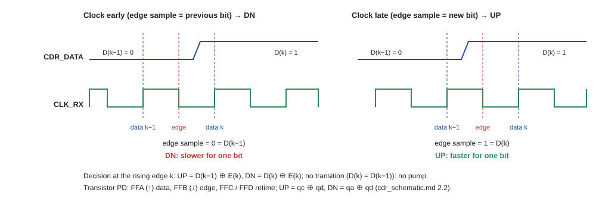

`CDR_DATA` is sampled at every rising `CLK_RX` edge (data sample D) and at every falling edge (edge sample E, half a bit later). At the rising edge k the detector compares D(k−1), E(k) and D(k):

| Condition | Meaning | Charge pump for the next bit |
|---|---|---|
| D(k) = D(k−1) | no transition, no information | off |
| D(k) ≠ D(k−1), E(k) = D(k−1) | the transition came after the falling edge: the clock is early | DN (VCO slower) |
| D(k) ≠ D(k−1), E(k) = D(k) | the transition came before the falling edge: the clock is late | UP (VCO faster) |

The decision is binary (bang-bang): the size of the phase error does not matter, only its sign. In lock the falling edge sits on the data transitions and the rising edge in the middle of the bit. The pump stays on for one VCO period after each decision, as in the analog block description.

Transistor level (`cdr_pd`): FFA (rising) takes the data sample `qa`, FFB (falling) the edge sample `qb`; FFC and FFD retime them to the rising edge, so UP = `qc` ⊕ `qd` and DN = `qa` ⊕ `qd`, each gated with `en`. The negative-edge flop swaps its latch phases instead of inverting the clock, so the edge sample has no extra inverter delay.

### 6.3 Charge pump

```
I_CP = icp · ( UP · fc_up(V_F) − DN · fc_dn(V_F) )     (into CDR_CH_OUT; UP raises V_F)
fc_up = ½ · (1 + tanh((VDD18A − v_cp_marg − V_F) / 20 mV))
fc_dn = ½ · (1 + tanh((V_F − v_cp_marg) / 20 mV))
```

The compliance is the same as the PLL's: the current fades out within `v_cp_marg` = 0.1 V of either rail. In lock V_F sits at 0.9 V ± 0.1 V (the proportional step), so the compliance does not matter in normal operation.

Transistor level (`cdr_cp`): current steering with n = 5 unit sources (ICP = 50 µA; the PLL uses n = 2). The switch pairs steer the current either to the output or to a replica node that an OTA follower holds at V(out), so the source drains do not jump and there is no charge sharing at the start of a pulse. The UP / DN mismatch over the output range has not been characterised (13.6). In a bang-bang loop a mismatch shifts the sampling point slightly; it does not change the lock behaviour.

### 6.4 Loop filter

C1 from the control node to ground, R8 in series with C2 from the control node to ground. The filter node is the pin `CDR_CH_OUT`, the R8 / C2 midpoint is the internal node `n_z`.

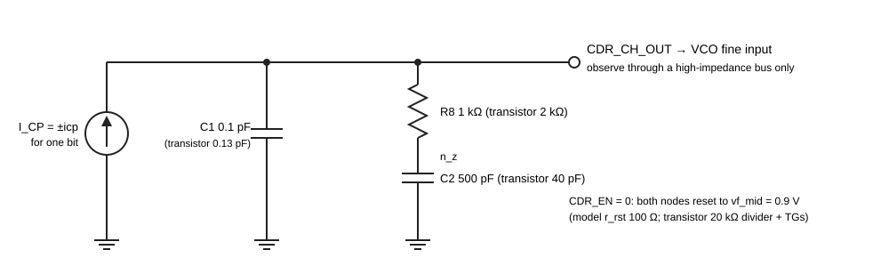

| Element | Model parameter | Model value | Transistor value | Transistor device |
|---|---|---|---|---|
| C1 (`CDR_C1`) | `c1` | 0.1 pF | 0.1 pF + about 30 fF node parasitics | MIM |
| R8 (`CDR_R8`) | `r8` | 1 kΩ | 2 kΩ | high-ohmic poly |
| C2 (`CDR_C2`) | `c2` | 500 pF | 40 pF | NMOS capacitor 48 × 10 µm × 10 µm, about 4800 µm² |
| Reset (off) | `r_rst` | 100 Ω to `vf_mid` on both nodes | 20 kΩ / 20 kΩ divider + transmission gates, τ ≈ 0.4 µs | — |

The model's 500 pF does not fit on silicon: it stands for the integral gain only. The transistor design keeps the same proportional step with half the current and twice the resistor, and accepts a larger integral step (7.4).

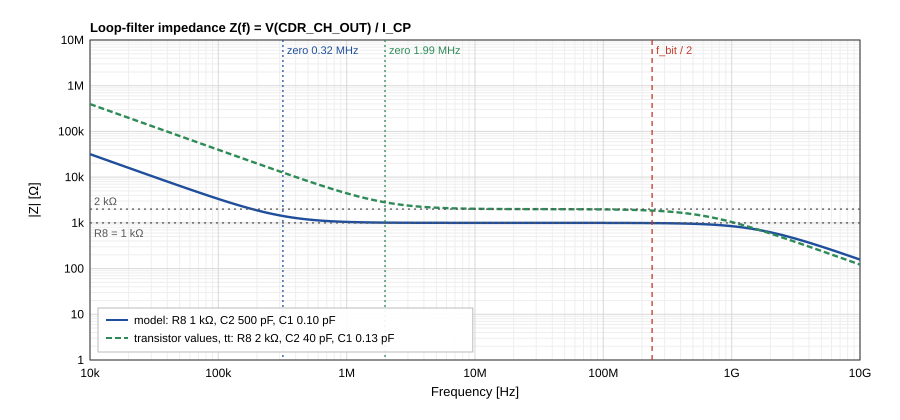

For one bit (2.08 ns) the filter is a resistor: the zero (0.32 / 1.99 MHz) lies far below the bit rate and the C1 pole (≈ 1 GHz) far above it. So each decision is a voltage step of icp · R8 = 0.1 V for one bit (proportional path), plus a small permanent step of icp · T_bit / C2 on C2 (integral path). C1 only rounds the step with τ = R8 · C1 ≈ 0.1–0.26 ns.

### 6.5 VCO

```
f_coarse = clamp(f_min + kvco · (V(CDR_V_IN_2) − v_fmin), f_min, f_max)      = afe_pll curve
f_VCO    = f_coarse · (1 + ppm_mis · 1e-6) + kvco_f · (V_F − vf_mid),  limited to [f_min / 2, 1.5 f_max]
         = 480 MHz at CDR_V_IN_2 = 0.9 V and V_F = 0.9 V
```

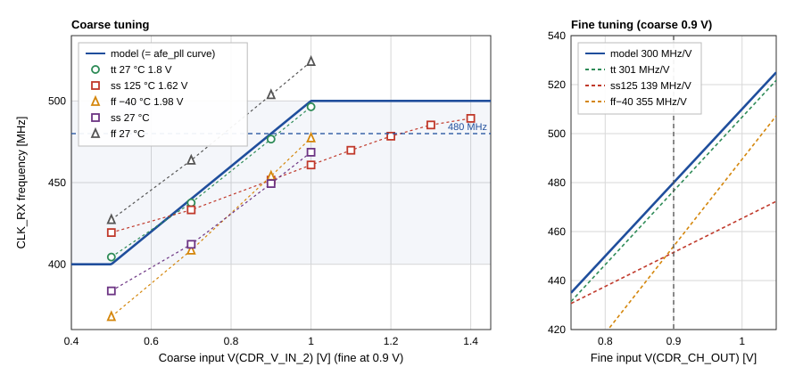

The coarse curve is the PLL's (same `f_min`, `f_max`, `kvco`, `v_fmin`). With `CDR_V_IN_2` = `CDR_CH_OUT_PLL` the CDR VCO runs at the PLL frequency times (1 + `ppm_mis`), where `ppm_mis` is the mismatch between the two VCOs (risk R3). The fine input is centred at `vf_mid` = 0.9 V, which is also the reset value of the filter, so the CDR restarts at the coarse frequency.

Transistor level: `vco_v2i` (coarse transistor XMC with RC 5 kΩ, fine transistor XMF with RF 3.2 kΩ, offset current XMOF) feeds a 5-stage current-starved ring. The PLL uses the same cell with the fine input on a VDD/2 reference. Measured (cdr_schematic.md 4.1, fine input 0.9 V):

| Coarse input | tt 27 °C 1.8 V | ss 27 °C | ff 27 °C | ss 125 °C 1.62 V | ff −40 °C 1.98 V | Model |
|---|---|---|---|---|---|---|
| 0.5 V | 404.4 MHz | 383.7 | 427.3 | 419.4 | 367.9 | 400 |
| 0.7 V | 437.6 | 412.2 | 463.7 | 433.3 | 408.6 | 440 |
| 0.9 V | 476.6 | 449.4 | 503.8 | 451.5 | 454.0 | 480 |
| 1.0 V | 496.4 | 468.6 | 524.1 | 460.8 | 477.3 | 500 |
| K_coarse (0.5–1.0 V) | 184 MHz/V | 170 | 194 | 83 | 219 | 200 |
| K_fine (0.8–1.0 V) | 301 MHz/V | 289 | 309 | 139 | 355 | 300 |
| Supply current | 1.21 mA | 1.16 | 1.26 | 1.19 | 1.33 | — |
| `CLK_RX` duty cycle | 49.3 % | 49.8 % | 48.9 % | 50.4 % | 48.9 % | 50 % |

At ss / 125 °C / 1.62 V the coarse curve compresses (469.8 / 478.4 / 485.3 / 489.3 MHz at 1.1 / 1.2 / 1.3 / 1.4 V): 480 MHz needs about 1.23 V and only 2 % of range is left above it. The fine gain halves at the same corner, which halves the proportional step (7.5). The cause is headroom in `vco_v2i` (13.1).

### 6.6 Retimed data `HS_RXD`

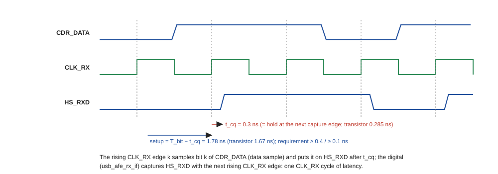

The data sample of the rising edge k appears on `HS_RXD` `t_cq` = 0.3 ns after that edge. The digital (`usb_afe_rx_if`) captures it with the next rising `CLK_RX` edge, which gives one cycle of latency, setup T_bit − `t_cq` = 1.78 ns and hold `t_cq` = 0.3 ns before routing. Polarity: 1 = J (`CDR_DATA` high = DP > DM, Q3). The output is serial, one bit per `CLK_RX` cycle; the digital deserializes it on `clk_rx` (`usb_rx_hs_sipo`), so no 1:8 output is needed (Q1, I12).

Transistor level: `qa` → XQA → NAND(`en`) → two inverters, so `HS_RXD` = `qa` while enabled and 1 while `CDR_EN` = 0. Measured at the pins: setup 1.67 ns, hold 0.285 ns. The PD flip-flops sample `CDR_DATA` 207 ps before the `CLK_RX` pin crossing (data buffer 80 ps, clock buffers INV4 / INV5 127 ps); the Spectre checker of `tb_afe_cdr_tr.scs` takes this as `t_smp`.

### 6.7 Enable, under-voltage lock-out, reset

The CDR is on when `CDR_EN` > `vth_logic` **and** V(VDD18A) > `vdd_min` = 1.5 V. When either condition goes away:

- `CLK_RX` stops low; the VCO phase freezes, so after the next enable the CDR starts at an arbitrary phase against the data (the lock statistics in 8.2 assume a random start phase).
- `HS_RXD` goes to 1 (isolated J, spec 3.2); the charge pump is off.
- Both filter nodes are pulled to `vf_mid` = 0.9 V through `r_rst` = 100 Ω (transistor: 20 kΩ divider, τ ≈ 0.4 µs, 45 µA while off). The integral path forgets its frequency: after the next enable the VCO runs at f_coarse · (1 + `ppm_mis`).

`CDR_EN` comes from `usb_afe_rx_if` (`cdr_en` = `rx_en` ∧ ¬`iso_en` ∧ HS mode, a `clk60` flop). It stays on during HS operation, also between packets: the integral path keeps the last packet's frequency and `CLK_RX` free-runs. The transistor block has no UVLO of its own; the power sequencer keeps `CDR_EN` low until `PG18A`.

## 7. Loop dynamics

A bang-bang loop has no linear small-signal gain: its phase detector only gives a sign. The behaviour is set by two step sizes per decision and by the transition density ρ of the data (0.5 for random NRZI data, ≥ 1/7 with bit stuffing, 1 during SYNC).

### 7.1 Step sizes

```
proportional phase step   φ_p  = icp · R8 · K_fine / f_bit                 = 0.0625 UI (model), 0.0627 UI (tt)
integral frequency step   Δf_i = icp · T_bit · K_fine / C2                 = 125 kHz = 260 ppm (model), 784 kHz = 1633 ppm (tt)
stability factor          ξ    = (Δf_i / f_bit) / φ_p = T_bit / (R8 · C2)  = 0.0042 (model), 0.026 (tt)
integral time constant    τ_i  = R8 · C2 / T_bit                           = 240 bits (model), 38 bits (tt)
```

ξ ≪ 1 means the proportional path dominates: the loop behaves like a first-order bang-bang loop that corrects phase, with a slow integral path that removes the frequency offset in the background. A loop with ξ approaching 1 would overshoot and limit-cycle with large amplitude.

### 7.2 Response to one decision

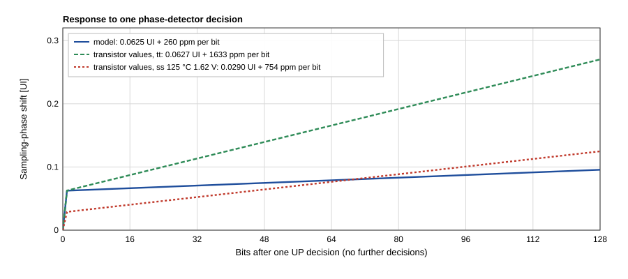

One UP decision advances the next sampling edges by φ_p at once (the VCO runs 30 MHz faster for one bit) and then keeps advancing them by Δf_i / f_bit per bit, because C2 keeps the extra voltage. In the transistor design the integral part catches up with the proportional part after 38 bits, in the model after 240 bits.

### 7.3 Frequency range and slew limit

- **Phase slew limit:** the loop can move the sampling phase by at most φ_p · ρ per bit, i.e. it follows a frequency offset of up to φ_p · ρ through the proportional path alone: 31 000 ppm at ρ = 0.5 and 8 900 ppm at the bit-stuffing minimum ρ = 1/7. Both are far above the ±1000 ppm of the link, so the CDR never slips on a frequency offset.
- **Integral path:** absorbs a steady offset with the time constant τ_i. While it settles, the offset is carried by an imbalance of UP and DN decisions (Δppm / φ_p ≈ 1.6 % more decisions of one sign at 1000 ppm), which shifts the mean sampling point by only a few mUI (8.4).
- **Jitter tolerance:** below a few MHz the loop follows sinusoidal jitter up to the slew limit A_pp ≈ φ_p · ρ · f_bit / (π · f_j); the integral path raises it further below about 1 MHz. Above about 10 MHz the loop no longer follows, and the tolerance falls to the eye: about 0.45 UI p-p in this noiseless simulation.

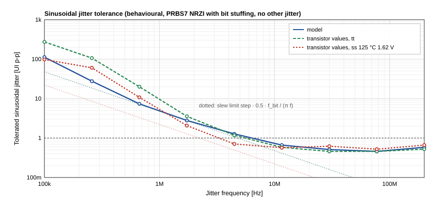

| Jitter frequency | 0.1 MHz | 0.32 MHz | 1.0 MHz | 3.3 MHz | 10.7 MHz | ≥ 20 MHz |
|---|---|---|---|---|---|---|
| Model | 112 UI p-p | 19 | 4.5 | 1.6 | 0.71 | 0.45–0.58 |
| tt values | 274 | 75 | 8.4 | 1.6 | 0.61 | 0.43–0.52 |
| ss 125 °C values | 98 | 41 | 4.8 | 0.94 | 0.63 | 0.48–0.66 |

USB 2.0 has no jitter-tolerance mask for this node; the receiver eye template applies at the connector. The table shows that the loop follows all slow wander (spread of the host's clock, supply drift) and that fast jitter must stay inside the eye.

### 7.4 Integral-path granularity

The integral step must be small against the frequency accuracy that matters. During a packet it does not matter much: the proportional path dominates (ξ ≪ 1). Between packets it does: the VCO keeps the frequency stored on C2 when the packet ends, and that value is only accurate to about one integral step. Model: within 260 ppm (after a ±1000 ppm packet +1262 / −851 ppm). Transistor: within 1633 ppm (ngspice +1630 / −827 ppm, i.e. up to 0.16 % off between packets). The digital does not care, because it only uses `clk_rx` during packets, and the next packet starts from wherever the VCO is; but a smaller step keeps the free-running clock within the ±0.25 % check with margin (13.2).

### 7.5 Corner dependence

The proportional step scales with K_fine and icp. K_fine varies from 139 MHz/V (ss, 125 °C, 1.62 V) to 355 MHz/V (ff, −40 °C, 1.98 V), so φ_p varies from 0.029 UI to 0.074 UI:

| Corner (transistor values) | K_fine | φ_p | Δf_i / f | Worst lock (no jitter) | Dither rms |
|---|---|---|---|---|---|
| ss 125 °C 1.62 V | 139 MHz/V | 0.029 UI (60 ps) | 754 ppm | **7 bits** | 0.020 UI |
| tt 27 °C 1.8 V | 301 MHz/V | 0.063 UI (131 ps) | 1633 ppm | 4 bits | 0.046 UI |
| ff −40 °C 1.98 V | 355 MHz/V | 0.074 UI (154 ps) | 1926 ppm | 4 bits (estimate, 12.2) | ≈ 0.05 UI |

A smaller step means a slower start (more bits to cross the initial phase error) but less dither. A larger step locks faster but dithers more and stops tracking at a 50 % eye (spec 4.2, A1 table: UI/8 fails). The register `TRIM_CDR.CDR_ICP` (34h [2:0], default 4) is reserved to trim icp, which could hold φ_p constant over corners; neither the model nor the transistor design implements it yet (13.5).

## 8. Receive behaviour

### 8.1 Lock transient

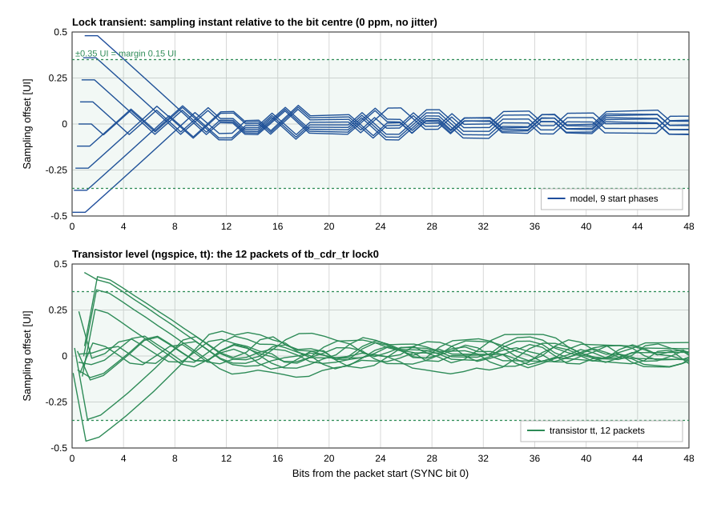

Each packet starts at an arbitrary phase against the free-running `CLK_RX`. During SYNC (KJKJ…, a transition every bit) every bit gives a decision, so the sampling instant moves towards the bit centre by φ_p per bit: from the worst start (0.5 UI off) it needs about 0.15 UI / φ_p ≈ 3 decisions to get inside the ±0.35 UI band (margin ≥ 0.15 UI). Then it dithers around the centre. The transistor level (12 packets of `tb_cdr_tr.py lock0`, ngspice) shows the same shape: worst 4 bits, mean 1.2 bits.

### 8.2 Lock-time statistics

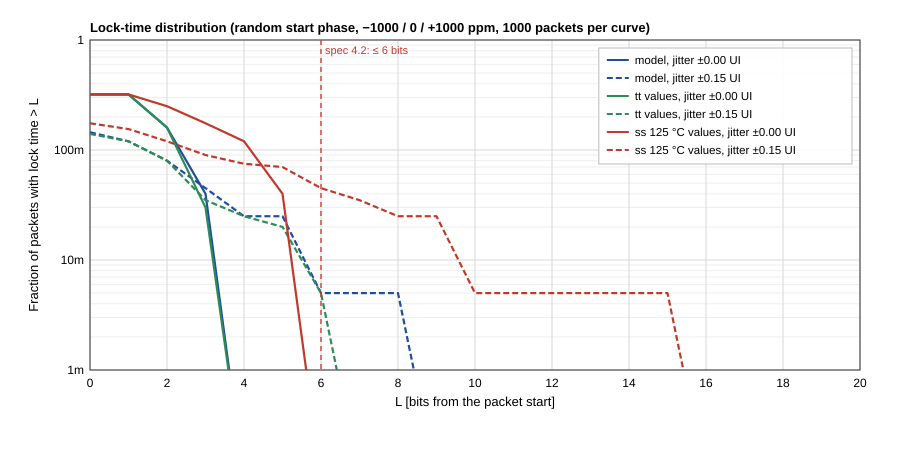

Lock time L, counted in bits from the first SYNC bit. Without jitter: the last edge with a margin below 0.15 UI (the `tb_afe_cdr` / `tb_cdr_tr.py` criterion). With jitter: the last wrongly sampled bit (the criterion of the spec 4.2 A1 statistics). 1000 packets per row, random start phase, data rate −1000 / 0 / +1000 ppm, uniform edge jitter.

| Case | Jitter | Mean | 99 % | Worst | L > 4 | L > 6 |
|---|---|---|---|---|---|---|
| Model | 0 | 0.83 | 4 | 4 | 0 % | 0 % |
| Model | ±0.15 UI | 0.42 | 8 | 24 | 2.8 % | 1.4 % |
| Model | ±0.25 UI | 1.23 | 18 | 75 | 9.2 % | 5.4 % |
| tt values | 0 | 0.82 | 4 | 4 | 0 % | 0 % |
| tt values | ±0.15 UI | 0.40 | 7 | 24 | 2.7 % | 1.2 % |
| tt values | ±0.25 UI | 2.17 | 50 | 78 | 10.9 % | 7.0 % |
| ss 125 °C values | 0 | 1.22 | 6 | **7** | 13.3 % | 0.2 % |
| ss 125 °C values | ±0.15 UI | 0.83 | 15 | 56 | 6.2 % | 4.1 % |
| ss 125 °C values | ±0.25 UI | 2.98 | 45 | 76 | 17.2 % | 13.5 % |
| Transistor tt (ngspice) | 0 | 1.2 | — | 4 | 0 of 12 | 0 of 12 |

The mean is below one bit, but with jitter there is a tail: when a packet starts with the sampling point inside the jittered edge zone, the decisions are random and the loop random-walks before it escapes. These numbers agree with the `afe_cdr_bm` results of spec 4.2 (UI/16 step, 0.15 UI: worst 9–16, L > 6 in 0.3–3 %).

### 8.3 SYNC budget

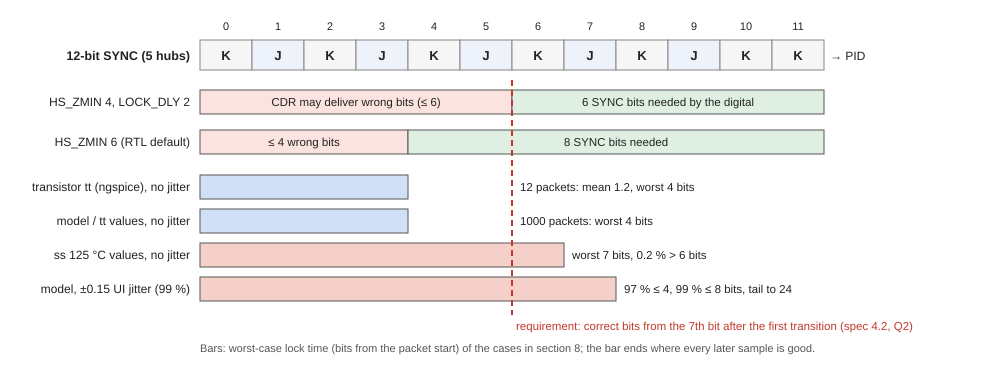

After 5 hubs a packet may arrive with only 12 SYNC bits. With the recommended digital setting (`HS_ZMIN` 4, `LOCK_DLY` 2) the digital needs the last 6 SYNC bits correct, so the CDR may deliver wrong bits for at most the first 6 bits (spec 4.2, requirement for Q2). With the current RTL default (`HS_ZMIN` 6) only 4 wrong bits are allowed. Squelch release and CDR lock run in parallel, so a squelch release up to 12 ns costs nothing extra.

| Setting | Allowed wrong bits | Model / tt values, no jitter | ss values, no jitter | Model, ±0.15 UI |
|---|---|---|---|---|
| `HS_ZMIN` 4, `LOCK_DLY` 2 (recommended) | 6 | met (worst 4) | **0.2 % of packets miss** (worst 7) | 1.4 % miss |
| `HS_ZMIN` 6 (RTL default) | 4 | met (worst 4) | 13.3 % miss | 2.8 % miss |

A packet whose SYNC is cut by the lock tail is lost, not corrupted: the digital chain never accepted a wrong packet in the A3 runs (PID / CRC16). The host retries it.

### 8.4 Frequency tracking

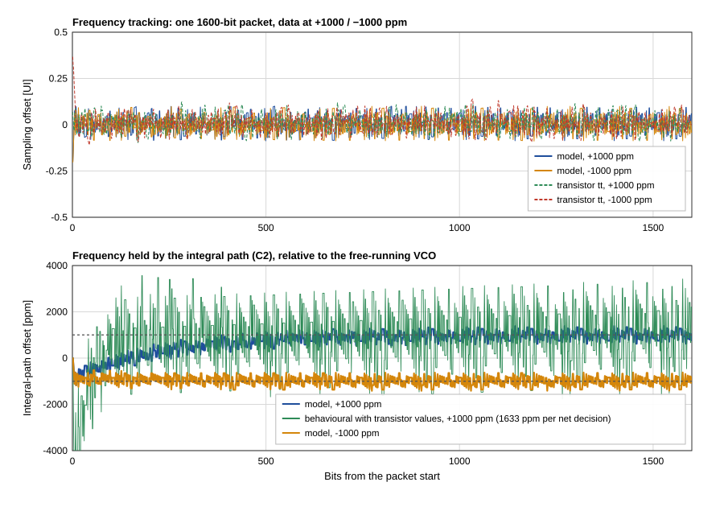

One 1600-bit packet with the data rate 1000 ppm above or below the free-running VCO. The sampling instant stays within ±0.12 UI of the bit centre for the whole packet; the integral path builds up the offset with the time constant τ_i (240 bits in the model). With the transistor values the integral path jumps by 1633 ppm per net decision, which the proportional path absorbs.

| Case | Errors | Min margin after lock | Mean sampling offset | Frequency stored at the end |
|---|---|---|---|---|
| Model, +1000 / −1000 ppm | 0 / 0 | 0.40 / 0.40 UI | +0.006 / +0.002 UI | +1262 / −851 ppm |
| tt values, +1000 / −1000 ppm | 0 / 0 | 0.40 / 0.39 UI | +0.002 / +0.002 UI | +2005 / −1431 ppm |
| ss 125 °C values, +1000 / −1000 ppm | 0 / 0 | 0.45 / 0.45 UI | 0.000 UI | +1517 / −1536 ppm |
| Transistor tt (ngspice), +1000 / −1000 ppm | 0 / 0 (1598 bits each) | 0.38 / 0.17 UI | +0.010 / +0.010 UI | +1630 / −827 ppm |

The digital HS word FIFO covers ±1000 ppm for 1027-byte packets (`tb_usb_rx_datapath`), so tracking inside the CDR only has to keep the bits correct, not match the clocks.

### 8.5 Steady-state dither

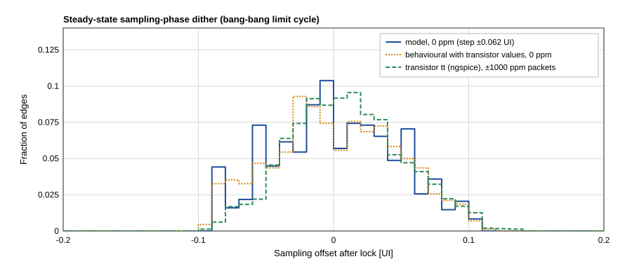

After lock the sampling point moves by ±φ_p at each transition (bang-bang limit cycle): 0.044 UI rms, 0.19 UI peak-to-peak in the model; the ngspice runs give 0.041–0.044 UI rms and 0.22–0.25 UI p-p. This dither eats directly into the eye: at a 70 % eye (±0.15 UI jitter) the remaining margin is about 0.15 − 0.1 = 0.05 UI on each side, which is why the jittered cases in 8.2 have a tail.

### 8.6 Without data

Without transitions there are no decisions: the charge pump stays off and the VCO runs at f_coarse · (1 + `ppm_mis`) plus whatever the integral path holds. After `CDR_EN` rises (filter reset) that is the coarse frequency; between packets it is the frequency of the last packet, within one integral step. `CLK_RX` keeps running, as the digital requires (D1): the squelch synchronizer and `LOCK_DLY` counter of `usb_afe_rx_if` run on it.

## 9. Timing

| Parameter | Symbol | Model | Transistor tt | Notes |
|---|---|---|---|---|
| `CLK_RX` period, locked | T_bit | 2.0833 ns ± 1000 ppm (follows the data) | same | `constraints/usb_phy.sdc` `clk_rx` |
| `CLK_RX` rise / fall time | t_rf | 50 ps (linear) | load-dependent (100 fF) | |
| `CLK_RX` rise → `HS_RXD` | t_cq | 0.3 ns | 0.285 ns | = hold at the capture flop |
| `HS_RXD` setup to the next rising `CLK_RX` | | T_bit − t_cq = 1.78 ns | 1.67 ns | requirement ≥ 0.4 ns |
| Sampling instant to the `CLK_RX` pin | t_smp | 0 | −207 ps | the PD samples before the pin edge |
| `CDR_EN` rise → first `CLK_RX` edge | | within one VCO period | immediate (ring starts from the clamp state) | random phase against the data |
| `CDR_EN` rise → correct bits | | ≤ 4 bits after the first SYNC bit (no jitter) | ≤ 4 bits (12 packets) | after the squelch release (`afe_receiver`) |
| `CDR_EN` fall → `CLK_RX` low | | immediate (t_rf) | < 1 ns | `HS_RXD` → 1 at the same time |
| `CDR_EN` fall → filter at 0.9 V | | ≈ 50 ns (r_rst · C2) | ≈ 2 µs (τ ≈ 0.4 µs) | |

## 10. Model parameters

| Parameter | Default | Range | Unit | Meaning |
|---|---|---|---|---|
| `f_min` | 400e6 | > 0 | Hz | Coarse curve lower limit. **Keep equal in `afe_pll.va`** |
| `f_max` | 500e6 | > f_min | Hz | Coarse curve upper limit. **Keep equal in `afe_pll.va`** |
| `kvco` | 200e6 | > 0 | Hz/V | Coarse gain. **Keep equal in `afe_pll.va`** |
| `v_fmin` | 0.5 | | V | Coarse voltage at f_min. **Keep equal in `afe_pll.va`** |
| `ppm_mis` | 0 | | ppm | Coarse mismatch against the PLL VCO (R3). ±1000 for the tracking check |
| `kvco_f` | 300e6 | > 0 | Hz/V | Fine gain |
| `vf_mid` | 0.9 | | V | Fine input at zero offset; filter reset value |
| `icp` | 100e-6 | > 0 | A | Charge-pump current |
| `r8` | 1e3 | > 0 | Ω | Filter series resistor (proportional path) |
| `c2` | 500e-12 | > 0 | F | Filter series capacitor (integral path) |
| `c1` | 0.1e-12 | > 0 | F | Filter shunt capacitor |
| `v_cp_marg` | 0.1 | ≥ 0 | V | Charge-pump compliance to the rails |
| `r_rst` | 100 | > 0 | Ω | Filter reset resistance while off |
| `vth_logic` | 0.9 | | V | Logic input threshold |
| `vdd_min` | 1.5 | | V | Supply-good threshold (UVLO) |
| `t_cq` | 0.3e-9 | ≥ 0 | s | `CLK_RX` rise → `HS_RXD` (`afe_cdr_bm` `T_CQ`) |
| `t_amb` | 0 | ≥ 0 | s | Sampler ambiguity window: a sample this close after a `CDR_DATA` crossing is random (`afe_cdr_bm` default 0.03 ns) |
| `t_rf` | 50e-12 | > 0 | s | Output edge time |
| `jit_rms` | 0 | ≥ 0 | s | VCO period jitter (Gaussian, per period) |
| `pts` | 10 | ≥ 4 | — | Time steps per VCO period (`$bound_step` = 1 / (pts · f_max) = 0.2 ns while on) |
| `seed0` | 5 | | — | Random seed (`t_amb`, `jit_rms`) |

Simulation cost: while the CDR is on, `$bound_step` limits the time step to 0.2 ns, and every `CDR_DATA` crossing adds a time point. For long system runs where the loop is not under test, use `afe_cdr_bm.v` in the Icarus shadow.

## 11. Dependencies

### 11.1 System context

| Connected to | Signal | Direction | Dependency |
|---|---|---|---|
| `afe_receiver` (HS receiver) | `RX_OUT_P` → `CDR_DATA` | → CDR | 1.8 V single-ended data, 1 = J. Its jitter and duty-cycle distortion eat into the dither margin (8.5). The level shift from the 3.3 V receiver must not use a library shifter (spec 2, Q8) |
| `afe_pll` | `CDR_CH_OUT_PLL` → `CDR_V_IN_2` | → CDR | Coarse frequency. The PLL must be locked before HS receive (the power sequencer enables RX only after `pll_lock`) |
| `afe_ldo` | `VDD18A` | → CDR | 1.8 V, shared with the PLL. Supply noise moves the ring frequency directly (13.4) |
| `usb_afe_rx_if` | `cdr_en` → `CDR_EN` | → CDR | On in HS mode while `RX_EN` = 1 and not isolated; a `clk60` flop |
| `usb_afe_rx_if`, `usb_rx_hs_sipo` | `CLK_RX` | CDR → | `clk_rx`: squelch synchronizer, `LOCK_DLY` / `SQ_COMP` delay, 1:8 SIPO, word clock `clk_rxw` = `clk_rx` / 8 for the HS word FIFO. Must free-run (D1) |
| `usb_afe_rx_if` | `HS_RXD` | CDR → | `hs_rxd_a`, captured on the rising `clk_rx` edge (setup / hold 9) |
| `usb_afe_rx_if` | — | — | `hs_cdr_lock` is generated digitally, `LOCK_DLY` bits after the squelch release; there is no lock pin |
| Analog test bus | `CDR_CH_OUT` | CDR → | Observation only (`TEST.ATB_SEL`, 3Ch) |

### 11.2 Values that must stay consistent

| Value | Here | Also in | Consequence of a mismatch |
|---|---|---|---|
| Coarse curve `f_min`, `f_max`, `kvco`, `v_fmin` | `afe_cdr.va` | `afe_pll.va`; the transistor PLL and CDR share `vco_v2i` / `vco_ring` | The CDR free-runs off-frequency: more lock bits, larger stored offset |
| Fine centre 0.9 V | `vf_mid` | the PLL's fine reference (VDD/2 in `afe_pll_tr.sp`) | +0.4 % offset between the two transistor VCOs today (13.3) |
| Proportional step ≈ UI/16 | `icp · r8 · kvco_f` | `afe_cdr_bm` `P_STEP` 0.13 ns; spec 4.2 A1 statistics; `afe_cdr_tr.sp` ICP / R8 | Lock statistics of spec 4.2 no longer apply |
| `t_cq` 0.3 ns | `afe_cdr.va` | `afe_cdr_bm` `T_CQ`; spec 4.2 setup / hold; SDC `clk_rx` input delay | Hold violations at the capture flop |
| `HS_RXD` polarity 1 = J | | `usb_rx_hs_frontend` (NRZI decode), Q3 | Inverted data (NRZI decoding is polarity-free, SYNC / EOP are not) |
| Isolated values `CLK_RX` = 0, `HS_RXD` = 1 | | spec 3.2, `afe_cdr_bm` | Spurious receive activity during isolation |
| Pin order | `afe_cdr.va` | `afe_cdr_tr.sp`, `tb_ams_*.vams`, `tb_afe_cdr*.scs` | Netlist errors |

### 11.3 Enable sequence

1. Power-up: `PG18A` = 1, PLL enabled and locked (`pll_lock`); `CDR_V_IN_2` settled at the 480 MHz point.
2. HS mode (after the chirp handshake, XcvrSelect 00): `usb_afe_rx_if` sets `cdr_en`. `CLK_RX` starts at the coarse frequency; the filter starts at 0.9 V.
3. Each packet: squelch releases → the CDR locks within the first SYNC bits (8.2) → `hs_cdr_lock` after `LOCK_DLY` bits → SYNC / PID decode.
4. Between packets: `CLK_RX` free-runs at the last packet's frequency (8.6).
5. Leaving HS (suspend, reset, FS / LS), isolation, or `RX_EN` = 0: `cdr_en` = 0, `CLK_RX` stops low, `HS_RXD` = 1. The digital `clk_rx` islands are held in reset while isolated.

### 11.4 Trim and test registers (spec 5, not implemented in the AFE)

| Register | Field | Default | Intended use |
|---|---|---|---|
| 34h `TRIM_CDR` | [2:0] `CDR_ICP` | 4 | Charge-pump current trim (proportional and integral step together). Could compensate the K_fine spread of 7.5 |
| 34h `TRIM_CDR` | [4:3] `CDR_BAND` | 1 | VCO band select (coarse range) |
| 36h `TRIM_DLY` | [2:0] `LOCK_DLY`, [5:3] `SQ_COMP` | 2, 0 | Digital: lock delay and squelch compensation (8.3) |
| 3Ch `TEST` | [3:0] `ATB_SEL` | 0 | Analog test bus select (e.g. `CDR_CH_OUT`) |

### 11.5 Files

| File | Role |
|---|---|
| `AFE/veriloga/afe_cdr.va` | the model described here |
| `AFE/doc/cdr.md` | model description |
| `AFE/veriloga/tb/tb_afe_cdr.scs`, `tb_afe_cdr.va` | Spectre testbench and checker (`AFE/veriloga/tb/run_va_tests.sh cdr`) |
| `AFE/veriloga/tb/tb_afe_cdr_tr.scs` | same checks on the transistor netlist (`t_smp`) |
| `AFE/spice/afe_cdr_tr.sp`, `afe_cells.sp` | transistor schematic; VCO, charge pump and bias shared with the PLL |
| `AFE/spice/tb/tb_cdr_tr.py` | ngspice testbench (`vco`, `lock0`, `lockp`, `lockn`) |
| `AFE/doc/cdr_schematic.md`, `AFE/spice/doc/cdr_*.svg` | transistor schematic description, drawn sheets and results |
| `afe_cdr_bm.v` | Icarus behavioural model (phase-step loop) |
| `usb_afe_rx_if.v`, `usb_rx_hs_sipo.v`, `usb_rx_hs_frontend.v` | digital counterparts |
| `AFE/ams/tb_ams_link.vams`, `tb_ams_mouse.vams`, `tb_ams_msc.vams` | AMS system tests with this model |
| `DOC/afe_interface_spec.md` 3.2, 4.2 | interface requirements and the A1 / A3 statistics |
| `AFE/doc/cdr_datasheet/gen_figures.py`, `data/` | figure generator and transistor data for this datasheet (`data/extract_tr.py`) |

## 12. Design guidance

These relations let the loop be re-tuned when the xh018 values of K_fine and icp are known:

```
1. Proportional step:   φ_p = icp · R8 · K_fine / f_bit          target ≈ UI/16 = 0.0625 UI
2. Worst lock time (no jitter, SYNC with a transition every bit, margin criterion 0.15 UI):
                        L_worst ≈ 1 + ⌈0.15 UI / φ_p⌉ bits        φ_p = 0.0625 → 4,  φ_p = 0.029 → 7
   ≤ 6 bits needs φ_p ≥ 0.03 UI in every corner; with ±0.15 UI jitter keep φ_p ≤ UI/8 (spec 4.2 A1).
3. Dither:              ≈ ±1.5 φ_p peak, ≈ 0.7 φ_p rms            must leave margin inside the eye
4. Integral step:       Δf_i / f = icp · T_bit · K_fine / (C2 · f_bit)
   stability factor     ξ = T_bit / (R8 · C2) ≪ 1                 (0.0042 model, 0.026 tt)
   time constant        τ_i = R8 · C2 / T_bit bits
5. Slew limit:          A_pp(f_j) ≈ φ_p · ρ · f_bit / (π · f_j)   ρ = transition density
6. Frequency range:     proportional alone follows up to φ_p · ρ  (8 900 ppm at ρ = 1/7)
```

- **Constant step over corners:** φ_p ∝ icp · K_fine. Today K_fine spreads 139–355 MHz/V, so φ_p spreads 0.029–0.074 UI. Either make K_fine track less (13.1) or trim icp (`CDR_ICP`) so that icp · K_fine stays constant.
- **Smaller integral step without a larger C2:** a dual-path charge pump (main pump into R8 only, a second pump of about icp / 8 straight into C2) brings Δf_i to the model's 260 ppm with 40 pF.
- **C2 area:** 40 pF NMOS capacitor ≈ 4800 µm². Its node sits at 0.9 V, so the MOS capacitor is in inversion; it must stay above the threshold voltage over the whole fine range (0.8–1.0 V in lock).
- **Leakage on `CDR_CH_OUT`:** a leakage current I_leak moves the frequency by I_leak / C2 · K_fine per second; the loop corrects it, but between packets it drifts. 1 nA → 7.5 kHz/µs (16 ppm/µs) with 40 pF.
- **Sampling-point offset:** in the transistor design the PD samples 207 ps before the `CLK_RX` pin edge. The digital captures `HS_RXD`, not `CDR_DATA`, so this offset does not matter for the digital timing; it only matters for checkers that compare against the pin.

## 13. Open points

1. **Coarse headroom at low VDD (transistor level).** At ss / 125 °C / 1.62 V the coarse curve flattens at 489 MHz and 480 MHz needs `CDR_V_IN_2` ≈ 1.23 V. The PLL with the same VCO cell fails to lock at that corner (−901 ppm, [pll_datasheet](../pll_datasheet/pll_datasheet.md) 13.1). Fix in `vco_v2i` (wider XMPD / XMPM, more offset current), then recheck both loops at all corners.
2. **Fine gain halves at ss / 125 °C / 1.62 V.** φ_p drops to 0.029 UI and the worst lock time to 7 bits: 0.2 % of packets miss the 6-bit requirement without jitter, 4.1 % with ±0.15 UI jitter (8.2, 8.3). Same fix as 1, or an icp trim. Closed-loop transistor runs at ss and ff are still missing (only the VCO has been run at corners).
3. **Integral-path granularity.** 1633 ppm per net decision in the transistor design, against 260 ppm in the model: the frequency stored between packets can be 0.16 % off (7.4). Dual-path pump (12).
4. **PLL / CDR VCO mismatch (R3).** Systematic +0.4 % today, from the two separate VDD/2 fine references of the transistor PLL and CDR (derive both from one divider). The random part needs a Monte Carlo run with the xh018 mismatch models and a matched layout (rings side by side, common centroid).
5. **Trim registers.** `CDR_ICP` and `CDR_BAND` (34h) exist in the register map but not in the model or the transistor design.
6. **Charge-pump mismatch.** Sweep `CDR_CH_OUT` 0.6–1.2 V with UP and DN separately; record I_up / I_dn and the static sampling offset it causes in closed loop.
7. **Jitter and supply sensitivity.** Not simulated. The single-ended ring has no supply rejection beyond the starving devices. Measure with a noise transient or Spectre pnoise once the PDK models are in, and repeat the lock statistics with the real `CDR_DATA` jitter of `afe_receiver`.
8. **xh018 models.** All transistor numbers use the placeholder 180 nm models; redo them with the PDK and update `kvco_f`, `icp`, `r8`, `c2` of the model to the final design (the model's 500 pF is not a silicon value).
9. **Spectre runs.** `tb_afe_cdr.scs`, `tb_afe_cdr_tr.scs` and the AMS system tests have never run. The model numbers in this datasheet come from a behavioural re-implementation, not from Spectre.

## 14. Not modelled

Metastability of the samplers beyond `t_amb`; charge-pump mismatch and leakage; VCO phase noise beyond white period jitter; supply and temperature dependence of the VCO; the coarse loop's ripple on `CDR_V_IN_2` (the PLL's reference spurs); the 207 ps sampling offset of the transistor design; supply current; output drive strength and load dependence; the `CDR_ICP` / `CDR_BAND` trims; a 1:4 or 1:8 demultiplexed output (not needed, Q1 / I12).

## 15. How the numbers were obtained

| Source | Method | Figures / values |
|---|---|---|
| Equations | Loop constants from the model parameters | 5.2, 7.1, Fig. 4, 7 |
| Behavioural simulation | Python re-implementation of the `afe_cdr.va` equations, evaluated once per VCO period: edge sample at the half period, data sample and decision at the rising edge, pump held for one period, C2 integrated, proportional step icp · R8 for that period (C1 neglected, τ ≈ 0.1 ns). Data: 12-bit SYNC, PRBS7 payload as NRZI with bit stuffing, 8-bit EOP; random start phase; uniform edge jitter; data rate offset; sinusoidal jitter for the tolerance (pass = no bit slip after a 300-bit warm-up) | Fig. 8–10, 12, 13; 7.3, 8.2, 8.4, 8.5 |
| Behavioural simulation with transistor values | The same, with icp 50 µA, R8 2 kΩ, C2 40 pF and K_fine of the corner (301 / 139 / 355 MHz/V) | "tt values", "ss values" |
| Transistor level | `afe_cdr_tr.sp` with ngspice 42 and `generic180.lib` (placeholder models): `tb_cdr_tr.py` VCO at five corners, closed loop `lock0` / `lockp` / `lockn` at tt. Per-edge sampling offsets extracted from those waveforms (`data/extract_tr.py`, same stimulus seeds) | Fig. 5, 9, 12, 13; 5.1, 6.5, 8.4 (from `cdr_schematic.md` 4) |
| Digital requirements | `DOC/afe_interface_spec.md` 4.2 (A1 / A3 results with `afe_cdr_bm` and `tb_usb_afe_rx_if`) | 8.3, Fig. 11 |

Regenerate the figures with `python3 AFE/doc/cdr_datasheet/gen_figures.py` (numpy and `rsvg-convert`, about 15 s; `--quick` for fewer packets). Rerun the transistor data with `python3 AFE/spice/tb/tb_cdr_tr.py` (ngspice, about 60 min) and then `python3 AFE/doc/cdr_datasheet/data/extract_tr.py`.

## 16. Revision history

| Revision | Date | Change |
|---|---|---|
| 0.1 | 2026-11-20 | First issue, based on `afe_cdr.va` of 2026-11-11 and `afe_cdr_tr.sp` of 2026-11-12 |
