# afe_pll — 480 MHz Clock-Synthesis PLL — Datasheet

*Datasheet of the PLL model `AFE/veriloga/afe_pll.va`, the lower loop of the PLL-assisted CDR block of the USB 2.0 ULPI PHY. Revision 0.1, 2026-11-20. It describes the behaviour of the Verilog-A model with its default parameters. Where the transistor-level design `AFE/spice/afe_pll_tr.sp` already exists, its simulated values are listed next to the model values. Those simulations use ngspice 42 and the placeholder 180 nm models `generic180.lib`, not the xh018 PDK. The Verilog-A model has not been run in Spectre yet. The loop curves in this datasheet come from a linear analysis and from a behavioural time-domain simulation that uses the same equations as the model (see 15).*

Figures: `fig/` (SVG; PNG copies for Word), generated by `gen_figures.py`. Related documents: [AFE/doc/pll.md](../pll.md) (model description), [AFE/doc/pll_schematic.md](../pll_schematic.md) (transistor schematic), `DOC/afe_interface_spec.md` sections 2, 3.3 and 4.3 (AFE ↔ digital interface).

## 1. Overview

`afe_pll` multiplies a 19.2 MHz or 24 MHz reference clock to the 480 MHz bit clock `clk_bit` of the digital core. It also provides a 60 MHz copy divided by 8, a buffered reference for the digital lock detector, and its control voltage as the coarse tuning input of the CDR's VCO.

**Features**

- Integer-N charge-pump PLL, type II, third order: tri-state PFD, ±20 µA charge pump, passive loop filter C4 ‖ (R2 + C3), ring VCO.
- Output 480 MHz (`CLK_BIT_A`) from 24 MHz (N = 20) or 19.2 MHz (N = 25), selected by `REFSEL1/0`.
- Second output of 60 MHz (`CLK60_A` = `CLK_BIT_A` / 8), 50 % duty. Its phase against `CLK_BIT_A` is known: the divider restarts with the VCO.
- Loop bandwidth (crossover) 1.0 MHz, phase margin 56°, 2.0 dB closed-loop peaking.
- Settling to ±800 ppm about 3 µs after `PLL_EN`. The requirement is 45 µs.
- VCO range 400–500 MHz with K_VCO = 200 MHz/V, 480 MHz at 0.9 V control voltage.
- Buffered reference `REF_DIG`, running whenever the supply is up, independent of `PLL_EN`.
- Control voltage on pin `CDR_CH_OUT_PLL` for the CDR's matched coarse VCO.
- Off state: clocks stopped low, loop filter discharged, restart from f_min. Below 1.5 V supply (UVLO) the PLL is off.
- No lock-detect output. Lock is judged digitally by `usb_pll_lock_det` from `REF_DIG` and `CLK_BIT_A`.
- Model-only fault injection: frequency error `f_err` and Gaussian period jitter `jit_rms`.

**Views and status**

| View | File | Status |
|---|---|---|
| Verilog-A model | `AFE/veriloga/afe_pll.va` | Written 2026-11-11, `CLK60_A` added 2026-11-15. Not simulated in Spectre (no simulator here) |
| Spectre testbench | `AFE/veriloga/tb/tb_afe_pll.scs` + checker `tb_afe_pll.va` | Written, not run |
| Icarus behavioural model | `afe_pll_bm.v` (repository root) | Frequency only, first-order settling (τ = 5 µs). Used by `tb_usb_pll_lock_det` and `tb_ams_pwr_shadow` |
| Transistor schematic | `AFE/spice/afe_pll_tr.sp` | ngspice: passes at tt and ff, **fails at ss / 125 °C / 1.62 V** (13.1). No `CLK60_A` divider yet, no layout |
| AMS system test | `AFE/ams/tb_ams_pwr.vams` | Instantiates `afe_pll` with the LDO and the digital power sequencer. Not run |

## 2. Block diagram

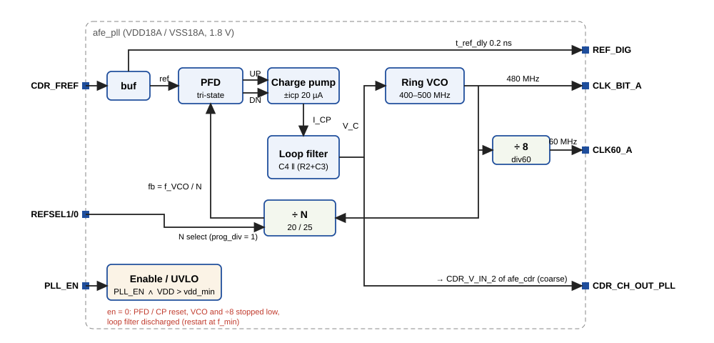

The loop: the PFD compares the rising edges of the buffered reference with those of the feedback divider output. The charge pump turns the PFD's UP / DN pulses into current pulses of ±icp into the loop filter. The filter voltage `V_C` (pin `CDR_CH_OUT_PLL`) tunes the ring VCO. The VCO output is `CLK_BIT_A`. It also drives the feedback divider ÷N and the output divider ÷8 (`CLK60_A`). The loop does not see the ÷8 divider.

## 3. Pin description

| Pin | Type | Direction | Level | Function |
|---|---|---|---|---|
| `CDR_FREF` | logic | in | 1.8 V CMOS, threshold `vth_logic` = 0.9 V | Reference clock, 24 MHz (REFSEL 01) or 19.2 MHz (REFSEL 00). Rising edges are used |
| `PLL_EN` | logic | in | 1.8 V CMOS | 1 = PLL on. 0 = VCO stopped, outputs low, PFD and charge pump reset, loop filter discharged |
| `REFSEL1`, `REFSEL0` | logic | in | 1.8 V CMOS | Feedback divider select (section 5.2), static. Ignored when `prog_div` = 0 |
| `CLK_BIT_A` | logic | out | 0 / VDD18A, edges `t_rf` = 50 ps | 480 MHz bit clock to the digital (`clk_bit`) |
| `CLK60_A` | logic | out | 0 / VDD18A | 60 MHz = `CLK_BIT_A` / 8, 50 % duty. Proposed, not wired in the digital |
| `REF_DIG` | logic | out | 0 / VDD18A | `CDR_FREF` delayed by `t_ref_dly` = 0.2 ns, for `usb_pll_lock_det` and as the clock of `usb_pwr_seq` |
| `CDR_CH_OUT_PLL` | analog | inout | 0 … VDD18A | Loop filter node, the VCO control voltage. Connect it to `CDR_V_IN_2` of `afe_cdr` (a gate, no DC load). Any extra load on this node changes the loop |
| `VDD18A` | supply | — | 1.8 V | Analog supply, from `afe_ldo` |
| `VSS18A` | supply | — | 0 V | Analog ground. All voltages refer to it |

All logic inputs of the model are ideal threshold comparators at `vth_logic` with no input current. Logic outputs are ideal voltage sources switching between 0 and V(VDD18A) with a linear edge of `t_rf`. They have no output resistance and no load dependence.

## 4. Operating conditions

| Parameter | Min | Typ | Max | Unit | Notes |
|---|---|---|---|---|---|
| Supply VDD18A | 1.62 | 1.80 | 1.98 | V | ±10 % corners used in the transistor simulations. Model: on above `vdd_min` = 1.5 V |
| Junction temperature | −40 | 27 | 125 | °C | Corners of the transistor simulations. The model has no temperature dependence |
| Reference frequency, REFSEL 01 | — | 24 | — | MHz | ±500 ppm (USB crystal tolerance). The PLL tracks any offset 1:1 |
| Reference frequency, REFSEL 00 | — | 19.2 | — | MHz | ±500 ppm |
| Reference duty cycle | 40 | 50 | 60 | % | Spec 2 (`ref_dig`). The PFD uses rising edges only |
| Reference input levels | 0 | — | VDD18A | V | Threshold 0.9 V |
| Load on `CLK_BIT_A` | — | 200 | — | fF | Transistor testbench load (root of the clock tree). The model is load-independent |
| Load on `CDR_CH_OUT_PLL` | — | gate | — | — | High impedance only. Any capacitance adds to C4 |

## 5. Electrical characteristics

### 5.1 Summary

Model: `afe_pll.va` defaults, values from the equations and the behavioural time-domain simulation. Transistor: `afe_pll_tr.sp`, ngspice (from `AFE/doc/pll_schematic.md` section 4 and this datasheet's runs). Corners: tt 27 °C 1.8 V, ss 125 °C 1.62 V, ff −40 °C 1.98 V.

| Parameter | Condition | Model | Transistor tt | ss | ff | Requirement (source) |
|---|---|---|---|---|---|---|
| Output frequency `CLK_BIT_A` | locked, 24 MHz, N = 20 | 480.000 MHz | 479.9998 MHz | **479.568 MHz (−901 ppm)** | 479.9999 MHz | 480 MHz ± 200 ppm, i.e. N · f_ref (tb_afe_pll) |
| Output frequency | locked, 19.2 MHz, N = 25 | 480.000 MHz | 480.0000 MHz | not run | not run | 480 MHz ± 200 ppm |
| Settling to ±800 ppm after `PLL_EN` | 24 MHz, filter discharged | 2.80 µs | 2.55 µs | **never** | 2.55 µs | ≤ 45 µs (spec 4.3) |
| Settling to ±800 ppm | 19.2 MHz | 3.30 µs | 3.05 µs | not run | not run | ≤ 30 µs (spec 4.3) |
| Control voltage in lock | 24 MHz | 0.900 V | 0.918 V | 1.365 V (CP at its limit) | 0.874 V | model check 0.85–0.95 V; CP range 0.1–1.7 V (model) |
| VCO gain K_VCO | 0.5–1.0 V | 200 MHz/V | 181 MHz/V (182 MHz/V in `pll_schematic.md`) | 89 MHz/V | 217 MHz/V | loop gain 0.5–2× of the model (7.5) |
| VCO frequency range | V_C = 0 … 1.4 V | 400–500 MHz (clamped) | 392–573 MHz | **401–480 MHz** | 381–603 MHz | must contain 480 MHz with margin at all corners (Fig. 5) |
| Charge-pump current icp | | 20 µA | 20 µA (2 × 10 µA bias) | — | — | — |
| Loop crossover f_c | N = 20 | 1.00 MHz | 0.92 MHz (calc.) | — | — | ≤ f_ref / 10 (continuous-time approximation) |
| Phase margin | N = 20 | 56.4° | 56.1° (calc.) | — | — | ≥ 45° (design target) |
| Closed-loop −3 dB bandwidth | N = 20 | 1.61 MHz | 1.47 MHz (calc.) | — | — | — |
| Closed-loop peaking | N = 20 | 1.98 dB | 2.11 dB (calc.) | — | — | — |
| Static phase offset at the PFD | locked | 0 (ideal PFD) | +3 ps | −2479 ps (not locked) | +76 ps | — |
| UP / DN pulse width in lock | | 0 (ideal reset) | 366 / 362 ps | 628 / 3106 ps | 322 / 244 ps | > CP switching time (no dead zone) |
| `CLK_BIT_A` duty cycle | locked | 50 % | 49.3 % | 50.5 % | 48.9 % | 50 ± 5 % (spec 2) |
| `CLK_BIT_A` period jitter | locked | `jit_rms` (default 0) | 0.26 ps rms, 1.2 ps p-p (deterministic only) | 8.25 ps rms, 30 ps p-p | 0.88 ps rms, 4.6 ps p-p | ≤ 50 ps p-p (spec 2, proposed) |
| `REF_DIG` delay from `CDR_FREF` | | 0.2 ns | 159 ps | 244 ps | 116 ps | — |
| `CLK60_A` | | `CLK_BIT_A` / 8, 50 %, `t_d60` = 0 | not built | — | — | rising edges on rising `CLK_BIT_A` edges (spec 2) |
| Supply current | locked | not modelled | 1.43 mA | 1.47 mA | 1.64 mA | — |
| Supply current | `PLL_EN` = 0 | not modelled | 7.6 µA | 5.6 µA | 10.5 µA | — (REF_DIG buffer still toggling) |
| Output after `PLL_EN` falls | | low, no edges | 0 edges, 0.00 V | pass | pass | low and quiet (tb_afe_pll) |
| Control voltage after `PLL_EN` falls | 1 µs later | < 1 mV (r_dis = 1 kΩ) | 0.0 mV | 0.0 mV | 0.0 mV | < 50 mV (tb_afe_pll) |

### 5.2 Frequency plan (feedback divider)

With `prog_div` = 1 (default) the feedback divider follows `REFSEL1/0`. The code is the same as in the digital decoder `usb_pll_lock_det`. With `prog_div` = 0 the divider is fixed at `div_01` = 20, as in the analog block today.

| REFSEL1 REFSEL0 | Reference | N (parameter = default) | VCO in lock | V_C in lock (model) | Lock-detector window count (256 ref cycles) | Digital decode |
|---|---|---|---|---|---|---|
| 0 0 | 19.2 MHz | `div_00` = 25 | 480 MHz | 0.900 V | 6400 expected, 6400 measured | `fb_div` = 25 |
| 0 1 | 24 MHz | `div_01` = 20 | 480 MHz | 0.900 V | 5120 / 5120 | `fb_div` = 20 (default) |
| 1 0 | 26 MHz | `div_10` = 20 | wants 520 MHz: model clamps at f_max = 500 MHz; transistor locks at 520 MHz | 1.76 V (model, CP at the rail); 1.121 V (transistor) | 4726 expected; model 4923, transistor 5120: never inside 4726 ± 5 → no lock reported | `refsel_err` = 1. 480 / 26 is not an integer, a fractional divider would be needed (Q6) |
| 1 1 | reserved | `div_11` = 20 | 480 MHz from 24 MHz | 0.900 V | 5120 | `refsel_err` = 1, treated as 24 MHz |

## 6. Functional description

### 6.1 Phase-frequency detector

Tri-state PFD on the rising edges of `CDR_FREF` (UP) and of the feedback divider output (DN). In the model, the reset is ideal: an edge on one input clears the other state instead of setting its own, so there is neither a reset pulse nor a dead zone, and the phase offset in lock is zero. The detector is linear over ±2π and gives a frequency-error signal beyond that (cycle slipping), so the loop pulls in from any VCO frequency inside the range without a separate frequency detector.

Transistor level: two TSPC flip-flops with D = 1 and a NAND + 2 inverter reset path, which gives about 365 ps UP / DN overlap pulses in lock. These pulses are wider than the charge pump's switching time, so there is no dead zone. The cost is a small reference spur.

### 6.2 Charge pump

The output current is +icp while UP is active and −icp while DN is active (both active: zero in the model). The current fades out smoothly (tanh, 20 mV scale) within `v_cp_marg` = 0.1 V of either rail. This keeps the control voltage between 0.1 V and 1.7 V even when the reference is missing or the loop is pushed to a range limit (26 MHz case).

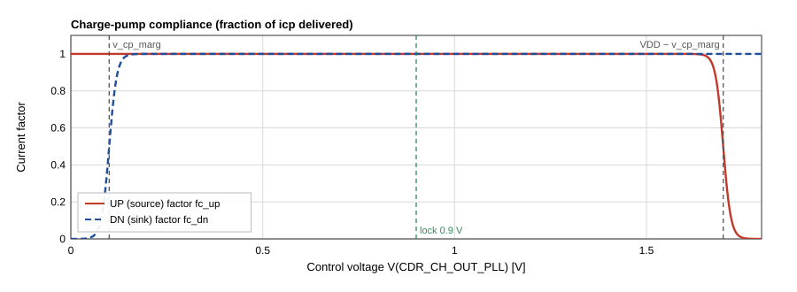

```
I_CP = −icp · ( UP · fc_up(V_C) − DN · fc_dn(V_C) )        (current into VSS18A; positive UP raises V_C)
fc_up = ½ · (1 + tanh((VDD18A − v_cp_marg − V_C) / 20 mV))
fc_dn = ½ · (1 + tanh((V_C − v_cp_marg) / 20 mV))
```

The transistor charge pump (`cdr_cp` with n = 2, shared with the CDR) loses headroom at a lower voltage: at ss / 125 °C / 1.62 V its PMOS source runs out at about 1.36 V. That causes the ss failure (13.1).

### 6.3 Loop filter

A passive second-order filter: C4 from the control node to ground, and R2 in series with C3 from the control node to ground. The filter node is the pin `CDR_CH_OUT_PLL`, and the R2 / C3 midpoint is the internal node `n_z`.

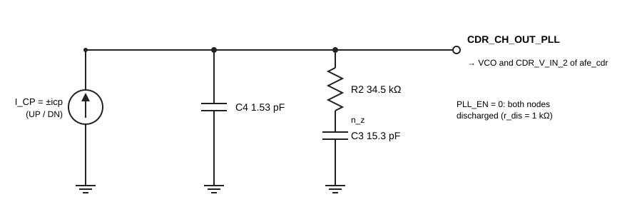

| Element | Model parameter | Value | Transistor device (`afe_pll_tr.sp`) |
|---|---|---|---|
| C4 (`CDR_C4`) | `c4` | 1.53 pF | MIM, 1.53 pF |
| R2 (`CDR_R2`) | `r2` | 34.5 kΩ | high-ohmic poly, 34.5 kΩ |
| C3 (`CDR_C3`) | `c3` | 15.3 pF | NMOS capacitor 18 × 10 µm × 10 µm ≈ 15.1 pF (≈ 1800 µm²) |
| Discharge (off) | `r_dis` | 1 kΩ on both nodes while off | NMOS 2/0.18 switches XD0, XD1, gate `enb` |

Transimpedance from the charge-pump current to the control voltage:

```
Z(s) = (1 + s·R2·C3) / ( s·(C3 + C4) · (1 + s·R2·C3·C4 / (C3 + C4)) )

zero  f_z = 1 / (2π·R2·C3)                       = 301.5 kHz
pole  f_p = (C3 + C4) / (2π·R2·C3·C4)            = 3.317 MHz
b = C3 / C4 = 10,   f_p / f_z = b + 1 = 11
mid-band resistance  R2·C3 / (C3 + C4)           = 31.4 kΩ
maximum phase lead at √(f_z·f_p) = 1.00 MHz:  atan(b / (2·√(b+1))) = 56.4°
```

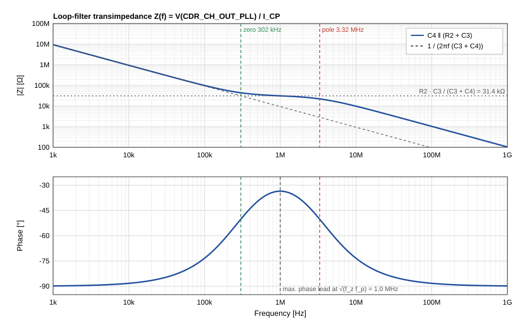

Below f_z the filter is an integrator on C3 + C4 = 16.83 pF. Between f_z and f_p it is resistive (31.4 kΩ), which gives the phase lead for stability. Above f_p, C4 integrates again and suppresses the PFD pulses: the ripple on V_C. The crossover is placed at the geometric mean of f_z and f_p, where the phase lead peaks. The filter is therefore at its phase-margin optimum for b = 10.

### 6.4 VCO

```
f_VCO = f_min + kvco · (V_C − v_fmin),   limited to [f_min, f_max]
      = 400 MHz + 200 MHz/V · (V_C − 0.5 V)   →  400 MHz up to 0.5 V,  480 MHz at 0.9 V,  500 MHz from 1.0 V
```

The model's phase integrates `f_VCO`. A rising edge of `CLK_BIT_A` happens at each phase crossing of +¼ and a falling edge at −¼, so the duty cycle is exactly 50 %. With `jit_rms` > 0, every period gets an independent Gaussian deviation (white period jitter). The loop does not correct it, so the output phase wanders slowly against the reference. While the PLL is off, the phase is frozen and `CLK_BIT_A` is low.

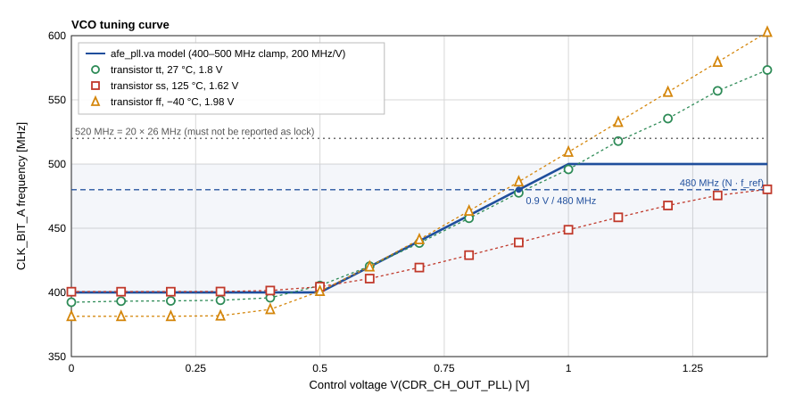

Transistor level: this is the CDR's VCO cell without changes (`vco_v2i` + 5-stage current-starved `vco_ring`). Coarse input = `CDR_CH_OUT_PLL`, fine input = an on-chip VDD/2 reference. It is not clamped. Measured sweep (fine input at VDD/2, 200 fF load, frequency from 20 periods):

| Corner | f at V_C = 0 V | f at 0.9 V | f at 1.4 V | K_VCO, 0.5–1.0 V | V_C for 480 MHz | Supply current at 480 MHz |
|---|---|---|---|---|---|---|
| tt, 27 °C, 1.8 V | 392 MHz | 478 MHz | 573 MHz | 181 MHz/V | 0.91 V | 1.41 mA |
| ss, 125 °C, 1.62 V | 401 MHz | 439 MHz | 480 MHz | 89 MHz/V | **1.40 V** | 1.44 mA |
| ff, −40 °C, 1.98 V | 381 MHz | 486 MHz | 603 MHz | 217 MHz/V | 0.87 V | 1.62 mA |

Below about 0.5 V the coarse input is cut off and the ring runs at its floor frequency (381–401 MHz). At ss / 125 °C / 1.62 V the gain halves and 480 MHz needs about 1.40 V (1.38 V in the closed-loop run of `pll_schematic.md`), beyond the charge-pump range (13.1). The 0.9 V operating point of the model is reached only at tt and ff.

The VCO tuning parameters (`f_min`, `f_max`, `kvco`, `v_fmin`) must be the same in `afe_cdr.va`. The CDR's VCO is a matched replica: with its coarse input on `CDR_CH_OUT_PLL` it free-runs at the PLL frequency without data, and its own fine loop only has to absorb the mismatch (risk R3).

### 6.5 Feedback divider

The divider ÷N divides the VCO phase by N. Its rising output edge is the PFD's DN input. N comes from `REFSEL1/0` (5.2). The model's divider has no delay. The transistor divider is a ÷5 prescaler at 480 MHz followed by a ÷4 / ÷5 stage at 96 MHz (N = 20 or 25). Its delay lies inside the loop and only shifts the phase of `CLK_BIT_A` against the reference, which nothing uses.

### 6.6 Output divider and `CLK60_A`

A ÷`div60` counter (8) clocked by the VCO's rising edges. `CLK60_A` goes high on count 0 and low on count `div60` / 2, so it is high for 4 and low for 4 VCO periods (50 %). Every rising `CLK60_A` edge comes with a rising `CLK_BIT_A` edge, plus the delay `t_d60` (default 0). The counter and the VCO state are reset when the PLL turns off. The first rising `CLK_BIT_A` edge after `PLL_EN` (or supply-good) is therefore also a rising `CLK60_A` edge, so the phase of `CLK60_A` is known after every restart.

Status: proposed. Today the digital generates `clk60` itself (`usb_clk_gen`, a ÷8 Johnson counter on `clk_bit`). If the digital ever uses `CLK60_A` as `clk60`, its `ld` strobe (phase 3, edge E4) must be aligned to `CLK60_A`, and the `clk_bit` → `clk60` skew budget of `constraints/usb_phy.sdc` applies to this pin. The transistor netlist has no ÷8 output yet.

### 6.7 Reference buffer `REF_DIG`

`REF_DIG` is a buffered copy of `CDR_FREF`, delayed by `t_ref_dly` = 0.2 ns (transistor tt: 159 ps). It is gated only by the supply-good condition, not by `PLL_EN`. The digital needs it while the PLL is off:
- `usb_pwr_seq` runs on `REF_DIG`, because `clk_bit` does not exist yet when it starts the PLL.
- `usb_pll_lock_det` checks a `clk_bit` heartbeat on `REF_DIG`, so it can detect a stopped VCO.

### 6.8 Enable, under-voltage lock-out, restart

The PLL is on when `PLL_EN` > `vth_logic` **and** V(VDD18A) > `vdd_min` = 1.5 V. When either condition goes away:
- `CLK_BIT_A` and `CLK60_A` stop low. The VCO phase freezes, and the ÷8 counter and the clock state are reset.
- The PFD states are cleared, so the charge pump is off.
- C4 and C3 are discharged through `r_dis` = 1 kΩ (time constants 1.5 ns and 15 ns). The VCO therefore restarts at f_min = 400 MHz, as `afe_pll_bm` does (`F_START`).

The model stops the clock immediately, even in the middle of a high phase. The digital must therefore stop CLKOUT before it drops `PLL_EN`: `usb_pwr_seq` waits for `clk_on` = 0 from `usb_clk_gen` (state CSTOP) before it clears `pll_en`. The transistor block has no UVLO of its own. There, the power sequencer keeps `PLL_EN` low until `PG18A`.

## 7. Loop dynamics

### 7.1 Small-signal model

The loop is linearized in the phase domain. It is valid while the PFD stays within ±2π, i.e. after frequency acquisition, and because f_c ≪ f_ref (f_ref / f_c = 24).

```
K_PD   = icp / 2π                          = 3.18 µA/rad
K_VCO  = 2π · kvco                         = 2π · 200 MHz/V
G(s)   = K_PD · Z(s) · K_VCO / (s · N)                  open-loop gain
H(s)   = N · G(s) / (1 + G(s))                          reference phase → VCO phase
E(s)   = 1 / (1 + G(s))                                 VCO phase noise → output (high-pass)

crossover (exact for f_c = √(f_z f_p)):
f_c   ≈ icp · kvco · R2 · C3 / (2π · N · (C3 + C4))     = 1.00 MHz (N = 20), 0.80 MHz (N = 25)
phase margin  PM = atan(f_c / f_z) − atan(f_c / f_p)    = 56.4° (N = 20)
```

| Quantity | Model, N = 20 | Model, N = 25 | Transistor tt (K_VCO 182 MHz/V, C3 15.1 pF), N = 20 | N = 25 |
|---|---|---|---|---|
| Crossover f_c | 0.999 MHz | 0.825 MHz | 0.921 MHz | 0.762 MHz |
| Phase margin | 56.4° | 56.0° | 56.1° | 55.2° |
| Closed-loop −3 dB bandwidth | 1.605 MHz | 1.307 MHz | 1.472 MHz | 1.202 MHz |
| Closed-loop peaking | 1.98 dB | 2.24 dB | 2.11 dB | 2.40 dB |
| f_ref / f_c | 24 | 23 | 26 | 25 |
| Zero / pole | 301.5 kHz / 3.317 MHz | same | 305.5 kHz / 3.321 MHz | same |

The exact values come from a numerical sweep of G(s). The approximation for f_c is 0.998 MHz.

### 7.2 Open-loop response

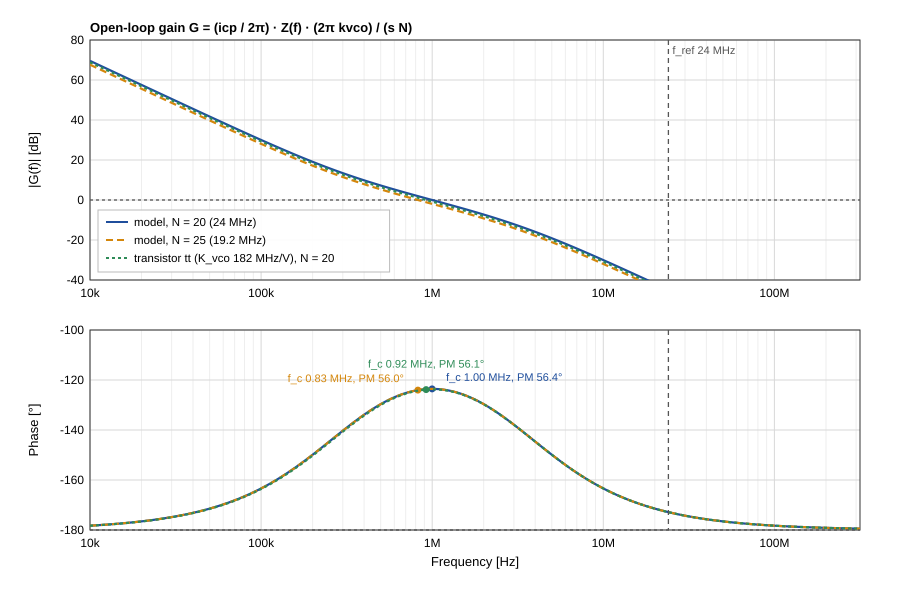

The gain falls at 40 dB/decade below f_z and above f_p, and at 20 dB/decade between them. The crossover lies at the maximum of the phase curve, so a change of the loop gain (K_VCO, icp or N over process) moves f_c but costs little phase margin (7.5).

### 7.3 Closed-loop response

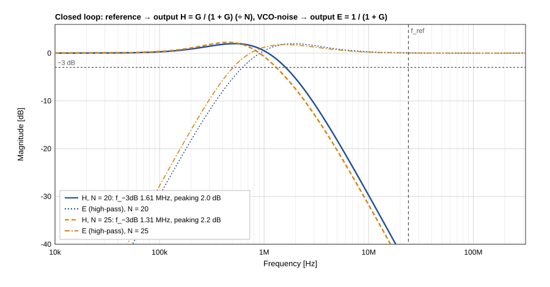

`H` (normalized by N) is the transfer of reference phase and noise to the output: low-pass with about 1.6 MHz bandwidth and 2 dB peaking. Reference phase noise is multiplied by N² (26 dB for N = 20) inside this band. `E` is the transfer of VCO phase noise to the output: high-pass, so the loop suppresses ring-VCO noise below about 1 MHz. Above that, the free-running VCO noise appears at the output.

### 7.4 Step response

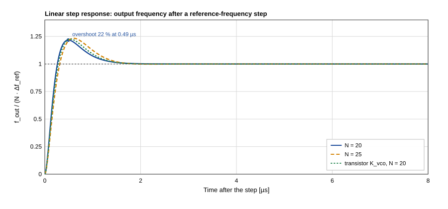

A step of the reference frequency (for example a crystal pulled by 500 ppm) gives a damped response of the output frequency. The numbers are for small steps that keep the charge pump and the VCO inside their linear range:

| Case | Overshoot | Time of the peak | Within ±2 % of the final value after |
|---|---|---|---|
| Model, N = 20 | 21.7 % | 0.49 µs | 1.39 µs |
| Model, N = 25 | 23.3 % | 0.60 µs | 1.50 µs |
| Transistor K_VCO (182 MHz/V), N = 20 | 22.5 % | 0.54 µs | 1.42 µs |

The roughly 20 % overshoot is normal for a 56° phase margin with the zero at f_c / 3.3. It is not visible at the digital side: the lock detector counts over 10.7 µs windows, by which time the step has settled to far below 1 ppm of the step size.

### 7.5 Sensitivity to process variation

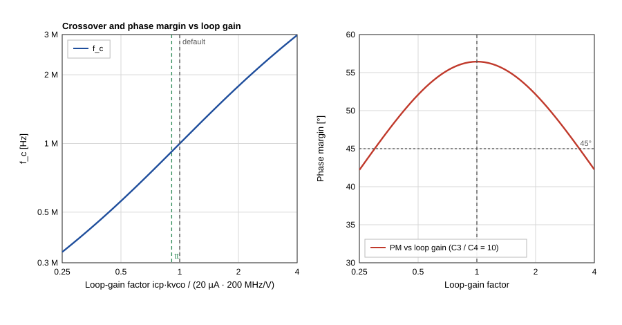

The loop gain is proportional to icp · K_VCO · R2 / N. f_c is roughly proportional to the loop gain. Because the crossover sits at the phase maximum of the filter, the phase margin falls only slowly on either side:

| Loop-gain factor | Case | f_c | Phase margin | Closed-loop peaking | f−3dB |
|---|---|---|---|---|---|
| 0.25 | | 0.33 MHz | 42.2° | 4.4 dB | 0.52 MHz |
| 0.44 | transistor ss (K_VCO 89 MHz/V) | 0.51 MHz | 50.5° | 3.2 dB | 0.78 MHz |
| 0.5 | | 0.56 MHz | 52.1° | 3.0 dB | 0.87 MHz |
| 0.91 | transistor tt (K_VCO 182 MHz/V) | 0.92 MHz | 56.4° | 2.1 dB | 1.47 MHz |
| 1.0 | model default | 1.00 MHz | 56.4° | 2.0 dB | 1.61 MHz |
| 1.08 | transistor ff (K_VCO 217 MHz/V) | 1.07 MHz | 56.4° | 1.9 dB | 1.72 MHz |
| 1.5 | | 1.41 MHz | 54.9° | 1.6 dB | 2.32 MHz |
| 2.0 | | 1.78 MHz | 52.1° | 1.6 dB | 2.96 MHz |
| 4.0 | | 2.98 MHz | 42.3° | 2.9 dB | 4.89 MHz |

(Loop gain varied through K_VCO with C3 = 15.3 pF; the tt row of 7.1 differs by 0.3° because it uses the extracted C3 = 15.1 pF. The ss and ff rows use the small-signal slope between 0.5 V and 1.0 V of the sweep in Fig. 5.)

A loop gain between 0.5× and 2× keeps the phase margin above 45°. This covers the expected spread of a ring VCO's K_VCO and a bias-derived icp.

## 8. Lock behaviour

### 8.1 Lock transient

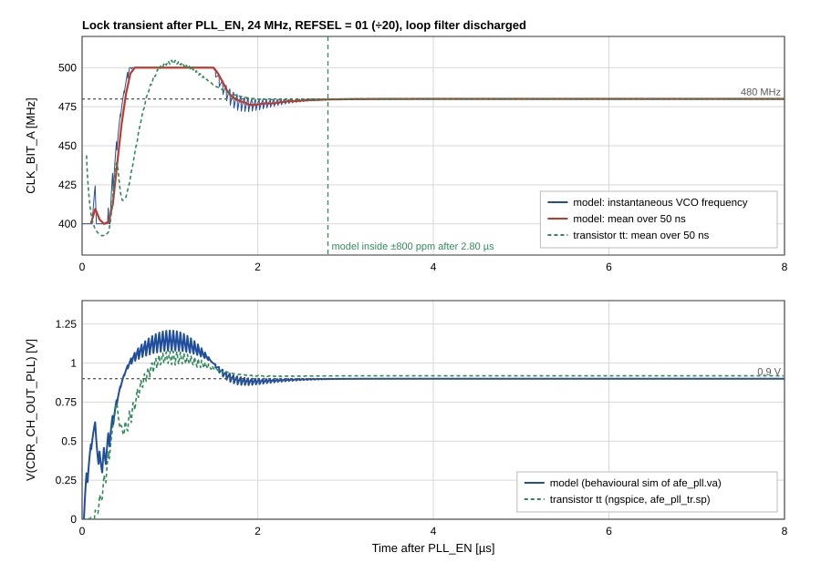

After `PLL_EN` the loop filter is empty, so the VCO starts at f_min = 400 MHz. The PFD then sees a large frequency error and the charge pump drives the control node at its full current. In the model that is a slew of icp / (C3 + C4) = 1.19 V/µs, i.e. about 240 MHz/µs on the VCO. The VCO overshoots to its upper limit (V_C peaks at 1.21 V after 1.0 µs, f clamped at 500 MHz), comes back as the phase error unwinds, and settles with the loop's natural damping. Before settling, the instantaneous frequency shows the per-cycle ripple of the PFD pulses on C4.

### 8.2 Settling

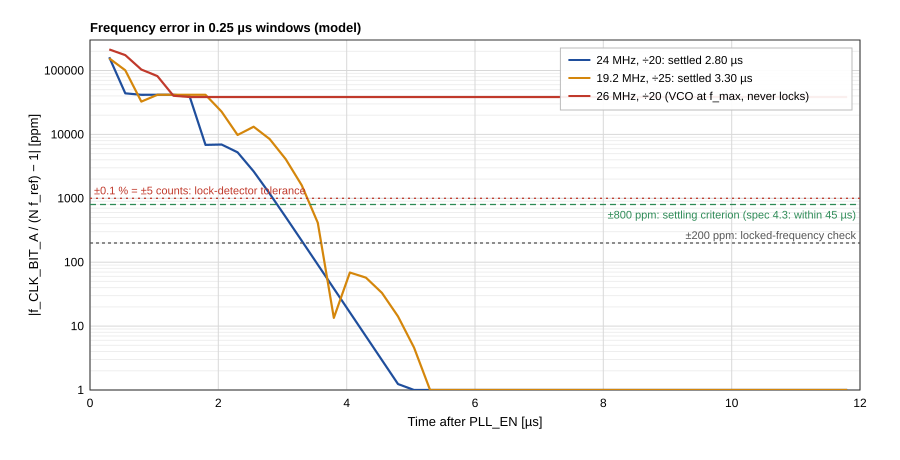

| Case | Settled to ±800 ppm (model) | Transistor tt | Requirement |
|---|---|---|---|
| 24 MHz, N = 20 | 2.80 µs | 2.55 µs | ≤ 45 µs |
| 19.2 MHz, N = 25 | 3.30 µs | 3.05 µs | ≤ 30 µs |
| 26 MHz, N = 20 | never: VCO at f_max = 500 MHz, error −3.8 % | locks at 520 MHz | the digital must not report lock |

The criterion is the one used by `tb_afe_pll.va` and `tb_pll_tr.py`: every 0.25 µs window after the settling time is within ±800 ppm of N · f_ref.

### 8.3 Lock detection and lock-time budget

The PLL has no lock output. `usb_pll_lock_det` counts `CLK_BIT_A` cycles over windows of 256 `REF_DIG` cycles (10.7 µs at 24 MHz, 13.3 µs at 19.2 MHz). A count of 5120 ± 5 (6400 ± 5 at 19.2 MHz), i.e. ±0.1 %, is good. Four consecutive good windows set `pll_lock`, and one bad window clears it. After the PLL has settled, the detector needs at most 5 windows (53 µs at 24 MHz, 67 µs at 19.2 MHz).

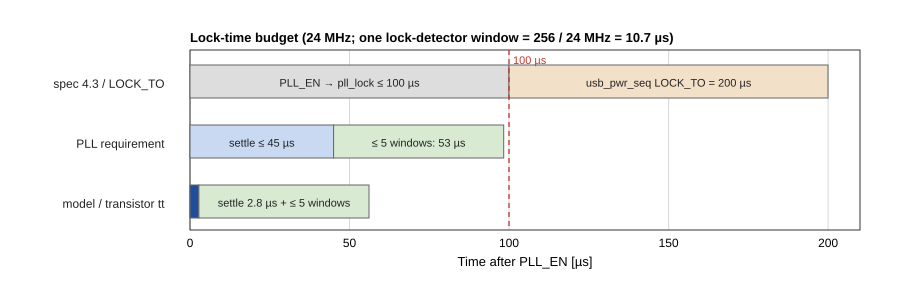

| Budget item | Value | Source |
|---|---|---|
| `PLL_EN` → `pll_lock` | ≤ 100 µs (proposed) | spec 4.3 |
| PLL settling to ±0.08 % | ≤ 45 µs at 24 MHz, ≤ 30 µs at 19.2 MHz, worst corner | spec 4.3 (derived in A4) |
| Lock detector after settling | ≤ 5 windows: 53 µs (24 MHz), 67 µs (19.2 MHz) | `usb_pll_lock_det` |
| Lock time-out of the power sequencer | `LOCK_TO` = 4800 `REF_DIG` cycles = 200 µs, then `pll_err`, PLL off for `OFF_CYC` = 1 µs and retry | `usb_pwr_seq` |
| This PLL (model / transistor tt) | 2.8 µs / 2.55 µs + ≤ 53 µs ≈ 56 µs | this datasheet |

The margin is large: the loop settles more than ten times faster than required. Settling time scales roughly as 1 / f_c. A narrower loop, with lower spurs and less reference-noise peaking, would still meet the budget down to f_c ≈ 150 kHz: about 19 µs at 24 MHz and 22 µs at 19.2 MHz. Such a change would need a fresh check of the CDR's coarse tracking.

### 8.4 Unsupported reference (26 MHz)

With REFSEL = 10 the divider stays at 20, so the loop aims for 520 MHz. The model's VCO stops at f_max = 500 MHz, and the control voltage runs into the charge-pump rail (1.76 V). The transistor VCO has no upper clamp and locks at 520 MHz (V_C = 1.121 V). In both cases the lock detector expects 4726 counts but sees 4923 (model) or 5120 (transistor), so it never reports lock. The digital also flags `refsel_err`. A real 26 MHz mode would need a fractional-N divider (open question Q6).

### 8.5 Fault injection (model only)

| Parameter | Effect | Use |
|---|---|---|
| `f_err` | The feedback divider divides by N · (1 + f_err), so the loop locks `CLK_BIT_A` at N · f_ref · (1 + f_err). This is what a broken feedback path or a wrong divider would do | `f_err` = 3e-3 (+0.3 %) reproduces the loss-of-lock case of `tb_usb_pll_lock_det`. ±0.05 % must keep lock |
| `jit_rms`, `seed0` | Gaussian period jitter of `CLK_BIT_A` (and `CLK60_A`), independent per period, not seen by the loop | Timing margin checks of the 480 MHz islands; spec 2 allows ≤ 50 ps p-p |

## 9. Timing

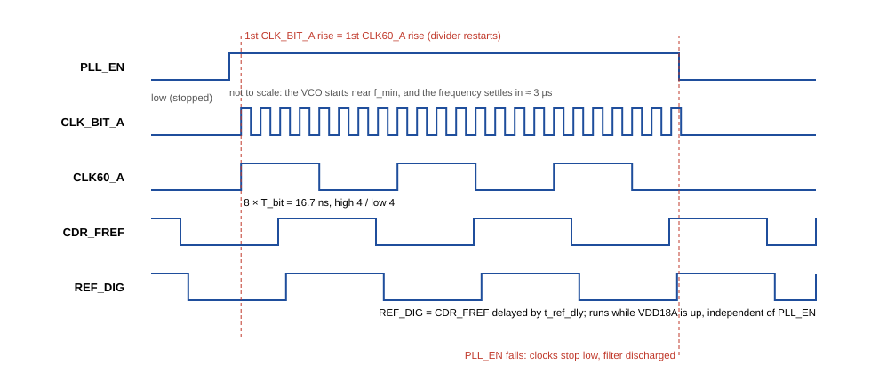

| Parameter | Symbol | Model | Transistor tt | Notes |
|---|---|---|---|---|
| `CLK_BIT_A` period, locked | T_bit | 2.0833 ns | 2.0833 ns | `constraints/usb_phy.sdc` `T_BIT` = 2.0833 |
| `CLK_BIT_A` rise / fall time | t_rf | 50 ps (linear, 0–100 %) | depends on load (200 fF) | |
| `CLK60_A` period | | 8 · T_bit = 16.67 ns | — | high 4 · T_bit, low 4 · T_bit |
| `CLK_BIT_A` rise → `CLK60_A` rise | t_d60 | 0 (parameter) | — | must fit the 60 ↔ 480 boundary budget if used |
| `CDR_FREF` → `REF_DIG` | t_ref_dly | 0.2 ns | 159 ps (ss 244, ff 116) | constant delay; the lock detector counts a ratio, so the delay does not matter |
| `PLL_EN` rise → first `CLK_BIT_A` edge | | within one VCO period at f_min (≤ 2.5 ns; depends on the phase frozen at the last turn-off) | not measured | the first edge is a `CLK60_A` rising edge |
| `PLL_EN` rise → settled ±800 ppm | t_set | 2.80 µs (24 MHz) | 2.55 µs | ≤ 45 µs |
| `PLL_EN` fall → clocks low | | immediate (t_rf) | < 20 ns, no further edges | the digital stops CLKOUT first |
| `PLL_EN` fall → V_C discharged | | < 0.1 µs | < 1 µs to 0 mV | restart from f_min |

## 10. Model parameters

| Parameter | Default | Range | Unit | Meaning |
|---|---|---|---|---|
| `f_min` | 400e6 | > 0 | Hz | VCO lower limit and frequency at `v_fmin`. **Keep equal in `afe_cdr.va`** (and `F_MIN` in `afe_pll_bm.v`) |
| `f_max` | 500e6 | > f_min | Hz | VCO upper limit. **Keep equal in `afe_cdr.va`** (`F_MAX`) |
| `kvco` | 200e6 | > 0 | Hz/V | VCO gain. **Keep equal in `afe_cdr.va`** |
| `v_fmin` | 0.5 | | V | control voltage at f_min. **Keep equal in `afe_cdr.va`** |
| `icp` | 20e-6 | > 0 | A | charge-pump current |
| `r2` | 34.5e3 | > 0 | Ω | loop filter series resistor |
| `c3` | 15.3e-12 | > 0 | F | loop filter series capacitor |
| `c4` | 1.53e-12 | > 0 | F | loop filter shunt capacitor |
| `v_cp_marg` | 0.1 | ≥ 0 | V | charge-pump compliance to the rails |
| `r_dis` | 1e3 | > 0 | Ω | filter discharge resistance while off |
| `prog_div` | 1 | 0, 1 | — | 1: N from REFSEL; 0: fixed `div_01` |
| `div_00`, `div_01`, `div_10`, `div_11` | 25, 20, 20, 20 | ≥ 1 | — | N for REFSEL 00 / 01 / 10 / 11 |
| `div60` | 8 | ≥ 2, even | — | `CLK60_A` divider (`P_DIV60` in `afe_pll_bm.v`) |
| `vth_logic` | 0.9 | | V | logic input threshold |
| `vdd_min` | 1.5 | | V | supply-good threshold (UVLO) |
| `t_rf` | 50e-12 | > 0 | s | output edge time |
| `t_ref_dly` | 0.2e-9 | ≥ 0 | s | `CDR_FREF` → `REF_DIG` delay |
| `t_d60` | 0 | ≥ 0 | s | `CLK_BIT_A` → `CLK60_A` delay |
| `pts` | 10 | ≥ 4 | — | time steps per VCO period (`$bound_step` = 1 / (pts · f_max) = 0.2 ns while on) |
| `f_err` | 0 | (−0.5, 0.5) | — | fault injection, relative frequency error |
| `jit_rms` | 0 | ≥ 0 | s | rms period jitter |
| `seed0` | 7 | | — | jitter random seed |

Simulation cost: while the PLL is on, `$bound_step` limits the time step to 0.2 ns. For long system runs at full speed this dominates the analog solver time. Use `afe_pll_bm.v` (digital, frequency only) where the loop itself is not under test.

## 11. Dependencies

### 11.1 System context

| Connected to | Signal | Direction | Dependency |
|---|---|---|---|
| Crystal oscillator / REFCLK buffer (not designed yet) | `CDR_FREF` | → PLL | 24 MHz or 19.2 MHz, ±500 ppm. The PLL output carries the same ppm error |
| `afe_ldo` | `VDD18A` | → PLL | 1.8 V. The PLL is off below 1.5 V (model). `PG18A` gates the power sequencer |
| `usb_pwr_seq` (digital) | `PLL_EN` | → PLL | Turned on after LDO and bias. Waits for `pll_lock` (time-out 200 µs, retry after 1 µs off). Turned off only after CLKOUT has stopped (`clk_on` = 0) |
| Strap / register | `REFSEL1/0` | → PLL | Static. Same code in the PLL and in `usb_pll_lock_det` |
| `usb_clk_gen` and all `clk_bit` islands | `CLK_BIT_A` | PLL → | `clk60` = `clk_bit` / 8, CLKOUT, `ld`. TX PISO, FS/LS sampler, squelch / disconnect captures, lock-detector sample word |
| `usb_pll_lock_det` | `CLK_BIT_A`, `REF_DIG` | PLL → | Counts the ratio. Expected counts depend on N (`fb_div`) |
| `usb_pwr_seq` | `REF_DIG` | PLL → | Its clock: must run while the PLL is off |
| `afe_cdr` | `CDR_CH_OUT_PLL` → `CDR_V_IN_2` | PLL → | Coarse tuning of the CDR VCO (matched replica). Any VCO mismatch must be absorbed by the CDR fine loop (R3) |
| Digital core (proposed) | `CLK60_A` | PLL → | Alternative source of `clk60`, not wired |

### 11.2 Values that must stay consistent

| Value | Here | Also in | Consequence of a mismatch |
|---|---|---|---|
| VCO curve `f_min`, `f_max`, `kvco`, `v_fmin` | `afe_pll.va` | `afe_cdr.va` (coarse curve); `afe_pll_bm.v` `F_MIN` / `F_MAX` | The CDR VCO free-runs off-frequency and its lock gets longer |
| Divider code REFSEL → N | `div_00` … `div_11` | `usb_pll_lock_det` (`fb_div`, expected count), `afe_pll_tr.sp` (`sel5`) | Lock never reported, or reported at the wrong frequency |
| ÷8 output | `div60` | `afe_pll_bm.v` `P_DIV60`, `usb_clk_gen` (÷8 Johnson counter), SDC `T_60` = 8 · `T_BIT` | `CLK60_A` and the core clock disagree |
| 480 MHz | N · f_ref | SDC `T_BIT` = 2.0833 ns | Timing constraints do not match the clock |
| Lock time | settling ≤ 45 µs | spec 4.3, `usb_pwr_seq` `LOCK_TO`, `usb_pll_lock_det` `GOOD_N` / `NW` | `pll_err` and retries |
| Off behaviour (clocks low, restart at f_min) | `afe_pll.va` | `afe_pll_bm.v` (`F_START`), `afe_pll_tr.sp` | Different start-up time in the shadow tests |
| Pin order | `afe_pll.va` | `afe_pll_tr.sp` (no `CLK60_A`), `tb_ams_pwr.vams`, `tb_afe_pll*.scs` | Netlist errors |

### 11.3 Power-up and power-down sequence

1. `por_n` released → `ldo_en` = 1 → `VDD18A` rises; `PG18A` = 1. From now on `REF_DIG` runs and clocks `usb_pwr_seq`.
2. `bias_en` = 1 (bias / bandgap).
3. `pll_en` = 1 (state PLL). The VCO starts at f_min and settles in about 3 µs.
4. `usb_pll_lock_det` sees four good windows → `pll_lock` = 1, at most about 56 µs after step 3. The digital releases CLKOUT and the ULPI interface.
5. No lock within `LOCK_TO` (200 µs): `pll_err`, `pll_en` = 0 for 1 µs, retry.
6. Power-down or suspend: CLKOUT is stopped first (`clk_on` = 0), then `pll_en` = 0. The clocks stop low and the filter is discharged.

### 11.4 Files

| File | Role |
|---|---|
| `AFE/veriloga/afe_pll.va` | the model described here |
| `AFE/doc/pll.md` | model description |
| `AFE/veriloga/tb/tb_afe_pll.scs`, `tb_afe_pll.va` | Spectre testbench and checker (`run_va_tests.sh pll`) |
| `AFE/veriloga/tb/tb_afe_pll_tr.scs` | same checks on the transistor netlist |
| `AFE/spice/afe_pll_tr.sp`, `afe_cells.sp` | transistor schematic; VCO, charge pump and bias shared with the CDR |
| `AFE/spice/tb/tb_pll_tr.py` | ngspice testbench |
| `AFE/doc/pll_schematic.md` | transistor schematic description and results |
| `afe_pll_bm.v` | Icarus behavioural model (frequency only) |
| `usb_pll_lock_det.v`, `usb_pwr_seq.v`, `usb_clk_gen.v` | digital counterparts |
| `AFE/ams/tb_ams_pwr.vams` | AMS system test with this model |
| `DOC/afe_interface_spec.md` 2, 3.3, 4.3 | interface requirements |
| `AFE/doc/pll_datasheet/gen_figures.py`, `svgplot.py`, `data/` | figure generator for this datasheet and its transistor data |

## 12. Design guidance

These relations let the loop be re-tuned when the xh018 values of K_VCO or icp are known:

```
1. Choose the crossover:        f_c ≤ f_ref / 10  (here 1 MHz = f_ref / 24)
2. Choose the pole/zero spread:  b = C3 / C4;  PM_max = atan(b / (2·√(b+1)))
                                 b = 10 → 56.4°,  b = 6 → 48.6°,  b = 15 → 61.9°
3. Place zero and pole around f_c:  f_z = f_c / √(b+1),  f_p = f_c · √(b+1)
4. Total capacitance:           C3 + C4 = icp · kvco · √(b+1) / (4π² · N · f_c²)   (b = 10: 16.8 pF)
   C4 = (C3 + C4) / (b + 1),  C3 = b · C4
5. Resistor:                    R2 = 1 / (2π · f_z · C3)
```

- To keep the same dynamics when K_VCO changes, scale icp inversely (the loop gain is icp · K_VCO). This leaves the filter, and its area, unchanged.
- To halve f_c at constant phase margin, multiply C3 and C4 by 4 and divide R2 by 2. Alternatively, keep the capacitors and divide icp by 4 and multiply R2 by 2: smaller area, but more relative charge-pump mismatch and more R2 noise.
- C3 (15.3 pF, about 1800 µm² as an NMOS capacitor) dominates the area. A MOS capacitor needs enough gate voltage: the C3 node sits at V_C ≈ 0.9 V in lock.
- Thermal noise of R2: √(4kT·R2) = 23.9 nV/√Hz. Through K_VCO that is 4.8 Hz/√Hz of frequency noise at the VCO, filtered by the loop like VCO noise.
- Ripple on V_C from a PFD pulse of width t_p with a net charge-pump current ΔI (mismatch): ΔV ≈ ΔI · t_p / C4. With a 10 % mismatch and 365 ps: 0.48 mV, i.e. 0.1 MHz of instantaneous frequency deviation at the reference rate.
- The control-voltage range in lock must stay inside the charge-pump compliance at all corners: this is the open problem at ss (13.1).

## 13. Open points

1. **Lock fails at ss / 125 °C / 1.62 V (transistor level).** The shared VCO needs about 1.4 V on the coarse input (Fig. 5), and the charge pump's PMOS side stops at about 1.36 V. Possible fixes are in the shared VCO: more range at low VDD, a fine reference that does not track VDD, or a regulated VCO supply. Until then the PLL meets spec 4.3 only from tt to ff.
2. **VCO mismatch between PLL and CDR (R3).** The systematic part is +0.4 % from the two VDD/2 fine references. The random part needs a Monte Carlo run with the xh018 mismatch models.
3. **Noise.** Phase noise, reference spurs and supply sensitivity are not simulated. The period-jitter requirement (≤ 50 ps p-p) and the accumulated jitter for the HS TX eye remain to be verified.
4. **`CLK60_A`.** The proposed pin exists only in the model. It needs a decision (Q-list) and a ÷8 output in the transistor netlist.
5. **Reference frequencies (Q6).** 26 MHz needs a fractional-N divider. The REFSEL pins are only needed if more than 24 MHz is supported.
6. **xh018 models.** The transistor numbers in this datasheet use the placeholder 180 nm models. They must be redone with the PDK, and then the model parameters (`kvco`, `icp`, VCO range) updated.
7. **Spectre runs.** `tb_afe_pll.scs` and `tb_ams_pwr.vams` have never run. The model numbers in this datasheet come from the equations and a behavioural re-implementation, not from Spectre.

## 14. Not modelled

Phase noise beyond white period jitter; reference spurs; charge-pump mismatch and leakage; the PFD reset pulse; K_VCO variation over the tuning range; temperature and supply dependence of the VCO; supply current; divider delays (except the fixed `t_d60`); output drive strength and load dependence; a lock-detect output (lock is judged digitally).

## 15. How the numbers were obtained

| Source | Method | Figures / values |
|---|---|---|
| Linear analysis | Numerical evaluation of G(s), H(s), E(s) with the model's default parameters | Fig. 4, 6, 7, 9; table 7.1 |
| Linear time-domain | Phase-domain loop integrated with 1 ns steps | Fig. 8 |
| Behavioural simulation | Python re-implementation of the `afe_pll.va` equations: tri-state PFD with ideal reset (exact edge times inside each step), charge pump with tanh compliance, C4 ‖ (R2 + C3) integrated with 25 ps steps, clamped linear VCO, ÷N on the integrated VCO phase. Reference edges start 0.5 / f_ref after `PLL_EN`; filter discharged at the start | Fig. 10, 11, 12; settling times; 26 MHz case |
| Transistor level | `afe_pll_tr.sp` with ngspice 42 and `generic180.lib` (placeholder 180 nm models): lock transients at tt (`tb_pll_tr.py`), VCO sweep 0–1.4 V at tt / ss / ff (`data/run_spice.py`) | Fig. 5, 10; tables 5.1, 8.2 (also from `pll_schematic.md` 4) |

Regenerate the figures with `python3 AFE/doc/pll_datasheet/gen_figures.py` (numpy and `rsvg-convert`, about 15 s). Rerun the transistor data with `python3 AFE/doc/pll_datasheet/data/run_spice.py` (ngspice).

## 16. Revision history

| Revision | Date | Change |
|---|---|---|
| 0.1 | 2026-11-20 | First issue, based on `afe_pll.va` of 2026-11-15 and `afe_pll_tr.sp` of 2026-11-12 |
