# afe_receiver — HS Receiver, Squelch and Disconnect Detector — Datasheet

*Datasheet of the receiver model `AFE/veriloga/afe_receiver.va` (modules `afe_hs_rx`, `afe_squelch`, `afe_receiver`), the high-speed receive front end of the USB 2.0 ULPI PHY. Revision 0.1, 2026-11-20. It describes the behaviour of the Verilog-A model with its default parameters. The transistor-level design `AFE/spice/afe_receiver_tr.sp` exists, and its simulated values are listed next to the model values. Those simulations use ngspice 42 and the placeholder 180 nm models `generic180.lib`, not the xh018 PDK. The Verilog-A model has not been run in Spectre yet. The model curves in this datasheet come from a re-implementation of the model equations driven by the same line waveforms as the transistor runs (see 13).*

Figures: `fig/` (SVG; PNG copies for Word), generated by `gen_figures.py`. Related documents: [AFE/doc/receiver.md](../receiver.md) (model description), [AFE/doc/receiver_schematic.md](../receiver_schematic.md) (transistor schematic), [AFE/doc/cdr_datasheet/cdr_datasheet.md](../cdr_datasheet/cdr_datasheet.md) (the CDR that takes `RX_OUT_P`), `DOC/afe_interface_spec.md` sections 2, 3.2, 3.5, 4.2 and 6 (AFE ↔ digital interface).

## 1. Overview

`afe_receiver` is the analog part of the 480 Mbit/s receive path. It contains three functions that share the line inputs `RX_IN_P` / `RX_IN_N` (DP / DM), the enable and the supplies:

- **HS receiver** (`afe_hs_rx`): a differential comparator with hysteresis. Its output `RX_OUT_P` (1 = J, DP > DM) goes to `CDR_DATA` of `afe_cdr`, which recovers clock and data.
- **Squelch detector** (`afe_squelch`): tells the digital whether a HS signal is on the line (`SQUELCH_A` = 0) or not (`SQUELCH_A` = 1). The digital starts and ends every HS packet on it.
- **HS disconnect detector** (`afe_squelch`): `DISC_A` = 1 when the differential voltage exceeds the disconnect level. A host samples it during the HS EOP to see that the device has gone.

**Features**

- Differential receiver with 20 mV hysteresis (transistor: 18 mV), delay 0.3 ns (transistor: 0.9 ns at tt), output 1 = J.
- Squelch threshold 125 mV (transistor: 110 mV static, 140 mV on 480 Mbit/s data), inside the USB 2.0 window: squelched below 100 mV, active above 150 mV. Common-mode range −50 … 500 mV.
- Squelch filter: an envelope that bridges the zero crossings of the data, a release timer and an assertion timer. Release ≤ 12 ns after the first transition (model 4.1 ns, transistor 7.3–8.0 ns); assertion 6 … 16.7 ns after the last bit (model 12.1 ns, transistor 13.2–14.1 ns); bursts shorter than 3 ns are ignored.
- Disconnect threshold 575 mV (transistor 566–585 mV), USB window 525 … 625 mV, after 4 ns (transistor 5 ns); falls at once.
- Two supply domains: 3.3 V (`RX_VDD`) for the input stages that see the line, 1.8 V (`RX_VDDO`) for comparators, timers and outputs. Outputs swing 0 … V(`RX_VDDO`), so `RX_OUT_P` feeds the 1.8 V CDR without a 480 Mbit/s level shifter (Q8).
- Off state (`RX_EN` = 0, or `RX_VDD` < 2.97 V): `RX_OUT_P` = 0, `RX_OUT_N` = 1, `SQUELCH_A` = 1, `DISC_A` = 0 (the isolated values of spec 3.2 / 3.5). The transistor design also switches off all bias currents (< 1 µA).
- Model-only options: input offset `v_off`, random input noise `v_noise`, input capacitance `c_in`, reference check `vref_min`.

**Views and status**

| View | File | Status |
|---|---|---|
| Verilog-A model | `AFE/veriloga/afe_receiver.va` | Written 2026-11-11. Not simulated in Spectre (no simulator here) |
| Spectre testbench | `AFE/veriloga/tb/tb_afe_receiver.scs` + checker `tb_afe_receiver.va` | Written, not run |
| Icarus behavioural models | `afe_hs_rx_bm.v`, `afe_squelch_bm.v` (repository root) | Same behaviour; used by `tb_afe_hs_rx`, `tb_afe_hs_chain`, `tb_usb_afe_rx_if`, `tb_usb_afe_chirp` and the AMS shadows. `afe_hs_rx_bm` has 15 mV input noise by default |
| Transistor schematic | `AFE/spice/afe_receiver_tr.sp` (249 MOSFETs) | ngspice: all checks pass at tt, ss / 125 °C and ff / −40 °C (section 5). No layout, no Monte Carlo |
| Spectre transistor testbench | `AFE/veriloga/tb/tb_afe_receiver_tr.scs` | Same checker with the transistor figures. Not run |
| AMS system tests | `AFE/ams/tb_ams_link.vams`, `tb_ams_mouse.vams`, `tb_ams_msc.vams` | Instantiate `afe_receiver` (host and device side). Not run |

## 2. Block diagram

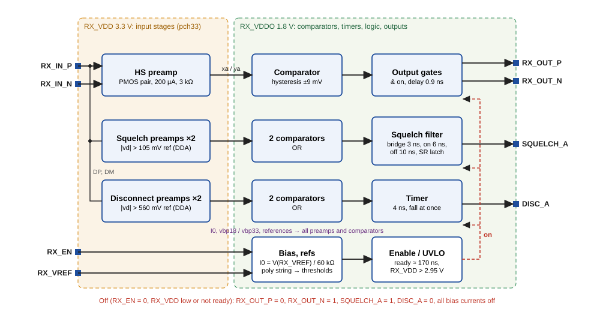

Each of the three paths has a preamplifier on 3.3 V that sees the line, a comparator on 1.8 V and a 1.8 V output stage. One bias current I0 = V(`RX_VREF`) / 60 kΩ sets every threshold through a poly resistor string, so the thresholds depend on `RX_VREF` and resistor ratios, not on absolute resistor values. The model has no internal structure: three ideal comparators on the differential voltage, the squelch and disconnect timers, and output delays.

## 3. Pin description

| Pin | Type | Direction | Level | Function |
|---|---|---|---|---|
| `RX_IN_P` | analog | in | −0.05 … 0.5 V (HS), up to 3.6 V (FS / LS, receiver off) | DP. High impedance (model: `c_in`, default 0; transistor ≈ 0.1 pF of gate) |
| `RX_IN_N` | analog | in | as `RX_IN_P` | DM |
| `RX_EN` | logic | in | 1.8 V CMOS, threshold `vth_logic` = 0.9 V | 1 = receiver, squelch and disconnect on. Driven by `rx_en_hs` of `usb_afe_rx_if` (HS mode with `RX_EN` of the digital, not isolated) |
| `RX_VREF` | analog | in | 1.2 V | Bias reference from the bias block (Q9). Model: 1 GΩ input, checked only when `vref_min` > 0. Transistor: sets I0 and every threshold; 0 V leaves the receiver dead |
| `RX_OUT_P` | logic | out | 0 / V(`RX_VDDO`) | HS data, 1 = J (DP > DM). To `CDR_DATA` of `afe_cdr` |
| `RX_OUT_N` | logic | out | 0 / V(`RX_VDDO`) | Complement of `RX_OUT_P`. Not used by the digital |
| `SQUELCH_A` | logic | out | 0 / V(`RX_VDDO`) | 1 = no HS signal (squelched), 0 = signal. `squelch_a` of `usb_afe_rx_if` and `usb_rx_status_sync` |
| `DISC_A` | logic | out | 0 / V(`RX_VDDO`) | 1 = differential voltage above the disconnect level. `disc` of `usb_rx_status_sync`, `host_disc` (host mode only) |
| `RX_VDD` | supply | — | 3.3 V | Input stages. UVLO: off below 2.97 V (transistor 2.92–2.95 V) |
| `RX_VDDO` | supply | — | 1.8 V | Output stages (model: any level, the outputs swing 0 … V(`RX_VDDO`); transistor: 1.8 V only, core devices) |
| `RX_GND` | supply | — | 0 V | Ground of both domains. All voltages refer to it |

Model outputs are ideal voltage sources with a linear edge of `t_rf` = 50 ps, no output resistance and no load dependence. The transistor testbench loads every output with 20 fF.

## 4. Operating conditions

| Parameter | Min | Typ | Max | Unit | Notes |
|---|---|---|---|---|---|
| Supply `RX_VDD` | 3.0 | 3.3 | 3.6 | V | ±10 %; corners of the transistor simulations. On above 2.97 V (model) |
| Supply `RX_VDDO` | 1.62 | 1.8 | 1.98 | V | ±10 % |
| Junction temperature | −40 | 27 | 125 | °C | Transistor corners. The model has no temperature dependence |
| `RX_VREF` | — | 1.2 | — | V | Thresholds scale with it in the transistor design |
| Differential input, HS data | ±150 | ±400 | ±500 | mV | USB 2.0 receiver eye; 400 mV nominal HS level |
| Common mode | −50 | 200 | 500 | mV | USB 2.0 HS receiver range |
| Data rate | — | 480 | — | Mbit/s | ±1000 ppm |
| Input edge time | — | 625 | — | ps | 0–100 %, the testbench value (USB: ≥ 500 ps 10–90 % at the transmitter) |
| Load on each output | — | 20 | — | fF | Transistor testbench load |

## 5. Electrical characteristics

### 5.1 Summary

Model: `afe_receiver.va` defaults. Transistor: `afe_receiver_tr.sp`, ngspice, at three corners: tt (27 °C, `RX_VDD` 3.3 V, `RX_VDDO` 1.8 V), ss (125 °C, 3.0 / 1.62 V) and ff (−40 °C, 3.6 / 1.98 V). Source: `AFE/spice/tb/tb_receiver_tr.py` (section 13).

| Parameter | Condition | Model | tt | ss | ff | Requirement (source) |
|---|---|---|---|---|---|---|
| **HS receiver** | | | | | | |
| Switching points | slow ramp, CM 200 mV | +10 / −10 mV | +8.9 / −8.8 mV | +7.7 / −7.6 mV | +6.2 / −6.2 mV | — |
| Hysteresis | CM −50 / 200 / 500 mV | 20 mV | 18.3 / 17.7 / 17.4 mV | 15.9 / 15.3 / 14.9 mV | 12.7 / 12.4 / 12.2 mV | 10 … 35 mV (testbench) |
| Hysteresis centre (offset) | | `v_off` = 0 | 0.0 mV | 0.0 mV | 0.0 mV | ±5 mV (testbench); no mismatch simulated |
| Delay DP − DM = 0 → `RX_OUT_P` | 400 mV, rising / falling | 0.30 ns | 0.91 / 0.90 ns | 1.24 / 1.20 ns | 0.73 / 0.73 ns | < 1.5 ns (testbench; the CDR retimes) |
| Delay | 150 mV PRBS7 | 0.30 ns | 1.03–1.06 ns | 1.45–1.51 ns | 0.80–0.81 ns | — |
| Delay spread (pattern) | PRBS7 400 / 150 mV | 0 | 34 / 29 ps | 68 / 53 ps | 11 / 11 ps | small against 2.08 ns |
| Duty cycle | 400 mV alternating | 50 % | 49.6 % | 49.1 % | 50.1 % | 45 … 55 % |
| Bit errors | PRBS7, 118 bits, 400 / 150 mV | 0 | 0 / 0 | 0 / 0 | 0 / 0 | 0 |
| **Squelch** | | | | | | |
| Threshold, static | CM −50 / 200 / 500 mV | 125 mV | 110.1 / 108.6 / 107.6 mV | 107.2 / 105.6 / 104.5 mV | 111.1 / 109.9 / 109.2 mV | 100 … 150 mV (USB 2.0) |
| Threshold, 480 Mbit/s alternating data | released from | > 125 mV | 140 mV (130 squelched) | 145 mV (140 squelched) | 130 mV (120 squelched) | 100 mV squelched, 150 mV released |
| Release (`SQUELCH_A` falls) | 400 mV, after the first transition | 4.1 ns | 7.39 ns | 7.95 ns | 7.25 ns | ≤ 12 ns (spec 4.2, A3) |
| Release | 160 mV | 4.1 ns | 7.96 ns | 8.58 ns | 7.66 ns | ≤ 12 ns |
| Assertion (`SQUELCH_A` rises) | after the last bit | 12.1 ns | 13.32 ns | 14.13 ns | 13.23 ns | 6 … 16.7 ns (hold ≥ 6 ns, < 8 bit times; spec 4.2) |
| Shortest activity that releases | | 3 ns (`t_sq_on` − `t_bridge`) | 3 ns (on 6 − bridge 3) | | | a 2 ns burst is ignored |
| 90 mV alternating; 2 ns burst at 400 mV | | ignored | ignored | ignored | ignored | ignored |
| **Disconnect** | | | | | | |
| Threshold (other wire at 0 V) | DP > DM / DM > DP | 575 mV | 578.1 / 578.3 mV | 565.9 / 566.1 mV | 584.5 / 584.6 mV | 525 … 625 mV (USB 2.0) |
| Delay | static 0 → 650 mV | 4.1 ns | 4.95 ns | 5.18 ns | 4.99 ns | — (sampled during the HS EOP) |
| 500 mV static | | `DISC_A` = 0 | 0 | 0 | 0 | 0 |
| **Enable and supply** | | | | | | |
| `RX_EN` → bias settled / outputs valid | | instant | 45 / 172 ns | 73 / 185 ns | 33 / 171 ns | — (not in the spec yet, 11.5) |
| UVLO | `RX_VDD` falling / rising | 2.97 V | 2.923 / 2.981 V | 2.954 / 2.987 V | 2.918 / 2.991 V | on down to 3.0 V |
| Supply current `RX_VDD` | on | not modelled | 890 µA | 880 µA | 901 µA | — |
| Supply current `RX_VDDO` | idle / 400 mV data | not modelled | 760 / 964 µA | 734 / 894 µA | 698 / 1046 µA | — |
| Power | on, with data | not modelled | 4.7 mW | 4.1 mW | 5.3 mW | — |
| Supply current, off | 95 ns after `RX_EN` falls | not modelled | 0.63 µA (1.8 nA at DC) | 0.87 µA | 0.51 µA | < 1 µA |
| Off outputs | `RX_EN` = 0; `RX_VDD` = 2.5 V | 0 / 1 / 1 / 0 | 0 / 1 / 1 / 0 | 0 / 1 / 1 / 0 | 0 / 1 / 1 / 0 | `RX_OUT_P` / `RX_OUT_N` / `SQUELCH_A` / `DISC_A` (spec 3.2 / 3.5) |

### 5.2 Thresholds against the USB 2.0 limits

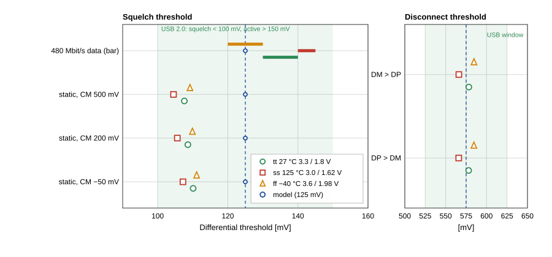

All thresholds lie inside the USB 2.0 windows at all three corners. The tightest margins are at ss / 125 °C: the static squelch threshold is 104.5 mV at 500 mV common mode (4.5 mV above the 100 mV limit), and on 480 Mbit/s data the squelch releases only from 145 mV (5 mV below the 150 mV limit). These margins have to absorb the random offsets of the preamps and comparators, which have not been simulated (11.1).

## 6. Functional description

### 6.1 HS receiver

```
vd       = V(RX_IN_P) − V(RX_IN_N) − v_off + noise
RX_OUT_P → 1   when vd > +v_hys / 2
RX_OUT_P → 0   when vd < −v_hys / 2       (holds in between)
RX_OUT_N = NOT RX_OUT_P;   delay t_dly = 0.3 ns, edges t_rf = 50 ps
```

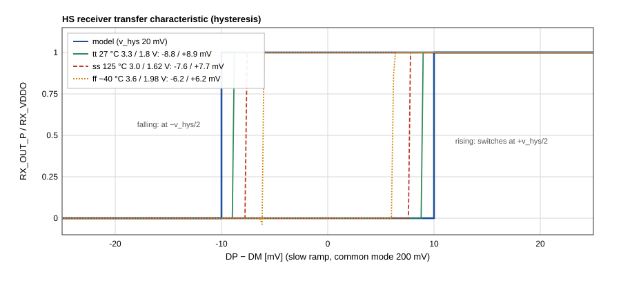

The hysteresis keeps the output from chattering on slow or noisy zero crossings; at 480 Mbit/s with 625 ps edges the input passes through the ±10 mV band in about 30 ps, so the hysteresis has no effect on the timing of valid data. It does not suppress noise on an idle line: noise larger than the hysteresis makes the output toggle at random while the line is idle. The digital tolerates this (the squelch gates SYNC detection; `LOCK_DLY` in `usb_afe_rx_if`); the model reproduces it with `v_noise` (default 0 here, 15 mV in `afe_hs_rx_bm`).

Transistor level: a thick-oxide PMOS pair (pch33 24/0.35, 200 µA tail, 3 kΩ poly loads; the line is at 0 … 0.5 V, so PMOS inputs) on `RX_VDD` feeds an Allstot / Baker comparator with cross-coupled loads on `RX_VDDO`. The ratio of the cross-coupled to the diode load width (2.55 / 2) sets the hysteresis; it is the place for the `RX_HYST` trim. The hysteresis shrinks at ff (12 mV) and grows at tt (18 mV), because the comparator gain changes with the corner.

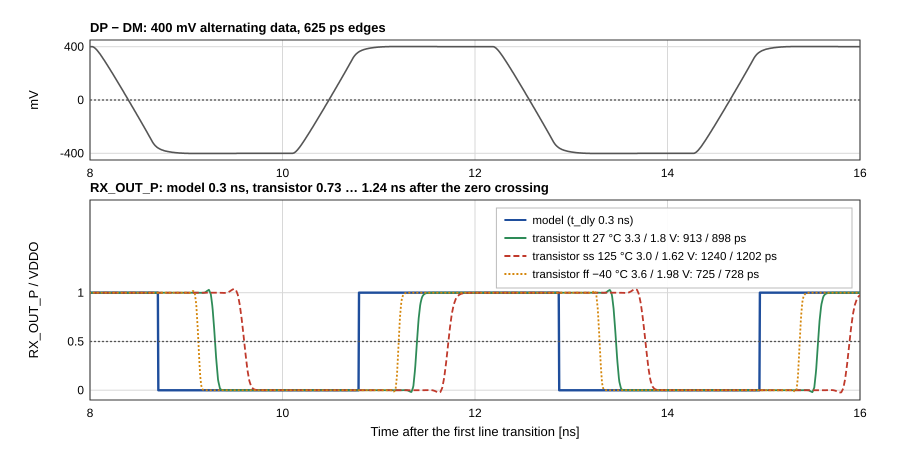

The transistor delay is 0.9 ns at tt (0.73 ns ff, 1.24 ns ss): preamp 0.14 ns, comparator core 0.28 ns, its mirror output stage 0.23 ns, output gates 0.23 ns. At 150 mV the delay grows by about 0.13 ns (tt) to 0.25 ns (ss), because the comparator gets less overdrive. Nothing in the digital depends on the absolute delay, since the CDR retimes the data; but the squelch / data alignment of spec 4.2 (A3) was derived with 0.3 ns (11.2).

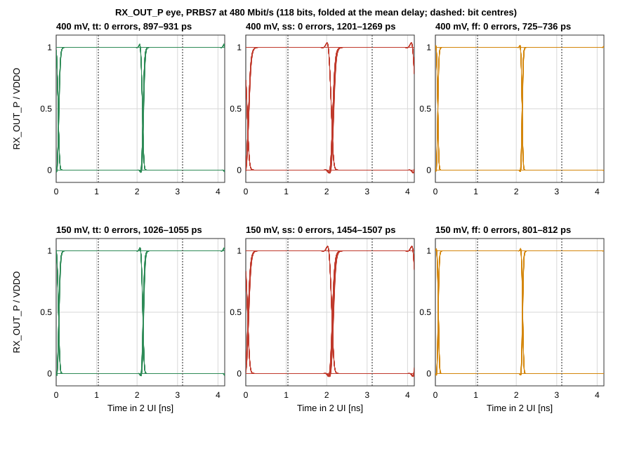

The pattern-dependent delay spread is 11–68 ps, about 3 % of a bit; with data at the USB minimum of 150 mV there are no bit errors in any corner.

### 6.2 Squelch detector

The line counts as active while |vd| > `v_sq` (125 mV). On HS data |vd| passes through zero at every transition, so the comparator output has short dips (about 0.2 ns per transition at 400 mV with 625 ps edges, longer at small amplitudes). Three timers turn this into a clean squelch signal:

| Timer | Model | Transistor | Function |
|---|---|---|---|
| Bridge `t_bridge` | 1 ns | 3 ns (60 fF ramp) | The envelope stays active across comparator dips shorter than this |
| On `t_sq_on` | 4 ns | 6 ns (125 fF) | The envelope must be active this long before `SQUELCH_A` falls |
| Off `t_sq_off` | 12 ns in total (bridge + 11 ns) | 10 ns after the bridge (190 fF), 13 ns in total | The envelope must be inactive this long before `SQUELCH_A` rises |

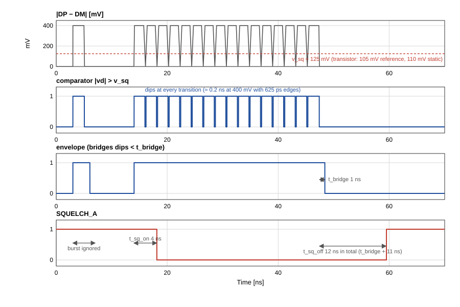

Both timers are inertial: activity shorter than `t_sq_on` − `t_bridge` (3 ns in both views) never releases the squelch, and a gap shorter than `t_sq_off` never asserts it. The release time is measured from the first line transition, the assertion time from the end of the last bit.

*Why the bridge:* without it every zero crossing restarted the release filter, and the squelch never released on alternating HS data. The first version of the model had this bug (found while writing `tb_afe_receiver`); `afe_squelch_bm.v` had it too and has the same bridge now.

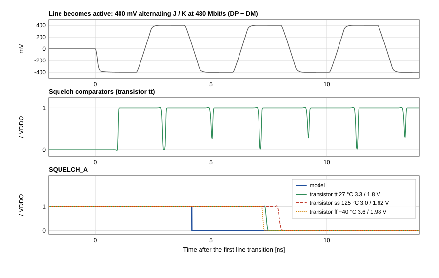

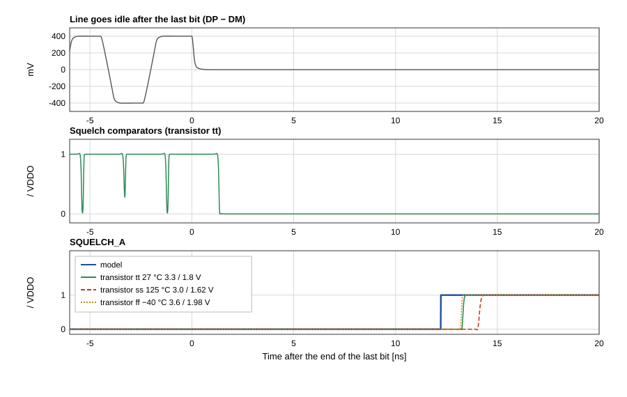

The transistor design releases about 3.3 ns later than the model (7.4 ns against 4.1 ns at tt): its on timer is 2 ns longer, and about 1.5 ns pass in the preamp and comparator before the timer starts. Assertion is 1.2 ns later (13.3 against 12.1 ns). Both stay inside the requirements of spec 4.2: release ≤ 12 ns costs no SYNC bits with the recommended digital setting (`HS_ZMIN` 4, `LOCK_DLY` 2), and a hold of 6 … 16.7 ns ends the packet within 8 bit times.

**Dynamic threshold.** The transistor squelch preamps see the opposite polarity every other bit and must recover from a −0.3 V swing before they can fire again. So on 480 Mbit/s data the squelch releases about 30 mV above its static threshold. The reference (105 mV) is deliberately below the model's 125 mV, so that both the static (≈ 110 mV) and the dynamic (≈ 140 mV) threshold land inside the 100 … 150 mV window.

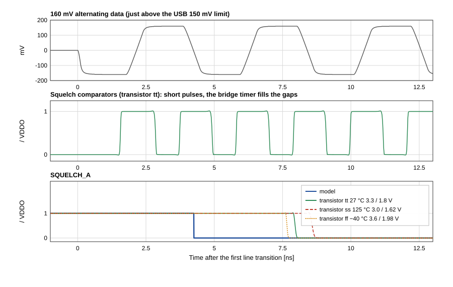

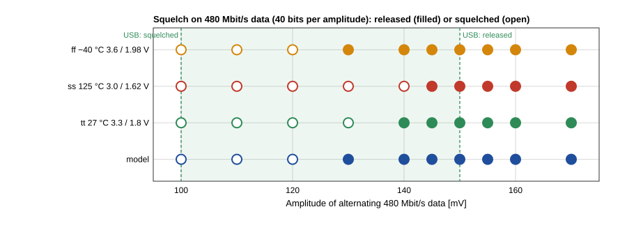

At 160 mV the transistor comparators are active for only about 0.5 ns per 2.08 ns bit; the 3 ns bridge fills the gaps of 1.6–1.8 ns. A 2 ns bridge chattered at tt. The model, with ideal comparators, needs only 1 ns.

### 6.3 Disconnect detector

`DISC_A` rises once |vd| has been above `v_disc` (575 mV) for `t_disc` (4 ns) and falls as soon as |vd| drops below it. A host samples it during the HS EOP: with the device attached the EOP is about 400 mV differential; when the device has gone, the host's driver sees only its own 45 Ω termination and the level doubles to about 800 mV.

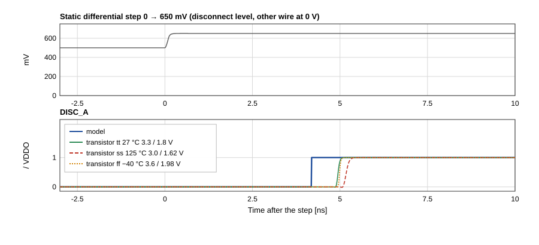

The transistor detector measures with one wire at 0 V, as during the EOP: thresholds 566–585 mV, delay 4.95–5.18 ns (1 ns of preamp and comparator delay before the 4 ns timer). It is not used by the device side of the PHY; the digital (`usb_rx_status_sync`) synchronizes it on `clk_bit` and ORs the 8 samples of each `clk60` tick, so a pulse of one bit time counts.

### 6.4 Enable, ready, UVLO

The receiver is on when `RX_EN` > `vth_logic` and V(`RX_VDD`) > `vdd_min` = 2.97 V (and V(`RX_VREF`) > `vref_min` when that check is enabled). Off, the outputs take their isolated values at once.

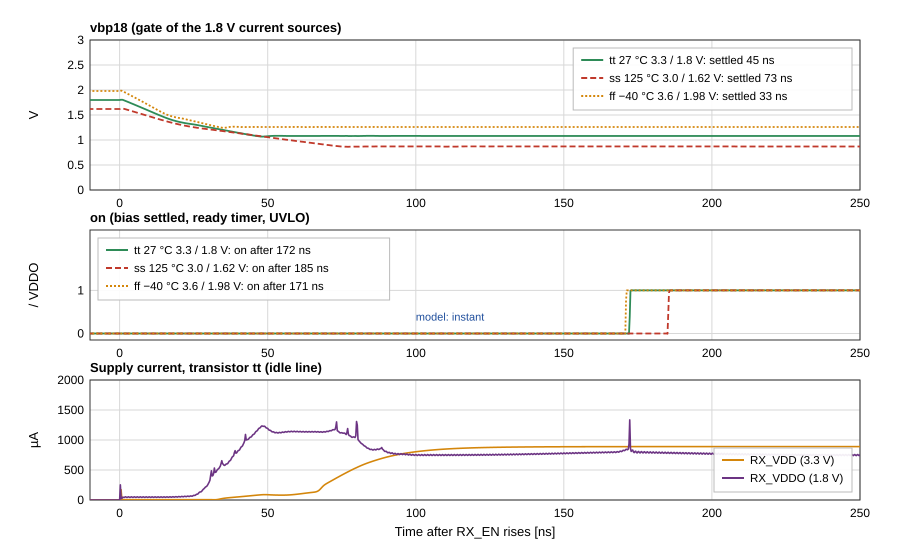

The transistor design needs time to start: the bias OTA settles in 33–73 ns, the 3.3 V current sources in about 80 ns. A ready timer therefore holds the outputs in their off state for about 170 ns (171–185 ns over the corners) after `RX_EN`; without it the comparators released `SQUELCH_A` and `DISC_A` for a few ns during start-up. The model turns on at once. The digital keeps `RX_EN` on for the whole of HS mode, so the turn-on time only matters after the chirp handshake and after resume (11.5).

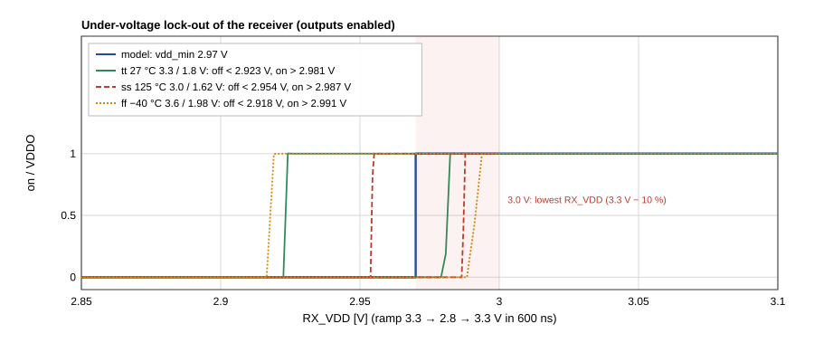

The transistor UVLO compares a divider of `RX_VDD` with I0 · RUV and has about 60 mV of hysteresis: off below 2.92–2.95 V, on above 2.98–2.99 V. Both edges stay below the 3.0 V minimum supply.

### 6.5 Supply domains and level shifting

The line sits at 0 … 0.5 V in HS mode but up to 3.6 V in FS / LS, so the input devices are 3.3 V thick-oxide transistors on `RX_VDD`. Their poly-resistor loads to ground keep every node that crosses into the 1.8 V domain below 0.6 V, so the 1.8 V comparators take them directly, without a level shifter. Everything after the preamps runs on `RX_VDDO`, and `RX_OUT_P` comes out at 1.8 V CMOS levels: this is the proposed 1.8 V output stage of Q8. The model allows `RX_VDDO` = `RX_VDD` (3.3 V outputs, today's analog block); the transistor netlist does not.

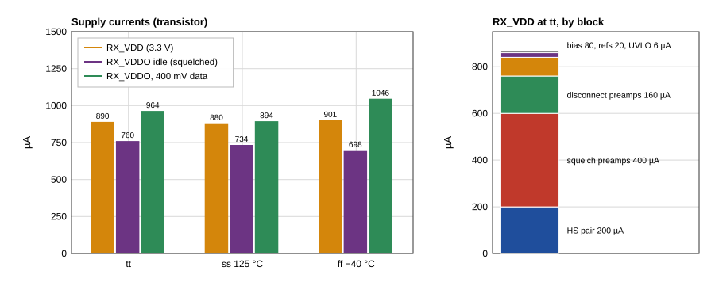

## 7. Timing

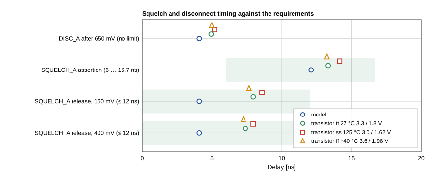

| Parameter | Model | Transistor tt | ss | ff | Requirement |
|---|---|---|---|---|---|
| DP − DM zero crossing → `RX_OUT_P` | 0.30 ns | 0.90–0.91 ns | 1.20–1.24 ns | 0.73 ns | < 1.5 ns (testbench) |
| `RX_OUT_P` edge time | 50 ps (linear) | load-dependent (20 fF) | | | |
| First line transition → `SQUELCH_A` = 0 | 4.1 ns | 7.39 ns (400 mV), 7.96 ns (160 mV) | 7.95 / 8.58 ns | 7.25 / 7.66 ns | ≤ 12 ns |
| End of the last bit → `SQUELCH_A` = 1 | 12.1 ns | 13.32 ns | 14.13 ns | 13.23 ns | 6 … 16.7 ns |
| Minimum activity that releases | 3 ns | 3 ns | | | a 2 ns burst is ignored |
| \|vd\| > 575 mV → `DISC_A` = 1 | 4.1 ns | 4.95 ns | 5.18 ns | 4.99 ns | — |
| \|vd\| < 575 mV → `DISC_A` = 0 | 0.1 ns | < 1 ns | | | — |
| `RX_EN` rise → outputs valid | 0 | 172 ns | 185 ns | 171 ns | — (11.5) |
| `RX_EN` fall → isolated outputs | 0.1–0.3 ns | < 1 ns | | | — |

Interaction with the digital (spec 4.2, A3 results): squelch release and CDR lock run in parallel. With `HS_ZMIN` 4 / `LOCK_DLY` 2 a squelch release up to 12 ns costs no SYNC bits, at 16 ns all packets with a 12-bit SYNC are lost. The transistor release (7.3–8.6 ns) leaves about 3.4 ns of margin. Rule of thumb from A3 for a 12-bit SYNC: squelch release / 2.08 ns + `LOCK_DLY` − `SQ_COMP` ≤ about 7 bits.

## 8. Model parameters

| Module | Parameter | Default | Range | Unit | Meaning |
|---|---|---|---|---|---|
| `afe_hs_rx` | `v_hys` | 20e-3 | ≥ 0 | V | Total hysteresis |
| | `v_off` | 0 | | V | Input offset |
| | `v_noise` | 0 | ≥ 0 | V | Peak of a uniform random input offset, redrawn every `t_noise` |
| | `t_noise` | 1e-9 | > 0 | s | Noise update interval |
| | `t_dly` | 0.3e-9 | ≥ 0 | s | Input → output delay |
| | `t_rf` | 50e-12 | > 0 | s | Output edge time |
| | `c_in` | 0 | ≥ 0 | F | Input capacitance per pin, to `RX_GND` |
| | `vdd_min` | 2.97 | | V | UVLO threshold on `RX_VDD` |
| | `vref_min` | 0 | | V | 0: `RX_VREF` not checked; > 0: off while V(`RX_VREF`) is below |
| | `r_vref` | 1e9 | > 0 | Ω | `RX_VREF` input resistance |
| | `vth_logic` | 0.9 | | V | `RX_EN` threshold |
| | `seed0` | 11 | | — | Noise seed |
| `afe_squelch` | `v_sq` | 125e-3 | > 0 | V | Squelch threshold on \|vd\| |
| | `t_sq_on` | 4e-9 | ≥ 0 | s | Envelope active → `SQUELCH_A` falls |
| | `t_sq_off` | 12e-9 | ≥ 0 | s | Line inactive (in total) → `SQUELCH_A` rises |
| | `t_bridge` | 1e-9 | ≥ 0 | s | Envelope bridge: comparator dips shorter than this are ignored |
| | `v_disc` | 575e-3 | > 0 | V | Disconnect threshold on \|vd\| |
| | `t_disc` | 4e-9 | ≥ 0 | s | Disconnect delay (inertial rise, immediate fall) |
| | `t_dly` | 0.1e-9 | ≥ 0 | s | Output stage delay |
| | `t_rf`, `vth_logic`, `vdd_min` | 50e-12, 0.9, 2.97 | | | As above |

The wrapper `afe_receiver` passes `v_hys`, `v_off`, `v_noise`, `t_dly` (HS receiver), `v_sq`, `t_sq_on`, `t_sq_off`, `t_bridge`, `v_disc` and `t_disc`; for the others, instantiate `afe_hs_rx` / `afe_squelch` directly.

To make the model behave like the transistor design at tt (for system simulations that care about the timing): `t_dly` = 0.9 ns, `v_hys` = 18 mV, `v_sq` = 110 mV (static; the transistor releases from 140 mV on data), `t_bridge` = 3 ns, `t_sq_on` ≈ 7 ns (6 ns timer + 1.5 ns preamp delay, minus the model's 0.1 ns output delay), `t_sq_off` = 13.2 ns, `t_disc` = 4.9 ns. The checker of `tb_afe_receiver_tr.scs` uses the same timing figures (`v_hys` 18 mV, `t_dly` 0.9 ns, `t_on` 7.3 ns, `t_off` 13.2 ns, `t_disc` 4.8 ns) with tolerances of 3 mV / 1 ns.

## 9. Dependencies

### 9.1 System context

| Connected to | Signal | Direction | Dependency |
|---|---|---|---|
| USB line (DP / DM), HS terminations | `RX_IN_P`, `RX_IN_N` | → RX | 45 Ω to ground at each end in HS mode; idle line at 0 V. The same wires carry FS / LS (up to 3.6 V) while the receiver is off |
| `afe_transceiver` (HS driver, terminations) | DP / DM | — | Own transmission is seen by the receiver too (the digital ignores the receiver while transmitting) |
| `afe_cdr` | `RX_OUT_P` → `CDR_DATA` | RX → | 1.8 V data. Delay and duty-cycle distortion of the receiver eat into the CDR's dither margin |
| `usb_afe_rx_if` | `rx_en_hs` → `RX_EN` | → RX | `clk60` flop; on in HS mode while the digital's `RX_EN` = 1 and not isolated |
| `usb_afe_rx_if` | `SQUELCH_A` | RX → | 2-FF synchronizer on `clk_rx`, `hs_cdr_lock` = `LOCK_DLY` bits after the release; `SQ_COMP` delays the data |
| `usb_rx_status_sync` | `SQUELCH_A`, `DISC_A` | RX → | Synchronized on `clk_bit`, one value per `clk60` tick, filtered (`sq_flt` 1, `disc_flt` 0). LineState in HS = `SQUELCH_A` (squelch = SE0, else J) |
| `usb_ulpi_phy_top` | `DISC_A` | RX → | `host_disc`, host mode only |
| Bias block | `RX_VREF` | → RX | 1.2 V reference (Q9). Sets every transistor threshold |
| `afe_ldo` / supplies | `RX_VDD`, `RX_VDDO` | → RX | 3.3 V and 1.8 V; `RX_VDDO` may be shared with the PLL / CDR domain |

### 9.2 Values that must stay consistent

| Value | Here | Also in | Consequence of a mismatch |
|---|---|---|---|
| Polarity `RX_OUT_P` = 1 ↔ DP > DM (J) | `afe_receiver.va` | `afe_hs_rx_bm.v`, `afe_cdr` (`HS_RXD` 1 = J), `usb_rx_hs_frontend`, Q3 | SYNC / EOP detection fails (NRZI data itself is polarity-free) |
| Isolated values 0 / 1 / 1 / 0 | `afe_receiver.va` | spec 3.2 / 3.5, `usb_afe_rx_if` (`sq_in` = `squelch_a` \| `iso_en`), `usb_rx_status_sync` reset values | Spurious receive activity or disconnects during isolation |
| Squelch release ≤ 12 ns, hold ≥ 6 ns | `t_sq_on`, `t_sq_off` | spec 4.2 A3, `HS_ZMIN` / `LOCK_DLY` / `SQ_COMP` defaults | Lost SYNC bits, late packet end |
| Squelch / disconnect thresholds | `v_sq`, `v_disc` | `afe_squelch_bm.v`, `tb_afe_receiver.va` checker | — |
| Timing and threshold behaviour | `afe_receiver.va` | `afe_hs_rx_bm.v` / `afe_squelch_bm.v` (`T_SQ_BRIDGE`) | Icarus shadows and AMS runs disagree |
| Pin order | `afe_receiver.va` | `afe_receiver_tr.sp`, `tb_ams_*.vams`, `tb_afe_receiver*.scs` | Netlist errors |

### 9.3 Enable sequence

1. Power-up: `RX_VDD`, `RX_VDDO` and `RX_VREF` present; `RX_EN` = 0, all outputs at their isolated values, no bias current.
2. HS mode (after the chirp handshake, XcvrSelect 00): `usb_afe_rx_if` sets `rx_en_hs` and `cdr_en`. The transistor receiver delivers valid outputs about 170 ns later; until then `SQUELCH_A` = 1.
3. Each packet: the line becomes active → `SQUELCH_A` falls within 12 ns → the digital takes `RX_OUT_P` through the CDR after `LOCK_DLY` bits → EOP → `SQUELCH_A` rises 6 … 16.7 ns after the last bit, which ends the packet.
4. Host mode: `DISC_A` is sampled during the HS EOP (disconnect = device gone).
5. Leaving HS (suspend, reset, FS / LS), isolation, or `RX_EN` = 0: `RX_EN` = 0, outputs isolated at once, bias off.

### 9.4 Trim and test registers (spec 6, not implemented in the AFE)

| Register | Field | Default | Intended use | Transistor hook |
|---|---|---|---|---|
| 32h `TRIM_RX` | [2:0] `RX_VTH` | 4 | HS / FS receiver threshold (offset) | — |
| 32h `TRIM_RX` | [5:3] `RX_HYST` | 4 | Hysteresis | cross-coupled width of XHS |
| 33h `TRIM_SQ` | [2:0] `SQ_VTH` | 4 | Squelch threshold | taps RR2 / RR3 of the reference string |
| 33h `TRIM_SQ` | [5:3] `DISC_VTH` | 4 | Disconnect threshold | taps RR1 … RR3 |
| 36h `TRIM_DLY` | [2:0] `LOCK_DLY`, [5:3] `SQ_COMP` | 2, 0 | Digital: lock delay and squelch compensation | — |

The model has no trim inputs; its parameters stand in for them.

### 9.5 Files

| File | Role |
|---|---|
| `AFE/veriloga/afe_receiver.va` | the model described here |
| `AFE/doc/receiver.md` | model description |
| `AFE/veriloga/tb/tb_afe_receiver.scs`, `tb_afe_receiver.va` | Spectre testbench and checker (`AFE/veriloga/tb/run_va_tests.sh receiver`) |
| `AFE/veriloga/tb/tb_afe_receiver_tr.scs` | same checks on the transistor netlist, with its figures and tolerances |
| `AFE/spice/afe_receiver_tr.sp` | transistor schematic |
| `AFE/spice/tb/tb_receiver_tr.py` | ngspice testbench (`seq`, `sqamp`, `dc0`, `dc2`, `dc5`) |
| `AFE/doc/receiver_schematic.md`, `AFE/spice/doc/rx_*.svg` | transistor schematic description, drawn sheets and results |
| `afe_hs_rx_bm.v`, `afe_squelch_bm.v` | Icarus behavioural models; tests `tb_afe_hs_rx`, `tb_afe_hs_chain` |
| `usb_afe_rx_if.v`, `usb_rx_status_sync.v` | digital counterparts |
| `AFE/ams/tb_ams_link.vams`, `tb_ams_mouse.vams`, `tb_ams_msc.vams` | AMS system tests with this model |
| `DOC/afe_interface_spec.md` 3.2, 3.5, 4.2, 6 | interface requirements, A3 squelch results, trims |
| `AFE/doc/receiver_datasheet/gen_figures.py`, `data/` | figure generator and transistor data for this datasheet (`data/extract_tr.py`) |

## 10. Design guidance

- **Squelch threshold window.** Static and dynamic thresholds must both lie in 100 … 150 mV including mismatch. The transistor design puts the reference at 105 mV, gets ≈ 110 mV static and ≈ 140 mV on data. The difference (≈ 30 mV) comes from preamp recovery; it shrinks with faster preamps (smaller load resistors, more current) and grows with slower ones. Check both after every change: `tb_receiver_tr.py dc0 dc2 dc5 sqamp`.
- **Preamp linearity.** The differential-difference preamps compare the line against a reference pair at the full threshold difference. Both pairs must stay in their linear range past the threshold: √2 · V_ov above the threshold (squelch 0.31 V > 0.105 V, disconnect 0.79 V > 0.56 V). Pairs in weak inversion saturate at about 100 mV and lose gain at the threshold.
- **Bridge against on timer.** The bridge must exceed the longest comparator gap on valid data at 150 mV (≈ 1.8 ns at tt, longer at ss); the shortest burst that releases is on − bridge, keep it at about 3 ns. The timers are capacitor ramps tripping at `RX_VDDO` / 2, so they shrink at low supply.
- **Release budget.** Release ≤ 12 ns including preamp and comparator delay (≈ 1.5 ns); assertion 6 … 16.7 ns after the last bit. The digital rule of thumb (A3) for a 12-bit SYNC: release / 2.08 ns + `LOCK_DLY` − `SQ_COMP` ≤ 7.
- **HS delay.** No limit from the digital, but keep the delay spread over patterns and amplitudes small against the CDR dither margin (today 11–68 ps).
- **Thresholds from one current.** Keep every reference a ratio of resistors of the same type and of `RX_VREF`; a trim should switch taps of the string, not change I0.
- **Input protection.** The pch33 gates see the FS / LS line (up to 3.6 V) while the receiver is off; ESD devices are not part of this block yet.

## 11. Open points

1. **Monte Carlo.** Random offsets of the squelch and disconnect preamps (gain ≈ 1 at the threshold) and comparators go straight into the thresholds; the HS pair's offset into the hysteresis centre. The squelch margins at ss / 125 °C are only 4.5 mV (static, 500 mV CM) and 5 mV (dynamic): check at 3σ with the xh018 mismatch models; the `SQ_VTH` trim is probably needed.
2. **HS receiver delay** is 0.9 ns at tt, three times the model's. Rerun the A3 squelch / data alignment of spec 4.2 with `t_dly` 0.9–1.25 ns, or speed up the comparator (a second linear stage instead of the mirror output stage).
3. **Squelch with real data.** The dynamic threshold is measured on alternating data with linear 625 ps edges. Check it with the USB receiver eye (template 4) and with ISI from a cable model.
4. **Power.** 4.7 mW at tt while on (4.1–5.3 mW over the corners); the squelch preamps take 400 µA of the 890 µA on `RX_VDD`. A shared pair for both polarities, or a lower-voltage input stage, could halve it.
5. **Turn-on time** (≈ 170 ns from `RX_EN`) needs a line in the interface spec and a check that `usb_afe_rx_if` never expects a valid squelch earlier.
6. **Noise and input protection.** No noise sources in the transistor runs (the model's `v_noise`), no ESD devices; the thick-oxide rating for 3.6 V on the gates while off must be confirmed with the xh018 rules.
7. **Trims.** `RX_VTH`, `RX_HYST`, `SQ_VTH`, `DISC_VTH` (32h / 33h) are not implemented in the model or the transistor design.
8. **FS / LS use (Q5).** Whether this receiver can also act as the FS / LS differential receiver (`RXRCV_A`) is open; today `RXRCV_A` comes from `afe_fsls_xcvr`. In chirp mode the digital needs `RXRCV_A` to resolve ±800 mV at the HS common mode.
9. **xh018 models and Spectre.** All transistor numbers use placeholder models (including the `nch33` / `pch33` cards). Redo them with the PDK, then run `tb_afe_receiver.scs`, `tb_afe_receiver_tr.scs` and the AMS system tests.

## 12. Not modelled

Frequency response and ISI of the receiver (it switches on the ideal differential voltage); common-mode rejection and common-mode range limits; the dependence of the squelch threshold on data pattern and edge rate (the transistor's dynamic threshold); preamp and comparator delays before the squelch and disconnect timers; the turn-on (ready) time; UVLO hysteresis; supply current; the trims; temperature and supply dependence. Use the figures of 8 to approximate the transistor timing.

## 13. How the numbers were obtained

| Source | Method | Figures / values |
|---|---|---|
| Transistor level | `afe_receiver_tr.sp` with ngspice 42 and `generic180.lib` (placeholder models), `AFE/spice/tb/tb_receiver_tr.py` at tt (27 °C, 3.3 / 1.8 V), ss (125 °C, 3.0 / 1.62 V) and ff (−40 °C, 3.6 / 1.98 V), runs of 2026-11-20 (same netlist as the `receiver_schematic.md` results). Line: current-steering driver into 45 Ω at each end (DP + DM = amplitude, idle at 0 V), 625 ps edges, through 500 Ω; 20 fF per output. Waveform windows cut by `data/extract_tr.py`; the printed results in `data/rx_<corner>_summary.txt` | All transistor values, Fig. 2–5, 7–15 |
| Model re-implementation | The `afe_receiver.va` equations (Schmitt trigger, squelch envelope with bridge / on / off timers, disconnect timer, output delays) evaluated sample by sample on the transistor run's V(DP) − V(DM) | Model curves in Fig. 3, 4, 6–11, 13; model timing 4.1 / 12.1 / 4.1 ns |
| Model documentation | `AFE/doc/receiver.md`, testbench windows of `tb_afe_receiver.va` | Parameters, 8 |
| Digital requirements | `DOC/afe_interface_spec.md` 3.2, 3.5, 4.2 (A3), 6 | Requirement columns, 7, 9 |

Regenerate the figures with `python3 AFE/doc/receiver_datasheet/gen_figures.py` (numpy and `rsvg-convert`, a few seconds). Rerun the transistor data with `python3 AFE/spice/tb/tb_receiver_tr.py --corner <c> --temp <T> --vdd <V> --vddo <V>` (ngspice, about 8 minutes per corner; it writes to `build/spice/`), move the `.dat` files of each corner into `build/spice/rx_<corner>/`, then run `python3 AFE/doc/receiver_datasheet/data/extract_tr.py` and copy the printed results to `data/rx_<corner>_summary.txt`.

## 14. Revision history

| Revision | Date | Change |
|---|---|---|
| 0.1 | 2026-11-20 | First issue, based on `afe_receiver.va` of 2026-11-11 and `afe_receiver_tr.sp` of 2026-11-13 |
