# afe_transceiver — USB 2.0 Line Transceiver (HS Driver, FS / LS Transceiver, Terminations) — Datasheet

*Datasheet of the line transceiver model `AFE/veriloga/afe_transceiver.va` (modules `afe_hs_tx`, `afe_fsls_xcvr`, `afe_term`, `afe_transceiver`), the part of the USB 2.0 ULPI PHY that drives and loads DP / DM. Revision 0.1, 2026-11-20. It describes the behaviour of the Verilog-A model with its default parameters. The transistor-level design `AFE/spice/afe_transceiver_tr.sp` exists, and its simulated values are listed next to the model values. Those simulations use ngspice 42 and the placeholder 180 nm models `generic180.lib`, not the xh018 PDK. The Verilog-A model has not been run in Spectre yet. The model curves in this datasheet come from a re-implementation of the model equations driven by the same stimulus and loads as the transistor runs (see 13).*

Figures: `fig/` (SVG; PNG copies for Word), generated by `gen_figures.py`. Related documents: [AFE/doc/transceiver.md](../transceiver.md) (model description), [AFE/doc/transceiver_schematic.md](../transceiver_schematic.md) (transistor schematic), [AFE/doc/receiver_datasheet/receiver_datasheet.md](../receiver_datasheet/receiver_datasheet.md) (the HS receiver and squelch on the same wires), `DOC/afe_interface_spec.md` sections 3.1, 3.4, 3.5, 4.1, 4.4 and 6 (AFE ↔ digital interface).

## 1. Overview

`afe_transceiver` holds everything that drives or loads the USB line apart from the HS receiver. It has three parts on one DP / DM pair:

- **HS transmitter** (`afe_hs_tx`): a 17.78 mA current-mode driver. It steers the current into DP (J) or DM (K). Into the 45 Ω terminations at both ends this gives ±400 mV; into one 45 Ω (chirp) about 800 mV. It is the model of the analog team's existing HS TX block.
- **FS / LS transceiver** (`afe_fsls_xcvr`): two 3.3 V voltage-mode drivers with FS (12 Mbit/s) and LS (1.5 Mbit/s) edge rates, and the three FS / LS receivers: single-ended `RXDP_A`, `RXDM_A` and differential `RXRCV_A`.
- **Terminations and pulls** (`afe_term`): the 1.5 kΩ DP pull-up (device attach, chirp), the 45 Ω HS terminations on DP and DM, and the 15 kΩ pull-downs (host / OTG).

The HS receiver, squelch and disconnect detector are in `afe_receiver`; the line itself (cable, far end) is in the testbenches.

**Features**

- HS current 17.78 mA × `i_scale` (amplitude trim `TX_AMP`), ±400 mV into 22.5 Ω (USB 360 … 440 mV); transistor 17.76 mA at tt, steady-state levels 397 … 407 mV at all corners, within 0.1 % from DP = 0 to 0.8 V.
- `TX_EN` settling: the model puts current on the line `t_en` = 20 ns after `TX_EN`. The transistor design sends the current into a 22.5 Ω dump first and hands it to the line 14.1 … 17.3 ns after `TX_EN` (ready timer), before the first SYNC bit at 20.8 ns (`TX_LEAD` = 10). The line stays quiet (< 5 mV) for at least `t_en` / 2 = 10 ns.
- HS edges: model 625 ps linear 0–100 % (500 ps 10–90 %, the USB minimum), delay 0.81 ns to the 50 % point. Transistor 10–90 % 0.53 … 1.11 ns and delay 0.69 … 1.34 ns over the corners; eye margin to USB template 1 at least +55 mV.
- `TX_IN_P` = `TX_IN_N` splits the current half / half (no differential signal); the model reports any such state longer than 0.1 ns (`skew_err`).
- FS / LS drivers: 45 Ω (transistor 32 … 39 Ω, USB 28 … 44 Ω); FS edges 12.5 ns / LS 187.5 ns 0–100 % (10 / 150 ns 10–90 %; transistor FS 10.0 … 11.3 ns, LS 117 … 146 ns). FS J = DP high, LS J = DM high; `FS_SE0_A` overrides `FS_DAT_A`.
- Receivers: single-ended threshold 1.4 V ± 0.1 V (transistor 1.20 … 1.64 V, USB 0.8 … 2.0 V); differential ±100 mV (transistor −79 … +57 mV, USB sensitivity 200 mV); delay 2 ns (transistor 1.7 … 2.8 ns at FS).
- Terminations: 1.5 kΩ, 45 Ω, 15 kΩ (transistor 1.47 … 1.53 kΩ, 44.5 … 46.0 Ω, 14.5 … 15.0 kΩ).
- Two supplies: `VDD33` for everything on the line, `VDD18` for the logic inputs and the receiver outputs (0 … V(`VDD18`)). All logic inputs are 1.8 V levels; the 480 Mbit/s path has no level shifter (Q8).
- Off state (`TX_EN` = 0, `FS_OE_A` = 0, `FS_RX_EN_A` = 0, or `VDD33` < 2.97 V): no driver current on the line, `RXDP_A` = `RXDM_A` = 0, `RXRCV_A` = 1 (the isolated values of spec 3.4); the pulls and terminations follow their own enables.

**Views and status**

| View | File | Status |
|---|---|---|
| Verilog-A model | `AFE/veriloga/afe_transceiver.va` | Written 2026-11-11. Not simulated in Spectre (no simulator here) |
| Spectre testbench | `AFE/veriloga/tb/tb_afe_transceiver.scs` + checker `tb_afe_transceiver.va` | Written, not run |
| Icarus behavioural models | `afe_hs_tx_bm.v`, `afe_fsls_bm.v`, `afe_term_bm.v` (repository root) | Same behaviour; used by `tb_usb_afe_tx_if`, `tb_usb_afe_fsls`, `tb_usb_afe_chirp`, `tb_usb_afe_rx_if`, `tb_afe_hs_chain`, `tb_afe_line` and the AMS shadows. `afe_term_bm` also has a DM pull-up for LS-device testbenches |
| Transistor schematic | `AFE/spice/afe_transceiver_tr.sp` (318 MOSFETs) | ngspice: tt and ff pass all checks; ss fails one testbench window (HS delay 1.34 ns against 1.3 ns, no USB limit; section 5). No layout, no Monte Carlo |
| Spectre transistor testbench | `AFE/veriloga/tb/tb_afe_transceiver_tr.scs` | Same checker with the transistor figures. Not run |
| AMS system tests | `AFE/ams/tb_ams_link.vams`, `tb_ams_mouse.vams`, `tb_ams_msc.vams` (through `ams_phy_end.v`, `ams_ulpi_phy.v`) | Instantiate `afe_transceiver` on both ends of the link. Not run |

## 2. Block diagram

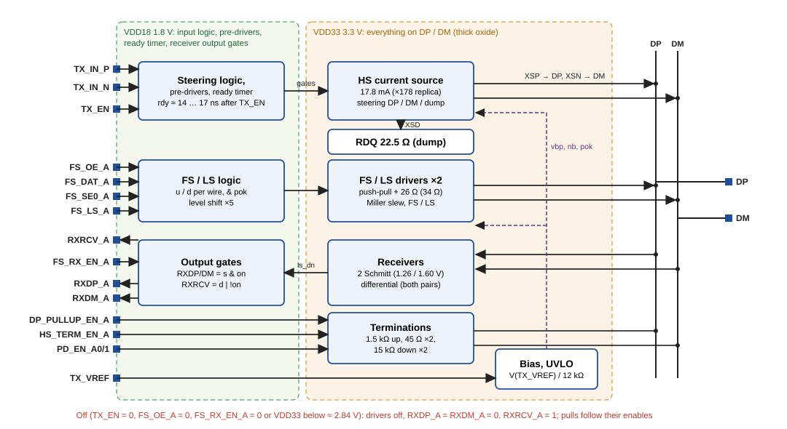

**HS path.** `TX_IN_P` / `TX_IN_N` / `TX_EN` are 1.8 V logic. The steering logic and pre-drivers on `VDD18` switch three thick-oxide steering switches (XSP → DP, XSN → DM, XSD → dump) under one 17.8 mA current source on `VDD33`. While the ready timer runs (`rdy` = 0) the current flows into the 22.5 Ω dump RDQ, which has the same resistance as the line, so the source settles at its final operating point; then `rdy` hands it to the line.

**FS / LS path.** A push-pull driver per wire with a 26 Ω series resistor and Miller capacitors that set a fixed slope (FS or LS gate current). The FS / LS logic forms pull-up / pull-down commands per wire and shifts them to 3.3 V.

**Receivers.** Two CMOS Schmitt triggers on `VDD33` (single-ended) and a rail-to-rail differential comparator (NMOS and PMOS pair summed) with hysteresis; their outputs are shifted down to 1.8 V and gated with `on` = `FS_RX_EN_A` & `pok`.

**Bias and UVLO.** A reference current V(`TX_VREF`) / 12 kΩ sets the HS current (through a 2/356 replica of the output branch) and all bias currents. A comparator on a `VDD33` divider produces `pok`, which disables the HS and FS / LS drivers and isolates the receivers below about 2.84 V; the pulls and terminations follow their enables only.

The model has none of this structure: an ideal current source with `transition()` steering, two voltage sources behind `r_out`, ideal threshold comparators and resistors with switch transitions.

## 3. Pin description

| Pin | Dir | Domain | Function | Off / isolated | Digital signal |
|---|---|---|---|---|---|
| `TX_IN_P` | in | 1.8 V | HS data, 1 = J (DP driven) | idle clamp 1 | `hs_tx_p` (`usb_tx_piso`) |
| `TX_IN_N` | in | 1.8 V | Complement of `TX_IN_P` (separate flop) | idle clamp 0 | `hs_tx_n` |
| `TX_EN` | in | 1.8 V | HS current on (settles `t_en` later) | 0 | `hs_tx_en` |
| `TX_I_5U` | in | analog | Bias current input (`bias_mode` 2 only); 1 GΩ to GND otherwise. Unused in the transistor design | — | — (Q9) |
| `TX_VREF` | in | analog | 1.2 V reference (`bias_mode` 1). **Required** by the transistor design: it sets every bias current | — | — (bias block, Q9) |
| `TX_CAP_P`, `TX_CAP_N` | inout | analog | Coupled to DP / DM through `r_cap` (default 1 TΩ = open) | — | — (Q10) |
| `FS_OE_A` | in | 1.8 V | FS / LS drivers on | 0 | `fs_oe` |
| `FS_DAT_A` | in | 1.8 V | 1 = J at the selected speed | 1 | `fs_dat` |
| `FS_SE0_A` | in | 1.8 V | Drive SE0 (overrides `FS_DAT_A`) | 0 | `fs_se0` |
| `FS_LS_A` | in | 1.8 V | 1 = LS edge rate and LS J polarity | 0 | `fs_ls` |
| `FS_RX_EN_A` | in | 1.8 V | FS / LS receivers on (new pin, keep high in suspend for resume detection) | — | none yet (see 11) |
| `RXRCV_A` | out | 0 … VDD18 | Differential receiver, 1 = DP > DM | 1 | `rxrcv` (`usb_rx_datapath`) |
| `RXDP_A`, `RXDM_A` | out | 0 … VDD18 | Single-ended receivers | 0, 0 | `rxdp`, `rxdm` |
| `DP_PULLUP_EN_A` | in | 1.8 V | 1.5 kΩ DP pull-up to VDD33 | 0 | `dp_pullup_en` (`usb_mode_term_ctrl`) |
| `HS_TERM_EN_A` | in | 1.8 V | 45 Ω from DP and from DM to GND | 0 | `hs_term_en` |
| `PD_EN_A0`, `PD_EN_A1` | in | 1.8 V | 15 kΩ DP / DM pull-downs | 0 | `dp_pulldown_en`, `dm_pulldown_en` |
| `DP`, `DM` | inout | 0 … VDD33 | USB line (through the ESD pads) | high impedance | — |
| `VDD33` | supply | 3.3 V | Line supply: HS current, FS / LS drivers, pulls, receivers' input stages, bias, UVLO | — | — |
| `VDD18` | supply | 1.8 V | Logic inputs, pre-drivers, ready timer, receiver output levels | — | — |
| `GND` | supply | | Common ground | — | — |

The pin order of the Verilog-A module is that of the table (from `TX_IN_P` to `GND`); `afe_transceiver_tr.sp`, `ams_phy_end.v` and the testbenches use the same order. In `afe_hs_tx` the outputs are called `TX_OUT_P` / `TX_OUT_N` and the supplies `TX_VDD` / `TX_GND`; the wrapper connects them to `DP`, `DM`, `VDD33`, `GND`.

## 4. Operating conditions

| Parameter | Min | Typ | Max | Note |
|---|---|---|---|---|
| `VDD33` | 3.0 | 3.3 | 3.6 V | Model: `sup_ok` above `vdd_min` = 2.97 V. Transistor UVLO: off below 2.83 … 2.84 V, on above 2.94 … 2.95 V |
| `VDD18` | 1.62 | 1.8 | 1.98 V | Sets the logic input levels and the receiver output swing |
| `TX_VREF` | | 1.2 | V | Transistor: HS current ∝ V(`TX_VREF`) (17.78 mA at 1.2 V). Model: ignored unless `bias_mode` = 1 |
| Logic input threshold | | 0.9 | V | Model `vth_logic`, fixed; transistor ≈ VDD18 / 2 |
| Junction temperature | −40 | 27 | 125 °C | Corners simulated: tt 27 °C, ss 125 °C, ff −40 °C |
| DP, DM | 0 | | VDD33 | No protection above VDD33 or with VDD33 = 0 (open point 5) |
| HS load | | 45 Ω ‖ 45 Ω, 2 pF / wire | | Both ends terminated; chirp: one 45 Ω |
| FS load | | 50 pF / wire | | Host 15 kΩ pull-downs, device 1.5 kΩ pull-up |
| LS load | 200 | | 600 pF / wire | Host 15 kΩ pull-downs |

## 5. Electrical characteristics

Model values are the defaults of `afe_transceiver.va`. Transistor values are ngspice results at tt (27 °C, VDD33 3.3 V, VDD18 1.8 V), ss (125 °C, 3.0 / 1.62 V) and ff (−40 °C, 3.6 / 1.98 V) with `TX_VREF` = 1.2 V.

### 5.1 HS transmitter

| Parameter | Model | tt | ss | ff | Requirement |
|---|---|---|---|---|---|
| HS current (J into 0.4 V) | 17.78 mA | 17.76 mA | 17.77 mA | 17.77 mA | 17.78 mA (400 mV into 22.5 Ω) |
| Current change, DP = 0 / 0.8 V, VDD33 = 3.0 V | 0 (above `v_compl`) | < 0.05 % | < 0.09 % | < 0.03 % | testbench < 1 % |
| `TX_IN_P` = `TX_IN_N` | half / half | 8.91 / 8.91 mA | 8.95 / 8.95 mA | 8.90 / 8.90 mA | half / half |
| Steady-state level, magnitude of DP − DM (3rd bit of a run) | 400 mV | 399.4 … 401.6 mV | 404.9 … 407.2 mV | 396.9 … 398.5 mV | 360 … 440 mV (USB) |
| Every bit centre | 400 mV | 399.4 … 404.0 mV | 389.0 … 407.7 mV | 396.9 … 401.6 mV | 360 … 440 mV |
| `TX_EN` → current on the line | 20 ns (`t_en`) | 16.0 ns | 14.1 ns | 17.3 ns | ≥ 10 ns quiet; ≤ 20.8 + 0.5 ns (10-bit lead) |
| First SYNC bit vs steady state | 0 % | +0.8 % | −1.2 % | +0.4 % | ≤ 2 % (testbench) |
| `TX_IN` → line delay (50 %) | 0.81 ns | 0.90 ns | 1.31 ns | 0.70 ns | constant (spec 4.1, Q4); testbench 0.5 … 1.3 ns |
| Edges 10–90 % | 500 ps (625 ps 0–100 %) | 669 … 716 ps | 1003 … 1109 ps | 533 … 557 ps | ≥ 500 ps (USB) |
| Crossing jitter, 94 edges | 0 | 29.1 ps p-p | 92.8 ps p-p | 18.6 ps p-p | ≤ 100 ps (testbench) |
| Eye margin to template 1 inner hexagon; peak | — ; 400 mV | +91 mV; 410 mV | +55 mV; 417 mV | +94 mV; 411 mV | ≥ 0; ≤ 475 mV |
| `TX_EN` falls → DP − DM within ±5 mV | ≈ 1.1 ns (`t_dly` + `t_rf_hs`) | 2.34 ns | 3.33 ns | 1.88 ns | — |
| Device chirp K, DM − DP (pull-up on, host 45 Ω) | 704 mV (DP 96 mV) | 702 mV (DP 97) | 713 mV (DP 86) | 693 mV (DP 107) | 500 … 900 mV (V_CHIRPK) |
| Line current with `TX_EN` = 0 or VDD33 < UVLO | 0 | 0.18 / 0.13 nA | 22.1 / 19.9 nA | 0.07 / 0.04 nA | < 1 µA |
| VDD33 / VDD18 current while sending | 17.78 mA / 0 | 18.32 / 0.55 mA | 18.23 / 0.50 mA | 18.44 / 0.59 mA | — |

### 5.2 FS / LS drivers

| Parameter | Model | tt | ss | ff | Requirement |
|---|---|---|---|---|---|
| Output impedance high / low | 45 Ω | 34.6 / 33.5 Ω | 38.6 / 36.0 Ω | 32.8 / 32.4 Ω | 28 … 44 Ω |
| FS edges 10–90 %, 50 pF | 11.3 ns | rise 10.5 … 11.1, fall 10.0 … 10.5 ns | 10.8 … 11.3 / 10.1 … 10.6 ns | 10.6 … 11.2 / 10.2 … 10.7 ns | 4 … 20 ns |
| FS rise / fall matching | 100 % | 105.5 % | 106.5 % | 104.3 % | 90 … 111 % |
| FS crossover | 1.65 V | 1.67 … 1.74 V | 1.54 … 1.61 V | 1.80 … 1.85 V | 1.3 … 2.0 V |
| VOH / VOL (15 kΩ) | VDD33 / 0 | 3.292 V / 72 mV | 2.992 V / 68 mV | 3.592 V / 77 mV | ≥ 2.8 V / ≤ 0.3 V |
| LS edges rise / fall, 200 pF | 150.5 ns | 121 / 125 ns | 118 / 117 ns | 122 / 133 ns | 75 … 300 ns |
| LS edges rise / fall, 600 pF | 158.5 ns | 140 / 142 ns | 146 / 141 ns | 137 / 146 ns | 75 … 300 ns |
| LS matching / crossover | 100 % / 1.65 V | 96 … 99 % / 1.76 … 1.79 V | 101 … 103 % / 1.60 … 1.64 V | 92 … 94 % / 1.92 … 1.94 V | 80 … 125 % / 1.3 … 2.0 V |
| Released DM after `FS_OE_A` falls | 0 V | −187 mV after 3 ns; −65 mV 100 ns later | −67 mV | −176 mV; −60 mV | settles to 0 V |
| VDD33 current, FS packet (50 pF) | — | 3.14 mA | 2.80 mA | 3.49 mA | — |

### 5.3 FS / LS receivers

| Parameter | Model | tt | ss | ff | Requirement |
|---|---|---|---|---|---|
| Single-ended threshold rising / falling | 1.5 / 1.3 V | 1.600 / 1.256 V | 1.561 / 1.203 V | 1.638 / 1.303 V | inside 0.8 … 2.0 V |
| `RXRCV_A` switching points, CM 0.4 V | ±100 mV | +34 / −63 mV | +54 / −79 mV | +22 / −54 mV | within ±200 mV (USB sensitivity); testbench ±100 mV |
| CM 0.8 V | ±100 mV | +28 / −36 mV | +42 / −52 mV | +21 / −24 mV | |
| CM 1.65 V | ±100 mV | +24 / −21 mV | +30 / −28 mV | +20 / −16 mV | |
| CM 2.5 V | ±100 mV | +32 / −22 mV | +57 / −36 mV | +21 / −15 mV | |
| `RXRCV_A` delay after DP = DM, FS; LS | 2 ns | 1.9 … 2.2; 2.8 … 3.6 ns | 2.4 … 2.8; 3.5 … 4.4 ns | 1.7 … 1.9; 2.4 … 3.0 ns | testbench 1.5 … 3.0 ns (FS) |
| `RXDP_A` / `RXDM_A` skew (FS) | 0 (same delay) | 2.1 ns | 1.8 ns | 2.5 ns | ≤ 5 ns (spec 4.4) |
| Bit errors on the own packet (FS, LS 200 / 600 pF) | 0 | 0 | 0 | 0 | 0 |
| Isolated values (`FS_RX_EN_A` = 0 or UVLO) | 0 / 0 / 1 | 0 / 0 / 1 | 0 / 0 / 1 | 0 / 0 / 1 | `RXDP_A` / `RXDM_A` / `RXRCV_A` = 0 / 0 / 1 |

### 5.4 Terminations, UVLO and static current

| Parameter | Model | tt | ss | ff | Requirement |
|---|---|---|---|---|---|
| DP pull-up (to VDD33) | 1.5 kΩ | 1491 Ω | 1532 Ω | 1473 Ω | 1.425 … 1.575 kΩ (testbench; USB idle from 0.9 kΩ) |
| HS termination (0.2 … 0.4 V) | 45 Ω | 44.95 Ω | 46.01 Ω | 44.52 Ω | 40.5 … 49.5 Ω |
| Pull-downs | 15 kΩ | 14.65 kΩ | 14.97 kΩ | 14.53 kΩ | 14.25 … 24.8 kΩ |
| UVLO off / on | 2.97 V (no hysteresis) | 2.835 / 2.945 V | 2.838 / 2.939 V | 2.833 / 2.948 V | on at 3.0 V |
| Line leakage, all off (DP = DM = 1.65 V) | 0 | 0.1 nA | 16.9 nA (junctions, 125 °C) | < 0.1 nA | < 1 µA |
| VDD33 current, all off (DP = DM = 0) | 0 | 565 µA | 476 µA | 689 µA | — (open point 2) |
| VDD33 current, all off, line at 1.65 V | 0 | 948 µA | 697 µA | 1296 µA | — (Schmitt triggers' crowbar current) |

## 6. Functional description

### 6.1 HS transmitter

**Current steering.** While settled, the model drives `i_hs` · `i_scale` · `kb` (17.78 mA) from `VDD33` into DP for `TX_IN_P` = 1, `TX_IN_N` = 0 (J), into DM for 0 / 1 (K), and half into each for `TX_IN_P` = `TX_IN_N`. The steering shares `fp`, `fm` follow the inputs through `transition()` with delay `t_dly` (0.5 ns) and linear ramps of `t_rf_hs` (0.625 ns). Each output current falls off smoothly within `v_compl` (0.3 V) of `VDD33` (tanh, 50 mV wide), which only matters for open lines. `r_out` (1 MΩ) and `c_out` (0) load each output to `GND`.

**`TX_EN` settling.** `TX_EN` rising starts a timer of `t_en` (20 ns); the outputs get current only when it expires with `TX_EN` still high and `VDD33` > `vdd_min`. `TX_EN` falling or `VDD33` dropping below `vdd_min` cancels it at once (the current ramps off with `t_dly` / `t_rf_hs`). The digital leads `TX_EN` by `TX_LEAD` bits and shows J during the lead, so the line shows at most one bit of J before SYNC when `TX_LEAD` = ⌈`t_en` / 2.083 ns⌉ = 10 (spec 4.1, A2).

In the transistor design `TX_EN` closes the enable switch at once and the current flows into the dump RDQ; the ready timer (a 0.085 pF capacitor discharged by about 5 µA) hands it to DP / DM 14.1 … 17.3 ns later. A 1 pF capacitor cancels the charge that the turn-on pulls out of the current-source gate, so the source has settled when the line gets the current; the first SYNC bit is within 1.2 % of the steady level (Fig. 2).

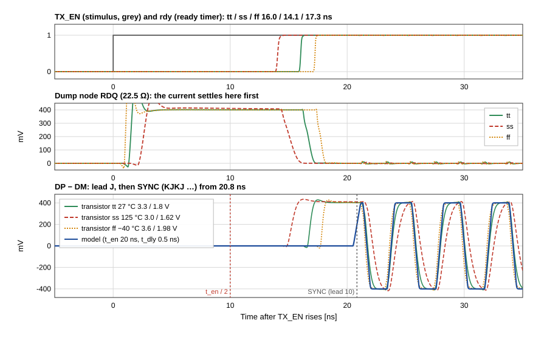

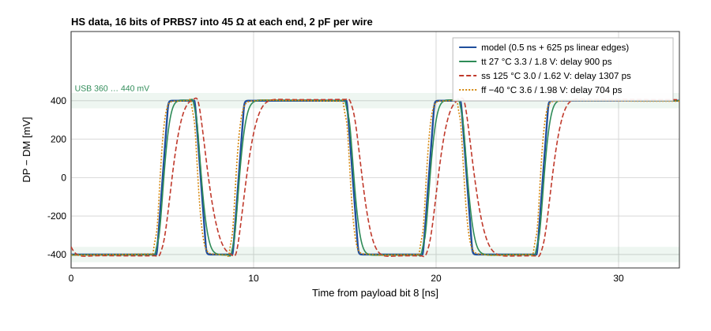

**Eye.** Fig. 4 folds bits 40 … 158 of the packet (PRBS7 after SYNC) at the mean delay. All three corners stay outside the inner hexagon of USB 2.0 template 1 (300 mV between 37.5 % and 62.5 % UI); the smallest margin is +55 mV at ss, where the slow edges (1.0 … 1.1 ns) close the eye most. Fig. 5 puts the HS figures of each corner against their limits.

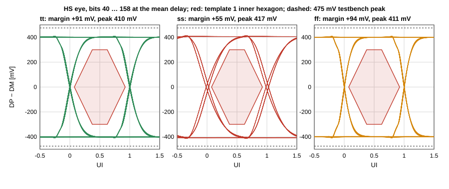

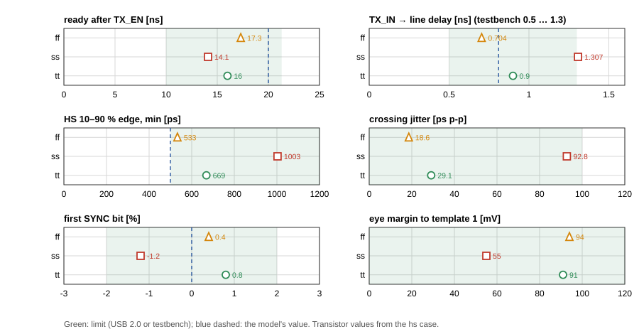

**P / N check.** `TX_IN_P` = `TX_IN_N` while settled for longer than `t_skew_max` (0.1 ns) prints a message and increments `skew_err`. `usb_tx_piso` drives both from separate flops on the same `clk_bit` edge, so only a boundary skew or a glitch triggers it. The transistor design splits the current into two equal halves (8.9 mA each) and opens one switch before the other closes (make before break), so the source never floats.

**Bias modes** (Q9): `bias_mode` 0 (default) uses `i_hs` as given, 1 scales it by V(`TX_VREF`) / `vref_nom` (1.2 V), 2 holds `TX_I_5U` at `v_i5u` (0.6 V) and scales by the current into it / 5 µA. The transistor design behaves as `bias_mode` 1. `TX_CAP_P/N` (Q10) connect to DP / DM through `r_cap` (1 TΩ by default, open).

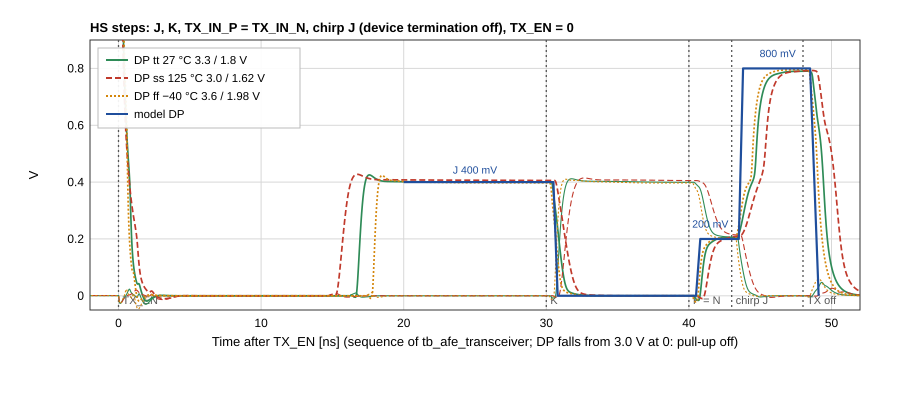

**Chirp.** With the device termination off and the host's 45 Ω on, the full current flows into one 45 Ω: DM = 800 mV for a K. With the 1.5 kΩ pull-up still on (device chirp K), DP sits at 3.3 V · 45 / 1545 = 96 mV, so DM − DP ≈ 704 mV (A6, spec 4.1; transistor 693 … 713 mV).

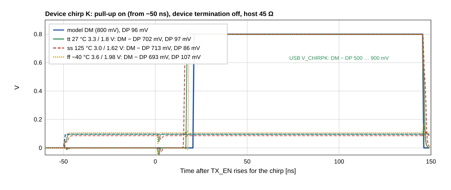

### 6.2 FS / LS drivers

| `FS_OE_A` | `FS_SE0_A` | `FS_LS_A` | `FS_DAT_A` | DP | DM | Line state |
|---|---|---|---|---|---|---|
| 0 | x | x | x | off | off | high impedance |
| 1 | 1 | x | x | 0 | 0 | SE0 |
| 1 | 0 | 0 | 1 | VDD33 | 0 | FS J |
| 1 | 0 | 0 | 0 | 0 | VDD33 | FS K |
| 1 | 0 | 1 | 1 | 0 | VDD33 | LS J |
| 1 | 0 | 1 | 0 | VDD33 | 0 | LS K |

The model drives each wire from a voltage source 0 … V(`VDD33`) behind `r_out` (45 Ω). The source ramps linearly in `t_fs` (12.5 ns) or `t_ls` (187.5 ns), so the 10–90 % time at the source is 10 / 150 ns; the `r_out` · C time constant of the line (2.25 ns at 50 pF, 27 ns at 600 pF) stretches it to 11.3 ns (FS, 50 pF) and 150.5 / 158.5 ns (LS, 200 / 600 pF) on the wire. `FS_OE_A` switches the conductance in `t_oe` = 1 ns. In the transistor design Miller capacitors fix the slope instead of the time, so the edge time depends less on the load (LS 121 ns at 200 pF, 140 ns at 600 pF), and the drivers have 34 Ω instead of 45 Ω. The transistor edge also starts later than the model's: the 50 % point comes 3 … 5 ns later than in the model at FS and about 35 … 50 ns later at LS (section 7, Fig. 9).

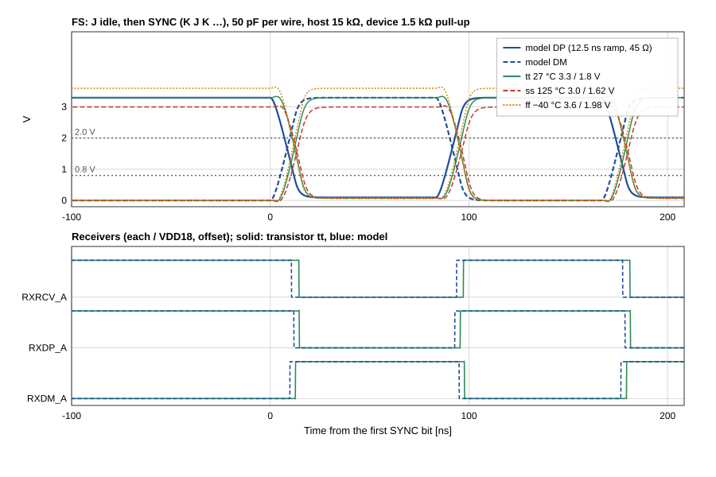

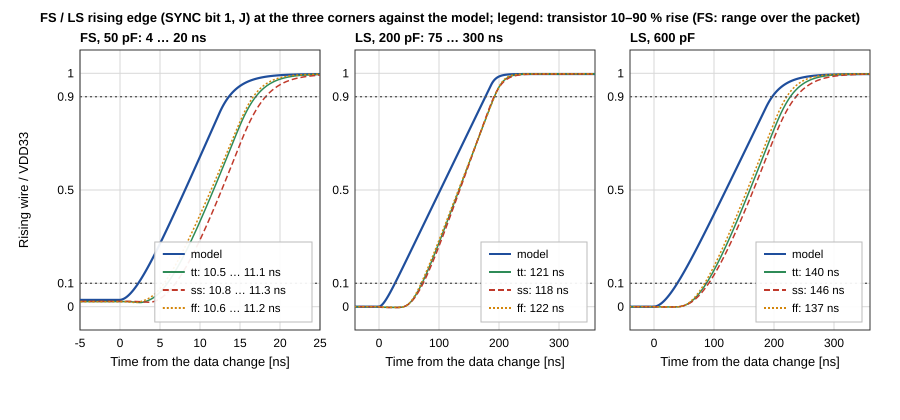

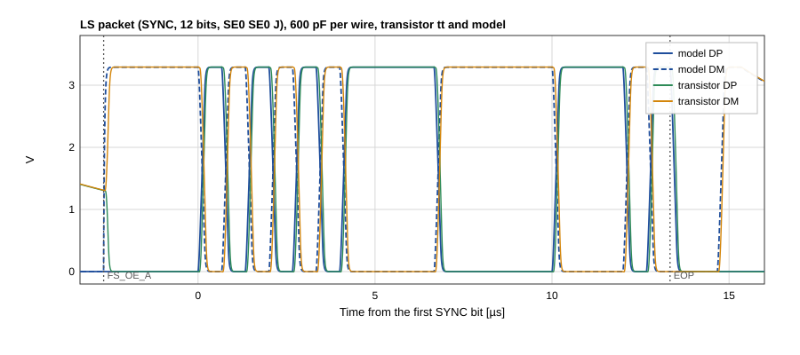

**Released line.** When `FS_OE_A` falls, the transistor driver switches its output devices off at once; the Miller capacitor couples that gate step onto the wire, and DM dips to about −187 mV before the 15 kΩ pull-down returns it (τ ≈ 90 ns with the line capacitance). It is still −65 mV 100 ns later. A receiver sees SE0 either way (open point 4).

### 6.3 FS / LS receivers

- `RXDP_A`, `RXDM_A`: single-ended, high above `vse` + `hys_se` / 2 = 1.5 V, low below 1.3 V. Transistor: CMOS Schmitt triggers on `VDD33` with 1.60 / 1.26 V at tt (Fig. 11).
- `RXRCV_A`: differential, 1 above +`vdi` / 2 = +100 mV, 0 below −100 mV. Transistor: both an NMOS and a PMOS pair, summed, so the gain holds from 0 V to `VDD33` common mode; the switching points lie within +57 / −79 mV at every corner and common mode, with 45 … 100 mV hysteresis.
- Delay `t_rx` = 2 ns, output edges `t_rf` = 0.2 ns, outputs 0 … V(`VDD18`). The model has the same delay for all three receivers, so it shows no `RXDP_A` / `RXDM_A` skew; the transistor shows up to 2.5 ns (spec 4.4 allows 5 ns).
- `FS_RX_EN_A` = 0 or `VDD33` < `vdd_min`: `RXDP_A` = `RXDM_A` = 0, `RXRCV_A` = 1.

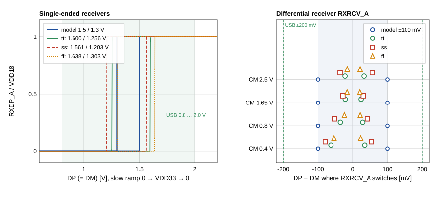

In chirp mode (OpMode 10) the digital qualifies LineState with `RXRCV_A`, because 800 mV chirps are below the single-ended thresholds (spec 4.4): `RXRCV_A` must resolve ±700 … 800 mV at about 0.4 V common mode. The transistor receiver switches within +54 / −79 mV there.

### 6.4 Terminations and pulls

`afe_term` adds a resistor through a switch per enable: `r_pu` (1.5 kΩ) DP → `VDD33`, `r_hs` (45 Ω) DP → `GND` and DM → `GND`, `r_pd` (15 kΩ) DP → `GND` (`PD_EN_A0`) and DM → `GND` (`PD_EN_A1`). `r_sw` (0) adds the switch resistance, `t_sw` (1 ns) the switching time. There is no DM pull-up (LS device role not in the spec; `afe_term_bm` has one for testbenches). In the USB3320 the FS drivers in SE0 provide the HS termination; here `HS_TERM_EN_A` switches separate 45 Ω resistors, either way works with the digital.

The transistor terminations are nch33 / pch33 switches in series with poly resistors (1.405 kΩ, 41.6 Ω, 14 kΩ). The series switch makes the HS termination 44.95 Ω at tt and keeps it flat over 0.2 … 0.4 V.

### 6.5 Supplies, UVLO and the off state

The model checks `VDD33` against `vdd_min` (2.97 V) in each sub-module: below it the HS current and the FS / LS drivers are off and the receivers isolated; the pulls of `afe_term` follow their enables only. The same holds in the transistor design; there `pok` has hysteresis (2.835 / 2.945 V at tt, Fig. 12). While TX is off the HS switch gates and the current-source node are parked at `VDD33`, so every junction on DP / DM stays reverse-biased and FS / LS levels up to `VDD33` on the line draw 0.1 nA.

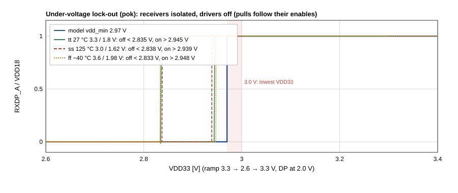

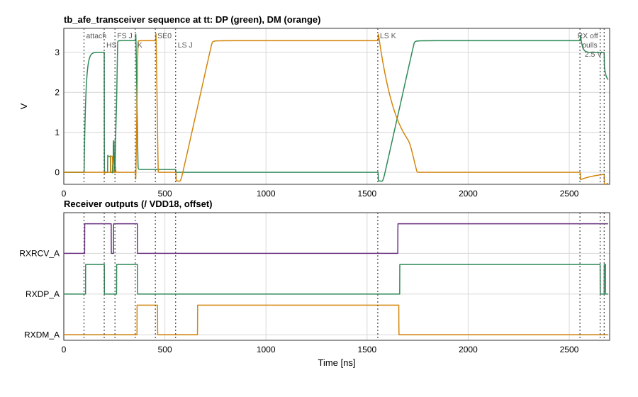

## 7. Timing

| Parameter | Model | Transistor (tt; ss … ff) | Requirement / use |
|---|---|---|---|
| `TX_EN` ↑ → HS current on the line | 20 ns (`t_en`) + 0.5 ns | 16.0 ns; 14.1 … 17.3 ns | ≤ `TX_LEAD` · 2.083 ns = 20.8 ns; line quiet ≥ 10 ns |
| `TX_EN` ↓ → HS current off (< 5 mV) | ≈ 1.1 ns | 2.34 ns; 1.88 … 3.33 ns | inside the inter-packet gap (`TX_LAG` + 3 < 88 bits) |
| `TX_IN` → line, 50 % | 0.81 ns | 0.90 ns; 0.69 … 1.34 ns | constant per chip; adds to the PHY TX start delay |
| HS edge 10–90 % | 500 ps | 669 … 716 ps; 533 … 1109 ps | ≥ 500 ps |
| `FS_DAT_A` → line 10–90 % (FS, 50 pF) | 11.3 ns | 10.0 … 11.3 ns | 4 … 20 ns |
| LS 10–90 % (200 … 600 pF) | 150.5 … 158.5 ns | 117 … 146 ns | 75 … 300 ns |
| `FS_DAT_A` → line 50 % (FS 50 pF; LS 200 / 600 pF) | 8.2 ns; 102.5 / 120 ns | 11.4 … 12.8 ns; 136 / 156 … 168 ns | none (asynchronous); the far end sees it as a constant offset |
| `FS_OE_A` → driver on / off | 1 ns (`t_oe`) | — (not measured) | — |
| Line → `RXRCV_A`, `RXDP_A`, `RXDM_A` | 2 ns (+ 0.2 ns edge) | FS 1.7 … 2.8 ns, LS 2.4 … 4.4 ns | asynchronous, 2-FF on `clk_bit`; D+ / D− skew ≤ 5 ns |
| Termination enable → resistor | 1 ns (`t_sw`) | — (not measured) | ≤ `BBM_TK` = 2 ticks (33 ns), break before make in `usb_mode_term_ctrl` |
| `VDD33` ↓ → off | at `vdd_min` | UVLO 2.83 … 2.84 V | — |

The digital latency up to these pins is in spec 4.1: data on the pins after `clk_bit` edge 8T + 14 + `TX_LEAD` + i, `TX_EN` after edge 8T + 14 + i, all pins from flops of `usb_tx_piso`.

## 8. Model parameters

`afe_transceiver` passes only `i_hs`, `i_scale`, `t_en`, `t_dly`, `bias_mode` (to `afe_hs_tx`) and `t_fs`, `t_ls`, `r_fs_out` (to `afe_fsls_xcvr`'s `r_out`). To change any other parameter, instantiate the three sub-modules directly.

**`afe_hs_tx`**

| Parameter | Default | Unit | Meaning |
|---|---|---|---|
| `i_hs` | 17.78e-3 | A | Driver current |
| `i_scale` | 1.0 | — | Amplitude trim (`TX_AMP`, spec 6) |
| `t_en` | 20e-9 | s | `TX_EN` → current settled (Q4) |
| `t_dly` | 0.5e-9 | s | `TX_IN` → output delay |
| `t_rf_hs` | 0.625e-9 | s | Output edge, 0–100 % |
| `t_skew_max` | 0.1e-9 | s | Longest tolerated `TX_IN_P` = `TX_IN_N` |
| `v_compl` | 0.3 | V | Headroom of the current source to `VDD33` |
| `r_out`, `c_out` | 1e6, 0 | Ω, F | Output resistance / capacitance per pin |
| `bias_mode` | 0 | — | 0 ideal, 1 `TX_VREF`, 2 `TX_I_5U` |
| `vref_nom`, `v_i5u` | 1.2, 0.6 | V | Bias references |
| `r_cap` | 1e12 | Ω | `TX_CAP_P/N` coupling |
| `vth_logic`, `vdd_min` | 0.9, 2.97 | V | Input threshold, supply-good threshold |

**`afe_fsls_xcvr`**

| Parameter | Default | Unit | Meaning |
|---|---|---|---|
| `r_out` | 45 | Ω | Driver output resistance per wire |
| `t_fs`, `t_ls` | 12.5e-9, 187.5e-9 | s | Source ramp 0–100 %, FS / LS |
| `t_oe` | 1e-9 | s | Driver on / off |
| `vse`, `hys_se` | 1.4, 0.2 | V | Single-ended threshold and hysteresis |
| `vdi` | 0.2 | V | Differential hysteresis window (±`vdi` / 2) |
| `t_rx`, `t_rf` | 2e-9, 0.2e-9 | s | Receiver delay and output edge |
| `vth_logic`, `vdd_min` | 0.9, 2.97 | V | Input threshold, supply-good threshold |

**`afe_term`**

| Parameter | Default | Unit | Meaning |
|---|---|---|---|
| `r_pu`, `r_hs`, `r_pd` | 1500, 45, 15000 | Ω | Pull-up, HS termination, pull-down |
| `r_sw` | 0 | Ω | Switch on-resistance (added) |
| `t_sw` | 1e-9 | s | Switching time |
| `vth_logic` | 0.9 | V | Input threshold |

**Transistor-like parameter set.** To make system simulations with the model behave like the transistor design at tt, use (derived from section 5; HS edges converted with 10–90 % = 0.8 × 0–100 %, FS / LS ramps fitted with the model re-implementation of 13 including the line RC):

| Parameter | Default | tt-like | ss-like | Derivation |
|---|---|---|---|---|
| `t_en` | 20 ns | 16 ns | 14 ns | ready timer (the line stays quiet before) |
| `t_rf_hs` | 0.625 ns | 0.86 ns | 1.32 ns | 10–90 % edge / 0.8 |
| `t_dly` | 0.5 ns | 0.47 ns | 0.65 ns | 50 % delay − `t_rf_hs` / 2 |
| `r_out` (FS / LS) | 45 Ω | 34 Ω | 37 Ω | DC output impedance |
| `t_fs` | 12.5 ns | 12.5 ns | 13 ns | FS 10–90 % (10.8 / 11.0 ns) with `r_out` 34 / 37 Ω into 50 pF, fitted with the model of 13 |
| `t_ls` | 187.5 ns | 150 ns (200 pF), 165 ns (600 pF) | 145 ns, 170 ns | LS 10–90 % fitted the same way (the transistor slope is fixed, so the best value depends on the load) |
| `vse`, `hys_se` | 1.4, 0.2 V | 1.43, 0.34 V | 1.38, 0.36 V | mid-point and difference of the switching points |
| `t_rx` | 2 ns | 2 ns (FS), 3 ns (LS) | 2.6 ns, 4 ns | `RXRCV_A` delay |

## 9. Dependencies

### 9.1 System context

| Connected to | Signal | Direction | Dependency |
|---|---|---|---|
| `usb_tx_piso` (`clk_bit` flops) | `hs_tx_p`, `hs_tx_n`, `hs_tx_en` → `TX_IN_P`, `TX_IN_N`, `TX_EN` | → XCVR | 1.8 V, all from flops on the same `clk_bit` edge; idle clamp P = 1, N = 0, `TX_EN` = 0 (`drv_dis`, `iso_en`) |
| `usb_afe_tx_if8` | lead / lag window | — | `TX_LEAD` (default 10) must cover the HS enable time: ⌈`t_en` / 2.083 ns⌉; `TX_LAG` (0) bits of EOP after the last bit |
| `usb_tx_piso` | `fs_oe`, `fs_dat`, `fs_se0`, `fs_ls` → `FS_*_A` | → XCVR | Same flops; `fs_ls` idles at 0 |
| `usb_rx_datapath` (`usb_rx_fsls_sampler`) | `RXRCV_A`, `RXDP_A`, `RXDM_A` | XCVR → | 2-FF synchronizers on `clk_bit`, DPLL on `clk60`; D+ / D− skew ≤ 5 ns, no SE1 glitches longer than 1 FS bit (spec 4.4) |
| `usb_line_state` | `RXDP_A`, `RXDM_A`, `RXRCV_A` | XCVR → | LineState at FS / LS = {`RXDM_A`, `RXDP_A`}, SE0 / SE1 filtered 2 (FS) / 14 (LS) ticks; chirp: `SQUELCH_A` qualified by `RXRCV_A` |
| `usb_mode_term_ctrl` | `dp_pullup_en`, `hs_term_en`, `dp/dm_pulldown_en` | → XCVR | `clk60` flops, break before make (`BBM_TK` = 2 ticks, 33 ns): the analog switches must settle within that |
| `usb_afe_trim_regs` | `trim_tx_amp`, `trim_hs_term` (30h) | → XCVR | Not connected in the model or the transistor design (see 9.4) |
| Power sequencer `usb_pwr_seq` | (`FS_RX_EN_A`, bias enable) | → XCVR | `FS_RX_EN_A` has no driver yet; receivers must stay on in suspend (resume detection) |
| `afe_receiver` | DP / DM | — | Shares the wires; sees the own HS transmission |
| Bias block | `TX_VREF` | → XCVR | 1.2 V; the transistor HS amplitude is ∝ V(`TX_VREF`) |
| ESD pads, package, cable | DP / DM | — | Not modelled (capacitance, reflections) |

### 9.2 Values that must stay consistent

| Value | Here | Also in | Consequence of a mismatch |
|---|---|---|---|
| Polarity: `TX_IN_P` = 1 → J (DP); FS J = DP high, LS J = DM high | `afe_hs_tx`, `afe_fsls_xcvr` | spec 3.1 / 3.4 (Q3), `usb_tx_piso`, `afe_hs_tx_bm.v`, `afe_fsls_bm.v` | SYNC / EOP inverted; LS device enumerates as FS or not at all |
| `t_en` ↔ `TX_LEAD` default 10 | `t_en` 20 ns | spec 4.1 (A2), `usb_afe_trim_regs` 31h, `afe_hs_tx_bm.v` `T_EN` | Lost SYNC bits (lead too short) or extra J (too long) |
| HS current / terminations → 400 mV | `i_hs`, `r_hs` | `afe_hs_tx_bm.v`, `afe_term_bm.v`, `tb_usb_afe_chirp` (A6 chirp 700 mV), the receiver's squelch / disconnect thresholds | Squelch or false disconnect at the far end |
| Isolated values of the receivers 0 / 0 / 1 | `afe_fsls_xcvr` | spec 3.4, reset values of `usb_rx_fsls_sampler` | Spurious LineState changes during isolation |
| `vdd_min` 2.97 V | all three sub-modules | `afe_receiver`, `afe_pll`, `afe_cdr` | Different blocks switch off at different supply levels |
| Pin order | `afe_transceiver.va` | `afe_transceiver_tr.sp`, `ams_phy_end.v`, `tb_afe_transceiver*.scs` | Netlist errors |
| Edge, level and receiver behaviour | `afe_transceiver.va` | `afe_hs_tx_bm.v`, `afe_fsls_bm.v`, `afe_term_bm.v` | Icarus shadows and AMS runs disagree |

### 9.3 Usage sequence

1. Power-up: `VDD33`, `VDD18`, `TX_VREF` present; all enables 0, `TX_IN_P` / `TX_IN_N` at the idle clamp 1 / 0. The transistor bias (about 0.57 mA on `VDD33`) is always on.
2. Device attach (FS): `DP_PULLUP_EN_A` = 1; receivers on (`FS_RX_EN_A` = 1) for the host's reset and the J / K / SE0 LineState.
3. HS handshake: device chirp K = `TX_EN` with `TX_IN_P` = 0 (`lead_first`), pull-up still on, termination off; after the host chirps, the termination goes on and the pull-up off (break before make).
4. HS packets: `TX_EN` rises `TX_LEAD` bits before SYNC; data on `TX_IN_P/N`; `TX_EN` falls `TX_LAG` bits after the EOP.
5. FS / LS packets: `FS_OE_A` with `FS_DAT_A` / `FS_SE0_A`; `FS_LS_A` for LS (and for LS-preamble traffic, not implemented).
6. Suspend: drivers off, pulls as in FS idle, receivers on for resume.
7. Isolation / power-down: all enables 0 through the isolation cells; the outputs to the digital go to 0 / 0 / 1.

### 9.4 Trim and test registers (spec 6, not implemented in the AFE)

| Register | Field | Default | Intended use | Transistor hook |
|---|---|---|---|---|
| 30h `TRIM_TX` | [3:0] `TX_AMP` | 8 | HS current (model `i_scale`) | RREF of the bias (I = V(`TX_VREF`) / RREF) |
| 30h `TRIM_TX` | [6:4] `HS_TERM` | 4 | HS termination resistance | RHP / RHM (41.6 Ω) segments |
| 31h `TRIM_LEAD` | [4:0] `TX_LEAD`, [7:5] `TX_LAG` | 10, 0 | Digital: `TX_EN` lead / lag | — |
| 32h `TRIM_RX` | [2:0] `RX_VTH`, [5:3] `RX_HYST` | 4, 4 | Receiver threshold / hysteresis | — (Schmitt feedback XP3 / XN3, `RXRCV_A` hysteresis currents) |
| 3Ch `TEST` | [4] `ANA_LPBK` | 0 | Near-end loopback TX → RX | — |

The model has no trim inputs; its parameters stand in for them. The FS / LS slew (Miller capacitors) has no trim field (open point 6).

### 9.5 Files

| File | Role |
|---|---|
| `AFE/veriloga/afe_transceiver.va` | the model described here |
| `AFE/doc/transceiver.md` | model description |
| `AFE/veriloga/tb/tb_afe_transceiver.scs`, `tb_afe_transceiver.va` | Spectre testbench and checker (`AFE/veriloga/tb/run_va_tests.sh transceiver`) |
| `AFE/veriloga/tb/tb_afe_transceiver_tr.scs` | same checks on the transistor netlist, with its figures and tolerances |
| `AFE/spice/afe_transceiver_tr.sp` | transistor schematic |
| `AFE/spice/tb/tb_transceiver_tr.py` | ngspice testbench (`seq`, `hs`, `fs`, `ls200`, `ls600`, `rx`, `dc`) |
| `AFE/doc/transceiver_schematic.md`, `transceiver_schematic.html`, `AFE/spice/doc/xc_*.svg` | transistor schematic description, drawn sheets and results |
| `afe_hs_tx_bm.v`, `afe_fsls_bm.v`, `afe_term_bm.v` | Icarus behavioural models; tests `tb_usb_afe_tx_if`, `tb_usb_afe_fsls`, `tb_usb_afe_chirp` |
| `AFE/ams/ams_phy_end.v`, `ams_ulpi_phy.v`, `tb_ams_*.vams` | AMS system assemblies that instantiate `afe_transceiver` |
| `usb_tx_piso.v`, `usb_afe_tx_if8.v`, `usb_mode_term_ctrl.v`, `usb_rx_fsls_sampler.v`, `usb_line_state.v` | digital counterparts |

## 10. Design guidance

- **`TX_LEAD`.** Keep the default 10 with the transistor design. Its ready time (≤ 17.3 ns) would allow 9 bits (18.75 ns) by the A2 rule, but then the first SYNC edge starts 1.4 ns after ready at ff; with ready only 0.8 ns before SYNC the first sizing produced a 495 ps edge (USB ≥ 500 ps). After the xh018 port, set `TX_LEAD` = ⌈(slowest ready + 2 ns) / 2.083 ns⌉.
- **HS delay spread.** 0.69 … 1.34 ns is less than one bit and constant per chip; the PHY's TX start delay budget (spec 4.1) has to include the maximum.
- **Bias reference.** The transistor HS amplitude follows V(`TX_VREF`) one to one: a 1 % reference error is a 4 mV level error. To see this in system simulations use `bias_mode` 1.
- **Using the model.** For digital and AMS checks the default parameters are deliberately on the conservative side (`t_en` 20 ns, 45 Ω, 12.5 ns ramps). For waveform-level comparisons with the transistor design use the parameter set of 8.
- **Receiver delay.** The transistor `RXRCV_A` delay grows with slower edges (LS 2.4 … 4.4 ns). The digital samples asynchronously, so only the D+ / D− skew matters (≤ 2.5 ns here, limit 5 ns).
- **Line current while off.** The parking of the HS switches only works while `VDD33` is up. Do not apply FS / LS levels to DP / DM from another device while this PHY is unpowered (open point 5).

## 11. Open points

1. **Monte Carlo.** `RXRCV_A` offset, Schmitt switching points, the RREF / line resistor ratio (HS amplitude) and the turn-on kick cancellation are mismatch-sensitive. Check `RXRCV_A` within ±200 mV and the HS amplitude within ±10 % at 3σ with the xh018 mismatch models.
2. **Idle bias** of about 0.57 mA on `VDD33` is always on (no bias enable pin in the model's interface). An enable from `usb_pwr_seq` would bring it to nA; its turn-on time then needs a line in the interface spec.
3. **Turn-on kick cancellation** with a fixed 1 pF is PVT dependent; it holds at the three corners (first SYNC bit within 1.2 %).
4. **Released-line dip** of DM (−187 mV) after `FS_OE_A` falls; harmless for the receivers, possibly visible in compliance captures.
5. **ESD and back-power.** No ESD devices, no protection against DP / DM above `VDD33` (VBUS short, 5.25 V) or against `VDD33` = 0 with a powered line.
6. **Trims.** `TX_AMP` (RREF), `HS_TERM` (RHP / RHM) and an FS slew trim are not implemented in the model or the transistor design.
7. **xh018 models.** Replace `generic180.lib`, use the PDK resistors and capacitors, rerun `tb_transceiver_tr.py` at all corners.
8. **HS delay and edge spread over PVT.** 0.69 … 1.34 ns delay, 0.53 … 1.11 ns edges (ff … ss). The ss delay misses the testbench's corner window by 0.04 ns (no USB limit), the ss crossing jitter (93 ps) is close to its 100 ps and the ff edges leave 33 ps to 500 ps. A gate drive that tracks the current-source node would close the spread.
9. **`FS_RX_EN_A`** is a new pin of the model with no digital driver and no row in spec 3.4; until the power sequencer drives it, tie it high (receivers always on).
10. **Q4 / Q9 / Q10** (analog team): real `t_en` and output state while `TX_EN` = 0; meaning of `TX_I_5U` / `TX_VREF`; the `TX_CAP_P/N` capacitors.
11. **Spectre.** Run `tb_afe_transceiver.scs`, `tb_afe_transceiver_tr.scs` and the AMS system tests once a simulator is available.
12. **ngspice testbench start-up.** Single-point PWL sources get a wrong DC operating point in ngspice 42 (section 13). Write them with two points in `tb_transceiver_tr.py` (and `tb_receiver_tr.py`) and rerun the corners to confirm that no figure moves.

## 12. Not modelled

The transmission line and reflections; the HS driver's output impedance except `r_out` and its real switch-off; pre-emphasis; the `TX_EN` → dump → line hand-over (the model's current is simply absent for `t_en`); load-independent (Miller) FS / LS slopes and the crossover matching of the drivers; the released-line dip; ESD and pad capacitance; UVLO hysteresis; receiver offset, common-mode dependence and slope-dependent delay; supply current except the HS current through the outputs; temperature and supply dependence apart from the FS / LS levels scaling with `VDD33`.

## 13. How the numbers were obtained

| Source | Method | Figures / values |
|---|---|---|
| Transistor level | `afe_transceiver_tr.sp` with ngspice 42 and `generic180.lib` (placeholder models), `AFE/spice/tb/tb_transceiver_tr.py` at tt (27 °C, 3.3 / 1.8 V), ss (125 °C, 3.0 / 1.62 V) and ff (−40 °C, 3.6 / 1.98 V), runs of 2026-11-20 (same netlist as the `transceiver_schematic.md` results). Far end: 45 Ω terminations in HS, 15 kΩ pull-downs in FS / LS; 2 pF (HS), 50 pF (FS), 200 / 600 pF (LS) per wire; logic stimulus through 500 Ω with 50 ps edges; 20 fF per receiver output. Waveform windows cut by `data/extract_tr.py`; the printed results in `data/xc_<corner>_summary.txt` | All transistor values, Fig. 2–13 |
| Model re-implementation | The `afe_transceiver.va` equations (current steering with `t_en` / `t_dly` / `t_rf_hs`, voltage sources behind `r_out` with linear ramps and `t_oe`, `afe_term` resistors, receiver thresholds and delay) evaluated on the stimulus of `tb_transceiver_tr.py` with the same loads (forward Euler, 5 … 125 ps steps) | Model curves in Fig. 2, 3, 6–12 |
| Model documentation | `AFE/doc/transceiver.md`, testbench steps of `tb_afe_transceiver.va` | Parameters, 8 |
| Digital requirements | `DOC/afe_interface_spec.md` 3.1, 3.4, 3.5, 4.1, 4.4, 6; `usb_mode_term_ctrl.v` | Requirement columns, 7, 9 |

**Testbench artifact.** ngspice 42 gives a PWL source with a single point (for example `pwl(0 3.3)`) a wrong value in the DC operating point: it takes the value of another source, and the PWL value only applies from the first time step on. `tb_transceiver_tr.py` writes `VDD33` (in `hs`, `fs`, `ls200`, `ls600`) and every constant logic input this way, so these runs start from a wrong operating point. Visible effect: the undriven LS line starts at 0.9 … 1.6 V and decays with 15 kΩ · 600 pF = 9 µs until `FS_OE_A` takes over (Fig. 10). Every check of those cases is taken at least 100 ns later, after a driver or termination has set the line, and `seq`, `rx` (multi-point `VDD33`) and `dc` (DC sources) are not affected, so no value in this datasheet changes. Fix: give every PWL at least two points (open point 12). `tb_receiver_tr.py` builds `RX_VDD` and `RX_EN` the same way.

Regenerate the figures with `python3 AFE/doc/transceiver_datasheet/gen_figures.py` (numpy and `rsvg-convert`, about 15 seconds). Rerun the transistor data with `python3 AFE/spice/tb/tb_transceiver_tr.py --corner <c> --temp <T> --vdd <V> --vddl <V>` (ngspice, about 15 minutes per corner; it writes to `build/spice/`), move the `.dat` files of each corner into `build/spice/xc_<corner>/`, then run `python3 AFE/doc/transceiver_datasheet/data/extract_tr.py` and copy the printed results to `data/xc_<corner>_summary.txt`.

## 14. Revision history

| Revision | Date | Change |
|---|---|---|
| 0.1 | 2026-11-20 | First issue, based on `afe_transceiver.va` of 2026-11-11 and `afe_transceiver_tr.sp` of 2026-11-14 |
